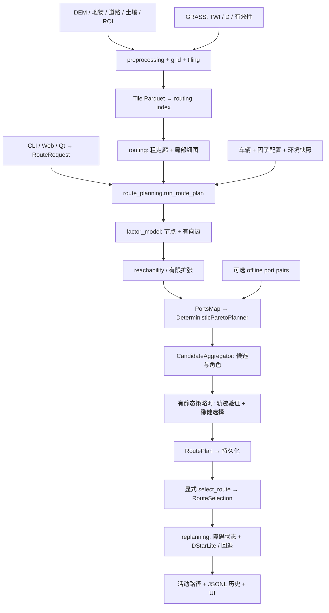

# 项目全息上下文快照：首读总览

> **状态：冻结快照（Git `986bd58`，2026-10-14 生成）。** 本文件描述的是 M0 开工前的架构，**不反映** M0/M1 之后的实现变更（道路宽度换算、Bekker/CI 修正、CLDAS 采样、消融档位、端点判定等）。当前实施依据唯一以 [docs/project_context/IMPLEMENTATION_PLAN.md](docs/project_context/IMPLEMENTATION_PLAN.md) + [STATE.md](docs/project_context/STATE.md) + [DECISIONS.md](docs/project_context/DECISIONS.md) 为准；与源码冲突时以源码为准。

## 1. 【项目现状与已达成目标】

### 阅读约定

这是供外部架构模型首次阅读的项目基线，覆盖完整业务链，但不内嵌全量 AST。证据日期 **2026-10-14**；仓库 `D:/Workspace/demo_v4`；HEAD `986bd58eef846f6f8a34961a43b208c315471110`。后续代码变化应重新核对；文档不是实时仓库。

**首次只需上传本文件。** 第 4 节列出了按问题补充资料的入口。网页模型无法因为文档里的本地路径就访问源文件；未上传的参考文档不能视为已经读过。已有 GPT/Gemini 长版作为历史参考保留，不需要一起上传。

### 产品目标与当前能力

目标是为**有人驾驶单车越野**提供基于地形、地物、土壤及环境条件的可解释路线候选、选择与障碍重规划。当前软件闭环是“GIS 建图—车辆评价—候选规划—显式激活—障碍修复—持久化”，不是已验证的自主驾驶控制系统。

| 已有代码能力 | 当前实现 | 不能据此推出的结论 |
|---|---|---|
| 静态通行数据构建 | DEM/土地覆盖/道路/土壤/ROI 归一化、坡度/TRI、H3 属性采样；可加入 GRASS TWI/排水证据 | 细网格不等于同分辨率真实观测；采样不等于通行真值 |
| 离线组织与按需加载 | Tile Parquet、manifest、版本化 routing index、可选离线 port-pair 表 | 索引建成不代表所有 OD 可达或在线不再细搜索 |
| 车辆与环境评价 | 节点因子区间、有向边 ETA/风险/代价/裕度；环境快照及回退 | 简化模型和参数存在假设，不是实车标定完成 |
| 确定性候选规划 | 多标量 profile 搜索、复用惩罚、widest 锚点、去重/非支配筛选/角色聚合 | 有限候选池，不保证求出全局完整 Pareto 前沿 |
| 轨迹与稳健筛选 | 后轴参考的直线/圆弧、车体扫掠检查；候选池绕行预算、环境排序 | 算法存在不表示每条路线几何有效；直线接圆弧也不意味着曲率连续 |
| 选择和重规划 | RoutePlan→RouteSelection；障碍确认/过期；D* Lite、受限全局回退和 safe_hold | “global”指当前加载图中的回退，不能当成全区域不可达证明 |
| 工程接口 | CLI、本地 HTTP WebGIS、PyQt5 桌面；JSON/GeoJSON/GPKG/YAML/JSONL | UI 可用、测试通过、路径输出与真实车辆可通行是不同层次 |

**技术栈**：Python>=3.11；h3>=4、NumPy>=2、pandas>=2、PyArrow>=16、GeoPandas>=1、Shapely>=2、rasterio>=1.3、affine、PyYAML。桌面为可选 PyQt5/PyQtWebEngine；水文依赖外部 GRASS；天气适配器为 Open-Meteo。以上是依赖声明，不是本机安装验证。

**现状证据**：现存 `outputs/qdx_route/route_plan.json` 是旧产物，5 条候选的 trajectory.status 均为 `invalid`；不能作为有效整车路线的验收证据，也不代表所有 OD 必然失败。本轮没有重跑业务测试或性能基准，不沿用历史“全绿”“秒级/毫秒级”作为当前结论。

### 当前边界与实际依赖

- QDX 配置仍引用仓库外 `D:/Workspace/qdx数据` 与 `D:/Workspace/demo_v1/data`；复制代码不能自动复现原始数据链。
- 生产请求默认 fine=14、coarse/tile=11；底层 `H3Graph` 默认仍是 13/10，实际应按 request/manifest/index 对齐，不能只看某个默认值。
- `assessment`、`H3AStarPlanner`、factory/facade 保留兼容路径；`Fleet*` 和 `FleetCoordinator` 是扩展契约，不代表多车闭环已实现。
- 文档中的“已实现”以当前源码路径为依据；“有效性”应由匹配输入、参数、产物和独立验证判断。以下探索建议均不是已经完成的功能。

## 2. 【架构拓扑与数据流向】



### 一次请求如何运行

1. **适配与环境**：`cli` 把 YAML/dict 校验为 `RouteRequest`。主入口加载可选 `StaticPlanningConfig`，解析路径中心处的天气快照或回放；可降级为降水压力或保留合成场景。天气不是逐 cell 的动态实测土壤场。
2. **加载图**：`routing._source_metadata/_load_route_graph` 兼容单 Parquet、tile manifest、routing index。tile manifest 附近存在匹配索引时会转索引分支；`parquet_path` 名字不意味着实际文件一定是 Parquet。索引分支先生成粗走廊，再按 parent 加载细格。
3. **评价后检查可达性**：`evaluate_factor_model` 产生 `FactorEvaluation`，随后吸附端点并做 `check_route_reachability`。不是先判物理可达、再评价物理因子。有限修复包含定向瓶颈父格扩张和满足条件时的 2-ring 重试。
4. **生成候选**：`PortsMapSearchContext` 在加载图上组织端口与细路径；离线表仅在适用条件满足时复用，缺失部分有在线搜索。索引策略 `fast_five_v1` 每 profile 一次尝试；普通策略 `full_pareto_v1` 也是有限候选生成。
5. **聚合与选择**：原始池上限 24，公开 `RoutePlan` 为 1..5 条唯一候选。聚合处理去重、支配、走廊和角色；有 static planning 才执行连续轨迹/稳健选择，并生成 schema-v2，否则 schema-v1。
6. **持久化后显式激活**：`run_route_plan` 不自动激活。`select_route` 按 candidate_id 或 role 激活，保存选择版本、活动路径和四类输入身份。
7. **重规划**：`replanning` 管理障碍确认、防抖、过期与回退频次；算法使用图 overlay 和冻结角色代价。局部失败再在传入图上尝试候选生成。重规划结果与历史被持久化，不只是返回一串节点。

### 架构中必须分清的三组边界

- **静态事实 / 请求评价**：tile/index 保存车辆中立事实；`FactorEvaluation` 是给定车辆、因子、环境和图的请求评价。旧 score/cost_score 不应被当成新链路的权威代价。
- **搜索 / 产品决策**：`portsmap` 负责路径搜索；`deterministic_pareto` 生成有限候选；`candidate_aggregation` 分配角色并执行稳健策略。修改最短路算法不自动改变候选角色和推荐政策。
- **引导线 / 连续轨迹 / 用户激活**：`h3_path`、`trajectory`、`RouteSelection` 是三个对象。推荐或激活不能自动证明 `trajectory.status == valid`；没有几何有效候选时，当前选择器会保留回退推荐并发出 `NO_GEOMETRY_VALID_CANDIDATE`。

## 3. 【全局数据组织与 Schema 契约（关键）】

### 领域对象：谁生产、谁消费、包含什么

下表是语义投影，不是可直接替代源码的完整类定义；完整字段、类型、默认值、校验条件在第 4 节指定的模块参考中。

| 对象 | 关键结构与语义 | 流向 |
|---|---|---|
| `H3Cell` | h3index、lat/lng、elevation/slope/tri、地物/土壤来源、排水/响应证据、parent_h3、静态 passable | grid/index → graph → factor |
| `H3Graph` | cells: `dict[str,H3Cell]`；edges: `dict[tuple[str,str],H3Edge]`；parent_children: `dict[str,set[str]]`；两级 resolution | 加载层 → 评价/搜索/图恢复 |
| `VehicleProfile` | 质量、爬坡角、速度、轮胎、离地间隙、推力、最小转弯半径；可选车宽/轴距/前后悬 | 配置 → 物理评价/轨迹 |
| `FactorInterval` / `NodeFactorMetrics` | lower/nominal/upper；节点因子、速度区间、裕度、置信度、reason_codes | factor → 有向边 |
| `DirectedEdgeMetrics` | from/to、distance_m、eta_lower_s/eta_s/eta_upper_s、上界是否有限、risk/cost、方向坡度、裕度、环境等效距离 | factor → PortsMap/metrics |
| `FactorEvaluation` | node_metrics、directed_edges；vehicle_hash、factor_model_hash、static_input_hash、graph_topology_hash | 评价 → 搜索/重规划 |
| `PathMetrics` | 路径距离、ETA 区间、terrain_risk、travel_cost、最小/均值裕度、edge_count、environment_distance_m | 精确重算 → 候选/选择 |
| `RouteCandidate` | candidate_id、h3_path: `tuple[str,...]`、roles、is_recommended、objectives、PathMetrics、corridor_signature、independence_evidence、trajectory | 聚合 → RoutePlan |
| `RoutePlan` | candidates、推荐/独立性参考 ID、mission_profile、四类身份；v2 加策略/场景身份；统计、警告、输出文件 | 主编排 → 文件/UI/激活 |
| `TrajectoryResult` | status、失败原因、WGS84 点列、直线/圆弧 primitive、长度/净空/曲率/环境距离、swept_dependency_cells | 几何 → 决策/重规划 |
| `RouteSelection` | active_h3_path、active_metrics、active_trajectory、selected_role、state、selection_version/replan_version、身份 | 显式激活 → 状态恢复/修复 |
| `BlockageRecord` / `ReplanRequest` | 障碍 ID/cell/状态/确认次数/可信来源/时间/TTL；选择路径与显式当前位置 | 用户观测 → 重规划 |

**数据关联图**：`H3Cell --h3index--> Graph/NodeMetric/DirectedEdge`；`H3路径 --candidate_id--> RouteCandidate`；`候选+身份 --plan_id--> RoutePlan`；`plan_id+candidate_id+version --> RouteSelection`。candidate ID 绑定路径，不代表跨地图、车辆、场景仍有相同通行性质。

### 角色、状态与关键不变量

- 业务角色：`fastest_eta / shortest_distance / max_passability_margin / minimum_travel_cost / independent_backup`；任务偏好：`fastest / shortest / passability / economy / resilient`。两者不是同一枚举；`recommended` 是策略选择，不是第六种角色。角色可能缺失或复用同一候选，不能保证五条不同路线。
- `RoutePlan` 要求 1..5 条候选、candidate_id 唯一、恰好一个 is_recommended。独立备份应检查 independence_evidence，而不是只看角色名称。
- 轨迹状态：`valid / invalid / not_evaluated / incomplete`；缺完整车辆尺寸时为 not_evaluated。导出的 field_state 仍为 unverified。
- 选择状态：`active / safe_hold / superseded / invalidated`；障碍状态：`tentative / confirmed / cleared / expired`。`ReplanRequest` 必须提供 current_h3 或完整 current_lat/current_lng 二选一。
- 15% 绕行预算以**当前几何有效候选池的最短轨迹**为参考，不是全图最短可行路线。稳健排序为净空等级优先、请求压力下最坏环境等效距离、长度、ID；切换滞后默认 5%。配置 clearance_target_m=0 时不能描述成“不断追求更大净空”。
- `environment_distance_m` 是 `Mapping[str,float]`，压力键格式 `f"{pressure:g}"`，例如 `"0.5"`。环境倍率 `M=1+w*U*S*(1+D)`；未知 U/D 用配置上界，含水率压力换算和共享敏感度均有模型假设。
- 冻结 Dataclass/MappingProxyType 是浅冻结；图是可变对象。哈希用于可追溯和一致性检查，不是科学正确性证明。

### 文件组织与重启恢复

```text
输入 GIS + vehicle/factor/static_planning YAML
  ↓
tile_manifest.json + tiles/.../*.parquet
  ↓
routing_index/current.json                        # {build_id}
routing_index/builds/<build_id>/routing_index.json # 身份/文件目录
  ├─ cells/part-00000.parquet                      # cell 静态列
  ├─ coarse_graph.parquet                         # parent/port 连接与代理指标
  ├─ landcover_catalog.parquet / 可选 soil_catalog.parquet
  └─ 可选 port_pairs.parquet                      # profile,parent,source,target,path,cost
  ↓
route_plan.json + route_manifest.json + routes.geojson / routes.gpkg
effective_vehicle.yaml + effective_factor_model.yaml + 可选 effective_static_planning.yaml
performance.json
  ↓ 显式激活/重规划
route_selection.json + replan_history.jsonl + 活动路线输出
```

索引分支的 route_manifest 通过 `graph_storage.format=routing_index` 记录索引引用、build_id 和 active_parent_h3；旧分支为 GPKG 中的 `h3_static_facts` 与 `h3_edges`，另兼容历史 embedded graph_snapshot。不能删除旧存储路径而只修改新索引写入端。

Tile 是可重建的静态事实；index 是带身份的查询/粗拓扑组织；RoutePlan 是一次请求产物；RouteSelection 是活动状态；JSONL 是历史。**这五类文件不能当成同一个“缓存”。** RoutePlan 与 manifest 的 schema_version 也不能混为一谈。

### 坐标、维度、单位与空值

| 契约 | 必须保持的约定 |
|---|---|
| 经纬度 | 输入/H3 API：lat,lng；GeoJSON/Shapely：lng,lat；GIS 规范化为 EPSG:4326；转换不意味着无误差 |
| 局部轨迹 | PointXY 为局部米制 x,y，后轴中心参考；heading rad、curvature 1/m；coordinates_wgs84 为 lng,lat |
| 栅格 | DEM/slope/TRI：float64[H,W]；按 row,col 访问；Affine 接收 col,row；nodata→NaN |
| 水文 | twi 与 valid 同形二维；D 输出 float32[H,W]；无效为 NaN；valid/boundary mask 落盘 uint8、nodata=255 |
| 边数组 | N 个 cell；E 条静态边生成 M=2E 条潜在有向边；u/v_indices 为 int32[M]，数值 float64[M]，可通过性 bool[M]；过滤后长度可变 |
| 图键 | 静态边通常规范化为无向 (a,b)；评价边为有向 (from,to)，反向独立；H3 ID 为字符串而非连续行号 |
| 度量 | 距离 m、时间 s、节点速度 m/s、车辆配置最大速度 km/h、坡度 deg、质量 kg、力 N、锥指数 kPa |
| 不确定性 | eta_upper_s=null 与 eta_upper_bounded=false 表示无有限上界；未知排水不等于干燥；risk/cost 不是实测事故概率/油耗 |

## 4. 【周边接口与按需资料索引】

### 关键接口锚点

以下签名直接来自当前源码；省略函数体。完整上下游、类型导入、Docstring、字段、Schema 在各模块附件中。最初未指定目标模块，此处以 `route_planning` 为主入口，后续应围绕具体探索问题缩小范围。

```python
# src/h3_offroad_planner/tiling.py:50
def build_h3_tile_cache(request: TileBuildRequest, progress: ProgressCallback | None=None, progress_range: tuple[int, int]=(10, 50)) -> dict[str, object]:
    """Build a resumable H3 tile cache from raw GIS inputs.

    Args:
        request: Valid tile build request. Unit: file paths and H3 resolutions.
        progress: Optional callback for real-time tile build status updates.
        progress_range: Bounded percentage interval (start, end) for progress mapping.

    Returns:
        JSON-serializable tile manifest.

    Raises:
        FileNotFoundError: If any required source path is missing.
        GridBuildError: If ROI tiling exceeds limits or a tile fails while
            `continue_on_error=False`.
        GISInputError: If GIS source layers cannot be read.
    """
    ...

# src/h3_offroad_planner/route_planning.py:88
def run_route_plan(request: RouteRequest, progress: ProgressCallback | None=None, progress_range: tuple[int, int]=(75, 95), *, export_gpkg: bool=True) -> RoutePlan:
    """Plan through a 1-ring indexed corridor, with one bounded 2-ring retry."""
    ...

# src/h3_offroad_planner/factor_model.py:929
def evaluate_factor_model(graph: H3Graph, vehicle: VehicleProfile, config: FactorModelConfig, environment: EnvironmentConfig | None=None) -> FactorEvaluation:
    """Evaluate physical node evidence once and freeze directed edge metrics."""
    ...

# src/h3_offroad_planner/route_persistence.py:545
def select_route(plan_path: str, candidate_id: str | None=None, role: str | None=None, expected_selection_version: int | None=None) -> RouteSelection:
    """Explicitly activate one plan candidate by stable id or assigned role."""
    ...

# src/h3_offroad_planner/replanning.py:111
def replan_route(request: ReplanRequest, graph: H3Graph, evaluation: FactorEvaluation, policy: ReplanPolicy | None=None) -> ReplanResult:
    """Apply blockage lifecycle, repair locally, and perform bounded global fallback."""
    ...
```


### 按问题补充附件

所有模块参考位于 `docs/project_context/modules/`。**先选择一个主题，只补充“第一批”；模型确有缺口再加第二批。** 模块名对应同名 `.md`，子包以点分隔，例如 `planners.deterministic_pareto.md`。

| 主题编号与探索问题 | 第一批参考模块 | 需要深入时再加 |
|---|---|---|
| T1 当前规划闭环到底如何运行 | route_planning、models、route_models | cli、routing、route_persistence |
| T2 遥感/DEM/地物怎样成为可通行区域与图 | grid.h3_grid_builder、preprocessing.gis_preprocessor、tiling | preprocessing.hydrology、routing_index、models |
| T3 物理代价、未知证据和天气如何传播 | factor_model、environment | vectorized_factor、vectorized_soil、dynamics.bekker、weather_fallback |
| T4 走廊、PortsMap、离线复用为何影响可达性/速度 | routing、portsmap、routing_index | offline_pairs、reachability、route_planning |
| T5 候选角色、独立备份和推荐是否可信 | candidate_aggregation、planners.deterministic_pareto、route_models | portsmap、dynamics.trajectory_geometry |
| T6 车辆几何、转弯与整车通行有什么边界 | dynamics.trajectory_geometry、models | factor_model、candidate_aggregation |
| T7 激活、重启、障碍状态与修复 | route_persistence、replanning、route_models | planners.dstar_lite、cli |
| T8 UI/接口与后端行为是否一致 | cli、web_console | desktop_client、desktop_project、desktop_map、map_config |

完整文件目录、字节数、符号定位、版本校验及第二轮阅读方法见 [资料索引](docs/project_context/INDEX.md)。符号检索文件为 `docs/project_context/SYMBOL_INDEX.md`；只有按符号查找时才需要它。**模块参考是 AST/Schema，不包含算法实现体**；若结论依赖算法细节，应明确请求 `模块.函数` 的源代码，而不是从名字或 Docstring 推断实现。

### 可直接附给 Gemini 的首轮任务

> 请先建立对这个项目的可核查理解，不急于重构或提出创新。用一段完整链路解释 GIS、图、车辆评价、搜索、决策和活动状态如何连接；说明你能从本文确认的能力和仍缺证据的结论。随后列出最影响后续探索的三个问题，每个问题说明为何重要、已有证据、缺少什么、需要哪个 T 编号或具体模块/符号。最多请求三份补充文件。不要把尚未上传的引用视为已阅读；如果需要实现体、运行结果或文献，应明确说明，不以合理猜测补齐。

后续可探索：①相同输入下，通行区域与网格表示对窄通道/错误连通的影响；②候选生成限制如何影响绕行预算与角色覆盖；③离线复用在车辆/场景改变时的适用性；④几何状态如何约束用户激活与实际交付。它们是待检验问题，不是本文宣称已完成的创新或修复。
