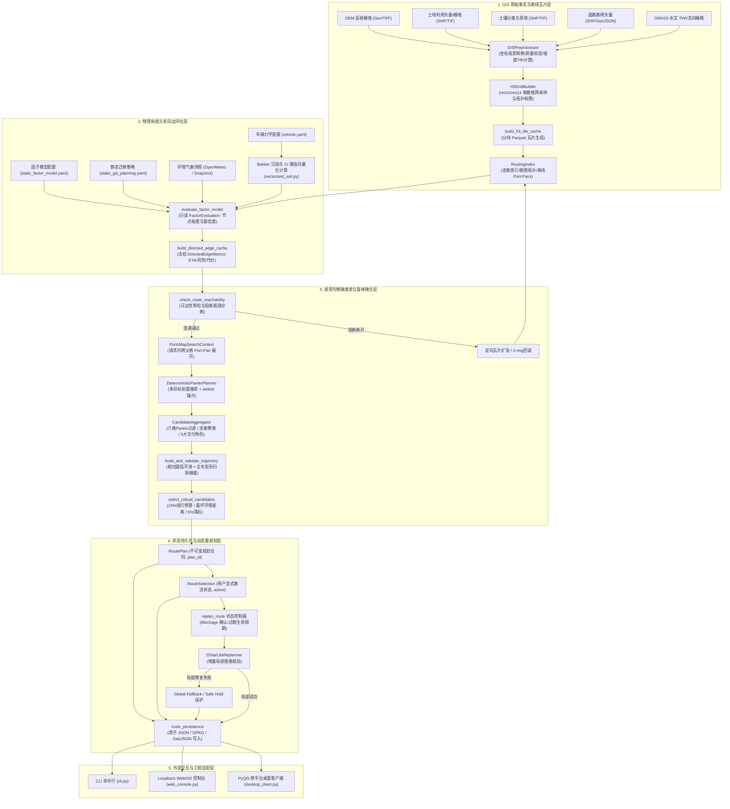

# 项目全息上下文快照（PROJECT_HOLOGRAM_gemini.md）

> **生成时间**：2026-10-14  
> **基线环境**：Python >= 3.11 | Uber H3 v4 | GeoPandas 1.0+ | Shapely 2.0+ | PyArrow 16.0+ | NumPy 2.0+  
> **测试状态**：505 passed, 2 skipped (全量测试套件通过，Ruff 代码风格检查全绿)  
> **目标读者**：外部顶层架构模型、大模型代码生成与重构调度器、系统架构审查专家

---

## 目录
1. [【项目现状与已达成目标】](#1-项目现状与已达成目标)
   - 1.1 系统定位与核心能力
   - 1.2 核心技术栈与三方基础设施
   - 1.3 生产主流程闭环与工程保障
2. [【架构拓扑与数据流向】](#2-架构拓扑与数据流向)
   - 2.1 生产架构全局拓扑（Mermaid DAG）
   - 2.2 运行时端到端数据流转链路
   - 2.3 核心模块边界与职责清单（含禁令）
3. [【全局数据组织与 Schema 契约（关键）】](#3-全局数据组织与-schema-契约关键)
   - 3.1 核心领域数据模型（Class / Dataclass 定义）
   - 3.2 数组与张量维度约定（Tensor / Array Dimension Contracts）
   - 3.3 物理存储与文件 I/O 规范（Parquet / GPKG / JSON / YAML）
   - 3.4 空间参考、网格索引与唯一性标识契约
4. [【周边关联模块的接口签名（AST Stub）】](#4-周边关联模块的接口签名ast-stub)
   - 4.1 编排入口与主线流程 (`route_planning.py`)
   - 4.2 物理裕度与因子评估引擎 (`factor_model.py`)
   - 4.3 精确请求内关口拓扑搜索 (`portsmap.py`)
   - 4.4 确定性 Pareto 规划器 (`planners/deterministic_pareto.py`)
   - 4.5 候选聚合与鲁棒决策 (`candidate_aggregation.py`)
   - 4.6 运动学平滑与全车连续扫掠 (`dynamics/trajectory_geometry.py`)
   - 4.7 空间可达性与阻断诊断 (`reachability.py`)
   - 4.8 离线瓦片索引与快速查询 (`routing_index.py`)
   - 4.9 动态重规划状态机控制器 (`replanning.py`)
   - 4.10 路线持久化与成果导出 (`route_persistence.py`)

---

## 1. 【项目现状与已达成目标】

### 1.1 系统定位与核心能力
本项目名为 **H3 Off-road Planner**（单车离线高精度越野通行力建模、多目标路径规划与动态重规划系统）。项目立足于野外复杂真实地理环境（地形起伏、微地形植被、软基土壤、水文汇流、真实路网与障碍物），彻底摆脱传统学术原型中“无向标量坡度”、“AHP/TOPSIS 统计主观权重评分”、“星型拓扑扭曲”导致的致命实车故障（如上坡失速趴窝、切坡侧翻、泥沼托底卡死、违背阿克曼转向折角等），构建了纯客观物理证据驱动的闭环工程系统。

系统当前已完全达成以下核心能力：
1. **双层 H3 离散高精六边形格网体系**：
   - 生产环境默认采用 **res11**（瓦片缓存与宏观拓扑管理层，单个六边形边长约 24.6 米，面积约 1572 m²）与 **res14**（亚米级微观精确物理评估层，单个六边形边长约 0.93 米，面积约 2.27 m²）。
   - 单个 res11 瓦片精确包容约 343 个 res14 高精微观格网，支持大范围战区/作业区切片构建与动态按需加载，同时向前兼容 `res10 + res13` 历史模式。
2. **客观物理裕度代价模型（Physical Bottleneck Margin）**：
   - 彻底废除 AHP/TOPSIS 主观赋权打分，采用无主观权重的物理瓶颈评估（`safety_margin`）。
   - 引入车辆力学约束：整车质量、底盘离地间隙、轮胎宽度与半径、最大爬坡角、发动机最大驱动推力、阿克曼最小转弯半径。
   - 结合微地形与地表力学：坡度与重力分量平衡计算、横坡倾翻角校核、地形粗糙度（TRI）、土地利用阻力系数、基于 Bekker 模型的轮土沉陷深度（Sinkage）与沉陷阻力、土壤 USCS 分类与圆锥指数（CI 锥指）。
   - 生成逐边冻结的有向度量（Directed Edge Metrics）：几何距离（$m$）、行车时间（ETA，单位 $s$）、综合能耗行驶代价（Travel Cost）、地形几何风险（Terrain Risk）。
3. **静态 GIS 土壤—机动迁移链（Static GIS Soil-Motion Transfer）**：
   - 分类土壤坚持“只记录来源事实”，坚决不通过双线性插值或粗糙成土分类强行推造虚假实测 Bekker 力学参数。
   - 离线整合 GRASS GIS 水文分析后端（基于 `r.watershed` MFD/D8 生成汇流累积量 accumulation、流向 drainage direction、地形湿度指数 TWI、有效性及边界影响），将 TWI 线性映射为局部排水敏感度 $D \in [0, 1]$，并结合地物类型形成地表响应 $U \in [0, 1]$。
   - 路径阶段解耦环境等效距离 $J = \sum (\text{length} \cdot M)$ 与 $travel\_cost$，在未知水文/土壤数据下采用配置上限进行保守的稳健选路。
4. **阿克曼非完整运动学与全车连续扫掠平滑（Swept-Volume Clearance）**：
   - 以车辆后轴中心（`rear_axle_center`）为运动学基准点，利用直线段与相切圆弧（Line + Arc）将离散的六边形折线平滑为曲率连续有界的真实行驶轨迹。
   - 基于整车外廓矩形包络（车宽、轴距、前悬、后悬）执行连续扫掠碰撞检测（Swept-volume Collision Check）与真实道路边界净空（Clearance）计算。车辆尺寸参数不完整时强制标记为 `not_evaluated`，杜绝伪造整车可通过结论。
5. **确定性多目标 Pareto 规划与角色聚合（Deterministic Pareto Planner & Aggregator）**：
   - 废除具有随机性、难以工程复现的遗传算法（NSGA-II），采用确定性、可复现的多轮剖面搜索与复用惩罚机制，构建包含 6 项全局物理目标的 Pareto 优化空间（`distance`, `environment_distance`, `eta`, `terrain_risk`, `travel_cost`, `passability_deficit`）及 widest-path 瓶颈锚点。
   - 基于请求内精确计算的 `PortsMap`，宏微两级拓扑展开为无断点的连续细格路径。
   - `CandidateAggregator` 实现精确去重、六维 Pareto 支配筛选、走廊聚类，并随后聚合映射为 5 项交付业务角色：根据单一指标最优提取 4 项专长角色（`fastest_eta`, `shortest_distance`, `max_passability_margin`, `minimum_travel_cost`），结合走廊核心阻断扰动仿真筛选出 1 项独立的强韧备选路径（`independent_backup`）。
   - 稳健决策：在几何有效池中依据 15% 绕行预算（`detour_ratio = 0.15`）筛选，按目标净空、最坏环境等效距离排序，并引入 5% 切换滞后防止决策颠簸。
6. **D* Lite 动态局部重规划（Dynamic Incremental Replanning）**：
   - 维护带确认阈值、防抖与 TTL 过期的障碍物生命周期控制器（`tentative -> confirmed -> cleared|expired`）。
   - 运行时以只读 overlay 形式挂载阻塞节点，在冻结角色代价（`_FrozenRoleCost`）上运行增量 D* Lite 算法毫秒级修复路径。
   - 具备局部修复失败向原任务偏好的全局回退能力；超出全局回退频次进入 `safe_hold`（安全保持），证实全图断开进入 `invalidated`（作废）。
7. **分块瓦片缓存（Tile Parquet）与 RoutingIndex 秒级快速预检**：
   - 支持大型区域离线瓦片构建，生成 `tile_manifest.json` 与分块 Parquet；
   - 构建 `h3_routing_index`（统一 `cells.parquet`、`coarse_edges.parquet`、预计算 `port_pairs.parquet`）；
   - 在线规划时基于空间相交与 1-ring 走廊动态切片加载，遭遇拓扑断开时触发瓶颈父格定向扩张（Targeted Bottleneck Dilation）或 2-ring 回退，秒级完成十万级格网的加载与规划。
8. **QDX 真实地理数据与多端工程交付**：
   - 坐标支持：自动检测 CGCS2000 (EPSG:4490) 与 WGS84 (EPSG:4326) 无损互转；
   - 自动解析林地株距（`rowspacing`）、冠径（`depth`），正确处理疏林穿行与密林避障；
   - 交付成果：支持原子写入的 `route_plan.json`、`route_selection.json`、`routes.gpkg`、`routes.geojson`、`performance.json` 及全流程配置快照；
   - 适配层：统一的业务接口支撑 CLI 命令行、本地 Web Console（带天地图与 Leaflet 交互）、PyQt5 跨平台桌面客户端（多线程非阻塞设计、SimpleQueue 与 QTimer 轮询响应）。

### 1.2 核心技术栈与三方基础设施
- **编程语言**：Python >= 3.11（开启 `annotations` 强类型标注规范）
- **空间离散格网**：`h3-py >= 4.0`（全面采用 Uber H3 API v4 接口）
- **地理空间与几何处理**：`geopandas >= 1.0`、`shapely >= 2.0`（C-GEOS 向量化操作）、`rasterio >= 1.3`（GDAL 栅格底层）、`affine >= 2.4`
- **高性能列式存储与计算**：`pyarrow >= 16.0`（Parquet Dataset 列过滤与零拷贝读取）、`numpy >= 2.0`、`pandas >= 2.0`
- **配置与序列化**：`PyYAML >= 6.0`、Python 原生 `json`（严格规范排序原子写入）
- **外部分析工具**：GRASS GIS（离线水文分析 `r.watershed`，支持 MFD 多流向算法）
- **交互与 GUI**：`PyQt5 >= 5.15`、`PyQtWebEngine >= 5.15`、Leaflet.js、天地图在线瓦片（私有配置加载与离线优雅降级）
- **工程门禁与验证**：`pytest >= 8.0`（505 项全量回归测试通过）、`ruff >= 0.4`（Lint 与格式规范校验全绿通过）

### 1.3 生产主流程闭环与工程保障
系统整体由 **离线数据构建期**、**在线路由规划期**、**动态运维交互期** 三大闭环构成：
```text
[离线数据构建期]
DEM / 土地利用 / 土壤 / 路网 / GRASS水文 
  --> GISPreprocessor (EPSG:4490 转 EPSG:4326, 坡度/TRI提取)
  --> H3GridBuilder (res11父格 + res14子格点/面采样)
  --> build_h3_tile_cache (生成 tiles/*.parquet + tile_manifest.json)
  --> build_routing_index (生成 cells.parquet + coarse_edges.parquet + 预计算 port_pairs.parquet)

[在线路由规划期]
用户请求 RouteRequest + 车辆配置 VehicleProfile + 因子配置 FactorModelConfig
  --> RoutingIndex 空间相交快速加载 1-ring 走廊图
  --> check_route_reachability (可达性快速预检，连通阻断时触发定向瓶颈瓦片扩张或 2-ring 回退)
  --> evaluate_factor_model (向量化坡度/力学/土壤裕度计算，生成只读 FactorEvaluation)
  --> build_directed_edge_cache (逐边冻结 distance/eta/terrain_risk/travel_cost/safety_margin)
  --> PortsMapSearchContext (建立请求内精确 Port-pair 拓扑图)
  --> DeterministicParetoPlanner (多剖面惩罚搜索 + widest 瓶颈锚点，产生 <= 24 条原始候选)
  --> CandidateAggregator (去重 + 六维 Pareto 支配筛选 + 走廊聚类 + 4 大单项角色标定 + 扰动存活独立备选生成，聚合输出 5 项交付角色)
  --> build_and_validate_trajectory (直线+相切圆弧平滑，全车矩形连续扫掠碰撞与净空校核)
  --> select_robust_candidates (15% 绕行预算、环境等效距离鲁棒优选，输出 <= 5 条 RouteCandidate)
  --> 原子写入交付 (route_plan.json, routes.gpkg, routes.geojson, performance.json)

[动态运维交互期]
用户显式激活 select_route --> RouteSelection (版本化状态 active)
  --> 车辆实测位姿 current_h3/current_lat_lng + 动态阻断观测 BlockageRecord
  --> replan_route 控制器 (生命周期确认/过期，只读 overlay 注入)
  --> D* Lite (局部快速重规划，只重算变动节点的 rhs/g 值)
  --> 若局部修复失败，自动触发受约束的同偏好全局回退 (global fallback)
  --> 状态流转推进 (active -> safe_hold / superseded / invalidated)
  --> 记录追加到 replan_history.jsonl 并原子写回活动路线
```

---

## 2. 【架构拓扑与数据流向】

### 2.1 生产架构全局拓扑（Mermaid DAG）
整个系统的生产依赖链路为严格的单向有向无环图（DAG），杜绝循环依赖与反向调用：



### 2.2 运行时端到端数据流转链路
在一次端到端真实规划请求中，数据在核心主干模块与适配层之间的流转次序如下：

1. **输入解析与上下文隔离**：
   - 适配层（CLI/Desktop/Web）解码 YAML 请求并组装 `RouteRequest`，校验输入端点坐标或图层、H3 分辨率（`res_fine=14`, `res_coarse=11`）及策略参数。
2. **走廊粗筛选与图加载**：
   - `_load_route_graph` 调用 `RoutingIndex`，在起点与终点间以 1-ring 扩展构建 ROI，快速提取目标瓦片的 `cells.parquet` 与 `coarse_edges.parquet`，拼装为内存对象 `H3Graph`。
3. **连通性前置诊断（Reachability Pre-flight Check）**：
   - `check_route_reachability` 执行双向泛洪检查。若发生断开（`ReachabilityDisconnectionError`），提取诊断报告中的瓶颈父格 `bottleneck_parents`，触发 `expand_targeted_bottleneck_parents` 增量补录瓦片并增量更新图与因子评估；若增量修复达到上限仍失败，安全提升至 2-ring 走廊重试。
4. **车辆自适应物理评估（Vectorized Evaluation）**：
   - `evaluate_factor_model` 接收只读 `H3Graph`、`VehicleProfile`、`FactorModelConfig` 与环境策略。利用 NumPy 向量化批量计算坡度分量、TRI 粗糙度、地表覆被因子、Bekker 沉陷与圆锥指数 CI。
   - 建立冻结的有向边度量字典 `directed_edges: Mapping[tuple[str, str], DirectedEdgeMetrics]`。若单向坡度过陡或推力不足以克服重力分力阻力，则直接切断该方向有向边。
5. **微观拓扑展开（Exact PortsMap Search）**：
   - 实例化 `PortsMapSearchContext`。提取跨父格边界格网与起终点作为 `Port`；在父格内部运行精确的局部 Dijkstra，生成唯一的 `PortPairPath` 并支持安全的请求级与跨请求只读缓存。
6. **确定性多目标求解（Deterministic Pareto Planning）**：
   - `DeterministicParetoPlanner` 运行固定剖面（`distance`, `eta`, `terrain_risk`, `travel_cost`），并基于复用边惩罚系数（`penalty_factor`）迭代搜集多样化路径；最后执行 `search_widest` 搜寻通过瓶颈裕度最高的安全路径。输出不超过 24 条原始候选路径 `GeneratedPath`。
7. **候选聚合、角色分配与独立备选推演（Candidate Aggregation）**：
   - `CandidateAggregator` 对 24 条原始路径进行微观展开验证与去重；
   - 执行六维 Pareto 弱支配筛选（`distance`, `environment_distance`, `eta`, `terrain_risk`, `travel_cost`, `passability_deficit`），剔除劣解；
   - 依据宏观父格序列提取 `corridor_signature` 并聚类；
   - 聚合分配 5 项交付业务角色：依单项最优严格标定 4 项专长角色 `fastest_eta`（最快）、`shortest_distance`（最短）、`max_passability_margin`（最安全通行）、`minimum_travel_cost`（最小综合代价）；
   - 以最快路线为基准执行走廊核心阻断仿真，在排除基准走廊的受限图上搜索并评估出 1 项具备强韧性的独立备选路径 `independent_backup`。
8. **连续轨迹几何扫掠与稳健选路（Kinematic Sweep & Robust Decision）**：
   - `build_and_validate_trajectory` 将每个候选的 H3 折线在局部平坦米制投影下平滑为相切圆弧和直线段组成的连续轨迹；以车辆全尺寸进行连续多边形扫掠，计算障碍净空 `min_clearance_m` 与环境等效距离 $J$；
   - `select_robust_candidates` 以几何有效候选池中的最短长度 $L_{ref}$ 为基准，过滤出 $L \le (1 + 0.15) \times L_{ref}$ 的预算池，按净空达标、最坏环境等效距离排序优选推荐路线。
9. **多格式原子落地与激活选择**：
   - `write_route_plan_outputs` 将 `RoutePlan` 及其几何以同目录临时文件原子替换的方式持久化为 `route_plan.json`、`routes.gpkg`、`routes.geojson`、`performance.json`。
   - 用户（或客户端）发送激活请求，`select_route` 写入版本化的 `RouteSelection`（状态初始化为 `active`）。
10. **动态重规划与局部更新（D* Lite Control Loop）**：
    - 运行中传入障碍物观测 `BlockageRecord` 与当前车辆位置；
    - `replan_route` 更新障碍物生命周期状态，若存在已确认（`confirmed`）障碍影响当前激活路线，立即调用 `DStarLiteReplanner` 基于只读 overlay 增量计算修复路径；
    - 修复结果写回并更新 `active_h3_path` 与版本号；历史记录实时追加至 `replan_history.jsonl`。

### 2.3 核心模块边界与职责清单（含禁令）

| 模块名称 | 核心文件路径 | 核心法定职责 | 严厉禁止的违规行为（架构红线） |
|---|---|---|---|
| **栅格与预处理** | `preprocessing/gis_preprocessor.py`<br>`preprocessing/hydrology.py` | 坐标系自动识别与投影变换（EPSG:4490/WGS84）、DEM 坡度与 TRI 提取、GRASS 离线水文分析与 TWI 计算 | 禁止引入车辆物理参数；禁止在预处理阶段进行通行性打分或路径搜索。 |
| **格网与瓦片** | `grid/h3_grid_builder.py`<br>`tiling.py`<br>`routing_index.py` | 离散 H3 格网空间采样、拓扑图构建、瓦片化列式 Parquet 存储、粗图与离线 Port-pair 索引加速 | 禁止载入车辆力学模型；禁止改变原始 GIS 属性事实；禁止静默抛弃几何边界。 |
| **物理裕度评估** | `factor_model.py`<br>`vectorized_factor.py`<br>`vectorized_soil.py` | 纯客观物理瓶颈裕度评估、Bekker沉陷模型、CI 锥指计算、方向推力平衡、逐边指标（ETA/风险/代价）冻结 | 严禁使用 AHP/TOPSIS 加权评分；严禁搜索过程中重复解析 YAML；严禁写回或修改基础图。 |
| **关口拓扑搜索** | `portsmap.py` | 为当前规划请求精确计算父格边界 Port、建立 Port-pair 拓扑图、展开为连续无间断细格路径 | 严禁跨请求磁盘硬缓存；严禁使用星型中心替代拓扑；严禁超限时静默退化为近似搜索。 |
| **确定性规划器** | `planners/deterministic_pareto.py`<br>`planners/h3_astar.py` | 基于标准化 Profile 的多轮剖面搜索、路径复用惩罚、widest-path 瓶颈锚点搜索，产出原始解集 | 严禁使用随机性遗传算法（NSGA-II）、代际演化、交叉变异；严禁产出未展开的宏观路径。 |
| **候选聚合决策** | `candidate_aggregation.py` | 原始路径微观校验、去重、六维 Pareto 筛选、走廊聚类、4 项单一指标专长角色分配与走廊阻断扰动仿真（最终聚合为 5 大交付业务角色） | 严禁以数据置信度充当路线业务角色；严禁在缺乏扰动存活验证时强行伪造独立备选路线。 |
| **运动学轨迹** | `dynamics/trajectory_geometry.py` | 后轴中心运动学平滑（直线+相切圆弧）、全尺寸多边形连续扫掠碰撞检测、障碍净空与环境等效距离核算 | 严禁在车辆几何缺失时输出 valid 状态；严禁以平滑后的几何直接覆盖 H3 离散引导格网。 |
| **领域模型合同** | `models.py`<br>`route_models.py` | 定义全生命周期的不可变核心实体、枚举约束、强类型合同与状态机流转规则 | 严禁在领域模型中掺杂 UI 显示逻辑、Qt 依赖或文件系统磁盘 I/O 操作。 |
| **持久化与成果** | `route_persistence.py` | 规范 JSON、GPKG 图层、GeoJSON、Manifest 的同目录临时文件原子写与安全替换 | 严禁猜测损坏的状态文件；严禁隐式激活未选择的候选路径；严禁覆盖旧的有效文件。 |
| **增量重规划** | `replanning.py`<br>`planners/dstar_lite.py` | 障碍物观测确认/防抖/TTL 生命周期管理、只读 overlay 注入、D* Lite 局部修补、有界全局回退 | 严禁向低层传递时间戳字典；严禁直接修改基础只读图；严禁无限次全局回退导致活锁。 |
| **系统编排总线** | `route_planning.py` | 组织端到端全流程闭环：加载、预检、评估、搜索、聚合、平滑、稳健选择、持久化落盘 | 严禁跳过物理评估直接路由；严禁绕过合同直接向适配器暴露未聚合的中间裸数据。 |
| **多端适配层** | `cli.py`<br>`web_console.py`<br>`desktop_client.py` | 参数解析、协议转换、线程解耦（桌面端 SimpleQueue + QTimer）、交互状态映射 | 严禁在适配层中重新实现规划、重规划或过滤业务规则；严禁在 UI 线程执行阻塞计算。 |

---

## 3. 【全局数据组织与 Schema 契约（关键）】

### 3.1 核心领域数据模型（Class / Dataclass 定义）

#### (1) `models.py` 核心基础模型
```python
@dataclass
class SoilProfile:
    """离线 Bekker 与土壤力学校验记录"""
    code: int                          # 栅格土壤分类编码 (正整数)
    name_zh: str                       # 中文名称 (非空字符串)
    soil_texture: str | None = None    # 质地分类, 如 'Lo', 'ClLo', 'SaLo'
    uscs: str | None = None            # USCS 工程分类, 如 'CL', 'ML', 'SM'
    bekker_soil: str | None = None     # Bekker 力学分组, 'loam' 或 'clayloam'
    soil_moisture: float | None = None # 体积含水量比率, (0, 1]
    is_passable: bool = True           # 先验物理是否可通行

@dataclass
class VehicleProfile:
    """全流程物理单车配置参数 (SI 国际单位制)"""
    name: str                          # 车辆型号唯一标识
    mass_kg: float                     # 整车满载总质量 (kg) > 0
    max_climb_angle_deg: float         # 车辆最大纵向爬坡度角 (deg) in (0, 90]
    max_speed_kmh: float               # 公路最高行驶车速 (km/h) > 0
    tire_width_m: float                # 单轮轮胎胎面宽度 (m) > 0
    ground_clearance_m: float          # 底盘最小离地间隙 (m) > 0
    max_thrust_n: float                # 发动机地面最大驱动推力 (N) > 0
    tire_radius_m: float               # 轮胎滚动半径 (m) > 0
    min_turn_radius_m: float           # 阿克曼转向最小转弯半径 (m) > 0
    width_m: float | None = None       # 整车车身宽度 (m) > 0
    wheelbase_m: float | None = None   # 前后轴距 (m) > 0
    front_overhang_m: float | None = None # 前悬长度 (m) >= 0
    rear_overhang_m: float | None = None  # 后悬长度 (m) >= 0
    reference_point: str = "rear_axle_center" # 运动学参考点, 必须为 'rear_axle_center'

@dataclass
class H3Cell:
    """内存规划图中的高精微观 (res14/res13) 六边形网格节点"""
    h3index: str                       # H3 64位十六进制索引字符串
    lat: float                         # 六边形中心纬度 [-90, 90]
    lng: float                         # 六边形中心经度 [-180, 180]
    elevation: float                   # DEM 绝对海拔高程 (m)
    slope: float                       # 地表标量坡度 (deg) >= 0
    tri: float                         # 地形粗糙度指数 TRI (m) >= 0
    lc_factor: float                   # 土地利用地表阻力系数 (0, inf]
    landcover_code: int | None = None  # 土地利用分类代码
    landcover_type: str | None = None  # 土地利用语义类型
    soil_code: int | None = None       # 土壤代码
    soil_type: str | None = None       # 土壤类型
    soil_texture: str | None = None    # 质地名称
    uscs: str | None = None            # USCS 代码
    soil_moisture: float | None = None # 含水量比率
    depth: float | None = None         # 植被微地形冠径/深度 (m)
    rowspacing: float | None = None    # 林地行株距 (m)
    cone_index_kpa: float | None = None# 计算所得锥指 (kPa)
    sinkage_m: float | None = None     # Bekker 计算沉陷深度 (m)
    sinkage_resistance: float | None = None # 沉陷阻力 (N)
    soil_mobility: float | None = None # 土壤机动性因子 [0, 1]
    soil_source: str | None = None     # 土壤事实来源
    source_support_m: float | None = None # 原始支撑尺度分辨率 (m)
    twi: float | None = None           # 地形湿度指数 TWI
    drainage_sensitivity: float | None = None # 局部排水敏感度 D in [0, 1]
    drainage_valid: bool = False       # 水文分析有效性布尔标志
    drainage_boundary_affected: bool = False # 是否受边界汇流截断影响
    surface_response: float | None = None # 地表水文响应 U in [0, 1]
    surface_evidence: str | None = None# 地表响应证据来源
    has_road: bool = False             # 是否包含硬化/等级道路中心线
    parent_h3: str = ""                # 所属粗格网父格 (res11/res10) H3 索引
    is_passable: bool = True           # 节点是否物理可通行
    score: float = 0.0                 # 兼容旧展示分值 [0, 1]
    cost_score: float | None = None    # 兼容旧代价分值 = 1.0 - score

@dataclass
class H3Edge:
    """相邻 H3 规划微观节点间的拓扑连接边"""
    cell_a: str                        # 节点 A H3 索引
    cell_b: str                        # 节点 B H3 索引
    geo_distance: float                # 空间大圆球面距离 (m) > 0
    has_road: bool = False             # 边上是否存在道路连接
    slope_a_to_b: float = 0.0          # 从 A 到 B 的有向坡度角 (deg)
    slope_b_to_a: float = 0.0          # 从 B 到 A 的有向坡度角 (deg)

@dataclass
class H3Graph:
    """内存中完整的有向拓扑规划图容器"""
    resolution_fine: int = 13          # 微观子格分辨率 (dataclass 默认 13，生产主线默认传参 14)
    resolution_coarse: int = 10        # 宏观父格分辨率 (dataclass 默认 10，生产主线默认传参 11)
    cells: dict[str, H3Cell] = field(default_factory=dict) # cell_id -> H3Cell
    edges: dict[tuple[str, str], H3Edge] = field(default_factory=dict) # (u, v) -> H3Edge
    parent_children: dict[str, set[str]] = field(default_factory=dict) # parent_id -> set(child_ids)

@dataclass
class TileBuildRequest:
    """离线瓦片缓存构建请求参数 (MVP-4.1)"""
    dem_path: str                      # DEM 栅格文件绝对路径 (非空)
    landcover_path: str                # 土地覆被栅格/矢量路径 (非空)
    roi_layer_path: str                # 感兴趣区域多边形图层路径 (非空)
    output_dir: str                    # 瓦片缓存输出目录 (非空)
    soil_path: str | None = None       # 土壤类型栅格路径 (可选)
    soil_catalog_path: str | None = None # 土壤属性编录表路径 (若提供 soil_path 则必填)
    road_path: str | None = None       # 矢量路网文件路径 (可选)
    drainage_path: str | None = None   # GRASS 汇流累积量栅格路径 (可选)
    twi_path: str | None = None        # 地形湿度指数 TWI 栅格路径 (可选)
    drainage_validity_path: str | None = None # 水文有效性掩膜栅格路径
    drainage_boundary_path: str | None = None # 水文边界影响掩膜栅格路径
    vehicle_path: str | None = None    # 车辆力学配置文件路径 (可选)
    factor_model_path: str | None = None # 因子模型参数文件路径 (可选)
    static_planning_path: str | None = None # 静态规划参数配置文件路径 (可选)
    res_fine: int = 14                 # 微观高精子格网分辨率 (默认 14, 边长约 0.93m)
    tile_res: int = 11                 # 宏观父格瓦片分辨率 (默认 11, 边长约 24.6m)
    max_tiles: int = 1_000             # 单次允许构建的最大父格瓦片数量
    max_cells_per_tile: int = 100_000  # 单个瓦片最大微观六边形单元数量
    sampling_mode: str = "center"      # 采样模式 (当前固定为 'center' 中心点采样)
    continue_on_error: bool = True     # 遭遇局部瓦片错误时记录日志并继续，而非整体崩溃
    overwrite: bool = True             # 是否强制覆盖已有瓦片文件

@dataclass
class RouteEndpoint:
    """用户输入的起终点或阻断点地理坐标模型 (models.py)"""
    role: str                          # 角色: 'start' | 'goal' | 'end' | 'blockage'
    lat: float                         # 纬度 [-90, 90]
    lng: float                         # 经度 [-180, 180]
    source_id: str | None = None       # 关联的要素源唯一 ID

@dataclass
class RouteRequest:
    """端到端完整规划请求核心输入合同 (models.py)"""
    input_mode: str                    # 输入模式: 'coordinates' | 'layer'
    parquet_path: str                  # 离线瓦片或 RoutingIndex 路径 (非空)
    planner_config_path: str           # 规划策略 YAML 路径 (非空)
    vehicle_path: str                  # 车辆力学参数 YAML 路径 (非空)
    output_dir: str                    # 输出持久化目录 (非空)
    start_lat: float | None = None     # 起点纬度 (坐标模式必选)
    start_lng: float | None = None     # 起点经度
    goal_lat: float | None = None      # 终点纬度
    goal_lng: float | None = None      # 终点经度
    endpoint_layer_path: str | None = None # 点要素图层路径 (图层模式必选)
    roi_layer_path: str | None = None  # ROI 多边形范围图层路径
    res_fine: int = 14                 # 微观物理子格分辨率 (边长约 0.93m)
    res_coarse: int = 11               # 宏观走廊父格分辨率 (边长约 24.6m)
    theme_attributes: list[str] = field(default_factory=lambda: list(DEFAULT_ROUTE_THEMES))
    max_snap_distance_m: float = 20_000.0 # 点向可通行六边形吸附最大距离 (m)
    corridor_buffer_deg: float = 0.15  # 自动走廊外扩缓冲区 (度)
    max_estimated_cells: int = 500_000 # 走廊估计格网数量上限
    roi_strategy: str = "auto_corridor"# ROI 提取策略: 'auto_corridor' | 'layer'
    objectives: list[str] = field(default_factory=lambda: ["distance"])
    candidate_index: int = 0
    blocked_cells: list[str] = field(default_factory=list) # 初始阻断细格列表
    factor_model_path: str | None = None # 物理因子配置路径
    mission_profile: str = "fastest"   # 任务偏好: 'fastest' | 'shortest' | 'passability' | 'economy' | 'resilient'
    max_candidate_paths: int = 5       # 最终交付候选上限 [1, 5]
    candidate_limit: int = 24          # 规划器原始候选池上限 [5, 24]
    penalty_factor: float = 0.25       # 路径复用惩罚因子
    static_planning_path: str | None = None # 静态规划与决策策略配置
    environment_snapshot_path: str | None = None # 运行时气象/含水环境快照路径
```

#### (2) `factor_model.py` 物理与环境评估模型
```python
@dataclass(frozen=True, slots=True)
class FactorInterval:
    """闭区间 [lower, nominal, upper] 比例因子"""
    lower: float                       # 下界, 0 <= lower <= nominal <= upper <= 1
    nominal: float                     # 标称期望值
    upper: float                       # 上界

@dataclass(frozen=True, slots=True)
class NodeFactorMetrics:
    """单节点冻结的物理裕度、速度区间与证据"""
    h3index: str                       # 节点 H3 索引
    slope: FactorInterval              # 坡度折扣因子区间
    landcover: FactorInterval          # 地表覆被折扣区间
    soil: FactorInterval               # 土壤质地折扣区间
    tri: FactorInterval                # 地形粗糙度折扣区间
    road: FactorInterval               # 道路加速因子区间
    safety_margin: FactorInterval      # 综合物理安全裕度区间 (瓶颈最小值)
    speed_lower_mps: float             # 车辆最低保证速度 (m/s) >= 0
    speed_nominal_mps: float           # 车辆标称行驶速度 (m/s)
    speed_upper_mps: float             # 车辆最高受限速度 (m/s)
    is_passable: bool                  # 该节点是否通过全部硬约束
    confidence: float                  # 数据完整度置信度 [0, 1]
    reason_codes: tuple[str, ...] = () # 阻断或缺失原因码
    cone_index_kpa: float | None = None
    sinkage_m: float | None = None

@dataclass(frozen=True, slots=True)
class DirectedEdgeMetrics:
    """冻结的有向通行边指标 (核心微观搜索边权)"""
    from_h3: str                       # 起点 H3
    to_h3: str                         # 终点 H3
    distance_m: float                  # 几何地面真实测地线距离 (m) > 0
    eta_lower_s: float                 # 依最高速度计算的最短 ETA (s)
    eta_s: float                       # 标称行驶时间 ETA (s) = distance / speed_nominal
    eta_upper_s: float | None          # 保守最长 ETA (s)，低速为零时为 None
    eta_upper_bounded: bool            # ETA 上界是否存在
    terrain_risk: float                # 地形几何风险 = distance * -ln(max(safety_margin, eps))
    travel_cost: float                 # 综合行驶能耗代价
    safety_margin_lower: float         # 有向边安全裕度下界 [0, 1]
    safety_margin_nominal: float       # 有向边安全裕度标称值
    safety_margin_upper: float         # 有向边安全裕度上界
    directed_slope_deg: float          # 该行进方向的实际坡度角 (正为上坡, 负为下坡)
    environment_distance_m: Mapping[str, float] = _EMPTY_ENV # 气象/水文不同压力下的等效距离 J

@dataclass(frozen=True)
class PathMetrics:
    """逐边精确累加的整条路径聚合指标"""
    distance_m: float                  # 累计几何距离 (m)
    eta_lower_s: float                 # 累计最优 ETA (s)
    eta_s: float                       # 累计标称 ETA (s)
    eta_upper_s: float | None          # 累计最劣 ETA (s)
    eta_upper_bounded: bool            # 标识是否有界
    terrain_risk: float                # 累计地形风险
    travel_cost: float                 # 累计行驶代价
    safety_margin_min: float           # 全线最恶劣瓶颈裕度 (min safety_margin)
    safety_margin_mean: float          # 全线加权平均裕度
    edge_count: int                    # 包含微观有向边数量
    environment_distance_m: Mapping[str, float] = MappingProxyType({}) # 各场景环境等效距离

@dataclass(frozen=True)
class FactorEvaluation:
    """一次路由请求内只读的物理证据与有向边全局拓扑上下文"""
    node_metrics: Mapping[str, NodeFactorMetrics]
    directed_edges: Mapping[tuple[str, str], DirectedEdgeMetrics]
    vehicle_hash: str                  # 车辆配置的唯一内容 SHA256
    factor_model_hash: str             # 因子配置的唯一内容 SHA256
    static_input_hash: str             # 静态地理数据源组合哈希
    graph_topology_hash: str           # 基础拓扑图连接哈希

    def directed_adjacency(self) -> Mapping[str, list[str]]:
        """从 directed_edges 提取并缓存的前向有向邻接表 (from_h3 -> [to_h3, ...])"""
        ...

@dataclass(frozen=True)
class EnvironmentConfig:
    """静态地表/排水放大系数策略与场景压力配置"""
    comparison_pressures: tuple[float, ...] = (0.0, 0.5, 1.0)
    request_pressures: tuple[float, ...] = (0.5, 1.0)
    unknown_drainage_range: tuple[float, float] = (0.0, 1.0)
    unknown_surface_range: tuple[float, float] = (0.0, 1.0)
    shared_sensitivity: float = 1.0
    model: str = "surface_drainage_multiplier_v1"
    pressure_basis: str = "synthetic_scenario"

@dataclass(frozen=True)
class WeatherConfig:
    """有界的在线气象查询与土壤湿度校准策略"""
    enabled: bool = False
    provider: str = "open-meteo"
    endpoint: str = "https://api.open-meteo.com/v1/forecast"
    model: str = "best_match"
    timeout_s: float = 3.0
    ttl_s: float = 1800.0
    failure_ttl_s: float = 60.0
    max_age_s: float = 10800.0
    theta_dry: float | None = None
    theta_wet: float | None = None
    calibration_status: str = "unspecified"
    api_reference_mm: float | None = None

@dataclass(frozen=True)
class GeometryConfig:
    """运动学连续轨迹平滑与全车连续扫掠容差参数"""
    simplify_tolerance_m: float = 0.05
    geometry_tolerance_m: float = 0.01
    map_error_m: float = 0.0
    arc_step_deg: float = 10.0
    max_arc_segments: int = 720

@dataclass(frozen=True)
class DecisionConfig:
    """候选池绕行预算、稳健排序与切换滞后决策策略"""
    detour_ratio: float = 0.15          # 绕行长度上限比例 (1 + 0.15) * L_ref
    clearance_target_m: float = 0.0    # 目标车身净空裕度 (m)
    clearance_tolerance_m: float = 0.01# 净空容差 (m)
    switch_relative_improvement: float = 0.05 # 切换新路线所需的相对指标改善阈值 (5% 滞后防抖)
    candidate_limit: int = 24          # 规划器原始候选上限
    display_limit: int = 5             # 最终交付给用户的推荐候选上限
    require_independent_backup: bool = False # 是否强制要求包含独立备选

@dataclass(frozen=True)
class StaticPlanningConfig:
    """版本化的静态 GIS 规划与决策主配置策略"""
    environment: EnvironmentConfig = EnvironmentConfig()
    weather: WeatherConfig = WeatherConfig()
    geometry: GeometryConfig = GeometryConfig()
    decision: DecisionConfig = DecisionConfig()
    soil: Mapping[str, object] = MappingProxyType({})
    hydrology: Mapping[str, object] = MappingProxyType({})
    version: str = "static_gis_route_v2"

@dataclass(frozen=True)
class FactorModelConfig:
    """物理裕度与速度参数主配置合同 (factor_model.py)"""
    landcover_speed_by_code: Mapping[int, float] = MappingProxyType({})
    soil_speed_by_uscs: Mapping[str, float] = MappingProxyType({})
    tri_best: float = 0.0
    tri_worst: float = 8.0
    missing_speed_lower: float = 0.25
    missing_speed_nominal: float = 0.60
    missing_speed_upper: float = 0.85
    missing_confidence: float = 0.50
    offroad_speed_factor: float = 0.70
    road_speed_factor: float = 1.0
    speed_floor_ratio: float = 0.05
    directed_slope_speed_min_factor: float = 0.20
    min_cone_index_kpa: float = 185.73
    max_sinkage_clearance_ratio: float = 1.0
    epsilon: float = 1.0e-6
    tri_coefficient: float = 0.1
    gravity_coefficient: float = 5.0
    max_ports: int = 20_000
    max_port_pairs: int = 200_000

@dataclass(frozen=True)
class VectorizedEdgeArrays:
    """NumPy 高性能批量向量化计算容器 (vectorized_factor.py)"""
    u_keys: list[str]                  # 起点 H3 索引列表
    v_keys: list[str]                  # 终点 H3 索引列表
    u_indices: npt.NDArray[np.int32]   # 起点紧凑整数索引
    v_indices: npt.NDArray[np.int32]   # 终点紧凑整数索引
    distances_m: npt.NDArray[np.float64] # 测地线距离 (m)
    slopes_deg: npt.NDArray[np.float64]# 有向坡度角 (deg)
    grade_force_n: npt.NDArray[np.float64] # 坡度阻力/推力平衡 (N)
    speed_lower_mps: npt.NDArray[np.float64] # 保证速度下界 (m/s)
    speed_nominal_mps: npt.NDArray[np.float64] # 标称行驶速度 (m/s)
    speed_upper_mps: npt.NDArray[np.float64] # 受限最高速度 (m/s)
    safety_margin: npt.NDArray[np.float64] # 综合物理安全裕度
    travel_cost: npt.NDArray[np.float64] # 综合能耗行驶代价
    is_passable: npt.NDArray[np.bool_] # 通行硬约束布尔掩码

@dataclass(frozen=True)
class EnvironmentSnapshot:
    """单次规划请求绑定的点时间环境气象强迫快照 (environment.py)"""
    provider: str                      # 气象数据源提供方 (如 'open-meteo')
    model: str                         # 气象预报数值模型 (如 'best_match')
    requested_at: str                  # 请求发起的 ISO 时间戳
    valid_at: str | None               # 气象数据有效观测/预报时间戳
    latitude: float                    # 空间锚点纬度 (通常为起终点几何质心)
    longitude: float                   # 空间锚点经度
    precipitation_24h_mm: float | None # 过去 24 小时累积降水量 (mm)
    soil_moisture_surface_m3_m3: float | None # 表层土壤体积含水率 (m³/m³)
    et0_24h_mm: float | None           # 过去 24 小时参考蒸散发量 (mm)
    age_s: float | None                # 缓存数据时效时间差 (秒)
    degraded: bool                     # 气象数据是否处于降级模式
    degradation_reason: str | None = None # 降级具体原因
    cache_hit: bool = False            # 是否命中本地磁盘缓存
```

#### (3) `route_models.py` 与 `candidate_aggregation.py` 交付成果与重规划状态合同
```python
@dataclass(frozen=True)
class AggregationResult:
    """多目标路径聚合与业务角色分配输出合同 (candidate_aggregation.py)"""
    candidates: tuple[RouteCandidate, ...] # 经 Pareto 筛选与去重后的唯一候选元组
    recommended_candidate_id: str      # 当前任务偏好下推荐的候选 ID
    independence_reference_candidate_id: str | None # 独立备选基准对照 ID
    warnings: tuple[str, ...]          # 聚合全流程告警信息
    statistics: dict[str, object]      # 聚类走廊与多目标度量统计指标

@dataclass(frozen=True)
class RouteCandidate:
    """唯一的高精微观候选路径及其业务角色标定"""
    candidate_id: str                  # 稳定 ID: 'route-' + sha256(h3_path)[:16]
    h3_path: tuple[str, ...]           # 严格连续的 H3 res14 序列
    roles: tuple[str, ...]             # 获得的角色列表 (如 ('fastest_eta', 'shortest_distance'))
    is_recommended: bool               # 当前任务偏好下是否被系统推荐
    objectives: Mapping[str, float]    # 原始物理单位目标字典
    metrics: PathMetrics               # 冻结的精确路径指标聚合
    corridor_signature: tuple[str, ...] # 宏观父格序列构成的走廊特征签名
    independence_evidence: Mapping[str, object] = field(default_factory=dict) # 扰动存活独立性证据
    geojson: Mapping[str, object] = field(default_factory=dict)
    generation_profile: str = "unknown"# 产生该候选的原始搜索 Profile
    replan_profile: str = "eta"        # 局部重规划时采用的代价映射类型
    trajectory: Mapping[str, object] = field(default_factory=dict) # 平滑后的连续几何轨迹

@dataclass(frozen=True)
class RoutePlan:
    """持久化的完整规划方案合同 (route_plan.json 映射实体)"""
    plan_id: str                       # 稳定 ID: 'plan-' + sha256(identity_payload)[:20]
    mission_profile: str               # 任务偏好 ('fastest','shortest','passability','economy','resilient')
    recommended_candidate_id: str      # 推荐候选 ID
    independence_reference_candidate_id: str | None # 独立备选所对照的基准路线 ID
    vehicle_hash: str
    factor_model_hash: str
    static_input_hash: str
    graph_topology_hash: str
    candidates: tuple[RouteCandidate, ...] # 包含 1 到 5 条唯一候选
    planning_policy_hash: str = ""     # 静态迁移决策策略哈希 (schema_version >= 2)
    scenario_hash: str = ""            # 气象环境场景快照哈希
    aggregation_stats: Mapping[str, object] = field(default_factory=dict)
    output_files: Mapping[str, str] = field(default_factory=dict)
    warnings: tuple[str, ...] = ()
    planner_name: str = "DeterministicParetoPlanner"
    schema_version: int = 1

@dataclass(frozen=True)
class RouteSelection:
    """用户显式激活选择的路线持久化状态 (route_selection.json 映射实体)"""
    plan_id: str                       # 关联的规划方案 ID
    candidate_id: str                  # 激活的候选路线 ID
    selected_role: str                 # 激活时依据的角色
    active_h3_path: tuple[str, ...]    # 当前实时活动细格序列 (动态重规划可在此更新)
    active_metrics: PathMetrics        # 当前活动指标
    vehicle_hash: str
    factor_model_hash: str
    static_input_hash: str
    graph_topology_hash: str
    state: str = "active"              # 状态: 'active' | 'safe_hold' | 'superseded' | 'invalidated'
    replan_version: int = 0            # 局部重规划递增版本号 (从 0 开始)
    selection_version: int = 1         # 选择变更版本号 (从 1 开始)
    active_trajectory: Mapping[str, object] = field(default_factory=dict)

@dataclass(frozen=True)
class BlockageRecord:
    """动态障碍物观测生命周期模型"""
    blockage_id: str                   # 唯一观测 ID
    h3index: str                       # 受阻 H3 索引
    state: str                         # 'tentative' | 'confirmed' | 'cleared' | 'expired'
    confirmation_count: int            # 累积观测确认次数
    trusted_source: bool               # 是否来自高置信度信源
    observed_at_epoch_s: float         # 首次观测 Unix 时间戳 (秒)
    expires_at_epoch_s: float | None = None # 过期时间戳
    mission_lifetime: bool = False     # 是否在整场任务期间持续有效
    source: str = "user"               # 观测来源

@dataclass(frozen=True)
class ReplanRequest:
    """显式局部重规划输入 (绝对不推测当前位置)"""
    selection_path: str                # 当前 route_selection.json 路径
    blockage_observations: tuple[BlockageRecord, ...] # 传入的最新障碍物观测列表
    current_h3: str | None = None      # 显式指定的车辆当前 H3 索引
    current_lat: float | None = None   # 显式指定的车辆当前纬度 (与 current_h3 二选一)
    current_lng: float | None = None   # 显式指定的车辆当前经度
    snap_distance_m: float = 20_000.0  # 吸附容限 (m)
    now_epoch_s: float = 0.0           # 当前时间戳 (用于生命周期 TTL 判定)

@dataclass(frozen=True)
class ReplanResult:
    """单次重规划执行产物"""
    plan_id: str
    candidate_id: str
    algorithm: str                     # 'DStarLite' | 'global_fallback' | 'safe_hold'
    status: str                        # 结果状态 ('active', 'safe_hold', 'invalidated' 等)
    replan_version: int
    old_path_hash: str
    new_path_hash: str | None
    metrics_before: PathMetrics
    metrics_after: PathMetrics | None
    warnings: tuple[str, ...] = ()

@dataclass(frozen=True)
class GeneratedPath:
    """确定性 Pareto 规划器生成的原始独立单解 (planners/deterministic_pareto.py)"""
    h3_path: tuple[str, ...]           # 原始展开的无断点连续微观 H3 序列
    metrics: PathMetrics               # 路径上冻结累加的物理指标
    generation_profile: str            # 产生该路径的搜索 Profile (如 'eta', 'distance', 'widest_path')
    scalar_cost: float                 # 在搜索 Profile 下计算得出的标量代价

    @property
    def objectives(self) -> dict[str, float]:
        """六维全局 Pareto 支配比较目标字典"""
        return {
            "distance": self.metrics.distance_m,
            "environment_distance": max(
                self.metrics.environment_distance_m.values(),
                default=self.metrics.distance_m,
            ),
            "eta": self.metrics.eta_s,
            "terrain_risk": self.metrics.terrain_risk,
            "travel_cost": self.metrics.travel_cost,
            "passability_deficit": 1.0 - self.metrics.safety_margin_min,
        }

@dataclass(frozen=True)
class ReachabilityDiagnosis:
    """起点至终点空间拓扑连通性与瓶颈边界详细诊断 (reachability.py)"""
    reachable: bool                    # 起终点在当前物理硬约束下是否连通
    visited_cells: frozenset[str] = frozenset() # 起点泛洪遍历可达的子格集合
    boundary_blockage_cells: frozenset[str] = frozenset() # 阻断连通的阻碍子格网边界集合
    bottleneck_parents: tuple[str, ...] = () # 阻碍边界对应的宏观父格集合 (供定向瓦片扩张修复)
    barrier_reasons: tuple[str, ...] = () # 阻断硬原因列表 (如 'NO_PASSABLE_EDGES', 'EXCESSIVE_SLOPE')
    component_size: int = 0            # 可达连通分支包含的节点数量
    disconnect_reason: str = ""        # 诊断语义概括原因

@dataclass(frozen=True)
class TrajectoryPrimitive:
    """局部切线连续的直线或圆弧基元 (dynamics/trajectory_geometry.py)"""
    kind: str                          # 基元类型: 'line' | 'arc'
    start_xy: tuple[float, float]      # 本地局部米制平面起点坐标 (x, y)
    end_xy: tuple[float, float]        # 本地局部米制平面终点坐标 (x, y)
    heading_start_rad: float           # 起点航向角 (rad)
    heading_end_rad: float             # 终点航向角 (rad)
    length_m: float                    # 基元测地弧长 (m)
    curvature_per_m: float             # 曲率 $\kappa$ (1/m), 直线为 0
    center_xy: tuple[float, float] | None = None # 圆弧圆心坐标 (直线为 None)
    turn_angle_rad: float = 0.0        # 圆弧转弯偏角 (rad)

@dataclass(frozen=True)
class TrajectoryResult:
    """单条 H3 路径平滑校验后的连续几何轨迹与全车扫掠结果 (dynamics/trajectory_geometry.py)"""
    trajectory_id: str                 # 轨迹唯一哈希标识
    status: str                        # 轨迹状态: 'valid' | 'invalid' | 'not_evaluated' | 'incomplete'
    failure_reasons: tuple[str, ...]   # 几何失败原因列表 (如转向超限、碰撞、净空不足等)
    coordinates_wgs84: tuple[tuple[float, float], ...] # WGS84 经纬度折线离散点序列
    primitives: tuple[TrajectoryPrimitive, ...] # 构成平滑轨迹的连续 Line+Arc 基元序列
    length_m: float                    # 平滑后的真实连续轨迹总长度 (m)
    environment_distance_m: Mapping[str, float] # 各气象/水文压力场景下的等效距离
    min_clearance_m: float | None      # 全车连续扫掠过程中测得的最小道路边界净空 (m)
    max_curvature_per_m: float         # 轨迹全线最大曲率 (1/m), 必满足 <= 1 / min_turn_radius
    auxiliary_eta_s: float             # 考虑平滑曲率减速后的辅助通行耗时 (s)
    unknown_coverage_m: float          # 缺少高精障碍物数据的路段累积长度 (m)
    swept_dependency_cells: tuple[str, ...] # 车身包络连续扫掠覆盖的微观 H3 格网索引集合
    reference_point: str = "rear_axle_center" # 运动学跟踪参考点 (后轴中心)
    crs: str = "LOCAL_EQUIRECTANGULAR_METERS" # 局部计算投影坐标参考
```

---

### 3.2 数组与张量维度约定（Tensor / Array Dimension Contracts）

在数据预处理、向量化土壤计算和批量有向边评估中，涉及的核心 NumPy 连续数组/张量维度与类型约定如下：

| 数据对象 | 变量名 / 字段 | 数组维度 (Shape) | 数据类型 (Dtype) | 物理单位 / 取值语义 |
|---|---|---|---|---|
| **DEM 高程栅格** | `dem` | `(H, W)` | `float64` | 绝对海拔高程 ($m$) |
| **地表坡度矩阵** | `slope` | `(H, W)` | `float64` | 地表坡度角 ($^\circ$), $[0, 90]$ |
| **地貌粗糙度矩阵** | `tri` | `(H, W)` | `float64` | 地形粗糙度指数 ($m$) |
| **地形湿度指数** | `twi` | `(H, W)` | `float32` | $\ln(a / \tan \beta)$，无量纲 |
| **局部排水敏感度** | `drainage` | `(H, W)` | `float32` | 归一化排水因子 $D \in [0, 1]$，不可用为 `NaN` |
| **水文有效性掩膜** | `valid` | `(H, W)` | `bool_` | 水文计算有效像元掩膜 |
| **批处理边起点索引** | `u_indices` | `(E,)` | `int32` | 边起点在节点数组中的行索引 |
| **批处理边终点索引** | `v_indices` | `(E,)` | `int32` | 边终点在节点数组中的行索引 |
| **有向边物理距离** | `distances_m` | `(E,)` | `float64` | 球面有向边地面长 ($m$) $> 0$ |
| **有向边前进坡度** | `slopes_deg` | `(E,)` | `float64` | 沿前进矢量的有向坡度角 ($^\circ$) |
| **重力分量阻力/助力** | `grade_force_n` | `(E,)` | `float64` | $m \cdot g \cdot \sin(\theta)$，上坡为正阻力 ($N$) |
| **有向边速度标称** | `speed_nominal_mps`| `(E,)` | `float64` | 标称车速 ($m/s$) |
| **有向边安全裕度** | `safety_margin_*` | `(E,)` | `float64` | 节点、坡度与推力裕度的最小值 $\in [0, 1]$ |
| **土壤 USCS 编码组** | `uscs_values` | `(N,)` | `<U4` (字符串) | USCS 类别代号（如 `'CL'`, `'ML'`） |
| **土壤体积含水量** | `soil_moisture` | `(N,)` | `float64` | 含水量比率 $\theta_v \in (0, 1]$ |
| **圆锥指数批量输出** | `cone_index_kpa` | `(N,)` | `float64` | 预测土壤圆锥指数 ($kPa$) |
| **Bekker 沉陷深度** | `sinkage_m` | `(N,)` | `float64` | 轮土极限沉陷量 ($m$) |
| **Bekker 沉陷阻力** | `resistance_n` | `(N,)` | `float64` | 车辆克服沉陷所需的行进阻力 ($N$) |
| **轨迹平滑控制点** | `coordinates_wgs84`| `(P, 2)` | `float64` | 经纬度坐标点对 `(lng, lat)` |
| **扫掠多边形坐标** | `exterior.coords` | `(V, 2)` | `float64` | 平面局部投影下外包多边形顶点 $(x, y)$ |

---

### 3.3 物理存储与文件 I/O 规范（Parquet / GPKG / JSON / YAML）

#### (1) 列式存储 Schema (`routing_index.py` & `offline_pairs.py`)
- **微观全量格网表 (`cells.parquet`)**：
  采用 `pyarrow.schema` 严格定义，按 `parent_h3` 分区/行组排序写入：
  ```python
  CELL_SCHEMA = pa.schema([
      pa.field("h3index", pa.string(), nullable=False),
      pa.field("parent_h3", pa.string(), nullable=False),
      pa.field("lat", pa.float64(), nullable=False),
      pa.field("lng", pa.float64(), nullable=False),
      pa.field("elevation", pa.float64(), nullable=False),
      pa.field("slope", pa.float64(), nullable=False),
      pa.field("tri", pa.float64(), nullable=False),
      pa.field("landcover_code", pa.int32()),
      pa.field("lc_factor", pa.float64(), nullable=False),
      pa.field("has_road", pa.bool_(), nullable=False),
      pa.field("is_passable", pa.bool_(), nullable=False),
      pa.field("depth", pa.float64()),
      pa.field("rowspacing", pa.float64()),
      pa.field("soil_code", pa.int32()),
      pa.field("soil_moisture", pa.float64()),
      pa.field("soil_source", pa.string()),
      pa.field("source_support_m", pa.float64()),
      pa.field("twi", pa.float64()),
      pa.field("drainage_sensitivity", pa.float64()),
      pa.field("drainage_valid", pa.bool_(), nullable=False),
      pa.field("drainage_boundary_affected", pa.bool_(), nullable=False),
      pa.field("surface_response", pa.float64()),
      pa.field("surface_evidence", pa.string()),
  ])
  ```
- **宏观父格粗拓扑边表 (`coarse_edges.parquet`)**：
  存储父格间的边界关口配对及地形特征统计（11 列）：
  ```python
  COARSE_SCHEMA = pa.schema([
      pa.field("parent_a", pa.string(), nullable=False),
      pa.field("parent_b", pa.string(), nullable=False),
      pa.field("port_a", pa.string(), nullable=False),
      pa.field("port_b", pa.string(), nullable=False),
      pa.field("distance_m", pa.float64(), nullable=False),
      pa.field("slope_mean", pa.float64(), nullable=False),
      pa.field("tri_mean", pa.float64(), nullable=False),
      pa.field("road_fraction", pa.float64(), nullable=False),
      pa.field("passable_fraction", pa.float64(), nullable=False),
      pa.field("risk_proxy", pa.float64(), nullable=False),
      pa.field("environment_proxy", pa.float64(), nullable=False),
  ])
  ```
- **离线预计算关口对表 (`port_pairs.parquet`)**：
  ```python
  PORT_PAIRS_SCHEMA = pa.schema([
      pa.field("profile", pa.string(), nullable=False),
      pa.field("parent_h3", pa.string(), nullable=False),
      pa.field("source", pa.string(), nullable=False),
      pa.field("target", pa.string(), nullable=False),
      pa.field("path", pa.list_(pa.string()), nullable=False),
      pa.field("cost", pa.float64(), nullable=False),
  ])
  ```

#### (2) GeoPackage 工业交付图层 (`routes.gpkg`)
由生产主线 `route_persistence.write_routes_gpkg` 生成，严格遵循标准化的轻量单图层交付契约（Public One-Layer GPKG Contract）：
- **图层 `route_candidates`**：LineString 几何，坐标系统一为 `EPSG:4326` (WGS84)。每条候选路线一条要素记录。
  - **核心属性表字段**：
    - `candidate_id` (str): 候选路线唯一哈希标识（`route-<hash16>`）
    - `roles` (str): 逗号拼接的角色标签集合（如 `"fastest_eta,shortest_distance"`）
    - `is_recommended` (bool): 是否为当前任务偏好推荐路线
    - `is_selected` (bool): 是否被激活选中（初始写入固定为 `False`）
    - `is_active` (bool): 是否为当前实时活动执行路线（初始写入固定为 `False`）
    - `eta_s` (float): 标称通行耗时（秒）
    - `eta_lower_s` (float): 最优预计耗时下界（秒）
    - `eta_upper_s` (float | None): 最差预计耗时上界（秒）
    - `distance_m` (float): 空间几何大圆测地线总长度（米）
    - `score_lower_min` (float): 全线最低物理安全裕度瓶颈值 $\min(\text{safety\_margin})$
    - `terrain_risk` (float): 累计地形几何风险
    - `travel_cost` (float): 累计综合行驶能耗代价
    - `trajectory_status` (str): 连续平滑轨迹校验状态（`valid` | `invalid` | `not_evaluated` | `incomplete`）
    - `environment_distance_m` (str): JSON 字符串序列化的各气象/水文压力场景等效距离映射
> **说明**：生产主线导出的 `routes.gpkg` 仅且必须包含单个 `route_candidates` 图层（不包含历史原型的 `routes`、`h3_cells`、`h3_edges`、`h3_theme_*` 等 4 个专题图层）。若在开发调试模式下需导出全图静态事实与阻断，内部支持调用 `_write_routes_gpkg` 生成调试图层（`h3_static_facts`, `route_candidates`, `route_recommended`, `route_selected`, `route_active`, `confirmed_blockages` 及非空间属性表 `h3_graph_edges`）。

#### (3) 规范 JSON 产物契约
所有 JSON 写入统一采用 `atomic_write_json`，通过同目录临时文件（`.<filename>.tmp`）写入并执行安全替换（锁定保护下 3 次退避重试）：
- `route_plan.json`：Schema v2 规范，包含顶层哈希锚点（`plan_id`, `vehicle_hash`, `factor_model_hash`, `planning_policy_hash`, `scenario_hash`）及全部候选路线的指标与几何。
- `route_selection.json`：记录当前活动候选 ID、当前活跃细格序列、重规划版本号与路线状态。
- `performance.json`：精确到微秒级记录端到端各阶段耗时（`index_open_s`, `corridor_load_s`, `graph_build_s`, `factor_eval_s`, `reachability_s`, `candidate_search_s`, `geometry_s`, `plan_ready_s` 等）及各级缓存命中率。
- `replan_history.jsonl`：逐行追加的动态重规划历史事件审计流。

---

### 3.4 空间参考、网格索引与唯一性标识契约

1. **地理空间参考系统 (CRS)**：
   - 外部 GIS 导入：自动识别并转换 **CGCS2000 (EPSG:4490)** 至 **WGS84 (EPSG:4326)**。
   - 内部数据流标准：经纬度全部固定为 WGS84。注意：Shapely / GeoPandas 内部坐标序恒为 `(longitude, latitude)`；`RouteEndpoint` 及 H3 原生中心点通常为 `(lat, lng)`。
   - 局部运动学与碰撞检测投影：采用以路径质心为原点的等距柱状切平面展开（`LOCAL_EQUIRECTANGULAR_METERS`），度量单位精确为米 ($m$)。
2. **Uber H3 离散格网层级规范**：
   - 管理父格：默认 `res11`（分辨率 11，单格面积 $\approx 1572 \text{ m}^2$）。
   - 物理评估子格：默认 `res14`（分辨率 14，单格面积 $\approx 2.27 \text{ m}^2$，亚米级采样）。
   - 索引格式：小写 15~16 字符 64 位十六进制字符串（如 `"8e31a00a2944fff"`）。父子包含关系严格满足 `h3.cell_to_parent(child_h3, 11) == parent_h3`。
3. **确定性哈希与唯一性命名空间**：
   - 规范哈希函数：`canonical_hash(payload: object) -> str`。对字典键递归严格排序，以无多余空格的 JSON 紧凑字符串进行 SHA-256 哈希计算。
   - 候选路线 ID 规范：`candidate_id = "route-" + canonical_hash(list(h3_path))[:16]`。严格由细格序列内容唯一确定，不可篡改。
   - 方案总体 ID 规范：`plan_id = "plan-" + canonical_hash(identity_payload)[:20]`。强绑定车辆哈希、因子哈希、地理输入哈希、策略哈希与候选序列。

---

## 4. 【周边关联模块的接口签名（AST Stub）】

本部分完整提取与核心规划生产链路（`route_planning`）存在上下游交互的所有类与函数接口签名（保留完整参数类型注解、返回值类型注解与核心 Docstring，具体函数体由 `...` 省略）。

### 4.1 编排入口与主线流程 (`route_planning.py`)
```python
def run_route_plan(
    request: RouteRequest,
    progress: ProgressCallback | None = None,
    progress_range: tuple[int, int] = (75, 95),
    *,
    export_gpkg: bool = True,
) -> RoutePlan:
    """Plan through a 1-ring indexed corridor, with one bounded 2-ring retry."""
    ...

def _run_route_plan_once(
    request: RouteRequest,
    progress: ProgressCallback | None,
    progress_range: tuple[int, int],
    *,
    corridor_ring: int,
    request_started: float,
    extra_warning: str | None = None,
    export_gpkg: bool = False,
) -> RoutePlan:
    """Create and persist a complete RoutePlan without activating any candidate."""
    ...

def _incrementally_expand_route_graph(
    index: RoutingIndex,
    graph: H3Graph,
    evaluation: FactorEvaluation,
    vehicle: VehicleProfile,
    factor_config: FactorModelConfig,
    new_parents: set[str],
    environment: EnvironmentConfig | None = None,
) -> tuple[H3Graph, FactorEvaluation, float, float]:
    """Incrementally add new parent tiles to an existing graph and evaluation without full rebuild."""
    ...
```

### 4.2 物理裕度与因子评估引擎 (`factor_model.py`)
```python
def load_factor_model(path: str) -> FactorModelConfig:
    """Load and normalize a physical-margin factor-model YAML file (Strict Schema v2)."""
    ...

def load_static_planning_config(path: str) -> StaticPlanningConfig:
    """Load the versioned soil/drainage, geometry, and robust decision policy."""
    ...

@dataclass(frozen=True)
class FactorEvaluation:
    """Complete immutable route-time evaluation context."""
    node_metrics: Mapping[str, NodeFactorMetrics]
    directed_edges: Mapping[tuple[str, str], DirectedEdgeMetrics]
    vehicle_hash: str
    factor_model_hash: str
    static_input_hash: str
    graph_topology_hash: str

    def directed_adjacency(self) -> Mapping[str, list[str]]:
        """Return cached forward directed adjacency from evaluation.directed_edges."""
        ...

def evaluate_factor_model(
    graph: H3Graph,
    vehicle: VehicleProfile,
    config: FactorModelConfig,
    environment: EnvironmentConfig | None = None,
) -> FactorEvaluation:
    """Evaluate physical node evidence once and freeze directed edge metrics."""
    ...

def build_directed_edge_cache(
    graph: H3Graph,
    node_metrics: Mapping[str, NodeFactorMetrics],
    vehicle: VehicleProfile,
    config: FactorModelConfig,
    environment: EnvironmentConfig | None = None,
) -> dict[tuple[str, str], DirectedEdgeMetrics]:
    """Generate immutable directed metrics (ETA, risk, cost, margins) for each passable edge."""
    ...

def evaluate_path_metrics(
    h3_path: list[str] | tuple[str, ...],
    evaluation: FactorEvaluation,
) -> PathMetrics:
    """Recompute exact path aggregates from the frozen directed-edge cache."""
    ...

def canonical_hash(payload: object) -> str:
    """Return SHA-256 for canonical UTF-8 JSON serialization."""
    ...
```

### 4.3 精确请求内关口拓扑搜索 (`portsmap.py`)
```python
@dataclass(frozen=True)
class ScalarProfile:
    """Non-negative additive objective weights and robust normalization scales."""
    weights: Mapping[str, float]
    scales: Mapping[str, float] = field(default_factory=dict)
    name: str = "custom"
    environment_pressure: float | None = None
    environment_weight: float = 0.0
    environment_scale: float = 1.0

    def edge_cost(self, edge: DirectedEdgeMetrics) -> float: ...

class PortsMapSearchContext:
    """Request-scoped exact PortsMap kernel with safe Port-pair reuse."""
    def __init__(
        self,
        graph: H3Graph,
        evaluation: FactorEvaluation,
        max_ports: int = 20_000,
        max_port_pairs: int = 200_000,
        base_cache_identity: str | None = None,
        offline_pairs: OfflinePairs | None = None,
        offline_parents: Collection[str] | None = None,
    ) -> None: ...

    def build_topology(
        self,
        start: str,
        goal: str,
        blocked: frozenset[str] = frozenset(),
    ) -> PortsMapTopology:
        """Build explicit boundary and temporary Ports for a request overlay."""
        ...

    def search(
        self,
        start: str,
        goal: str,
        profile: ScalarProfile,
        blocked: frozenset[str] = frozenset(),
        exploration_penalties: Mapping[str, int] | None = None,
        penalty_factor: float = 0.0,
    ) -> PortsMapSearchResult:
        """Run exact weighted PortsMap search and expand the complete fine path."""
        ...

    def search_widest(
        self,
        start: str,
        goal: str,
        blocked: frozenset[str] = frozenset(),
    ) -> PortsMapSearchResult:
        """Find the maximum-minimum passability route with fixed metric tie-breaks."""
        ...

    def clear_pair_cache(self) -> None:
        """Release request-local Port-pair paths once callers no longer need them."""
        ...
```

### 4.4 确定性 Pareto 规划器 (`planners/deterministic_pareto.py`)
```python
@dataclass(frozen=True)
class GeneratedPath:
    """One unique raw path with exact original-unit metrics and its search profile."""
    h3_path: tuple[str, ...]
    metrics: PathMetrics
    generation_profile: str
    scalar_cost: float

    @property
    def objectives(self) -> dict[str, float]:
        """Return the six raw-unit values used for route-level Pareto comparison:
        (distance, environment_distance, eta, terrain_risk, travel_cost, passability_deficit)
        """
        ...

class DeterministicParetoPlanner:
    """Generate bounded alternatives without genetic populations or generations."""
    def __init__(
        self,
        context: PortsMapSearchContext,
        max_paths: int = 5,
        candidate_limit: int = 24,
        penalty_factor: float = 0.25,
        include_composite: bool = False,
        environment_pressures: tuple[float, ...] = (),
        attempts_per_profile: int | None = None,
    ) -> None: ...

    def plan(
        self,
        start: str,
        goal: str,
        blocked: frozenset[str] = frozenset(),
        progress: ProgressCallback | None = None,
    ) -> list[GeneratedPath]:
        """Return at most 24 exact unique raw candidates including a widest anchor."""
        ...
```

### 4.5 候选聚合与鲁棒决策 (`candidate_aggregation.py`)
```python
@dataclass(frozen=True)
class AggregationResult:
    """Unique role candidates or a bounded pre-display candidate pool."""

    candidates: tuple[RouteCandidate, ...]
    recommended_candidate_id: str
    independence_reference_candidate_id: str | None
    warnings: tuple[str, ...]
    statistics: dict[str, object]

class CandidateAggregator:
    """Aggregate raw deterministic paths into five fixed product roles."""
    def __init__(
        self,
        graph: H3Graph,
        context: PortsMapSearchContext,
        disruption_radius: int = 0,
    ) -> None: ...

    def aggregate(
        self,
        raw_candidates: list[GeneratedPath],
        mission_profile: str,
        max_candidates: int = 5,
        *,
        preserve_pool: bool = False,
    ) -> AggregationResult:
        """Return exact unique candidates, merged roles, and mission recommendation."""
        ...

def select_robust_candidates(
    candidates: tuple[RouteCandidate, ...],
    policy: DecisionConfig,
    current_candidate_id: str | None = None,
    request_pressures: tuple[float, ...] = (),
) -> tuple[tuple[RouteCandidate, ...], str, dict[str, object], tuple[str, ...]]:
    """Apply the candidate-pool detour budget, robust order, and optional hysteresis."""
    ...
```

### 4.6 运动学平滑与全车连续扫掠 (`dynamics/trajectory_geometry.py`)
```python
@dataclass(frozen=True)
class TrajectoryPrimitive:
    """One tangent-continuous line or circular-arc primitive in local meters."""
    kind: str
    start_xy: tuple[float, float]
    end_xy: tuple[float, float]
    heading_start_rad: float
    heading_end_rad: float
    length_m: float
    curvature_per_m: float
    center_xy: tuple[float, float] | None = None
    turn_angle_rad: float = 0.0

@dataclass(frozen=True)
class TrajectoryResult:
    """Geometry state and continuous final-route metrics for one H3 guide."""
    trajectory_id: str
    status: str
    failure_reasons: tuple[str, ...]
    coordinates_wgs84: tuple[tuple[float, float], ...]
    primitives: tuple[TrajectoryPrimitive, ...]
    length_m: float
    environment_distance_m: Mapping[str, float]
    min_clearance_m: float | None
    max_curvature_per_m: float
    auxiliary_eta_s: float
    unknown_coverage_m: float
    swept_dependency_cells: tuple[str, ...]
    reference_point: str = "rear_axle_center"
    crs: str = "LOCAL_EQUIRECTANGULAR_METERS"

def build_and_validate_trajectory(
    h3_path: tuple[str, ...] | list[str],
    graph: H3Graph,
    evaluation: FactorEvaluation,
    vehicle: VehicleProfile,
    environment: EnvironmentConfig,
    geometry: GeometryConfig,
) -> TrajectoryResult:
    """Correct one H3 guide into Line+Arc continuous curves and validate whole-vehicle sweep."""
    ...
```

### 4.7 空间可达性与阻断诊断 (`reachability.py`)
```python
@dataclass(frozen=True)
class ReachabilityDiagnosis:
    """Detailed structural diagnosis of reachability and barrier boundaries."""
    reachable: bool
    visited_cells: frozenset[str] = frozenset()
    boundary_blockage_cells: frozenset[str] = frozenset()
    bottleneck_parents: tuple[str, ...] = ()
    barrier_reasons: tuple[str, ...] = ()
    component_size: int = 0
    disconnect_reason: str = ""

def check_route_reachability(
    graph: H3Graph,
    evaluation: FactorEvaluation,
    start: str,
    goal: str,
    progress: ProgressCallback | None = None,
    res_coarse: int | None = None,
) -> ReachabilityDiagnosis:
    """Pre-flight reachability gate.

    Verifies that the start and goal endpoints are physically passable and mutually
    reachable via directed passable edges before entering heavy Pareto search.

    If disconnected, raises ReachabilityDisconnectionError carrying detailed
    barrier and bottleneck parent diagnosis for targeted repair.
    """
    ...

def diagnose_route_reachability(
    graph: H3Graph,
    evaluation: FactorEvaluation,
    start: str,
    goal: str,
    res_coarse: int | None = None,
) -> ReachabilityDiagnosis:
    """Analyze reachability between start and goal and diagnose bottleneck barrier parents."""
    ...
```

### 4.8 离线瓦片索引与快速查询 (`routing_index.py`)
```python
@dataclass(frozen=True)
class RoutingIndex:
    """Validated routing-index manifest and its immutable build directory."""
    pointer_path: Path
    build_dir: Path
    manifest: Mapping[str, object]
    coarse_graph: pd.DataFrame

    @property
    def build_id(self) -> str: ...
    @property
    def has_port_pairs(self) -> bool: ...
    def load_cells(self, parent_h3: set[str]) -> pd.DataFrame:
        """Read only row groups matching the requested res11 parents."""
        ...
    def load_graph(self, parent_h3: set[str]) -> H3Graph:
        """Construct an in-memory H3Graph for requested parent tiles."""
        ...
    def load_port_pairs(
        self,
        active_parents: Collection[str],
        *,
        load_paths: bool = False,
    ) -> OfflinePairs:
        """Read offline precomputed Port-Pair cache entries."""
        ...

def open_routing_index(path: str | Path) -> RoutingIndex:
    """Open and validate an existing routing index build."""
    ...

def build_routing_index(
    tile_manifest: Mapping[str, object],
    *,
    vehicle_path: str | None = None,
    factor_model_path: str | None = None,
    static_planning_path: str | None = None,
    port_pairs_path: str | Path | None = None,
    port_pairs_vehicle_hash: str | None = None,
) -> dict[str, object]:
    """Compile tile Parquet files into a unified fast routing index."""
    ...
```

### 4.9 动态重规划状态机控制器 (`replanning.py`)
```python
@dataclass(frozen=True)
class ReplanPolicy:
    """Explicit bounded confirmation, timing, and fallback-loop controls."""
    confirmation_threshold: int = 2
    debounce_window_s: float = 1.0
    cooldown_s: float = 2.0
    recent_failed_corridor_ttl_s: float = 120.0
    global_fallback_window_s: float = 300.0
    max_global_fallbacks: int = 3

def replan_route(
    request: ReplanRequest,
    graph: H3Graph,
    evaluation: FactorEvaluation,
    policy: ReplanPolicy | None = None,
) -> ReplanResult:
    """Apply blockage lifecycle, repair locally via D* Lite, or perform bounded global fallback."""
    ...
```

### 4.10 路线持久化与成果导出 (`route_persistence.py`)
```python
def atomic_write_json(path: str | Path, payload: object) -> None:
    """Write canonical ordered JSON via same-directory temporary replacement."""
    ...

def write_routes_gpkg(path: str, plan: RoutePlan) -> str:
    """Write the public one-layer route GeoPackage contract (layer='route_candidates')."""
    ...

def write_route_plan_outputs(
    plan: RoutePlan,
    graph: H3Graph,
    output_dir: str,
    tile_manifest: Mapping[str, object] | None = None,
    *,
    export_gpkg: bool = True,
) -> dict[str, str]:
    """Write RoutePlan JSON, GeoJSON, GPKG and style/manifest artifacts atomically."""
    ...

def select_route(
    plan_path: str,
    candidate_id: str | None = None,
    role: str | None = None,
    expected_selection_version: int | None = None,
) -> RouteSelection:
    """Explicitly activate one candidate route into a versioned RouteSelection."""
    ...

def load_route_plan(path: str) -> RoutePlan:
    """Load and validate an immutable persisted RoutePlan."""
    ...

def load_route_selection(path: str) -> RouteSelection:
    """Load and validate an active RouteSelection state."""
    ...
```
