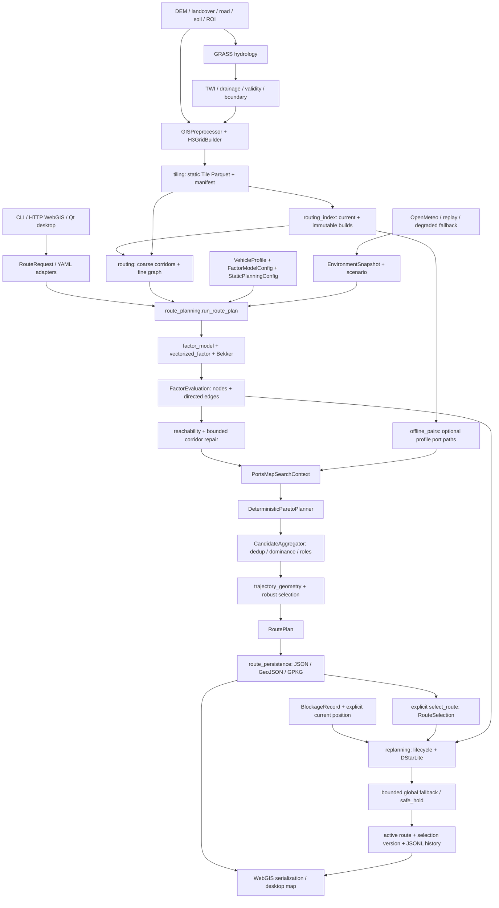

# 项目全息上下文快照（PROJECT_HOLOGRAM.md）

## 1. 【项目现状与已达成目标】

### 1.1 快照身份与阅读边界

- 扫描日期：2026-10-14（Asia/Shanghai）；仓库：`D:/Workspace/demo_v4`；HEAD：`986bd58eef846f6f8a34961a43b208c315471110`；分支：`feat/codex-arch-upgrade`。
- 直接解析当前工作区 `49` 个生产 Python 文件、`89` 个类和 `903` 个函数/方法定义（含嵌套定义）；读取包配置、主流程、落盘协议及代表性既有产物。`tests/`、`scripts/`、`demo/` 用作验证/运维范围索引，不混入生产接口。
- 唯一新增交付文件为本 Markdown；没有导入执行项目模块、启动 GUI、发起天气请求或重新规划，没有修改代码、配置、数据和既有输出。测试存在不等于本次测试通过；本次验证的是文档提取完整性与源码一致性。
- 第 4 部分的用户占位符 `[目标模块名]` 未具体化，因此暂定 `h3_offroad_planner.route_planning`，主入口 `run_route_plan`。接口目录进一步覆盖整个生产包，保留直接/间接关系和边缘接口，便于外部模型改选目标。
- 优先级：当前源码定义 > 当前配置 > 既有产物 > README/设计文档。历史产物不能证明由当前 HEAD 生成；设计方案不能当成已合并实现。本文“实现”指代码路径存在，不等于真实车辆通行、最优性或性能验收。

### 1.2 产品能力与主流程闭环

这是单车、车辆约束感知的 H3 越野规划系统：GIS 静态事实离线建图，在线按车辆和环境求有限候选，再显式激活选路并处理障碍变化。当前能力包括：

| 能力 | 当前实现入口与结果 | 证据边界 |
|---|---|---|
| GIS 归一化与属性采样 | `preprocessing/gis_preprocessor.py` 读取 DEM/土地覆盖/道路/土壤；`grid/h3_grid_builder.py` 挂载坡度、TRI、分类与水文证据 | 坐标转换、中心采样不保证原始数据精度或语义真值 |
| 静态水文 | `preprocessing/hydrology.py` 调用外部 GRASS `r.watershed`，输出累积流、TWI、排水敏感度与有效性掩膜 | 需要米制投影 DEM；TWI 是代理量；未设阈值不能制造有效 D |
| 分层瓦片和索引 | `tiling.build_h3_tile_cache` → Parquet/manifest → `routing_index.build_routing_index`；可选 `offline_pairs.precompute_port_pairs` | 瓦片事实与车辆评估分离；索引完成不等于任意 OD 可达 |
| 车辆物理评价 | `factor_model.evaluate_factor_model`、`vectorized_factor`、`dynamics/bekker.py` 产出节点区间和有向边时间/风险/代价 | 简化物理模型；缺失值、置信度、原因码随结果传递 |
| 全局有限候选 | `route_planning.run_route_plan` → `PortsMapSearchContext` → `DeterministicParetoPlanner` → `CandidateAggregator` | 多标量配置、重复路径惩罚、去重、非支配筛选不构成完整 Pareto 前沿保证 |
| 候选角色与环境稳健选路 | 五种角色、独立备份证据；静态策略分支执行轨迹验证和 `select_robust_candidates` | 推荐是策略选择；角色最优性只相对于生成/准入候选池；备份不能强行补位 |
| 连续几何 | `dynamics/trajectory_geometry.py` 直线/圆弧、后轴参考、转弯半径、整车扫掠和 clearance 检验 | 状态分为 valid/invalid/not_evaluated/incomplete；导出 `field_state=unverified` |
| 激活与重规划 | `route_persistence.select_route` 保存选择；`replanning.replan_route` 管理障碍确认、D* Lite、全局回退和 safe_hold | 规划不自动激活；持久化路由身份、版本和图/车辆哈希必须匹配 |
| 交互与交付 | CLI、标准库 HTTP WebGIS、PyQt5 桌面，JSON/GeoJSON/GPKG/JSONL/effective YAML | UI 与历史产物存在不表示当前本地依赖、地图配置或外部服务可用 |

完整链：`原始 GIS → 静态瓦片 → 路由索引 → RouteRequest → 图/因子/环境 → 候选 → 轨迹与策略 → RoutePlan 落盘 → 显式 RouteSelection → 障碍观测 → D* Lite/回退 → 活动路径与历史落盘`。

### 1.3 技术栈、运行面与现实约束

- `pyproject.toml`：Python **>=3.11**，包 `h3-offroad-planner==0.1.0`；setuptools；h3>=4、NumPy>=2、pandas>=2、PyArrow>=16、rasterio>=1.3、GeoPandas>=1、Shapely>=2、affine>=2.4、PyYAML>=6。桌面可选 PyQt5/PyQtWebEngine>=5.15；开发 pytest/mypy/ruff。版本范围不等于当前机器安装版本。
- CLI：`h3-offroad-planner = h3_offroad_planner.cli:main`，子命令 `preprocess-hydrology / build-tiles / plan / run / select / replan`，统一 `--request <YAML>`；另有 desktop 与 console 两个 console-script 入口。
- Web 后端为 `ThreadingHTTPServer`；桌面由 Qt worker 执行业务并通过地图桥展示。GRASS 是外部程序，Open-Meteo 是外部天气适配器；地图服务配置独立，不读取/复制 `map.private.yaml` 的凭据值。
- 配置不是统一默认分辨率：`RouteRequest`/`TileBuildRequest` 默认 fine=14、coarse/tile=11；底层 `H3Graph` 构造默认仍为 13/10。实际请求、manifest、索引必须对齐。H3 细分尺度不能替代 DEM 的有效空间分辨率。
- `configs/mvp81_qdx_delivery.yaml` 仍引用仓库外 `D:/Workspace/qdx数据` 和 `D:/Workspace/demo_v1/data`；本仓库不是完全自包含数据包。`static_gis_planning.yaml` 的 weather 开关为 true，具体线上压力由环境解析而非文件初始压力单独决定。
- README 中 Python >=3.10、“完整 Pareto”式描述及 `dynamic_replanning.py` 路径与现有实现不完全一致；实际重规划文件是 `replanning.py`，导出目录是 `exporting/`。不要按 README 想象另一套服务层。
- `FleetTask/FleetPlanningInput/FleetPlan` 与 `FleetCoordinator` 是扩展契约；不能据此声称多车协同已闭环。`H3AStarPlanner`/factory/facade 与旧评分链保留为兼容/示例路径，不能代替新的 RoutePlan 主链。

### 1.4 当前工作区与代表性产物

扫描开始时 Git 已有未跟踪文档及 `tmp/` 内容；现有状态予以保留。生产受版本控制文件在扫描开始时没有 Git 修改。以下仅是本机现存文件的抽样，未执行重放：

- `outputs/qdx_route/route_plan.json`：`{"schema_version": 2, "planner_name": "DeterministicParetoPlanner", "candidate_count": 5, "trajectory_status_counts": {"invalid": 5}}`；文件修改时间 UTC `2026-09-21T02:53:23.742630+00:00`。
- `outputs/qdx_tiles/routing_index/current.json`：`{"build_id": "f84ef3b2b1cdfc3db9cfac99"}`；文件修改时间 UTC `2026-09-19T10:05:32.324230+00:00`。

因此现存 QDX RoutePlan 的候选数量不能当作连续车辆轨迹验证通过。快照不采纳未重跑的历史性能数字作为当前性能结论。

测试主题：`test_cli_validation_coverage`, `test_closed_loop_candidates`, `test_closed_loop_contract_validation`, `test_closed_loop_factor`, `test_closed_loop_persistence`, `test_closed_loop_portsmap`, `test_closed_loop_replanning`, `test_dem_asset_validation`, `test_desktop_project_validation`, `test_desktop_ui`, `test_environment`, `test_independent_backup_regression`, `test_map_config`, `test_model_validation_coverage`, `test_mvp1`, `test_mvp2`, `test_mvp3`, `test_mvp31`, `test_mvp4`, `test_mvp41`, `test_mvp42`, `test_mvp7`, `test_mvp71`, `test_mvp8`, `test_offline_port_pairs`, `test_qdx_data_ingestion`, `test_reachability`, `test_route_planning_optimization`, `test_route_role_gate_regression`, `test_routing_index`, `test_soil_catalog_mapping`, `test_static_gis_transfer`, `test_vectorized_factor`, `test_weather_fallback`。本次未运行测试。

## 2. 【架构拓扑与数据流向】



### 2.1 核心边界和有条件的流转

- **适配层**：`cli` 将 YAML/dict 校验成请求；`web_console` 解码 HTTP envelope、调用 CLI payload 函数、序列化 FeatureCollection；`desktop_client/desktop_project/desktop_map` 管理 Qt 状态、工程选择、异步进度与地图事件。适配层不应自行重定义车辆代价。
- **静态事实层**：`preprocessing → grid → tiling → routing_index`；车辆相关 `score/cost_score/sinkage` 等不能成为新路由的静态权威，瓦片保留源证据。`routing_index` 以 parent 条件读取 Parquet；粗层路径只限制在线细图搜索范围。
- **请求计算层**：`routing._load_route_graph` 兼容单 Parquet、tile manifest 和 routing index；当前入口先 1-ring，失败时满足索引条件才有 2-ring 重试；定向瓶颈扩张最多 2 次、每次额外 parent 上限 15（见 `route_planning`）。这些有限修复不是全图完备性保证。
- **因子与拓扑层**：`FactorEvaluation` 绑定车辆/因子/静态输入/拓扑身份；`PortsMapSearchContext` 使用有向边及父格边界端口构图。离线端口表是可选加速；车辆哈希匹配才加载，未预计算父格/缺失连接有在线回退路径。请求缓存和跨请求缓存是不同作用域。
- **搜索与决策层**：索引分支 `fast_five_v1` 每 profile 一次尝试；普通分支 `full_pareto_v1` 仍是有限生成策略名称。候选聚合后，只有提供 static planning 时才做轨迹/稳健筛选并生成 schema-v2；无该配置为 schema-v1。
- **持久化层**：`route_persistence` 承担领域对象反序列化、原子替换、图重建、显式激活和活动路径保存；索引分支图快照是 build 引用+active parents，旧分支图快照保存进 GPKG。消费者必须按 `graph_storage.format` 分派。
- **重规划层**：`replanning` 是产品状态控制器，`planners/dstar_lite` 是内存算法。障碍确认、冷却/TTL、失败走廊、全局回退次数和持久化均在控制器。不能只调用 D* Lite 就宣称产品状态闭环。
- **依赖耦合**：主编排直接使用 `routing`/`grid` 的下划线辅助函数；`factor_model` 在函数内部导入向量化模块，而向量化模块导入因子类型，属于延迟导入环。静态 import 图不是运行调用图；地图信号、回调、鸭子类型和动态分支需结合下述接口与源码判断。

### 2.2 生产模块静态依赖邻接表

箭头表示源码出现的项目内 `ImportFrom`（含延迟导入），不是宣称每个被导入符号在所有请求中都会调用。完整符号在第 4 部分。

- `h3_offroad_planner` → `config`, `coordination`, `exporting`, `factor_model`, `models`, `route_models`, `route_planning`, `routing`, `tiling`
- `__main__` → `cli`
- `assessment` → `assessment.trafficability`
- `assessment.trafficability` → `dynamics.bekker`, `models`
- `candidate_aggregation` → `factor_model`, `models`, `planners.deterministic_pareto`, `portsmap`, `route_models`
- `cli` → `config`, `factor_model`, `models`, `preprocessing.hydrology`, `replanning`, `route_models`, `route_persistence`, `route_planning`, `tiling`
- `config` → `models`
- `coordination` → `coordination.interfaces`
- `coordination.interfaces` → `models`
- `desktop_client` → `cli`, `desktop_map`, `desktop_project`, `models`, `route_persistence`, `tiling`, `web_console`
- `desktop_map` → `map_config`
- `desktop_project` → `cli`, `models`
- `dynamics` → `dynamics.cost_function`, `dynamics.los_path_smoother`
- `dynamics.bekker` → `models`
- `dynamics.cost_function` → `models`
- `dynamics.los_path_smoother` → `models`
- `dynamics.trajectory_geometry` → `factor_model`, `models`
- `environment` → `factor_model`, `weather_fallback`
- `exporting` → `exporting.gis_exporter`
- `exporting.gis_exporter` → `models`
- `factor_model` → `dynamics.bekker`, `models`, `vectorized_factor`, `vectorized_soil`
- `grid` → `grid.h3_grid_builder`
- `grid.h3_grid_builder` → `models`, `preprocessing`
- `offline_pairs` → `config`, `factor_model`, `grid`, `models`, `portsmap`, `routing_index`
- `planners` → `planners.deterministic_pareto`, `planners.dstar_lite`, `planners.facade`, `planners.factory`, `planners.h3_astar`, `planners.interfaces`
- `planners.deterministic_pareto` → `factor_model`, `models`, `portsmap`
- `planners.dstar_lite` → `models`, `planners.interfaces`
- `planners.facade` → `models`, `planners.interfaces`
- `planners.factory` → `dynamics.cost_function`, `models`, `planners.dstar_lite`, `planners.facade`, `planners.h3_astar`
- `planners.h3_astar` → `dynamics.cost_function`, `models`, `planners.interfaces`
- `planners.interfaces` → `models`
- `portsmap` → `factor_model`, `models`
- `preprocessing` → `preprocessing.gis_preprocessor`, `preprocessing.hydrology`
- `preprocessing.gis_preprocessor` → `models`
- `preprocessing.hydrology` → `models`
- `reachability` → `factor_model`, `models`
- `replanning` → `candidate_aggregation`, `config`, `dynamics.trajectory_geometry`, `factor_model`, `models`, `planners.deterministic_pareto`, `planners.dstar_lite`, `portsmap`, `route_models`, `route_persistence`
- `route_models` → `factor_model`
- `route_persistence` → `factor_model`, `models`, `route_models`, `routing_index`
- `route_planning` → `candidate_aggregation`, `config`, `dynamics.trajectory_geometry`, `environment`, `factor_model`, `grid.h3_grid_builder`, `models`, `offline_pairs`, `planners.deterministic_pareto`, `portsmap`, `reachability`, `route_models`, `route_persistence`, `routing`, `routing_index`
- `routing` → `config`, `exporting`, `grid`, `models`, `planners`, `routing_index`
- `routing_index` → `config`, `factor_model`, `grid`, `models`, `offline_pairs`
- `tiling` → `exporting`, `factor_model`, `grid`, `models`, `preprocessing`, `routing_index`
- `vectorized_factor` → `dynamics.bekker`, `factor_model`, `models`, `vectorized_soil`
- `vectorized_soil` → `dynamics.bekker`, `models`
- `web_console` → `cli`, `config`, `map_config`, `models`, `route_persistence`, `tiling`

## 3. 【全局数据组织与 Schema 契约（关键）】

### 3.1 全局单位、坐标、索引与空值

| 对象 | 精确约定 / 使用边界 |
|---|---|
| H3 cell ID | `str`，主键 `h3index`；父格 `parent_h3`；图以 cell ID 作字典键。不是连续整数栅格索引；父格分辨率来自 request/manifest |
| 输入端点和 H3 API | 明确 `lat, lng`；`lat ∈ [-90,90]`, `lng ∈ [-180,180]`。不要因二元 tuple 自动推断顺序 |
| GIS / GeoJSON / Shapely | WGS84 `EPSG:4326`，坐标为 `(lng, lat)`，bounds=`(minx,miny,maxx,maxy)`；栅格采样前按源 CRS 转换 |
| `models.Coordinate` | 仅定义 `tuple[float,float]`，类型别名没有轴序约束；H3AStar/DStarLite 生成 `Path` 只设置 cells/total_cost，coordinates 默认空列表；GIS exporter 从图重新取 `(cell.lng,cell.lat)`，不读取 Path.coordinates |
| 轨迹 | `coordinates_wgs84` 为 `(lng,lat)`；`PointXY` 是局部米制 `(x,y)`；`LOCAL_EQUIRECTANGULAR_METERS`，局部原点由路径均值构造；heading 为 rad，curvature 为 1/m；后轴中心参考 |
| 无向静态边 | `H3Graph.edges: dict[tuple[str,str],H3Edge]`；构图常将两端 ID 按字典序规范化；`H3Edge` 同时保留 a→b、b→a 坡度 |
| 有向边 | `FactorEvaluation.directed_edges[(from_h3,to_h3)]`；反向键独立，坡度、ETA、可通过性可不同，不能把有向图当成静态无向图 |
| 基础单位 | `distance_m/length_m` 米；`eta*_s` 秒；`max_speed_kmh` 千米/时，节点速度 m/s；坡度 deg；车辆质量 kg、力 N、锥指数 kPa、含水率 m³/m³ |
| 代价和风险 | `travel_cost` 与 `terrain_risk` 是项目模型指标；不能当作实测油耗/货币/事故概率。环境 `environment_distance_m` 是按压力键分组的等效距离，不是几何长度替代值 |
| 空值 | 源栅格 nodata 常转 NaN，Arrow 可空列为 null，JSON 领域对象用 None→null；`eta_upper_s=None` 配合 `eta_upper_bounded=False` 表示无有限上界；未知 D 不等于 0 |
| 冻结 | `@dataclass(frozen=True)` 和 `MappingProxyType` 属浅冻结；嵌套 object 未自动深冻结；`H3Graph` 是可变对象 |
| 身份 | canonical hash 由排序 JSON 的确定性内容计算；candidate ID 绑定 H3 路径，plan ID 绑定身份 payload；schema-v2 加入策略、场景与 trajectory IDs。哈希一致不替代语义/实地验证 |

### 3.2 数组与矩阵维度

- `GISPreprocessor.load_dem`：`tuple[NDArray[float64], Affine, CRS]`；DEM、slope、TRI 共享 `(H,W)`，索引为 `[row,col]`，Affine 按 `(col,row)` 映射到 `(x,y)`；读第一波段，缺失值 NaN；不是 `(W,H)`，没有 batch/channel 维。
- `map_twi_to_drainage(twi,valid,t0,t1)`：两者同形二维，`twi: floating[H,W]`、`valid: bool[H,W]`，返回 `float32[H,W]`；有效单元 `clip((TWI-t0)/(t1-t0),0,1)`，其余 NaN；t1>t0。落盘 validity/boundary mask 为 uint8、nodata=255。
- `vectorized_speed_multiplier`：土地覆盖 `float64[N]`（允许缺失 NaN）、USCS `str_[N]`、TRI `float64[N]` → 倍率 `float64[N]`。土壤向量函数按输入同形逐元素输出；调用方要对齐样本轴，源码未统一用 shape 类型系统约束。
- `compute_vectorized_edge_arrays`：N=`len(graph.cells)`，无向边 E=`len(graph.edges)`，M=2E；节点数组顺序为 `list(graph.cells.keys())`，`u_indices/v_indices: int32[M]` 指向该顺序；距离/坡度/力/速度/裕度/代价 `float64[M]`，`is_passable: bool[M]`。后续按有效边索引过滤，不保证过滤后的长度仍为 2E。
- `OfflinePairsTable`：读取后的 profile/parent/source/target 向量与 cost 按 Parquet 行对齐；字符串列可使用 object 数组，cost float64；路径列可延迟加载，不能把未载入的 path 解释为不存在路径。
- 天气 hourly 数组共享 time 的长度 T；precipitation、三个深度 moisture、ET0 必须同长且数值范围有效。表层代理 `(theta_0_1 + 2*theta_1_3 + 2*theta_3_9)/5`；preceding-24h 求和不等于栅格逐点含水率反演。
- 当前生产包无深度学习 tensor/batch/channel 契约；NumPy 栅格和边数组是主要稠密结构。

### 3.3 文件、请求与状态契约

| 层级/格式 | 生产者 → 消费者 | 契约 |
|---|---|---|
| request YAML | 配置/GUI → cli | route/tile_build/hydrology/select/replan 按字段白名单校验；组合交付含 tile_build 与 route；精确白名单见下方常量 |
| 原始 GeoTIFF | rasterio → preprocessor/grid | DEM/分类土壤/土地覆盖/水文单波段，必须有 CRS；土壤可配 DBF 目录；nodata 不制造有效通行证据 |
| SHP/GeoJSON/GPKG | GeoPandas → preprocessor/routing | ROI Polygon/MultiPolygon；端点含 role/坐标；土地覆盖、道路分类及 depth/rowspacing 来自源字段映射 |
| tile manifest JSON | tiling → routing/index/UI | artifact_kind=tile_h3_cache，schema_version=2；tiles 列表含 parent_h3/path/status/bounds/cells_count/edges_count/error/static_input_hash/statistics；tile_fact_authority=vehicle_independent |
| tile Parquet | tiling → index/routing | 每行 cell 静态事实，加 adjacency_json（JSON 字符串 neighbor-ID→距离）、edge_length_m、nodata、sampling_mode、static_input_hash；移除车辆评价列 |
| index current JSON | routing_index → open_routing_index | `{build_id}` 指向 `routing_index/builds/<build_id>/routing_index.json`；current 原子更新，构建目录不可变发布 |
| index files | routing_index → routing | cells/part-00000.parquet、coarse_graph.parquet、landcover_catalog.parquet、可选 soil_catalog.parquet、port_pairs.parquet；manifest 保存路径/哈希/字节和输入身份；Arrow 列见 3.5 |
| offline pairs Parquet | offline_pairs → PortsMap | profile,parent_h3,source,target,path:list[str],cost:float64；逻辑键 `(profile,parent,source)` → target → `(path_tuple,cost)`；可选车辆哈希存 Arrow metadata，已算父格集合从载入行派生 |
| RoutePlan JSON | run_route_plan → persistence/UI | 下方 RoutePlan.to_dict；候选 1..5、candidate_id 唯一、恰一个 is_recommended；schema-v2 增加策略/场景身份，trajectory 是嵌套映射 |
| route_manifest JSON | persistence → reload/UI | schema_version 与 RoutePlan 自身版本不可混用；graph_storage 为 routing_index 或 gpkg 判别联合；索引保存 build_id+active_parent_h3；GPKG 保存 cells_layer+edges_table |
| routes.geojson | 索引轻量导出 → UI/GIS | FeatureCollection，LineString 坐标 lng/lat，属性包含候选角色/指标/几何状态；旧 GPKG 分支不能假定同样生成所有轻量文件 |
| routes.gpkg | persistence → GIS/reload | route_candidates；完整图分支另含 h3_static_facts、route_recommended、route_selected、route_active、confirmed_blockages 和 h3_edges 非空间表；索引轻量导出可只含候选 |
| selection / history | select/replan → reload | route_selection.json 保存 active_h3_path、active_metrics、active_trajectory、state、selection_version/replan_version、四类身份；replan_history.jsonl 一行一个事件 |
| effective YAML | factor_model → replay/replan | effective_vehicle.yaml / effective_factor_model.yaml / effective_static_planning.yaml；保存实际参数；环境 snapshot/replay 另外参与 scenario hash |
| performance.json | run_route_plan → diagnostics | 秒级阶段计时+节点/边/候选/父格数+缓存和细搜索统计；只描述对应那次请求；本快照不宣称这些数字是当前实测 |

关键不变量：PATH_ROLES 与 MISSION_PROFILES 不是同一枚举；recommendation 不是第六种角色。RouteSelection.state 为 active/safe_hold/superseded/invalidated；BlockageRecord.state 为 tentative/confirmed/cleared/expired。ReplanRequest 必须显式提供 current_h3 或完整 current_lat/current_lng 二选一。轨迹 valid 仍是地图与模型内验证，不是 field verified。

HTTP：GET `/api/bootstrap`、`/api/data-catalog`；POST `/api/run`、`/api/run-stream`、`/api/select`、`/api/replan`。运行 envelope 必须含字符串 request_yaml，operation 默认为 combined，可选地图选择字段；解码后的内部字典才产生 payload。流式响应为 `application/x-ndjson` 按行 JSON 事件。select/replan 接受各自 JSON 对象，不使用该 YAML envelope。`/api/replan` 的活动路由入口与通用 `_run_operation` 的字符串分派不能仅凭 operation 名混同。Qt 信号定义和 Web serializers 见接口与映射提取。

环境压力键为 `f"{pressure:g}"`（例如 `"0.5"`），不是 float JSON 键；倍率 `M=1+w*U*S*(1+D)`，U 为 surface_response、S 为 shared_sensitivity、D 为 drainage_sensitivity，未知证据使用配置上界。天气优先将有效表层含水率按 theta_dry/theta_wet 线性裁剪到 [0,1]，否则尝试降水压力回退，再保留合成场景；身份排除 requested_at/cache_hit/age_s。`canonical_hash` 为 ensure_ascii=False、sort_keys=True、separators=(",",":") 的 UTF-8 JSON SHA-256。

### 3.4 全包数据类型、属性、别名与校验条件（AST 提取）

以下保留源码注解和默认表达式，不执行构造器。未注解的实例属性明确标为“未注解”，给首次静态赋值表达式帮助追踪，不伪造 Any/推断类型；动态 setattr、继承库内部属性不保证可枚举。类的行为接口集中放在第 4 部分。校验摘录保留原始条件/异常，存在循环局部变量时仅作为原样证据，完整上下文以行号为准。

#### `src/h3_offroad_planner/assessment/trafficability.py`

```python
# TrafficabilityAssessor — src/h3_offroad_planner/assessment/trafficability.py:16
class TrafficabilityAssessor:
    'Legacy standalone evaluator retained outside the RoutePlan production chain.'
    # self.vehicle: 未注解; L28; initial=vehicle
    # self.weights: 未注解; L29; initial=weights
    # self.bekker: 未注解; L30; initial=BekkerChecker()
    ...
```

#### `src/h3_offroad_planner/candidate_aggregation.py`

```python
# AggregationResult — src/h3_offroad_planner/candidate_aggregation.py:44
@dataclass(frozen=True)
class AggregationResult:
    'Unique role candidates or a bounded pre-display candidate pool.'
    candidates: tuple[RouteCandidate, ...]
    recommended_candidate_id: str
    independence_reference_candidate_id: str | None
    warnings: tuple[str, ...]
    statistics: dict[str, object]
    ...

# CandidateAggregator — src/h3_offroad_planner/candidate_aggregation.py:54
class CandidateAggregator:
    'Aggregate raw deterministic paths into five fixed product roles.'
    # self.graph: 未注解; L66; initial=graph
    # self.context: 未注解; L67; initial=context
    # self.disruption_radius: 未注解; L68; initial=disruption_radius
    ...
```

#### `src/h3_offroad_planner/cli.py`

```python
# L238
ProgressCallback = Callable[[str, int, str], None]
```

#### `src/h3_offroad_planner/coordination/interfaces.py`

```python
# FleetCoordinator — src/h3_offroad_planner/coordination/interfaces.py:12
class FleetCoordinator(Protocol):
    'Abstract boundary reserved for a future multi-vehicle coordinator.'
    ...
```

#### `src/h3_offroad_planner/desktop_client.py`

```python
# L117
ProgressCallback = Callable[[str, int, str], None]

# L118
DesktopOperationEvent = tuple[str, object]

# DesktopOperationWorker — src/h3_offroad_planner/desktop_client.py:121
class DesktopOperationWorker(QObject):
    'Legacy Qt compatibility shim for executing one delivery operation.'
    progress = pyqtSignal(str, int, str)
    completed = pyqtSignal(object)
    failed = pyqtSignal(str)
    # self._operation: 未注解; L132; initial=operation
    # self._payload: 未注解; L133; initial=payload
    ...

# ProjectSettingsDialog — src/h3_offroad_planner/desktop_client.py:149
class ProjectSettingsDialog(QDialog):
    'Edit the typed desktop project without exposing raw YAML text.'
    # self._project: 未注解; L154; initial=project
    _path_inputs: dict[tuple[str, str], tuple[QLineEdit, bool]]  # instance; L155; initial={}
    _int_inputs: dict[tuple[str, str], QSpinBox]  # instance; L156; initial={}
    _float_inputs: dict[tuple[str, str], QDoubleSpinBox]  # instance; L157; initial={}
    _bool_inputs: dict[tuple[str, str], QCheckBox]  # instance; L158; initial={}
    # self._sections: 未注解; L162; initial=QToolBox()
    # self._mission_profile: 未注解; L196; initial=QComboBox()
    # self._endpoint_mode: 未注解; L211; initial=QComboBox()
    # self._start_summary: 未注解; L223; initial=QLabel(_endpoint_text('起点', self._project.endpoint('start')))
    # self._goal_summary: 未注解; L224; initial=QLabel(_endpoint_text('终点', self._project.endpoint('goal')))
    # self._sampling_mode: 未注解; L264; initial=sampling
    # self._roi_strategy: 未注解; L304; initial=roi_strategy
    ...

# DesktopMainWindow — src/h3_offroad_planner/desktop_client.py:442
class DesktopMainWindow(QMainWindow):
    'Map-first desktop shell backed by one structured project state.'
    # self._project: 未注解; L447; initial=load_project_yaml(DEFAULT_DELIVERY_PATH)
    _last_result: dict[str, object] | None  # instance; L448; initial=None
    _active_grid_level: str  # instance; L449; initial='parent'
    _selected_parent_h3: str | None  # instance; L450; initial=None
    _selected_fine_grid: dict[str, object] | None  # instance; L451; initial=None
    _candidate_routes: list[dict[str, object]]  # instance; L452; initial=[]
    _active_thread: Thread | None  # instance; L453; initial=None
    _operation_events: SimpleQueue[DesktopOperationEvent]  # instance; L454; initial=SimpleQueue()
    # self._operation_poll_timer: 未注解; L455; initial=QTimer(self)
    # self._status_bar: 未注解; L461; initial=status_bar
    # self.map_view: 未注解; L468; initial=DesktopMapView()
    # self.project_summary: 未注解; L519; initial=QLabel()
    # self.settings_button: 未注解; L521; initial=QPushButton('打开项目设置…')
    # self.progress_bar: 未注解; L537; initial=QProgressBar()
    # self.progress_label: 未注解; L539; initial=QLabel('Waiting for operation')
    # self.result_text: 未注解; L540; initial=QTextBrowser()
    # self.theme_box: 未注解; L542; initial=QComboBox()
    # self.candidate_box: 未注解; L545; initial=QComboBox()
    # self.activate_candidate_button: 未注解; L547; initial=QPushButton('确认并激活当前候选')
    # self.fine_grid_button: 未注解; L551; initial=QPushButton('显示细层格网')
    # self.parent_grid_button: 未注解; L554; initial=QPushButton('显示父层格网')
    # self.log_text: 未注解; L558; initial=QPlainTextEdit()
    operation_buttons: list[QPushButton]  # instance; L579; initial=[]
    _last_logged_step: str | None  # instance; L867; initial=None
    ...
```

#### `src/h3_offroad_planner/desktop_map.py`

```python
# DesktopMapView — src/h3_offroad_planner/desktop_map.py:74
class DesktopMapView(QWebEngineView):
    'Bridge one Leaflet/TianDiTu map to typed Qt signals and GeoJSON display.'
    study_area_selected = pyqtSignal(object)
    coordinate_selected = pyqtSignal(str, float, float)
    parent_grid_selected = pyqtSignal(str)
    grid_cell_selected = pyqtSignal(str)
    toolbar_action = pyqtSignal(str)
    map_error = pyqtSignal(str)
    # self._page_ready: 未注解; L86; initial=False
    _pending_scripts: list[str]  # instance; L87; initial=[]
    ...
```

#### `src/h3_offroad_planner/desktop_project.py`

```python
# DesktopProjectState — src/h3_offroad_planner/desktop_project.py:26
@dataclass
class DesktopProjectState:
    'The only editable configuration source for the desktop client.\n\n    The two request mappings deliberately retain every imported value.  This lets\n    the settings dialog edit the fields it understands without discarding valid\n    fields that have no current control.  A map-drawn study area is held as\n    geometry until a run or export materializes it as GeoJSON.\n    '
    tile_build: dict[str, object]
    route: dict[str, object]
    extra_sections: dict[str, object] = field(default_factory=dict)
    study_area_geojson: dict[str, object] | None = None
    ...
```

#### `src/h3_offroad_planner/dynamics/bekker.py`

```python
# BekkerChecker — src/h3_offroad_planner/dynamics/bekker.py:37
class BekkerChecker:
    'Check soil mobility using CI and Bekker sinkage formulas.'
    # self.speed_score_floor: 未注解; L52; initial=speed_score_floor
    ...
```

#### `src/h3_offroad_planner/dynamics/cost_function.py`

```python
# CostFunction — src/h3_offroad_planner/dynamics/cost_function.py:12
class CostFunction:
    'Compute single-step movement cost with directional slope constraints.'
    # self.vehicle: 未注解; L44; initial=vehicle
    # self.k_r: 未注解; L45; initial=k_r
    # self.gravity_coeff: 未注解; L46; initial=gravity_coeff
    # self.score_coefficient: 未注解; L47; initial=score_coefficient
    ...
```

#### `src/h3_offroad_planner/dynamics/los_path_smoother.py`

```python
# LOSPathSmoother — src/h3_offroad_planner/dynamics/los_path_smoother.py:14
class LOSPathSmoother:
    'Smooth a path by greedily shortcutting across visible graph segments.'
    # self.graph: 未注解; L23; initial=graph
    ...
```

#### `src/h3_offroad_planner/dynamics/trajectory_geometry.py`

```python
# L28
PointXY = tuple[float, float]

# TrajectoryPrimitive — src/h3_offroad_planner/dynamics/trajectory_geometry.py:32
@dataclass(frozen=True)
class TrajectoryPrimitive:
    'One tangent-continuous line or circular-arc primitive in local meters.'
    kind: str
    start_xy: PointXY
    end_xy: PointXY
    heading_start_rad: float
    heading_end_rad: float
    length_m: float
    curvature_per_m: float
    center_xy: PointXY | None = None
    turn_angle_rad: float = 0.0
    ...

# TrajectoryResult — src/h3_offroad_planner/dynamics/trajectory_geometry.py:62
@dataclass(frozen=True)
class TrajectoryResult:
    'Geometry state and continuous final-route metrics for one H3 guide.'
    trajectory_id: str
    status: str
    failure_reasons: tuple[str, ...]
    coordinates_wgs84: tuple[tuple[float, float], ...]
    primitives: tuple[TrajectoryPrimitive, ...]
    length_m: float
    environment_distance_m: Mapping[str, float]
    min_clearance_m: float | None
    max_curvature_per_m: float
    auxiliary_eta_s: float
    unknown_coverage_m: float
    swept_dependency_cells: tuple[str, ...]
    reference_point: str = 'rear_axle_center'
    crs: str = 'LOCAL_EQUIRECTANGULAR_METERS'
    ...

# _LocalProjection — src/h3_offroad_planner/dynamics/trajectory_geometry.py:199
@dataclass(frozen=True)
class _LocalProjection:
    lat0: float
    lng0: float
    ...
```

校验 `TrajectoryPrimitive.__post_init__`：

- `L46 if self.kind not in {'line', 'arc'}` → `raise ValueError('trajectory primitive kind must be line or arc.')`
- `L48 if not isfinite(self.length_m) or self.length_m < 0.0` → `raise ValueError('trajectory primitive length must be finite and non-negative.')`
- `L50 if self.kind == 'arc' and (self.center_xy is None or abs(self.curvature_per_m) <= EPSILON)` → `raise ValueError('arc primitive requires a center and non-zero curvature.')`

校验 `TrajectoryResult.__post_init__`：

- `L81 if self.status not in {'valid', 'invalid', 'not_evaluated', 'incomplete'}` → `raise ValueError('trajectory status is invalid.')`
- `L83 if any((not isfinite(value) or value < 0.0 for value in (self.length_m, self.max_curvature_per_m, self.auxiliary_eta_s, self.unknown_coverage_m)))` → `raise ValueError('trajectory metrics must be finite and non-negative.')`

#### `src/h3_offroad_planner/environment.py`

```python
# EnvironmentSnapshot — src/h3_offroad_planner/environment.py:35
@dataclass(frozen=True)
class EnvironmentSnapshot:
    'Validated point-in-time forcing used by one planning request.'
    provider: str
    model: str
    requested_at: str
    valid_at: str | None
    latitude: float
    longitude: float
    precipitation_24h_mm: float | None
    soil_moisture_surface_m3_m3: float | None
    et0_24h_mm: float | None
    age_s: float | None
    degraded: bool
    degradation_reason: str | None = None
    cache_hit: bool = False
    ...

# _CacheEntry — src/h3_offroad_planner/environment.py:74
@dataclass(frozen=True)
class _CacheEntry:
    expires_at: float
    snapshot: EnvironmentSnapshot
    ...

# OpenMeteoProvider — src/h3_offroad_planner/environment.py:79
class OpenMeteoProvider:
    'Fetch one centroid snapshot; never performs I/O during graph search.'
    # self._config: 未注解; L90; initial=config
    # self._opener: 未注解; L91; initial=opener
    # self._now: 未注解; L92; initial=now
    # self._clock: 未注解; L93; initial=clock
    _cache: dict[tuple[float, float], _CacheEntry]  # instance; L94; initial={}
    # self._lock: 未注解; L95; initial=Lock()
    ...
```

#### `src/h3_offroad_planner/exporting/gis_exporter.py`

```python
# GISExporter — src/h3_offroad_planner/exporting/gis_exporter.py:42
class GISExporter:
    'Export H3 graph and path artifacts to GIS-friendly files.'
    ...
```

#### `src/h3_offroad_planner/factor_model.py`

```python
# FactorInterval — src/h3_offroad_planner/factor_model.py:126
@dataclass(frozen=True, slots=True)
class FactorInterval:
    'Ordered ratio interval on the closed unit range.'
    lower: float
    nominal: float
    upper: float
    ...

# NodeFactorMetrics — src/h3_offroad_planner/factor_model.py:146
@dataclass(frozen=True, slots=True)
class NodeFactorMetrics:
    'Frozen speed factors, physical safety margin, and evidence for one node.'
    h3index: str
    slope: FactorInterval
    landcover: FactorInterval
    soil: FactorInterval
    tri: FactorInterval
    road: FactorInterval
    safety_margin: FactorInterval
    speed_lower_mps: float
    speed_nominal_mps: float
    speed_upper_mps: float
    is_passable: bool
    confidence: float
    reason_codes: tuple[str, ...] = ()
    cone_index_kpa: float | None = None
    sinkage_m: float | None = None
    ...

# DirectedEdgeMetrics — src/h3_offroad_planner/factor_model.py:216
@dataclass(frozen=True, slots=True)
class DirectedEdgeMetrics:
    'Frozen metrics for one directed graph edge.'
    from_h3: str
    to_h3: str
    distance_m: float
    eta_lower_s: float
    eta_s: float
    eta_upper_s: float | None
    eta_upper_bounded: bool
    terrain_risk: float
    travel_cost: float
    safety_margin_lower: float
    safety_margin_nominal: float
    safety_margin_upper: float
    directed_slope_deg: float
    environment_distance_m: Mapping[str, float] = _EMPTY_ENV
    ...

# PathMetrics — src/h3_offroad_planner/factor_model.py:312
@dataclass(frozen=True)
class PathMetrics:
    'Exact path aggregates recomputed from frozen directed-edge metrics.'
    distance_m: float
    eta_lower_s: float
    eta_s: float
    eta_upper_s: float | None
    eta_upper_bounded: bool
    terrain_risk: float
    travel_cost: float
    safety_margin_min: float
    safety_margin_mean: float
    edge_count: int
    environment_distance_m: Mapping[str, float] = MappingProxyType({})
    ...

# EnvironmentConfig — src/h3_offroad_planner/factor_model.py:389
@dataclass(frozen=True)
class EnvironmentConfig:
    'Static surface/drainage multiplier policy and request pressure scenarios.'
    comparison_pressures: tuple[float, ...] = (0.0, 0.5, 1.0)
    request_pressures: tuple[float, ...] = (0.5, 1.0)
    unknown_drainage_range: tuple[float, float] = (0.0, 1.0)
    unknown_surface_range: tuple[float, float] = (0.0, 1.0)
    shared_sensitivity: float = 1.0
    model: str = 'surface_drainage_multiplier_v1'
    pressure_basis: str = 'synthetic_scenario'
    ...

# WeatherConfig — src/h3_offroad_planner/factor_model.py:441
@dataclass(frozen=True)
class WeatherConfig:
    'Bounded request-time weather lookup and optional moisture calibration.'
    enabled: bool = False
    provider: str = 'open-meteo'
    endpoint: str = 'https://api.open-meteo.com/v1/forecast'
    model: str = 'best_match'
    timeout_s: float = 3.0
    ttl_s: float = 1800.0
    failure_ttl_s: float = 60.0
    max_age_s: float = 10800.0
    theta_dry: float | None = None
    theta_wet: float | None = None
    calibration_status: str = 'unspecified'
    api_reference_mm: float | None = None
    ...

# GeometryConfig — src/h3_offroad_planner/factor_model.py:489
@dataclass(frozen=True)
class GeometryConfig:
    'Continuous trajectory construction and validation tolerances.'
    simplify_tolerance_m: float = 0.05
    geometry_tolerance_m: float = 0.01
    map_error_m: float = 0.0
    arc_step_deg: float = 10.0
    max_arc_segments: int = 720
    ...

# DecisionConfig — src/h3_offroad_planner/factor_model.py:510
@dataclass(frozen=True)
class DecisionConfig:
    'Candidate-pool detour budget, robust ordering, and switch hysteresis.'
    detour_ratio: float = 0.15
    clearance_target_m: float = 0.0
    clearance_tolerance_m: float = 0.01
    switch_relative_improvement: float = 0.05
    candidate_limit: int = 24
    display_limit: int = 5
    require_independent_backup: bool = False
    ...

# StaticPlanningConfig — src/h3_offroad_planner/factor_model.py:537
@dataclass(frozen=True)
class StaticPlanningConfig:
    'Versioned request policy for the three static-GIS planning increments.'
    environment: EnvironmentConfig = EnvironmentConfig()
    weather: WeatherConfig = WeatherConfig()
    geometry: GeometryConfig = GeometryConfig()
    decision: DecisionConfig = DecisionConfig()
    soil: Mapping[str, object] = MappingProxyType({})
    hydrology: Mapping[str, object] = MappingProxyType({})
    version: str = 'static_gis_route_v2'
    ...

# FactorModelConfig — src/h3_offroad_planner/factor_model.py:597
@dataclass(frozen=True)
class FactorModelConfig:
    'Validated physical-margin and speed configuration for route evaluation.'
    landcover_speed_by_code: Mapping[int, float] = MappingProxyType({})
    soil_speed_by_uscs: Mapping[str, float] = MappingProxyType({})
    tri_best: float = 0.0
    tri_worst: float = 8.0
    missing_speed_lower: float = 0.25
    missing_speed_nominal: float = 0.6
    missing_speed_upper: float = 0.85
    missing_confidence: float = 0.5
    offroad_speed_factor: float = 0.7
    road_speed_factor: float = 1.0
    speed_floor_ratio: float = 0.05
    directed_slope_speed_min_factor: float = 0.2
    min_cone_index_kpa: float = 185.73
    max_sinkage_clearance_ratio: float = 1.0
    epsilon: float = 1e-06
    tri_coefficient: float = 0.1
    gravity_coefficient: float = 5.0
    max_ports: int = 20000
    max_port_pairs: int = 200000
    ...

# FactorEvaluation — src/h3_offroad_planner/factor_model.py:704
@dataclass(frozen=True)
class FactorEvaluation:
    'Complete immutable route-time evaluation context.'
    node_metrics: Mapping[str, NodeFactorMetrics]
    directed_edges: Mapping[tuple[str, str], DirectedEdgeMetrics]
    vehicle_hash: str
    factor_model_hash: str
    static_input_hash: str
    graph_topology_hash: str
    ...

# _RawNodeEvidence — src/h3_offroad_planner/factor_model.py:1194
@dataclass(frozen=True)
class _RawNodeEvidence:
    speed_factors: tuple[FactorInterval, ...]
    safety_margin: FactorInterval
    passable: bool
    confidence: float
    reasons: tuple[str, ...]
    cone_index_kpa: float | None
    sinkage_m: float | None
    ...
```

校验 `FactorInterval.__post_init__`：

- `L135 if not all((isfinite(value) for value in values))` → `raise ValueError('factor interval values must be finite.')`
- `L137 if not 0.0 <= self.lower <= self.nominal <= self.upper <= 1.0` → `raise ValueError('factor interval must satisfy 0 <= lower <= nominal <= upper <= 1.')`

校验 `NodeFactorMetrics.__post_init__`：

- `L166 if not self.h3index` → `raise ValueError('h3index must be non-empty.')`
- `L169 if not all((isfinite(value) and value >= 0.0 for value in speeds))` → `raise ValueError('node speeds must be finite and non-negative.')`
- `L171 if not self.speed_lower_mps <= self.speed_nominal_mps <= self.speed_upper_mps` → `raise ValueError('node speed interval must be ordered.')`
- `L173 if not 0.0 <= self.confidence <= 1.0` → `raise ValueError('confidence must be in [0, 1].')`

校验 `DirectedEdgeMetrics.__post_init__`：

- `L242 if not self.from_h3 or not self.to_h3 or self.from_h3 == self.to_h3` → `raise ValueError('directed edge endpoints must be distinct non-empty ids.')`
- `L244 if not all((isfinite(value) and value >= 0.0 for value in finite_nonnegative))` → `raise ValueError('directed edge metrics must be finite and non-negative.')`
- `L246 if self.distance_m <= 0.0` → `raise ValueError('distance_m must be positive.')`
- `L248 if self.eta_upper_bounded != (self.eta_upper_s is not None)` → `raise ValueError('eta_upper_bounded must match eta_upper_s presence.')`
- `L250 if self.eta_upper_s is not None and self.eta_upper_s < self.eta_s` → `raise ValueError('eta_upper_s must not be below eta_s.')`
- `L252 if not 0.0 <= self.safety_margin_lower <= self.safety_margin_nominal <= self.safety_margin_upper <= 1.0` → `raise ValueError('directed edge safety-margin interval must be ordered in [0, 1].')`
- `L260 if any((not isfinite(value) or value < self.distance_m for value in self.environment_distance_m.values()))` → `raise ValueError('environment edge distances must be finite and >= geometry distance.')`

校验 `PathMetrics.__post_init__`：

- `L335 if not all((isfinite(value) and value >= 0.0 for value in values))` → `raise ValueError('path metrics must be finite and non-negative.')`
- `L337 if self.edge_count < 0` → `raise ValueError('edge_count must be non-negative.')`
- `L339 if not 0.0 <= self.safety_margin_min <= self.safety_margin_mean <= 1.0` → `raise ValueError('path safety-margin aggregates must be ordered in [0, 1].')`
- `L341 if self.eta_upper_bounded != (self.eta_upper_s is not None)` → `raise ValueError('eta_upper_bounded must match eta_upper_s presence.')`
- `L343 if any((not isfinite(value) or value < self.distance_m for value in self.environment_distance_m.values()))` → `raise ValueError('environment path distances must be finite and >= geometry distance.')`

校验 `EnvironmentConfig.__post_init__`：

- `L401 if self.model != 'surface_drainage_multiplier_v1'` → `raise ConfigError('unsupported environment model version.')`
- `L403 if self.pressure_basis not in {'synthetic_scenario', 'model_snapshot_v1', 'precipitation_apiv1'}` → `raise ConfigError('unsupported environment pressure_basis.')`
- `L417 if not set(self.request_pressures).issubset(self.comparison_pressures)` → `raise ConfigError('request_pressures must be a subset of comparison_pressures.')`
- `L425 if not isfinite(self.shared_sensitivity) or self.shared_sensitivity < 0.0` → `raise ConfigError('shared_sensitivity must be finite and non-negative.')`
- `L413 if not values or len(set(values)) != len(values)` → `raise ConfigError(f'{name} must contain unique pressure values.')`
- `L415 if any((not isfinite(value) or value < 0.0 for value in values))` → `raise ConfigError(f'{name} must contain finite non-negative values.')`
- `L423 if len(bounds) != 2 or not 0.0 <= bounds[0] <= bounds[1] <= 1.0` → `raise ConfigError(f'{name} must be an ordered [0, 1] interval.')`

校验 `WeatherConfig.__post_init__`：

- `L458 if self.provider != 'open-meteo'` → `raise ConfigError('unsupported weather provider.')`
- `L460 if not self.endpoint.startswith('https://')` → `raise ConfigError('weather endpoint must use https.')`
- `L462 if not self.model` → `raise ConfigError('weather model must be non-empty.')`
- `L468 if (self.theta_dry is None) != (self.theta_wet is None)` → `raise ConfigError('theta_dry and theta_wet must be provided together.')`
- `L470 if self.theta_dry is not None and self.theta_wet is not None and (not 0.0 <= self.theta_dry < self.theta_wet <= 1.0)` → `raise ConfigError('theta calibration must satisfy 0 <= dry < wet <= 1.')`
- `L476 if self.api_reference_mm is not None and (not isfinite(self.api_reference_mm) or self.api_reference_mm <= 0.0)` → `raise ConfigError('api_reference_mm must be finite and positive.')`
- `L480 if self.calibration_status not in {'unspecified', 'provisional_cldas_spatial_20260101', 'field_validated'}` → `raise ConfigError('unsupported weather calibration_status.')`
- `L466 if not isfinite(value) or value <= 0.0` → `raise ConfigError(f'{name} must be finite and positive.')`

校验 `GeometryConfig.__post_init__`：

- `L503 if not isfinite(self.map_error_m) or self.map_error_m < 0.0` → `raise ConfigError('map_error_m must be finite and non-negative.')`
- `L505 if not isinstance(self.max_arc_segments, int) or self.max_arc_segments <= 0` → `raise ConfigError('max_arc_segments must be a positive integer.')`
- `L501 if not isfinite(value) or value <= 0.0` → `raise ConfigError(f'{name} must be finite and positive.')`

校验 `DecisionConfig.__post_init__`：

- `L526 if not 0.0 <= self.switch_relative_improvement < 1.0` → `raise ConfigError('switch_relative_improvement must be in [0, 1).')`
- `L528 if not 1 <= self.display_limit <= 5` → `raise ConfigError('display_limit must be in [1, 5].')`
- `L530 if not self.display_limit <= self.candidate_limit <= 24` → `raise ConfigError('candidate_limit must be in [display_limit, 24].')`
- `L532 if not isinstance(self.require_independent_backup, bool)` → `raise ConfigError('require_independent_backup must be a boolean.')`
- `L524 if not isfinite(value) or value < 0.0` → `raise ConfigError(f'{name} must be finite and non-negative.')`

校验 `StaticPlanningConfig.__post_init__`：

- `L549 if self.version != 'static_gis_route_v2'` → `raise ConfigError('unsupported static planning version.')`

校验 `FactorModelConfig.__post_init__`：

- `L621 if not isfinite(self.tri_best) or not isfinite(self.tri_worst) or (not self.tri_worst > self.tri_best >= 0.0)` → `raise ValueError('tri thresholds must satisfy tri_worst > tri_best >= 0.')`
- `L632 _require_ratio('missing_confidence', self.missing_confidence)`
- `L633 _require_ratio('offroad_speed_factor', self.offroad_speed_factor)`
- `L634 _require_ratio('road_speed_factor', self.road_speed_factor)`
- `L635 _require_ratio('speed_floor_ratio', self.speed_floor_ratio, allow_zero=True)`
- `L636 _require_ratio('directed_slope_speed_min_factor', self.directed_slope_speed_min_factor, allow_zero=True)`
- `L641 _require_positive('min_cone_index_kpa', self.min_cone_index_kpa)`
- `L642 _require_positive('max_sinkage_clearance_ratio', self.max_sinkage_clearance_ratio)`
- `L643 _require_ratio('epsilon', self.epsilon)`
- `L644 _require_nonnegative('tri_coefficient', self.tri_coefficient)`
- `L645 _require_nonnegative('gravity_coefficient', self.gravity_coefficient)`
- `L647 if any((isinstance(value, bool) or not isinstance(value, int) for value in limits))` → `raise ValueError('PortsMap limits must be integers.')`
- `L649 if self.max_ports <= 0 or self.max_port_pairs <= 0` → `raise ValueError('PortsMap limits must be positive integers.')`
- `L663 _require_ratio('configured speed factor', value, allow_zero=True)`

校验 `FactorEvaluation.__post_init__`：

- `L721 if any((not value for value in hashes))` → `raise ValueError('factor evaluation hashes must be non-empty.')`

#### `src/h3_offroad_planner/grid/h3_grid_builder.py`

```python
# _SpatialIndex — src/h3_offroad_planner/grid/h3_grid_builder.py:92
class _SpatialIndex(Protocol):
    ...

# H3GridBuilder — src/h3_offroad_planner/grid/h3_grid_builder.py:97
class H3GridBuilder:
    'Build sampled or ROI-continuous H3 graphs from normalized GIS layers.'
    COMPACT: bool = False
    # self.res_fine: 未注解; L123; initial=res_fine
    # self.res_coarse: 未注解; L124; initial=res_coarse
    # self.sample_stride: 未注解; L125; initial=sample_stride
    # self.max_cells: 未注解; L126; initial=max_cells
    # self.road_buffer_deg: 未注解; L127; initial=road_buffer_deg
    # self.land_cover_factors: 未注解; L128; initial=_landcover_factors(land_cover_factors)
    # self.default_landcover_factor: 未注解; L129; initial=default_landcover_factor
    ...
```

#### `src/h3_offroad_planner/map_config.py`

```python
# MapProviderConfig — src/h3_offroad_planner/map_config.py:31
@dataclass(frozen=True)
class MapProviderConfig:
    'Runtime-only basemap settings that are never written to route artifacts.'
    provider: str = 'tianditu'
    layer_type: str = 'imagery'
    token: str = ''
    token_source: str = 'unset'
    ...
```

校验 `MapProviderConfig.__post_init__`：

- `L40 if self.provider != 'tianditu'` → `raise ValueError("map provider must be 'tianditu'.")`
- `L42 if self.layer_type not in SUPPORTED_LAYERS` → `raise ValueError(f'map layer_type must be one of {sorted(SUPPORTED_LAYERS)}.')`
- `L44 if not isinstance(self.token, str)` → `raise TypeError('map token must be a string.')`
- `L46 if self.token_source not in {'unset', 'environment', 'local_config'}` → `raise ValueError('map token_source is invalid.')`

#### `src/h3_offroad_planner/models.py`

```python
# L8
Coordinate = tuple[float, float]

# ConfigError — src/h3_offroad_planner/models.py:52
class ConfigError(ValueError):
    'Raised when project configuration is missing or invalid.'
    ...

# GISInputError — src/h3_offroad_planner/models.py:56
class GISInputError(ValueError):
    'Raised when GIS source data cannot be loaded or normalized.'
    ...

# GridBuildError — src/h3_offroad_planner/models.py:60
class GridBuildError(ValueError):
    'Raised when H3 graph construction input is invalid or empty.'
    ...

# AssessmentError — src/h3_offroad_planner/models.py:64
class AssessmentError(ValueError):
    'Raised when trafficability assessment cannot be completed.'
    ...

# PlanningInputError — src/h3_offroad_planner/models.py:68
class PlanningInputError(ValueError):
    'Raised when a planner request violates the public input contract.'
    ...

# PlanningFailedError — src/h3_offroad_planner/models.py:72
class PlanningFailedError(RuntimeError):
    'Raised when no finite path can be produced for a valid request.'
    ...

# SoilProfile — src/h3_offroad_planner/models.py:108
@dataclass
class SoilProfile:
    'Soil catalog record used by offline Bekker assessment.\n\n    Attributes:\n        code: Raster soil class code. Unit: category code. Valid range: > 0.\n        name_zh: Chinese soil subclass name. Unit: none. Must be non-empty.\n        soil_texture: Soil texture class, such as `Lo`, `ClLo`, or `SaLo`.\n        uscs: USCS soil class, such as `CL`, `ML`, or `SM`.\n        bekker_soil: Bekker model group, currently `loam` or `clayloam`.\n        soil_moisture: Volumetric water content. Unit: ratio. Valid range: (0, 1].\n        is_passable: Whether this soil class is physically passable before vehicle checks.\n    '
    code: int
    name_zh: str
    soil_texture: str | None = None
    uscs: str | None = None
    bekker_soil: str | None = None
    soil_moisture: float | None = None
    is_passable: bool = True
    ...

# VehicleProfile — src/h3_offroad_planner/models.py:141
@dataclass
class VehicleProfile:
    'Physical vehicle profile used by all single-vehicle planner stages.\n\n    Attributes:\n        name: Vehicle name. Unit: none. Must be non-empty.\n        mass_kg: Total vehicle mass. Unit: kilogram (kg). Valid range: > 0.\n        max_climb_angle_deg: Maximum safe uphill pitch. Unit: degree. Range: (0, 90].\n        max_speed_kmh: Maximum road speed. Unit: kilometer per hour. Valid range: > 0.\n        tire_width_m: Tire width. Unit: meter (m). Valid range: > 0.\n        ground_clearance_m: Ground clearance. Unit: meter (m). Valid range: > 0.\n        max_thrust_n: Maximum engine thrust. Unit: newton (N). Valid range: > 0.\n        tire_radius_m: Tire radius. Unit: meter (m). Valid range: > 0.\n        min_turn_radius_m: Minimum turning radius. Unit: meter (m). Valid range: > 0.\n    '
    name: str
    mass_kg: float
    max_climb_angle_deg: float
    max_speed_kmh: float
    tire_width_m: float
    ground_clearance_m: float
    max_thrust_n: float
    tire_radius_m: float
    min_turn_radius_m: float
    width_m: float | None = None
    wheelbase_m: float | None = None
    front_overhang_m: float | None = None
    rear_overhang_m: float | None = None
    reference_point: str = 'rear_axle_center'
    ...

# H3Cell — src/h3_offroad_planner/models.py:208
@dataclass
class H3Cell:
    'Single fine-resolution planning cell in an in-memory H3-style graph.'
    h3index: str
    lat: float
    lng: float
    elevation: float
    slope: float
    tri: float
    lc_factor: float
    landcover_code: int | None = None
    landcover_type: str | None = None
    soil_code: int | None = None
    soil_type: str | None = None
    soil_texture: str | None = None
    uscs: str | None = None
    soil_moisture: float | None = None
    depth: float | None = None
    rowspacing: float | None = None
    cone_index_kpa: float | None = None
    sinkage_m: float | None = None
    sinkage_resistance: float | None = None
    soil_mobility: float | None = None
    soil_source: str | None = None
    source_support_m: float | None = None
    twi: float | None = None
    drainage_sensitivity: float | None = None
    drainage_valid: bool = False
    drainage_boundary_affected: bool = False
    surface_response: float | None = None
    surface_evidence: str | None = None
    has_road: bool = False
    parent_h3: str = ''
    is_passable: bool = True
    score: float = 0.0
    cost_score: float | None = None
    ...

# RouteEndpoint — src/h3_offroad_planner/models.py:292
@dataclass
class RouteEndpoint:
    'User-provided route point before H3 snapping.\n\n    Attributes:\n        role: Endpoint role. Unit: none. Valid values: start, goal, end, blockage.\n            The role `end` is normalized to `goal`.\n        lat: Latitude. Unit: degrees. Valid range: [-90, 90].\n        lng: Longitude. Unit: degrees. Valid range: [-180, 180].\n        source_id: Optional source feature id. Unit: none.\n    '
    role: str
    lat: float
    lng: float
    source_id: str | None = None
    ...

# RouteRequest — src/h3_offroad_planner/models.py:319
@dataclass
class RouteRequest:
    'Parameterized route request for MVP-3.1.\n\n    Attributes:\n        input_mode: Endpoint input mode. Unit: none. Valid values: coordinates, layer.\n        parquet_path: Persisted H3 table path. Unit: filesystem path. Must be non-empty.\n        planner_config_path: Planner YAML path. Unit: filesystem path. Must be non-empty.\n        vehicle_path: Vehicle YAML path. Unit: filesystem path. Must be non-empty.\n        output_dir: Output directory. Unit: filesystem path. Must be non-empty.\n        start_lat/start_lng/goal_lat/goal_lng: Coordinate input endpoint values.\n            Unit: degrees. Required when `input_mode="coordinates"`.\n        endpoint_layer_path: Point layer path with a `role` field. Required for layer mode.\n        roi_layer_path: Optional polygon ROI layer. Unit: filesystem path.\n        res_fine: Fine H3 resolution. Unit: H3 resolution. Must exceed `res_coarse`.\n        res_coarse: Parent H3 resolution. Unit: H3 resolution. Must be >= 0.\n        theme_attributes: H3 cell attributes exported as thematic map layers.\n        max_snap_distance_m: Endpoint snapping tolerance. Unit: meters. Must be > 0.\n        corridor_buffer_deg: Auto corridor buffer. Unit: degrees. Must be > 0.\n        max_estimated_cells: Upper bound for estimated H3 cells. Unit: count. Must be > 0.\n        roi_strategy: ROI fallback strategy. Unit: none. Valid values: auto_corridor, layer.\n        max_candidate_paths: Maximum returned alternatives. Unit: count. Valid range: [1, 5].\n        candidate_limit: Maximum raw candidate pool. Unit: count. Valid range:\n            [max_candidate_paths, 24].\n        penalty_factor: Multiplicative path-reuse penalty coefficient. Unit:\n            dimensionless. Must be finite and >= 0.\n    '
    input_mode: str
    parquet_path: str
    planner_config_path: str
    vehicle_path: str
    output_dir: str
    start_lat: float | None = None
    start_lng: float | None = None
    goal_lat: float | None = None
    goal_lng: float | None = None
    endpoint_layer_path: str | None = None
    roi_layer_path: str | None = None
    res_fine: int = 14
    res_coarse: int = 11
    theme_attributes: list[str] = field(default_factory=lambda: list(DEFAULT_ROUTE_THEMES))
    max_snap_distance_m: float = 20000.0
    corridor_buffer_deg: float = 0.15
    max_estimated_cells: int = 500000
    roi_strategy: str = 'auto_corridor'
    objectives: list[str] = field(default_factory=lambda: ['distance'])
    candidate_index: int = 0
    blocked_cells: list[str] = field(default_factory=list)
    factor_model_path: str | None = None
    mission_profile: str = 'fastest'
    max_candidate_paths: int = 5
    candidate_limit: int = 24
    penalty_factor: float = 0.25
    static_planning_path: str | None = None
    environment_snapshot_path: str | None = None
    ...

# TileBuildRequest — src/h3_offroad_planner/models.py:442
@dataclass
class TileBuildRequest:
    'Raw-GIS tile cache build request for MVP-4.1.\n\n    Attributes:\n        dem_path: DEM raster path. Unit: filesystem path. Must be non-empty.\n        landcover_path: Landcover raster/vector path. Unit: filesystem path. Must be non-empty.\n        roi_layer_path: Polygon ROI layer path. Unit: filesystem path. Must be non-empty.\n        output_dir: Tile cache output directory. Unit: filesystem path. Must be non-empty.\n        soil_path: Optional soil raster path. Unit: filesystem path.\n        soil_catalog_path: Soil catalog path. Required when `soil_path` is provided.\n        road_path: Optional road vector path. Unit: filesystem path.\n        res_fine: Fine H3 resolution. Unit: H3 resolution. Must exceed `tile_res`.\n        tile_res: Parent H3 tile resolution. Unit: H3 resolution. Must be >= 0.\n        max_tiles: Maximum parent tiles per run. Unit: count. Must be > 0.\n        max_cells_per_tile: Maximum fine cells per tile. Unit: count. Must be > 0.\n        sampling_mode: Attribute sampling mode. MVP-4.1 supports only `center`.\n        continue_on_error: Whether tile failures are recorded instead of aborting.\n        overwrite: Whether existing tile Parquet files are rebuilt.\n    '
    dem_path: str
    landcover_path: str
    roi_layer_path: str
    output_dir: str
    soil_path: str | None = None
    soil_catalog_path: str | None = None
    road_path: str | None = None
    drainage_path: str | None = None
    twi_path: str | None = None
    drainage_validity_path: str | None = None
    drainage_boundary_path: str | None = None
    vehicle_path: str | None = None
    factor_model_path: str | None = None
    static_planning_path: str | None = None
    res_fine: int = 14
    tile_res: int = 11
    max_tiles: int = 1000
    max_cells_per_tile: int = 100000
    sampling_mode: str = 'center'
    continue_on_error: bool = True
    overwrite: bool = True
    ...

# H3Edge — src/h3_offroad_planner/models.py:531
@dataclass
class H3Edge:
    'Directed-slope edge between two adjacent planning cells.'
    cell_a: str
    cell_b: str
    geo_distance: float
    has_road: bool = False
    slope_a_to_b: float = 0.0
    slope_b_to_a: float = 0.0
    ...

# H3Graph — src/h3_offroad_planner/models.py:552
@dataclass
class H3Graph:
    'Complete in-memory graph shared by MVP-1 planners.'
    resolution_fine: int = 13
    resolution_coarse: int = 10
    cells: dict[str, H3Cell] = field(default_factory=dict)
    edges: dict[tuple[str, str], H3Edge] = field(default_factory=dict)
    parent_children: dict[str, set[str]] = field(default_factory=dict)
    ...

# PlannerInput — src/h3_offroad_planner/models.py:572
@dataclass
class PlannerInput:
    'Input request for a global planner invocation.'
    graph: H3Graph
    start: str
    goal: str
    vehicle: VehicleProfile
    objectives: list[str] = field(default_factory=lambda: ['distance'])
    ...

# Path — src/h3_offroad_planner/models.py:596
@dataclass
class Path:
    'Path result represented as H3-style cell ids and aggregate cost.'
    cells: list[str]
    total_cost: float
    coordinates: list[Coordinate] = field(default_factory=list)
    objectives: dict[str, float] = field(default_factory=dict)
    ...

# PlannerOutput — src/h3_offroad_planner/models.py:617
@dataclass
class PlannerOutput:
    'Container for successful planner paths and diagnostic metadata.'
    paths: list[Path]
    metadata: dict[str, int | float | str] = field(default_factory=dict)
    ...

# FleetTask — src/h3_offroad_planner/models.py:625
@dataclass
class FleetTask:
    'Basic uncoordinated vehicle task data for a future fleet implementation.\n\n    Attributes:\n        vehicle_id: Unique vehicle identifier. Unit: none. Must be non-empty.\n        start: Start H3 cell id. Unit: H3 index string. Must be present in graph.\n        goal: Goal H3 cell id. Unit: H3 index string. Must be present in graph.\n        vehicle: Physical vehicle profile for edge-cost evaluation.\n        objectives: Planner objective whitelist shared with `PlannerInput`.\n    '
    vehicle_id: str
    start: str
    goal: str
    vehicle: VehicleProfile
    objectives: list[str] = field(default_factory=lambda: ['distance'])
    ...

# FleetPlanningInput — src/h3_offroad_planner/models.py:660
@dataclass
class FleetPlanningInput:
    'Basic input container for an unimplemented future fleet coordinator.\n\n    Attributes:\n        graph: Shared H3 planning graph. Unit: H3Graph. Must contain all task endpoints.\n        tasks: Known vehicle tasks. Unit: count. At least one task is required.\n    '
    graph: H3Graph
    tasks: list[FleetTask]
    ...

# FleetPlan — src/h3_offroad_planner/models.py:686
@dataclass
class FleetPlan:
    'Basic future coordinator output with one path per vehicle.'
    paths: dict[str, Path]
    metadata: dict[str, int | float | str] = field(default_factory=dict)
    ...
```

校验 `SoilProfile.__post_init__`：

- `L130 if not isinstance(self.code, int) or self.code <= 0` → `raise ValueError('soil profile code must be a positive integer.')`
- `L132 if not isinstance(self.name_zh, str) or not self.name_zh.strip()` → `raise ValueError('soil profile name_zh must be a non-empty string.')`
- `L135 _require_positive('soil_moisture', self.soil_moisture)`
- `L136 if self.soil_moisture > 1.0` → `raise ValueError('soil_moisture must be in (0, 1].')`

校验 `VehicleProfile.__post_init__`：

- `L172 if not isinstance(self.name, str) or not self.name.strip()` → `raise ValueError('name must be a non-empty string.')`
- `L174 _require_positive('mass_kg', self.mass_kg)`
- `L175 _require_positive('max_climb_angle_deg', self.max_climb_angle_deg)`
- `L176 if self.max_climb_angle_deg > 90.0` → `raise ValueError('max_climb_angle_deg must be in (0, 90].')`
- `L178 _require_positive('max_speed_kmh', self.max_speed_kmh)`
- `L179 _require_positive('tire_width_m', self.tire_width_m)`
- `L180 _require_positive('ground_clearance_m', self.ground_clearance_m)`
- `L181 _require_positive('max_thrust_n', self.max_thrust_n)`
- `L182 _require_positive('tire_radius_m', self.tire_radius_m)`
- `L183 _require_positive('min_turn_radius_m', self.min_turn_radius_m)`
- `L188 _require_optional_nonnegative('front_overhang_m', self.front_overhang_m)`
- `L189 _require_optional_nonnegative('rear_overhang_m', self.rear_overhang_m)`
- `L190 if self.reference_point != 'rear_axle_center'` → `raise ValueError("reference_point must be 'rear_axle_center'.")`
- `L187 _require_positive(name, value)`

校验 `H3Cell.__post_init__`：

- `L246 if not isinstance(self.h3index, str) or not self.h3index` → `raise ValueError('h3index must be a non-empty string.')`
- `L248 _require_lat_lng(self.lat, self.lng)`
- `L249 _require_finite('elevation', self.elevation)`
- `L250 _require_finite('slope', self.slope)`
- `L251 _require_finite('tri', self.tri)`
- `L252 if self.tri < 0.0` → `raise ValueError('tri must be non-negative.')`
- `L254 if not (self.lc_factor > 0.0 or isinf(self.lc_factor))` → `raise ValueError('lc_factor must be positive or infinity.')`
- `L256 if self.landcover_code is not None and self.landcover_code < 0` → `raise ValueError('landcover_code must be non-negative when provided.')`
- `L258 if self.soil_code is not None and self.soil_code <= 0` → `raise ValueError('soil_code must be positive when provided.')`
- `L264 _require_optional_nonnegative('depth', self.depth)`
- `L265 _require_optional_nonnegative('rowspacing', self.rowspacing)`
- `L266 _require_optional_nonnegative('cone_index_kpa', self.cone_index_kpa)`
- `L267 _require_optional_nonnegative('sinkage_m', self.sinkage_m)`
- `L268 _require_optional_nonnegative('sinkage_resistance', self.sinkage_resistance)`
- `L269 if self.soil_mobility is not None and (not 0.0 <= self.soil_mobility <= 1.0)` → `raise ValueError('soil_mobility must be in [0, 1] when provided.')`
- `L271 _require_optional_nonnegative('source_support_m', self.source_support_m)`
- `L278 if self.drainage_valid != (self.drainage_sensitivity is not None)` → `raise ValueError('drainage_valid must match drainage_sensitivity presence.')`
- `L280 if not 0.0 <= self.score <= 1.0` → `raise ValueError('score must be in [0, 1].')`
- `L285 if not 0.0 <= self.cost_score <= 1.0` → `raise ValueError('cost_score must be in [0, 1].')`
- `L287 if abs(self.cost_score - expected_cost_score) > 1e-09` → `raise ValueError('cost_score must equal 1 - score.')`
- `L261 _require_positive('soil_moisture', self.soil_moisture)`
- `L262 if self.soil_moisture > 1.0` → `raise ValueError('soil_moisture must be in (0, 1].')`
- `L273 _require_finite('twi', self.twi)`
- `L276 if value is not None and (not 0.0 <= value <= 1.0)` → `raise ValueError(f'{name} must be in [0, 1] when provided.')`

校验 `RouteEndpoint.__post_init__`：

- `L310 if role not in ROUTE_ENDPOINT_ROLES` → `raise ValueError(f'role must be one of {sorted(ROUTE_ENDPOINT_ROLES)}.')`
- `L313 _require_lat_lng(self.lat, self.lng)`
- `L314 if self.source_id is not None and (not str(self.source_id).strip())` → `raise ValueError('source_id must be non-empty when provided.')`

校验 `RouteRequest.__post_init__`：

- `L376 if self.input_mode not in ROUTE_INPUT_MODES` → `raise ValueError(f'input_mode must be one of {sorted(ROUTE_INPUT_MODES)}.')`
- `L378 _require_non_empty_path('parquet_path', self.parquet_path)`
- `L379 _require_non_empty_path('planner_config_path', self.planner_config_path)`
- `L380 _require_non_empty_path('vehicle_path', self.vehicle_path)`
- `L381 _require_non_empty_path('output_dir', self.output_dir)`
- `L382 if self.res_coarse < 0 or self.res_fine <= self.res_coarse` → `raise ValueError('res_fine must be greater than res_coarse >= 0.')`
- `L384 _require_positive('max_snap_distance_m', self.max_snap_distance_m)`
- `L385 _require_positive('corridor_buffer_deg', self.corridor_buffer_deg)`
- `L386 if self.max_estimated_cells <= 0` → `raise ValueError('max_estimated_cells must be positive.')`
- `L388 if self.roi_strategy not in ROI_STRATEGIES` → `raise ValueError(f'roi_strategy must be one of {sorted(ROI_STRATEGIES)}.')`
- `L390 if not self.objectives or len(set(self.objectives)) != len(self.objectives)` → `raise ValueError('objectives must be non-empty and contain no duplicates.')`
- `L393 if unknown_objectives` → `raise ValueError(f'unknown planner objectives: {sorted(unknown_objectives)}')`
- `L395 if not isinstance(self.candidate_index, int)` → `raise TypeError('candidate_index must be an integer.')`
- `L397 if isinstance(self.candidate_index, bool) or self.candidate_index < 0` → `raise ValueError('candidate_index must be a non-negative integer.')`
- `L399 if len(set(self.blocked_cells)) != len(self.blocked_cells) or any((not isinstance(cell_id, str) or not cell_id for cell_id in self.blocked_cells))` → `raise ValueError('blocked_cells must contain unique non-empty H3 ids.')`
- `L403 _require_optional_path('factor_model_path', self.factor_model_path)`
- `L404 _require_optional_path('static_planning_path', self.static_planning_path)`
- `L405 _require_optional_path('environment_snapshot_path', self.environment_snapshot_path)`
- `L406 if self.mission_profile not in {'fastest', 'shortest', 'passability', 'economy', 'resilient'}` → `raise ValueError('mission_profile is invalid.')`
- `L414 if not 1 <= self.max_candidate_paths <= 5` → `raise ValueError('max_candidate_paths must be in [1, 5].')`
- `L416 if not self.max_candidate_paths <= self.candidate_limit <= 24` → `raise ValueError('candidate_limit must be in [max_candidate_paths, 24].')`
- `L418 if not isfinite(self.penalty_factor) or self.penalty_factor < 0.0` → `raise ValueError('penalty_factor must be finite and non-negative.')`
- `L421 if not self.theme_attributes or any((not attr.strip() for attr in self.theme_attributes))` → `raise ValueError('theme_attributes must contain non-empty attribute names.')`

校验 `TileBuildRequest.__post_init__`：

- `L485 _require_non_empty_path('dem_path', self.dem_path)`
- `L486 _require_non_empty_path('landcover_path', self.landcover_path)`
- `L487 _require_non_empty_path('roi_layer_path', self.roi_layer_path)`
- `L488 _require_non_empty_path('output_dir', self.output_dir)`
- `L489 _require_optional_path('soil_path', self.soil_path)`
- `L490 _require_optional_path('soil_catalog_path', self.soil_catalog_path)`
- `L491 _require_optional_path('road_path', self.road_path)`
- `L492 _require_optional_path('drainage_path', self.drainage_path)`
- `L493 _require_optional_path('twi_path', self.twi_path)`
- `L494 _require_optional_path('drainage_validity_path', self.drainage_validity_path)`
- `L495 _require_optional_path('drainage_boundary_path', self.drainage_boundary_path)`
- `L496 _require_optional_path('vehicle_path', self.vehicle_path)`
- `L497 _require_optional_path('factor_model_path', self.factor_model_path)`
- `L498 _require_optional_path('static_planning_path', self.static_planning_path)`
- `L499 if self.drainage_path is None and any((value is not None for value in (self.twi_path, self.drainage_validity_path, self.drainage_boundary_path)))` → `raise ValueError('drainage_path is required with drainage mask paths.')`
- `L504 if self.soil_path is not None and self.soil_catalog_path is None` → `raise ValueError('soil_catalog_path is required when soil_path is provided.')`
- `L506 if self.tile_res < 0 or self.res_fine <= self.tile_res` → `raise ValueError('res_fine must be greater than tile_res >= 0.')`
- `L508 if self.max_tiles <= 0` → `raise ValueError('max_tiles must be positive.')`
- `L510 if self.max_cells_per_tile <= 0` → `raise ValueError('max_cells_per_tile must be positive.')`
- `L512 if self.sampling_mode not in TILE_SAMPLING_MODES` → `raise ValueError(f'sampling_mode must be one of {sorted(TILE_SAMPLING_MODES)}.')`
- `L514 if not isinstance(self.continue_on_error, bool)` → `raise TypeError('continue_on_error must be bool.')`
- `L516 if not isinstance(self.overwrite, bool)` → `raise TypeError('overwrite must be bool.')`

校验 `H3Edge.__post_init__`：

- `L542 if not self.cell_a or not self.cell_b` → `raise ValueError('cell_a and cell_b must be non-empty.')`
- `L544 if self.cell_a == self.cell_b` → `raise ValueError('cell_a and cell_b must be different cells.')`
- `L546 _require_positive('geo_distance', self.geo_distance)`
- `L547 _require_finite('slope_a_to_b', self.slope_a_to_b)`
- `L548 _require_finite('slope_b_to_a', self.slope_b_to_a)`

校验 `H3Graph.__post_init__`：

- `L562 if self.resolution_coarse < 0 or self.resolution_fine <= self.resolution_coarse` → `raise ValueError('resolution_fine must be greater than resolution_coarse >= 0.')`
- `L565 if len(key) != 2 or key[0] not in self.cells or key[1] not in self.cells` → `raise ValueError(f'edge key {key!r} references missing cells.')`
- `L567 if {key[0], key[1]} != {edge.cell_a, edge.cell_b}` → `raise ValueError(f'edge key {key!r} does not match edge endpoints.')`

校验 `PlannerInput.__post_init__`：

- `L582 if self.start not in self.graph.cells` → `raise PlanningInputError(f'start={self.start!r} is not present in graph.')`
- `L584 if self.goal not in self.graph.cells` → `raise PlanningInputError(f'goal={self.goal!r} is not present in graph.')`
- `L586 if not self.objectives` → `raise PlanningInputError('objectives must be non-empty.')`
- `L588 if len(set(self.objectives)) != len(self.objectives)` → `raise PlanningInputError('objectives must not contain duplicates.')`
- `L591 if unknown` → `raise PlanningInputError(f'unknown planner objectives: {sorted(unknown)}')`

校验 `Path.__post_init__`：

- `L605 if not self.cells` → `raise ValueError('cells must be non-empty.')`
- `L607 if not (isfinite(self.total_cost) or isinf(self.total_cost))` → `raise ValueError('total_cost must be finite or infinity.')`
- `L610 if not isinstance(name, str) or not name` → `raise ValueError('objective names must be non-empty strings.')`
- `L612 if not isfinite(value) or value < 0.0` → `raise ValueError(f'objective {name!r} must be finite and non-negative.')`

校验 `FleetTask.__post_init__`：

- `L643 if not isinstance(self.vehicle_id, str) or not self.vehicle_id.strip()` → `raise ValueError('vehicle_id must be a non-empty string.')`
- `L646 if not isinstance(self.start, str) or not self.start` → `raise ValueError('start must be a non-empty H3 cell id.')`
- `L648 if not isinstance(self.goal, str) or not self.goal` → `raise ValueError('goal must be a non-empty H3 cell id.')`
- `L650 if not self.objectives` → `raise ValueError('objectives must be non-empty.')`
- `L652 if len(set(self.objectives)) != len(self.objectives)` → `raise ValueError('objectives must not contain duplicates.')`
- `L655 if unknown` → `raise ValueError(f'unknown planner objectives: {sorted(unknown)}')`

校验 `FleetPlanningInput.__post_init__`：

- `L672 if not self.tasks` → `raise PlanningInputError('fleet tasks must contain at least one task.')`
- `L676 if task.vehicle_id in seen` → `raise PlanningInputError(f'duplicate fleet vehicle_id: {task.vehicle_id!r}.')`
- `L679 if task.start not in self.graph.cells` → `raise PlanningInputError(f'fleet task start={task.start!r} is not in graph.')`
- `L681 if task.goal not in self.graph.cells` → `raise PlanningInputError(f'fleet task goal={task.goal!r} is not in graph.')`

校验 `FleetPlan.__post_init__`：

- `L693 if not self.paths` → `raise ValueError('paths must contain at least one vehicle path.')`
- `L696 if not isinstance(vehicle_id, str) or not vehicle_id` → `raise ValueError('fleet plan vehicle ids must be non-empty strings.')`
- `L698 if not isinstance(path, Path)` → `raise TypeError('fleet plan values must be Path instances.')`

#### `src/h3_offroad_planner/offline_pairs.py`

```python
# L43
OfflinePairs = Mapping[tuple[str, str, str], Mapping[str, tuple[tuple[str, ...], float]]]

# OfflinePairsTable — src/h3_offroad_planner/offline_pairs.py:129
class OfflinePairsTable(Mapping[tuple[str, str, str], Mapping[str, tuple[tuple[str, ...], float]]]):
    'Lightweight, ultra-fast view of offline port pairs backed by PyArrow and NumPy slices.\n\n    Loads scalar costs into memory for macro graph search in sub-second time,\n    indexing contiguous slices per parent and unpacking pure Python dicts on-demand,\n    while deferring fine cell path resolution until the winning trajectory is found.\n    '
    # self.parquet_path: 未注解; L144; initial=Path(path)
    active_parents: frozenset[str]  # instance; L145; initial=frozenset(active_parents) if active_parents is not None else frozenset()
    _path_cache: dict[tuple[str, str, str, str], tuple[str, ...]]  # instance; L148; initial={}
    _parent_tables: dict[tuple[str, str], dict[str, dict[str, tuple[tuple[str, ...], float]]]]  # instance; L149; initial={}
    _macro_adj_cache: dict[tuple[str, float, frozenset[str]], dict[str, list[tuple[str, tuple[str, ...], float]]]]  # instance; L152; initial={}
    # self._profs: 未注解; L191; initial=table['profile'].to_numpy(zero_copy_only=False)
    # self._parents: 未注解; L192; initial=table['parent_h3'].to_numpy(zero_copy_only=False)
    # self._sources: 未注解; L193; initial=table['source'].to_numpy(zero_copy_only=False)
    # self._targets: 未注解; L194; initial=table['target'].to_numpy(zero_copy_only=False)
    # self._costs: 未注解; L195; initial=table['cost'].to_numpy(zero_copy_only=False)
    _slices: dict[tuple[str, str], list[tuple[int, int]]]  # instance; L166; initial={}
    offline_parents_by_profile: frozenset[tuple[str, str]]  # instance; L167; initial=frozenset()
    offline_parents: frozenset[str]  # instance; L168; initial=frozenset()
    ...
```

#### `src/h3_offroad_planner/planners/deterministic_pareto.py`

```python
# L16
ProgressCallback = Callable[[str, int, str], None]

# GeneratedPath — src/h3_offroad_planner/planners/deterministic_pareto.py:33
@dataclass(frozen=True)
class GeneratedPath:
    'One unique raw path with exact original-unit metrics and its search profile.'
    h3_path: tuple[str, ...]
    metrics: PathMetrics
    generation_profile: str
    scalar_cost: float
    ...

# DeterministicParetoPlanner — src/h3_offroad_planner/planners/deterministic_pareto.py:63
class DeterministicParetoPlanner:
    'Generate bounded alternatives without genetic populations or generations.'
    # self.context: 未注解; L85; initial=context
    # self.max_paths: 未注解; L86; initial=max_paths
    # self.candidate_limit: 未注解; L87; initial=candidate_limit
    # self.penalty_factor: 未注解; L88; initial=penalty_factor
    # self.include_composite: 未注解; L89; initial=include_composite
    # self.attempts_per_profile: 未注解; L90; initial=max(1, min(max_paths, 3)) if attempts_per_profile is None else attempts_per_profile
    # self.profile_search_count: 未注解; L95; initial=0
    # self.environment_pressures: 未注解; L100; initial=environment_pressures
    ...
```

校验 `GeneratedPath.__post_init__`：

- `L42 if not self.h3_path or not self.generation_profile` → `raise ValueError('generated path and profile must be non-empty.')`
- `L44 if not isfinite(self.scalar_cost) or self.scalar_cost < 0.0` → `raise ValueError('generated scalar cost must be finite and non-negative.')`

#### `src/h3_offroad_planner/planners/dstar_lite.py`

```python
# L14
Key = tuple[float, float]

# MovementCost — src/h3_offroad_planner/planners/dstar_lite.py:17
class MovementCost(Protocol):
    'Minimal directed movement-cost interface required by D* Lite.'
    ...

# DStarLiteReplanner — src/h3_offroad_planner/planners/dstar_lite.py:27
class DStarLiteReplanner(LocalReplanner):
    'Incrementally repair a reverse shortest-path tree after cell blockages.'
    # self.cost_function: 未注解; L32; initial=cost_function
    _g: dict[str, float]  # instance; L33; initial={}
    _rhs: dict[str, float]  # instance; L34; initial={}
    _queue: list[tuple[float, float, str]]  # instance; L35; initial=[]
    _queued_keys: dict[str, Key]  # instance; L36; initial={}
    _start: str | None  # instance; L37; initial=None
    _goal: str | None  # instance; L38; initial=None
    _km: float  # instance; L39; initial=0.0
    ...
```

#### `src/h3_offroad_planner/planners/facade.py`

```python
# PathPlannerFacade — src/h3_offroad_planner/planners/facade.py:17
class PathPlannerFacade:
    'Orchestrate global planning and local blockage handling.'
    # self._global: 未注解; L22; initial=global_planner
    # self._local: 未注解; L23; initial=local_replanner
    _last_input: PlannerInput | None  # instance; L24; initial=None
    ...
```

#### `src/h3_offroad_planner/planners/factory.py`

```python
# PlannerFactory — src/h3_offroad_planner/planners/factory.py:22
class PlannerFactory:
    'Build a `PathPlannerFacade` from validated configuration.'
    ...
```

#### `src/h3_offroad_planner/planners/h3_astar.py`

```python
# H3AStarPlanner — src/h3_offroad_planner/planners/h3_astar.py:21
class H3AStarPlanner(GlobalPlanner):
    'Plan through a parent-cell corridor before running fine-cell A*.'
    # self.cost_function: 未注解; L26; initial=cost_function
    ...
```

#### `src/h3_offroad_planner/planners/interfaces.py`

```python
# GlobalPlanner — src/h3_offroad_planner/planners/interfaces.py:12
class GlobalPlanner(ABC):
    'Abstract global planner interface.'
    ...

# LocalReplanner — src/h3_offroad_planner/planners/interfaces.py:20
class LocalReplanner(ABC):
    'Abstract local replanner interface.'
    ...
```

#### `src/h3_offroad_planner/portsmap.py`

```python
# PortsMapLimitError — src/h3_offroad_planner/portsmap.py:43
class PortsMapLimitError(PlanningFailedError):
    'Raised when exact PortsMap construction exceeds configured demo limits.'
    code: str = 'PORTS_MAP_LIMIT_EXCEEDED'
    ...

# ScalarProfile — src/h3_offroad_planner/portsmap.py:50
@dataclass(frozen=True)
class ScalarProfile:
    'Non-negative additive objective weights and robust normalization scales.'
    weights: Mapping[str, float]
    scales: Mapping[str, float] = field(default_factory=lambda: {'distance': 1.0, 'eta': 1.0, 'terrain_risk': 1.0, 'travel_cost': 1.0})
    name: str = 'custom'
    environment_pressure: float | None = None
    environment_weight: float = 0.0
    environment_scale: float = 1.0
    _w_dist: float = field(init=False, repr=False, default=0.0)
    _w_eta: float = field(init=False, repr=False, default=0.0)
    _w_risk: float = field(init=False, repr=False, default=0.0)
    _w_cost: float = field(init=False, repr=False, default=0.0)
    ...

# Port — src/h3_offroad_planner/portsmap.py:144
@dataclass(frozen=True)
class Port:
    'Fine-grid endpoint participating in a parent-level macro graph.'
    h3index: str
    parent_h3: str
    is_temporary: bool = False
    ...

# PortPairPath — src/h3_offroad_planner/portsmap.py:157
@dataclass(frozen=True)
class PortPairPath:
    'Exact directed shortest path between two Ports inside one parent.'
    parent_h3: str
    from_port: str
    to_port: str
    h3_path: tuple[str, ...]
    scalar_cost: float
    ...

# PortsMapTopology — src/h3_offroad_planner/portsmap.py:178
@dataclass(frozen=True)
class PortsMapTopology:
    'Explicit Ports and cross-parent directed edge segments for one request.'
    ports: Mapping[str, Port]
    ports_by_parent: Mapping[str, tuple[str, ...]]
    cross_parent_edges: Mapping[tuple[str, str], tuple[str, ...]]
    port_hashes: Mapping[str, str] = field(default_factory=dict)
    ...

# PortsMapSearchResult — src/h3_offroad_planner/portsmap.py:188
@dataclass(frozen=True)
class PortsMapSearchResult:
    'Expanded continuous fine-grid route with exact scalar and path metrics.'
    h3_path: tuple[str, ...]
    scalar_cost: float
    metrics: PathMetrics
    ports_count: int
    port_pairs_count: int
    cache_hits: int
    ...

# PortsMapSearchContext — src/h3_offroad_planner/portsmap.py:199
class PortsMapSearchContext:
    'Request-scoped exact PortsMap kernel with safe Port-pair reuse.'
    _fine_dijkstra = _fine_tile_search
    # self.graph: 未注解; L220; initial=graph
    # self.evaluation: 未注解; L221; initial=evaluation
    # self.max_ports: 未注解; L222; initial=max_ports
    # self.max_port_pairs: 未注解; L223; initial=max_port_pairs
    # self.base_cache_identity: 未注解; L224; initial=base_cache_identity
    # self._offline_pairs: 未注解; L225; initial=offline_pairs
    # self._offline_cache_hits: 未注解; L226; initial=0
    # self._neighbors: 未注解; L252; initial=_directed_neighbors(evaluation.directed_edges)
    _pair_cache: dict[tuple[str, str, object, object, str], dict[tuple[str, str], PortPairPath]]  # instance; L253; initial={}
    _source_edge_cache: dict[tuple[str, str, object, object, str], dict[str, list[tuple[str, tuple[str, ...], float]]]]  # instance; L257; initial={}
    _computed_sources: dict[tuple[str, str, object, object, str], set[str]]  # instance; L261; initial={}
    # self._cache_hits: 未注解; L265; initial=0
    # self._base_cache_hits: 未注解; L266; initial=0
    # self._base_cache_misses: 未注解; L267; initial=0
    # self._fine_search_calls: 未注解; L268; initial=0
    _visited_parents: set[str]  # instance; L269; initial=set()
    # self._coord_scale: 未注解; L283; initial=coord_scale
    _base_topology_cache: dict[frozenset[str], tuple[dict[str, Port], dict[tuple[str, str], tuple[str, ...]], dict[str, tuple[str, ...]]]]  # instance; L284; initial={}
    _parent_keys: dict[str, set[tuple[str, str, object, object, str]]]  # instance; L292; initial={}
    _goal_dist_caches: dict[str, dict[str, float]]  # instance; L293; initial={}
    _offline_parents_by_profile: set[tuple[str, str]]  # instance; L229; initial=set(offline_pairs.offline_parents_by_profile)
    # self._offline_parents: 未注解; L244; initial=set(offline_parents) if offline_parents is not None else set()
    # self._parent_children: 未注解; L246; initial=graph.parent_children
    ...
```

校验 `ScalarProfile.__post_init__`：

- `L69 if unknown` → `raise ValueError(f'unknown scalar objectives: {sorted(unknown)}')`
- `L71 if sum(self.weights.values()) + self.environment_weight <= 0.0` → `raise ValueError('scalar profile must contain a positive weight sum.')`
- `L76 if set(self.scales) != set(OBJECTIVE_NAMES)` → `raise ValueError('scalar scales must define all four additive objectives.')`
- `L78 if any((not isfinite(value) or value <= 0.0 for value in self.scales.values()))` → `raise ValueError('scalar scales must be finite and positive.')`
- `L80 if not isfinite(self.environment_weight) or self.environment_weight < 0.0` → `raise ValueError('environment_weight must be finite and non-negative.')`
- `L82 if not isfinite(self.environment_scale) or self.environment_scale <= 0.0` → `raise ValueError('environment_scale must be finite and positive.')`
- `L84 if self.environment_pressure is not None and (not isfinite(self.environment_pressure) or self.environment_pressure < 0.0)` → `raise ValueError('environment_pressure must be finite and non-negative.')`
- `L88 if self.environment_weight > 0.0 and self.environment_pressure is None` → `raise ValueError('environment_pressure is required for environment_weight.')`
- `L74 if not isfinite(value) or value < 0.0` → `raise ValueError('scalar weights must be finite and non-negative.')`

校验 `Port.__post_init__`：

- `L152 if not self.h3index or not self.parent_h3` → `raise ValueError('Port identifiers must be non-empty.')`

校验 `PortPairPath.__post_init__`：

- `L167 if not self.parent_h3 or not self.from_port or (not self.to_port)` → `raise ValueError('Port-pair identifiers must be non-empty.')`
- `L169 if len(self.h3_path) < 2` → `raise ValueError('Port-pair path must contain at least two cells.')`
- `L171 if self.h3_path[0] != self.from_port or self.h3_path[-1] != self.to_port` → `raise ValueError('Port-pair path endpoints must match its Port ids.')`
- `L173 if not isfinite(self.scalar_cost) or self.scalar_cost < 0.0` → `raise ValueError('Port-pair scalar cost must be finite and non-negative.')`

#### `src/h3_offroad_planner/preprocessing/gis_preprocessor.py`

```python
# RasterLayer — src/h3_offroad_planner/preprocessing/gis_preprocessor.py:70
@dataclass(frozen=True)
class RasterLayer:
    'Lazy raster descriptor used for large GIS layers.\n\n    Attributes:\n        path: Raster file path. Unit: filesystem path.\n        crs: Coordinate reference system string.\n        width: Raster width. Unit: pixels.\n        height: Raster height. Unit: pixels.\n        bounds: Raster bounds as `(left, bottom, right, top)`.\n        nodata: Optional nodata value.\n        dtype: First-band data type.\n    '
    path: Path
    crs: str
    width: int
    height: int
    bounds: tuple[float, float, float, float]
    nodata: float | None
    dtype: str
    ...

# RasterQuality — src/h3_offroad_planner/preprocessing/gis_preprocessor.py:93
@dataclass(frozen=True)
class RasterQuality:
    'Finite-value and metadata summary for one raster source.'
    crs: str
    finite_max: float | None
    finite_min: float | None
    height: int
    nodata_ratio: float
    width: int
    ...

# GISPreprocessor — src/h3_offroad_planner/preprocessing/gis_preprocessor.py:104
class GISPreprocessor:
    'Load and normalize GIS sources for the H3 graph builder.'
    # self.target_crs: 未注解; L111; initial=target_crs
    ...
```

#### `src/h3_offroad_planner/preprocessing/hydrology.py`

```python
# HydrologyConfig — src/h3_offroad_planner/preprocessing/hydrology.py:32
@dataclass(frozen=True)
class HydrologyConfig:
    'Frozen, region-independent GRASS/TWI processing policy.'
    backend: str = 'grass_r_watershed'
    flow_method: str = 'mfd'
    analysis_resolution_m: float | None = None
    mapping_t0: float | None = None
    mapping_t1: float | None = None
    upstream_complete: bool | None = None
    version: str = 'twi_drainage_v1'
    ...

# HydrologyArtifacts — src/h3_offroad_planner/preprocessing/hydrology.py:64
@dataclass(frozen=True)
class HydrologyArtifacts:
    'Paths produced by one immutable static hydrology run.'
    accumulation_path: str
    drainage_direction_path: str
    twi_path: str
    drainage_sensitivity_path: str | None
    validity_path: str
    boundary_influence_path: str
    manifest_path: str
    ...
```

校验 `HydrologyConfig.__post_init__`：

- `L44 if self.backend != 'grass_r_watershed'` → `raise ConfigError("hydrology backend must be 'grass_r_watershed'.")`
- `L46 if self.flow_method not in {'mfd', 'd8'}` → `raise ConfigError("hydrology flow_method must be 'mfd' or 'd8'.")`
- `L48 if self.analysis_resolution_m is not None and (not isfinite(self.analysis_resolution_m) or self.analysis_resolution_m <= 0.0)` → `raise ConfigError('analysis_resolution_m must be finite and positive.')`
- `L52 if (self.mapping_t0 is None) != (self.mapping_t1 is None)` → `raise ConfigError('mapping_t0 and mapping_t1 must be provided together.')`
- `L59 if not self.version` → `raise ConfigError('hydrology version must be non-empty.')`
- `L55 if not all((isfinite(value) for value in (self.mapping_t0, self.mapping_t1)))` → `raise ConfigError('TWI mapping thresholds must be finite.')`
- `L57 if self.mapping_t1 <= self.mapping_t0` → `raise ConfigError('mapping_t1 must be greater than mapping_t0.')`

#### `src/h3_offroad_planner/reachability.py`

```python
# L19
ProgressCallback = Callable[[str, int, str], None]

# ReachabilityDiagnosis — src/h3_offroad_planner/reachability.py:54
@dataclass(frozen=True)
class ReachabilityDiagnosis:
    'Detailed structural diagnosis of reachability and barrier boundaries.'
    reachable: bool
    visited_cells: frozenset[str] = frozenset()
    boundary_blockage_cells: frozenset[str] = frozenset()
    bottleneck_parents: tuple[str, ...] = ()
    barrier_reasons: tuple[str, ...] = ()
    component_size: int = 0
    disconnect_reason: str = ''
    ...

# ReachabilityDisconnectionError — src/h3_offroad_planner/reachability.py:66
class ReachabilityDisconnectionError(PlanningFailedError):
    'Raised when reachability pre-check fails, carrying diagnostic barrier details.'
    # self.diagnosis: 未注解; L75; initial=diagnosis
    ...
```

#### `src/h3_offroad_planner/replanning.py`

```python
# ReplanPolicy — src/h3_offroad_planner/replanning.py:49
@dataclass(frozen=True)
class ReplanPolicy:
    'Explicit bounded confirmation, timing, and fallback-loop controls.'
    confirmation_threshold: int = 2
    debounce_window_s: float = 1.0
    cooldown_s: float = 2.0
    recent_failed_corridor_ttl_s: float = 120.0
    global_fallback_window_s: float = 300.0
    max_global_fallbacks: int = 3
    ...

# _FrozenRoleCost — src/h3_offroad_planner/replanning.py:72
class _FrozenRoleCost:
    'Read-only role-specific edge-cost adapter consumed by D* Lite.'
    # self.evaluation: 未注解; L81; initial=evaluation
    # self.role: 未注解; L82; initial=role
    # self.passability_threshold: 未注解; L83; initial=passability_threshold
    ...
```

校验 `ReplanPolicy.__post_init__`：

- `L60 if self.confirmation_threshold <= 0 or self.max_global_fallbacks <= 0` → `raise ValueError('replan count thresholds must be positive.')`
- `L68 if any((not isfinite(value) or value < 0.0 for value in values))` → `raise ValueError('replan time windows must be finite and non-negative.')`

#### `src/h3_offroad_planner/route_models.py`

```python
# RouteCandidate — src/h3_offroad_planner/route_models.py:44
@dataclass(frozen=True)
class RouteCandidate:
    'One unique fine-grid route with zero or more deterministic product roles.'
    candidate_id: str
    h3_path: tuple[str, ...]
    roles: tuple[str, ...]
    is_recommended: bool
    objectives: Mapping[str, float]
    metrics: PathMetrics
    corridor_signature: tuple[str, ...]
    independence_evidence: Mapping[str, object] = field(default_factory=dict)
    geojson: Mapping[str, object] = field(default_factory=dict)
    generation_profile: str = 'unknown'
    replan_profile: str = 'eta'
    trajectory: Mapping[str, object] = field(default_factory=dict)
    ...

# RoutePlan — src/h3_offroad_planner/route_models.py:104
@dataclass(frozen=True)
class RoutePlan:
    'Stable planning result written before any user route is activated.'
    plan_id: str
    mission_profile: str
    recommended_candidate_id: str
    independence_reference_candidate_id: str | None
    vehicle_hash: str
    factor_model_hash: str
    static_input_hash: str
    graph_topology_hash: str
    candidates: tuple[RouteCandidate, ...]
    planning_policy_hash: str = ''
    scenario_hash: str = ''
    aggregation_stats: Mapping[str, object] = field(default_factory=dict)
    output_files: Mapping[str, str] = field(default_factory=dict)
    warnings: tuple[str, ...] = ()
    planner_name: str = 'DeterministicParetoPlanner'
    schema_version: int = 1
    ...

# RouteSelection — src/h3_offroad_planner/route_models.py:198
@dataclass(frozen=True)
class RouteSelection:
    'Persisted explicit user activation and current active-route state.'
    plan_id: str
    candidate_id: str
    selected_role: str
    active_h3_path: tuple[str, ...]
    active_metrics: PathMetrics
    vehicle_hash: str
    factor_model_hash: str
    static_input_hash: str
    graph_topology_hash: str
    state: str = 'active'
    replan_version: int = 0
    selection_version: int = 1
    active_trajectory: Mapping[str, object] = field(default_factory=dict)
    ...

# BlockageRecord — src/h3_offroad_planner/route_models.py:250
@dataclass(frozen=True)
class BlockageRecord:
    'Persistable blockage observation lifecycle record.'
    blockage_id: str
    h3index: str
    state: str
    confirmation_count: int
    trusted_source: bool
    observed_at_epoch_s: float
    expires_at_epoch_s: float | None = None
    mission_lifetime: bool = False
    source: str = 'user'
    ...

# ReplanRequest — src/h3_offroad_planner/route_models.py:280
@dataclass(frozen=True)
class ReplanRequest:
    'Explicit local-replan input; current position is never inferred.'
    selection_path: str
    blockage_observations: tuple[BlockageRecord, ...]
    current_h3: str | None = None
    current_lat: float | None = None
    current_lng: float | None = None
    snap_distance_m: float = 20000.0
    now_epoch_s: float = 0.0
    ...

# ReplanResult — src/h3_offroad_planner/route_models.py:311
@dataclass(frozen=True)
class ReplanResult:
    'Product-level result of one local repair or global fallback attempt.'
    plan_id: str
    candidate_id: str
    algorithm: str
    status: str
    replan_version: int
    old_path_hash: str
    new_path_hash: str | None
    metrics_before: PathMetrics
    metrics_after: PathMetrics | None
    warnings: tuple[str, ...] = ()
    ...
```

校验 `RouteCandidate.__post_init__`：

- `L61 if not self.candidate_id or not self.h3_path` → `raise ValueError('candidate_id and h3_path must be non-empty.')`
- `L63 if self.candidate_id != candidate_id_for_path(self.h3_path)` → `raise ValueError('candidate_id must equal the stable H3 path hash.')`
- `L65 if len(set(self.roles)) != len(self.roles) or set(self.roles).difference(PATH_ROLES)` → `raise ValueError('candidate roles must be unique known role names.')`
- `L67 if any((not isfinite(value) or value < 0.0 for value in self.objectives.values()))` → `raise ValueError('candidate objectives must be finite and non-negative.')`
- `L69 if not self.generation_profile or not self.replan_profile` → `raise ValueError('candidate profiles must be non-empty.')`
- `L81 if status not in {'valid', 'invalid', 'not_evaluated', 'incomplete'}` → `raise ValueError('candidate trajectory status is invalid.')`

校验 `RoutePlan.__post_init__`：

- `L125 if self.mission_profile not in MISSION_PROFILES` → `raise ValueError(f'mission_profile must be one of {MISSION_PROFILES!r}.')`
- `L127 if not 1 <= len(self.candidates) <= 5` → `raise ValueError('RoutePlan must contain one to five candidates.')`
- `L130 if len(set(identifiers)) != len(identifiers)` → `raise ValueError('RoutePlan candidates must be unique.')`
- `L132 if self.recommended_candidate_id not in identifiers` → `raise ValueError('recommended_candidate_id must identify a candidate.')`
- `L134 if sum((candidate.is_recommended for candidate in self.candidates)) != 1` → `raise ValueError('RoutePlan must mark exactly one recommended candidate.')`
- `L136 if self.planner_name != 'DeterministicParetoPlanner'` → `raise ValueError('new RoutePlan outputs must use DeterministicParetoPlanner.')`
- `L138 if self.plan_id != plan_id_for_payload(self.identity_payload())` → `raise ValueError('plan_id does not match the canonical plan identity payload.')`

校验 `RouteSelection.__post_init__`：

- `L216 if not self.plan_id or not self.candidate_id or (not self.active_h3_path)` → `raise ValueError('selection identifiers and active path must be non-empty.')`
- `L218 if self.selected_role not in PATH_ROLES` → `raise ValueError('selected_role must be a known path role.')`
- `L220 if self.state not in ROUTE_STATES` → `raise ValueError(f'selection state must be one of {sorted(ROUTE_STATES)}.')`
- `L222 if self.replan_version < 0 or self.selection_version <= 0` → `raise ValueError('selection versions are outside their valid ranges.')`

校验 `BlockageRecord.__post_init__`：

- `L264 if not self.blockage_id or not self.h3index or (not self.source)` → `raise ValueError('blockage identifiers and source must be non-empty.')`
- `L266 if self.state not in BLOCKAGE_STATES` → `raise ValueError(f'blockage state must be one of {sorted(BLOCKAGE_STATES)}.')`
- `L268 if self.confirmation_count <= 0` → `raise ValueError('confirmation_count must be positive.')`
- `L270 if not isfinite(self.observed_at_epoch_s) or self.observed_at_epoch_s < 0.0` → `raise ValueError('observed_at_epoch_s must be finite and non-negative.')`
- `L273 if not isfinite(self.expires_at_epoch_s)` → `raise ValueError('expires_at_epoch_s must be finite when provided.')`
- `L275 if self.expires_at_epoch_s <= self.observed_at_epoch_s` → `raise ValueError('expires_at_epoch_s must follow observed_at_epoch_s.')`

校验 `ReplanRequest.__post_init__`：

- `L292 if not self.selection_path` → `raise ValueError('selection_path must be non-empty.')`
- `L296 if has_h3 == has_coordinates` → `raise ValueError('provide exactly one of current_h3 or current_lat/current_lng.')`
- `L298 if (self.current_lat is None) != (self.current_lng is None)` → `raise ValueError('current_lat and current_lng must be provided together.')`
- `L300 if self.current_lat is not None and (not -90.0 <= self.current_lat <= 90.0)` → `raise ValueError('current_lat must be in [-90, 90] degrees.')`
- `L302 if self.current_lng is not None and (not -180.0 <= self.current_lng <= 180.0)` → `raise ValueError('current_lng must be in [-180, 180] degrees.')`
- `L304 if not isfinite(self.snap_distance_m) or self.snap_distance_m <= 0.0` → `raise ValueError('snap_distance_m must be finite and positive.')`
- `L306 if not isfinite(self.now_epoch_s) or self.now_epoch_s < 0.0` → `raise ValueError('now_epoch_s must be finite and non-negative.')`

校验 `ReplanResult.__post_init__`：

- `L326 if self.status not in ROUTE_STATES` → `raise ValueError('replan status is invalid.')`
- `L328 if self.algorithm not in {'DStarLite', 'global_fallback', 'safe_hold'}` → `raise ValueError('replan algorithm is invalid.')`
- `L330 if self.replan_version < 0` → `raise ValueError('replan_version must be non-negative.')`

#### `src/h3_offroad_planner/route_planning.py`

```python
# L85
ProgressCallback = Callable[[str, int, str], None]
```

#### `src/h3_offroad_planner/routing.py`

```python
# L64
JsonObject = dict[str, object]
```

#### `src/h3_offroad_planner/routing_index.py`

```python
# RoutingIndex — src/h3_offroad_planner/routing_index.py:92
@dataclass(frozen=True)
class RoutingIndex:
    'Validated routing-index manifest and its immutable build directory.'
    pointer_path: Path
    build_dir: Path
    manifest: Mapping[str, object]
    coarse_graph: pd.DataFrame
    ...
```

#### `src/h3_offroad_planner/tiling.py`

```python
# L39
TerrainLayers = tuple[npt.NDArray[np.float64], npt.NDArray[np.float64], npt.NDArray[np.float64], Affine]

# L47
ProgressCallback = Callable[[str, int, str], None]
```

#### `src/h3_offroad_planner/vectorized_factor.py`

```python
# VectorizedEdgeArrays — src/h3_offroad_planner/vectorized_factor.py:90
@dataclass(frozen=True)
class VectorizedEdgeArrays:
    'Container holding continuous arrays of batch directed edge computations.'
    u_keys: list[str]
    v_keys: list[str]
    u_indices: npt.NDArray[np.int32]
    v_indices: npt.NDArray[np.int32]
    distances_m: npt.NDArray[np.float64]
    slopes_deg: npt.NDArray[np.float64]
    grade_force_n: npt.NDArray[np.float64]
    speed_lower_mps: npt.NDArray[np.float64]
    speed_nominal_mps: npt.NDArray[np.float64]
    speed_upper_mps: npt.NDArray[np.float64]
    safety_margin: npt.NDArray[np.float64]
    travel_cost: npt.NDArray[np.float64]
    is_passable: npt.NDArray[np.bool_]
    ...
```

#### `src/h3_offroad_planner/web_console.py`

```python
# L96
ProgressCallback = Callable[[str, int, str], None]

# _ConsoleHandler — src/h3_offroad_planner/web_console.py:115
class _ConsoleHandler(BaseHTTPRequestHandler):
    'Serve static WebGIS content, bootstrap metadata, and delivery operations.'
    ...
```

### 3.5 显式 Schema、枚举、白名单与序列化映射

常量、Arrow schema 直接提取。后续字典为 AST 中实际出现的键及值表达式，不是人为补造 JSON Schema：`dict[str,object]` / `Mapping[str,object]`、`**` 展开、条件更新、动态键均保留其开放性。一个函数多个分支分别列出，不把分支强行合成所有字段必填的结构。

**`src/h3_offroad_planner/cli.py`**

```python
# L46
EXIT_REQUEST_ERROR: int = 2
# L47
HYDROLOGY_FIELDS: frozenset[str] = frozenset({'analysis_resolution_m', 'backend', 'dem_path', 'flow_method', 'grass_executable', 'mapping_t0', 'mapping_t1', 'output_dir', 'upstream_complete', 'version'})
# L61
TILE_BUILD_FIELDS: frozenset[str] = frozenset({'continue_on_error', 'dem_path', 'landcover_path', 'max_cells_per_tile', 'max_tiles', 'output_dir', 'overwrite', 'res_fine', 'road_path', 'roi_layer_path', 'sampling_mode', 'soil_catalog_path', 'soil_path', 'twi_path', 'drainage_path', 'drainage_validity_path', 'drainage_boundary_path', 'tile_res', 'vehicle_path', 'factor_model_path', 'static_planning_path'})
# L86
ROUTE_FIELDS: frozenset[str] = frozenset({'corridor_buffer_deg', 'candidate_index', 'blocked_cells', 'endpoint_layer_path', 'goal_lat', 'goal_lng', 'input_mode', 'max_estimated_cells', 'max_snap_distance_m', 'output_dir', 'parquet_path', 'planner_config_path', 'res_coarse', 'res_fine', 'roi_layer_path', 'roi_strategy', 'start_lat', 'start_lng', 'theme_attributes', 'objectives', 'vehicle_path', 'factor_model_path', 'mission_profile', 'max_candidate_paths', 'candidate_limit', 'penalty_factor', 'static_planning_path', 'environment_snapshot_path'})
# L118
SELECT_FIELDS: frozenset[str] = frozenset({'candidate_id', 'expected_selection_version', 'plan_path', 'role'})
# L121
REPLAN_FIELDS: frozenset[str] = frozenset({'blockage_observations', 'current_h3', 'current_lat', 'current_lng', 'now_epoch_s', 'policy', 'selection_path', 'snap_distance_m'})
# L637
_REQUEST_ERRORS = (ConfigError, FileNotFoundError, GISInputError, GridBuildError, OSError, PlanningFailedError, PlanningInputError, ValueError)
```

**`src/h3_offroad_planner/factor_model.py`**

```python
# L63
GRAVITY_MPS2: float = 9.81
# L64
MODEL_SCHEMA_VERSION: int = 2
# L65
PHYSICAL_EVIDENCE_WARNING: str = 'PHYSICAL_EVIDENCE_INCOMPLETE'
# L66
MISSING_REASON_PREFIX: str = 'MISSING_'
# L67
_EMPTY_ENV: MappingProxyType[str, float] = MappingProxyType({})
# L68
SCHEMA_V2_SECTIONS: frozenset[str] = frozenset({'schema_version', 'uncertainty', 'speed', 'hard_constraints', 'risk', 'cost', 'portsmap'})
# L79
SCHEMA_V2_FIELDS: Mapping[str, frozenset[str]] = MappingProxyType({'uncertainty': frozenset({'missing_speed_interval', 'missing_confidence'}), 'speed': frozenset({'landcover_by_code', 'soil_by_uscs', 'tri_best', 'tri_worst', 'offroad_factor', 'road_factor', 'floor_ratio', 'directed_slope_min_factor'}), 'hard_constraints': frozenset({'min_cone_index_kpa', 'max_sinkage_clearance_ratio'}), 'risk': frozenset({'epsilon'}), 'cost': frozenset({'tri_coefficient', 'gravity_coefficient'}), 'portsmap': frozenset({'max_ports', 'max_port_pairs'})})
# L100
LEGACY_ACTIVE_SECTIONS: frozenset[str] = frozenset({'schema_version', 'benefit', 'uncertainty', 'speed', 'hard_constraints', 'risk', 'cost', 'portsmap'})
# L112
LEGACY_ACTIVE_FIELDS: Mapping[str, frozenset[str]] = MappingProxyType({'benefit': frozenset({'tri_best', 'tri_worst'}), 'uncertainty': frozenset({'missing_interval', 'missing_confidence'}), 'speed': SCHEMA_V2_FIELDS['speed'] - {'tri_best', 'tri_worst'}, 'hard_constraints': SCHEMA_V2_FIELDS['hard_constraints'], 'risk': SCHEMA_V2_FIELDS['risk'], 'cost': SCHEMA_V2_FIELDS['cost'], 'portsmap': SCHEMA_V2_FIELDS['portsmap']})
# L141
_ROAD_INTERVAL_1_0 = FactorInterval(1.0, 1.0, 1.0)
# L142
_OFFROAD_INTERVAL_0_7 = FactorInterval(0.7, 0.7, 0.7)
# L1332
_DEFAULT_BEKKER = BekkerChecker()
# L1333
_ORIGINAL_BEKKER_ENRICH_CELL = BekkerChecker.enrich_cell
```

**`src/h3_offroad_planner/grid/h3_grid_builder.py`**

```python
# L28
EARTH_RADIUS_M: float = 6371000.0
# L29
DEFAULT_ROAD_BUFFER_DEG: float = 0.001
# L30
AREA_DOMINANCE_MAX_PIXELS: int = 250000
# L31
LOGGER = logging.getLogger(__name__)
# L32
CRS_WGS84: str = 'EPSG:4326'
# L33
LANDCOVER_CODE_COLUMNS: tuple[str, ...] = ('fclass', 'FCLASS', 'landcover_code', 'lc_code', 'code', 'value', 'DN', 'gridcode', 'type', 'Type')
# L45
FCLASS_CODE_MAPPING: dict[str, int] = {'water': 5, '01': 5, 'forest': 2, '02': 2, 'grass': 3, 'grassland': 3, '03': 3, 'plowland': 1, 'cropland': 1, '04': 1, 'shrubwood': 4, 'shrubland': 4, '05': 4, 'building': 6, '06': 6, 'wasteland': 7, 'barren': 7, '07': 7, 'road': 8}
# L66
LAND_COVER_FACTORS: dict[int, float] = {0: inf, 1: 1.2, 2: 1.35, 3: 1.3, 4: 1.1, 5: inf, 6: inf, 7: 1.5, 8: 0.85, 9: 1.6}
# L78
LAND_COVER_TYPES: dict[int, str] = {0: 'unclassified', 1: 'cropland', 2: 'forest', 3: 'grassland', 4: 'shrubland', 5: 'water', 6: 'building', 7: 'barren', 8: 'impervious', 9: 'other'}
```

**`src/h3_offroad_planner/models.py`**

```python
# L35
ROUTE_ENDPOINT_ROLES: frozenset[str] = frozenset({'start', 'goal', 'end', 'blockage'})
# L36
ROUTE_INPUT_MODES: frozenset[str] = frozenset({'coordinates', 'layer'})
# L37
ROI_STRATEGIES: frozenset[str] = frozenset({'auto_corridor', 'layer'})
# L38
DEFAULT_ROUTE_THEMES: tuple[str, ...] = ('score', 'cost_score')
# L39
TILE_SAMPLING_MODES: frozenset[str] = frozenset({'center'})
# L40
PLANNER_OBJECTIVES: frozenset[str] = frozenset({'distance', 'environment_distance', 'roughness', 'slope', 'trafficability', 'travel_cost'})
```

**`src/h3_offroad_planner/offline_pairs.py`**

```python
# L47
BASE_PROFILE_NAMES: tuple[str, ...] = ('distance', 'eta', 'terrain_risk', 'travel_cost')
# L54
PORT_PAIRS_SCHEMA = pa.schema([pa.field('profile', pa.string(), nullable=False), pa.field('parent_h3', pa.string(), nullable=False), pa.field('source', pa.string(), nullable=False), pa.field('target', pa.string(), nullable=False), pa.field('path', pa.list_(pa.string()), nullable=False), pa.field('cost', pa.float64(), nullable=False)])
```

**函数内 Arrow Schema `src/h3_offroad_planner/offline_pairs.py`**

```python
# L54
pa.schema([pa.field('profile', pa.string(), nullable=False), pa.field('parent_h3', pa.string(), nullable=False), pa.field('source', pa.string(), nullable=False), pa.field('target', pa.string(), nullable=False), pa.field('path', pa.list_(pa.string()), nullable=False), pa.field('cost', pa.float64(), nullable=False)])
```

**`src/h3_offroad_planner/portsmap.py`**

```python
# L31
EPSILON: float = 1e-12
# L32
OBJECTIVE_NAMES: tuple[str, ...] = ('distance', 'eta', 'terrain_risk', 'travel_cost')
# L33
BASE_PAIR_CACHE_LIMIT: int = 65536
# L34
_BASE_PAIR_CACHE: dict[tuple[str, str, str, str, str], tuple[tuple[str, tuple[str, ...], float], ...]] = {}
# L38
_BASE_PAIR_CACHE_RANKS: list[tuple[int, tuple[str, str, str, str, str]]] = []
# L39
_BASE_PAIR_CACHE_LOCK = Lock()
# L40
_GET_FIRST = itemgetter(0)
```

**`src/h3_offroad_planner/preprocessing/gis_preprocessor.py`**

```python
# L25
DEGREES_TO_METERS: float = 111320.0
# L26
TARGET_CRS: str = 'EPSG:4326'
# L27
WATER_SOIL_CODES: frozenset[int] = frozenset({18, 85})
# L28
URBAN_SOIL_CODES: frozenset[int] = frozenset({84})
# L29
PADDY_SOIL_CODES: frozenset[int] = frozenset({44, 55, 64, 80, 82, 90})
# L30
ALLUVIAL_SOIL_CODES: frozenset[int] = frozenset({26, 27, 72})
# L31
BROWN_RED_SOIL_CODES: frozenset[int] = frozenset({14, 22, 48, 49, 50, 58, 73, 74, 92, 184})
# L32
LITHIC_SOIL_CODES: frozenset[int] = frozenset({38, 47, 53, 96})
# L33
MARSH_SOIL_CODES: frozenset[int] = frozenset({17})
# L38
SOIL_USCS_OVERRIDES: dict[int, tuple[str | None, str | None, str | None, bool]] = {14: ('Lo', 'CL', 'loam', True), 17: (None, None, None, False), 18: (None, None, None, False), 22: ('Lo', 'CL', 'loam', True), 26: ('SiLo', 'ML', 'loam', True), 27: ('SiLo', 'ML', 'loam', True), 38: ('Lo', 'CL', 'loam', True), 44: ('ClLo', 'CL', 'clayloam', True), 47: ('Lo', 'CL', 'loam', True), 48: ('Lo', 'CL', 'loam', True), 49: ('Lo', 'CL', 'loam', True), 50: ('ClLo', 'CL', 'clayloam', True), 53: ('Lo', 'CL', 'loam', True), 55: ('ClLo', 'CL', 'clayloam', True), 58: ('Lo', 'CL', 'loam', True), 64: ('ClLo', 'CL', 'clayloam', True), 72: ('SiLo', 'ML', 'loam', True), 73: ('ClLo', 'CL', 'clayloam', True), 74: ('ClLo', 'CL', 'clayloam', True), 80: ('ClLo', 'CL', 'clayloam', True), 82: ('ClLo', 'CL', 'clayloam', True), 84: (None, None, None, False), 85: (None, None, None, False), 90: ('ClLo', 'CL', 'clayloam', True), 92: ('ClLo', 'CL', 'clayloam', True), 96: ('Lo', 'CL', 'loam', True), 184: ('Lo', 'CL', 'loam', True)}
```

**`src/h3_offroad_planner/route_models.py`**

```python
# L25
PATH_ROLES: tuple[str, ...] = ('fastest_eta', 'shortest_distance', 'max_passability_margin', 'minimum_travel_cost', 'independent_backup')
# L32
MISSION_PROFILES: tuple[str, ...] = ('fastest', 'shortest', 'passability', 'economy', 'resilient')
# L39
ROUTE_STATES: frozenset[str] = frozenset({'active', 'safe_hold', 'superseded', 'invalidated'})
# L40
BLOCKAGE_STATES: frozenset[str] = frozenset({'tentative', 'confirmed', 'cleared', 'expired'})
```

**`src/h3_offroad_planner/route_persistence.py`**

```python
# L43
CRS_WGS84: str = 'EPSG:4326'
# L44
GRAPH_EDGE_TABLE: str = 'h3_edges'
# L45
LEGACY_DUPLICATE_OUTPUTS: tuple[str, ...] = ('route_candidates.geojson', 'route_recommended.geojson', 'style_manifest.json', 'selected_route.geojson', 'active_route.geojson')
```

**`src/h3_offroad_planner/routing_index.py`**

```python
# L42
ROUTING_INDEX_KIND = 'h3_routing_index'
# L43
ROUTING_INDEX_SCHEMA_VERSION = 1
# L44
MAX_BOUNDARY_PORTS = 8
# L46
CELL_SCHEMA = pa.schema([pa.field('h3index', pa.string(), nullable=False), pa.field('parent_h3', pa.string(), nullable=False), pa.field('lat', pa.float64(), nullable=False), pa.field('lng', pa.float64(), nullable=False), pa.field('elevation', pa.float64(), nullable=False), pa.field('slope', pa.float64(), nullable=False), pa.field('tri', pa.float64(), nullable=False), pa.field('landcover_code', pa.int32()), pa.field('lc_factor', pa.float64(), nullable=False), pa.field('has_road', pa.bool_(), nullable=False), pa.field('is_passable', pa.bool_(), nullable=False), pa.field('depth', pa.float64()), pa.field('rowspacing', pa.float64()), pa.field('soil_code', pa.int32()), pa.field('soil_moisture', pa.float64()), pa.field('soil_source', pa.string()), pa.field('source_support_m', pa.float64()), pa.field('twi', pa.float64()), pa.field('drainage_sensitivity', pa.float64()), pa.field('drainage_valid', pa.bool_(), nullable=False), pa.field('drainage_boundary_affected', pa.bool_(), nullable=False), pa.field('surface_response', pa.float64()), pa.field('surface_evidence', pa.string())])
# L74
COARSE_SCHEMA = pa.schema([pa.field('parent_a', pa.string(), nullable=False), pa.field('parent_b', pa.string(), nullable=False), pa.field('port_a', pa.string(), nullable=False), pa.field('port_b', pa.string(), nullable=False), pa.field('distance_m', pa.float64(), nullable=False), pa.field('slope_mean', pa.float64(), nullable=False), pa.field('tri_mean', pa.float64(), nullable=False), pa.field('road_fraction', pa.float64(), nullable=False), pa.field('passable_fraction', pa.float64(), nullable=False), pa.field('risk_proxy', pa.float64(), nullable=False), pa.field('environment_proxy', pa.float64(), nullable=False)])
```

**函数内 Arrow Schema `src/h3_offroad_planner/routing_index.py`**

```python
# L46
pa.schema([pa.field('h3index', pa.string(), nullable=False), pa.field('parent_h3', pa.string(), nullable=False), pa.field('lat', pa.float64(), nullable=False), pa.field('lng', pa.float64(), nullable=False), pa.field('elevation', pa.float64(), nullable=False), pa.field('slope', pa.float64(), nullable=False), pa.field('tri', pa.float64(), nullable=False), pa.field('landcover_code', pa.int32()), pa.field('lc_factor', pa.float64(), nullable=False), pa.field('has_road', pa.bool_(), nullable=False), pa.field('is_passable', pa.bool_(), nullable=False), pa.field('depth', pa.float64()), pa.field('rowspacing', pa.float64()), pa.field('soil_code', pa.int32()), pa.field('soil_moisture', pa.float64()), pa.field('soil_source', pa.string()), pa.field('source_support_m', pa.float64()), pa.field('twi', pa.float64()), pa.field('drainage_sensitivity', pa.float64()), pa.field('drainage_valid', pa.bool_(), nullable=False), pa.field('drainage_boundary_affected', pa.bool_(), nullable=False), pa.field('surface_response', pa.float64()), pa.field('surface_evidence', pa.string())])
# L74
pa.schema([pa.field('parent_a', pa.string(), nullable=False), pa.field('parent_b', pa.string(), nullable=False), pa.field('port_a', pa.string(), nullable=False), pa.field('port_b', pa.string(), nullable=False), pa.field('distance_m', pa.float64(), nullable=False), pa.field('slope_mean', pa.float64(), nullable=False), pa.field('tri_mean', pa.float64(), nullable=False), pa.field('road_fraction', pa.float64(), nullable=False), pa.field('passable_fraction', pa.float64(), nullable=False), pa.field('risk_proxy', pa.float64(), nullable=False), pa.field('environment_proxy', pa.float64(), nullable=False)])
# L443
pa.schema([pa.field('landcover_code', pa.int32(), nullable=False), pa.field('landcover_type', pa.string()), pa.field('lc_factor', pa.float64(), nullable=False)])
# L461
pa.schema([pa.field('soil_code', pa.int32(), nullable=False), pa.field('soil_type', pa.string()), pa.field('soil_texture', pa.string()), pa.field('uscs', pa.string())])
```

**`src/h3_offroad_planner/tiling.py`**

```python
# L35
CRS_WGS84: str = 'EPSG:4326'
# L36
TILE_MANIFEST_NAME: str = 'tile_manifest.json'
# L37
TILE_CACHE_KIND: str = 'tile_h3_cache'
# L38
TILE_COVERAGE_MODE: str = 'h3_polyfill_tile_cache'
```

**映射字段 `src/h3_offroad_planner/candidate_aggregation.py`**

```text
# L27 <module>
'fastest' => 'fastest_eta'
'shortest' => 'shortest_distance'
'passability' => 'max_passability_margin'
'economy' => 'minimum_travel_cost'
'resilient' => 'independent_backup'

# L34 <module>
'fastest_eta' => 'eta'
'shortest_distance' => 'distance'
'max_passability_margin' => 'passability_then_terrain_risk'
'minimum_travel_cost' => 'travel_cost'
'independent_backup' => 'resilient_eta'

# L545 _assign_metric_roles
'fastest_eta' => min(values, key=_fastest_key)
'shortest_distance' => min(values, key=_shortest_key)
'max_passability_margin' => min(values, key=_passability_key)
'minimum_travel_cost' => min(values, key=_travel_cost_key)

# L241 CandidateAggregator._independent_backup
'reference_candidate_id' => candidate_id_for_path(reference.h3_path)
'core_kind' => core_kind
'blocked_core_parents' => core_parents
'blocked_core_cells' => core_cells
'masked_parents' => sorted(masked_parents)
'blocked_cells_count' => len(blocked)
'survived_disruption' => True
'candidate_corridor' => list(self._corridor_signature(independent.h3_path))

# L307 CandidateAggregator._route_geojson
'type' => 'Feature'
'properties' => { 'h3_path' => list(path) }
'geometry' => { 'type' => 'LineString'; 'coordinates' => coordinates }

# L454 select_robust_candidates
'length_reference_scope' => 'candidate_pool'
'length_reference_m' => length_reference
'detour_ratio' => policy.detour_ratio
'length_budget_m' => limit
'geometry_valid_count' => len(valid)
'budget_candidate_count' => len(budgeted)
'clearance_target_m' => policy.clearance_target_m
'switch_reason' => switch_reason
'previous_candidate_id' => current_candidate_id
'request_pressures' => list(request_pressures)

# L389 select_robust_candidates
'length_reference_scope' => 'candidate_pool'
'length_reference_m' => None
'geometry_valid_count' => 0

# L126 CandidateAggregator.aggregate
'raw_count' => len(raw_candidates)
'unique_count' => len(validated)
'pareto_count' => len(pareto)
'cluster_representative_count' => len(representatives)
'returned_count' => len(candidates)
'independent_backup_available' => independent is not None
```

**映射字段 `src/h3_offroad_planner/desktop_project.py`**

```text
# L227 write_study_area_file
'type' => 'Feature'
'properties' => {  }
'geometry' => json.loads(json.dumps(geometry.__geo_interface__))

# L233 write_study_area_file
'type' => 'FeatureCollection'
'features' => [feature]
```

**映射字段 `src/h3_offroad_planner/dynamics/trajectory_geometry.py`**

```text
# L563 _result
'h3_path' => list(path)
'status' => status
'primitives' => [primitive.to_dict() for primitive in primitives]

# L100 TrajectoryResult.to_dict
'trajectory_id' => self.trajectory_id
'status' => self.status
'failure_reasons' => list(self.failure_reasons)
'coordinates_wgs84' => [list(point) for point in self.coordinates_wgs84]
'primitives' => [primitive.to_dict() for primitive in self.primitives]
'length_m' => self.length_m
'environment_distance_m' => dict(sorted(self.environment_distance_m.items()))
'min_clearance_m' => self.min_clearance_m
'max_curvature_per_m' => self.max_curvature_per_m
'auxiliary_eta_s' => self.auxiliary_eta_s
'unknown_coverage_m' => self.unknown_coverage_m
'swept_dependency_cells' => list(self.swept_dependency_cells)
'reference_point' => self.reference_point
'crs' => self.crs
'field_state' => 'unverified'
```

**映射字段 `src/h3_offroad_planner/environment.py`**

```text
# L53 EnvironmentSnapshot.to_dict
'provider' => self.provider
'model' => self.model
'requested_at' => self.requested_at
'valid_at' => self.valid_at
'latitude' => self.latitude
'longitude' => self.longitude
'spatial_support' => 'route_endpoint_centroid'
'spatial_support_km' => None
'precipitation_24h_mm' => self.precipitation_24h_mm
'soil_moisture_surface_m3_m3' => self.soil_moisture_surface_m3_m3
'soil_moisture_support_cm' => '0-5_estimated_from_0-1_1-3_3-9'
'et0_24h_mm' => self.et0_24h_mm
'age_s' => self.age_s
'degraded' => self.degraded
'degradation_reason' => self.degradation_reason
'cache_hit' => self.cache_hit

# L134 OpenMeteoProvider._request
'latitude' => f'{latitude:.6f}'
'longitude' => f'{longitude:.6f}'
'hourly' => 'precipitation,soil_moisture_0_to_1cm,soil_moisture_1_to_3cm,soil_moisture_3_to_9cm,et0_fao_evapotranspiration'
'past_days' => 1
'forecast_days' => 1
'timezone' => 'UTC'
'models' => self._config.model
```

**映射字段 `src/h3_offroad_planner/exporting/gis_exporter.py`**

```text
# L138 _cell_record
'h3index' => cell.h3index
'parent_h3' => cell.parent_h3
'lat' => _finite_or_none(cell.lat)
'lng' => _finite_or_none(cell.lng)
'elevation' => _finite_or_none(cell.elevation)
'slope' => _finite_or_none(cell.slope)
'tri' => _finite_or_none(cell.tri)
'lc_factor' => _finite_or_none(cell.lc_factor)
'landcover_code' => cell.landcover_code
'landcover_type' => cell.landcover_type
'soil_code' => cell.soil_code
'soil_type' => cell.soil_type
'soil_texture' => cell.soil_texture
'uscs' => cell.uscs
'soil_moisture' => _finite_or_none(cell.soil_moisture)
'soil_mobility' => _finite_or_none(cell.soil_mobility)
'has_road' => cell.has_road
'is_passable' => cell.is_passable
'score' => _finite_or_none(cell.score)
'cost_score' => _finite_or_none(cell.cost_score)

# L244 _export_theme_layers
'attributes' => {  }
'color_ramp' => list(THEME_COLORS)

# L265 _theme_spec
'attribute' => attribute
'field' => 'style_value'
'kind' => 'categorical'
'categories' => categories
'colors' => {category: THEME_COLORS[index % len(THEME_COLORS)] for index, category in enumerate(categories)}

# L286 _numeric_theme_spec
'attribute' => attribute
'field' => 'style_value'
'kind' => 'numeric'
'min' => min(values)
'max' => max(values)
'colors' => list(THEME_COLORS)

# L323 _style_fields
'style_value' => str(value)
'style_bin' => str(value)
'style_color' => color

# L334 _numeric_style_fields
'style_value' => value
'style_bin' => bin_index
'style_color' => THEME_COLORS[bin_index]

# L174 _edges_gdf
'cell_a' => edge.cell_a
'cell_b' => edge.cell_b
'distance_m' => _finite_or_none(edge.geo_distance)
'has_road' => edge.has_road
'slope_a_b' => _finite_or_none(edge.slope_a_to_b)
'slope_b_a' => _finite_or_none(edge.slope_b_to_a)

# L279 _numeric_theme_spec
'attribute' => attribute
'field' => 'style_value'
'kind' => 'numeric'
'max' => None
'min' => None

# L315 _style_fields
'style_value' => None
'style_bin' => 'no_data'
'style_color' => NO_DATA_COLOR

# L330 _numeric_style_fields
'style_value' => value
'style_bin' => 0
'style_color' => NO_DATA_COLOR

# L193 _path_gdf
'cell_count' => len(path_result.cells)
'total_cost' => _finite_or_none(path_result.total_cost)
'start' => path_result.cells[0]
'goal' => path_result.cells[-1]
```

**映射字段 `src/h3_offroad_planner/factor_model.py`**

```text
# L80 <module>
'uncertainty' => frozenset({'missing_speed_interval', 'missing_confidence'})
'speed' => frozenset({'landcover_by_code', 'soil_by_uscs', 'tri_best', 'tri_worst', 'offroad_factor', 'road_factor', 'floor_ratio', 'directed_slope_min_factor'})
'hard_constraints' => frozenset({'min_cone_index_kpa', 'max_sinkage_clearance_ratio'})
'risk' => frozenset({'epsilon'})
'cost' => frozenset({'tri_coefficient', 'gravity_coefficient'})
'portsmap' => frozenset({'max_ports', 'max_port_pairs'})

# L113 <module>
'benefit' => frozenset({'tri_best', 'tri_worst'})
'uncertainty' => frozenset({'missing_interval', 'missing_confidence'})
'speed' => SCHEMA_V2_FIELDS['speed'] - {'tri_best', 'tri_worst'}
'hard_constraints' => SCHEMA_V2_FIELDS['hard_constraints']
'risk' => SCHEMA_V2_FIELDS['risk']
'cost' => SCHEMA_V2_FIELDS['cost']
'portsmap' => SCHEMA_V2_FIELDS['portsmap']

# L356 PathMetrics.to_dict
'distance_m' => self.distance_m
'eta_lower_s' => self.eta_lower_s
'eta_s' => self.eta_s
'eta_upper_s' => self.eta_upper_s
'eta_upper_bounded' => self.eta_upper_bounded
'terrain_risk' => self.terrain_risk
'travel_cost' => self.travel_cost
'score_lower_min' => self.safety_margin_min
'score_nominal_mean' => self.safety_margin_mean
'edge_count' => self.edge_count
'environment_distance_m' => dict(sorted(self.environment_distance_m.items()))

# L429 EnvironmentConfig.to_dict
'model' => self.model
'pressure_basis' => self.pressure_basis
'comparison_pressures' => list(self.comparison_pressures)
'request_pressures' => list(self.request_pressures)
'unknown_drainage_range' => list(self.unknown_drainage_range)
'unknown_surface_range' => list(self.unknown_surface_range)
'shared_sensitivity' => self.shared_sensitivity

# L555 StaticPlanningConfig.to_dict
'version' => self.version
'soil' => dict(self.soil)
'hydrology' => dict(self.hydrology)
'environment' => self.environment.to_dict()
'weather' => asdict(self.weather)
'geometry' => asdict(self.geometry)
'decision' => asdict(self.decision)

# L667 FactorModelConfig.to_dict
'schema_version' => MODEL_SCHEMA_VERSION
'uncertainty' => { 'missing_speed_interval' => [self.missing_speed_lower, self.missing_speed_nominal, self.missing_speed_upper]; 'missing_confidence' => self.missing_confidence }
'speed' => { 'landcover_by_code' => dict(sorted(self.landcover_speed_by_code.items())); 'soil_by_uscs' => dict(sorted(self.soil_speed_by_uscs.items())); 'tri_best' => self.tri_best; 'tri_worst' => self.tri_worst; 'offroad_factor' => self.offroad_speed_factor; 'road_factor' => self.road_speed_factor; 'floor_ratio' => self.speed_floor_ratio; 'directed_slope_min_factor' => self.directed_slope_speed_min_factor }
'hard_constraints' => { 'min_cone_index_kpa' => self.min_cone_index_kpa; 'max_sinkage_clearance_ratio' => self.max_sinkage_clearance_ratio }
'risk' => { 'epsilon' => self.epsilon }
'cost' => { 'tri_coefficient' => self.tri_coefficient; 'gravity_coefficient' => self.gravity_coefficient }
'portsmap' => { 'max_ports' => self.max_ports; 'max_port_pairs' => self.max_port_pairs }

# L1142 graph_topology_hash
'a' => edge.cell_a
'b' => edge.cell_b
'distance_m' => edge.geo_distance
'slope_a_to_b' => edge.slope_a_to_b
'slope_b_to_a' => edge.slope_b_to_a

# L1152 graph_topology_hash
'resolution_fine' => graph.resolution_fine
'resolution_coarse' => graph.resolution_coarse
'cells' => sorted(graph.cells)
'edges' => edges

# L1096 static_input_hash
'h3index' => cell.h3index
'parent_h3' => cell.parent_h3
'lat' => cell.lat
'lng' => cell.lng
'elevation' => cell.elevation
'slope' => cell.slope
'tri' => cell.tri
'lc_factor' => cell.lc_factor if isfinite(cell.lc_factor) else 'inf'
'landcover_code' => cell.landcover_code
'landcover_type' => cell.landcover_type
'soil_code' => cell.soil_code
'soil_type' => cell.soil_type
'soil_texture' => cell.soil_texture
'uscs' => cell.uscs
'soil_moisture' => cell.soil_moisture
'depth' => cell.depth
'rowspacing' => cell.rowspacing
'soil_source' => cell.soil_source
'source_support_m' => cell.source_support_m
'twi' => cell.twi
'drainage_sensitivity' => cell.drainage_sensitivity
'drainage_valid' => cell.drainage_valid
'drainage_boundary_affected' => cell.drainage_boundary_affected
'surface_response' => cell.surface_response
'surface_evidence' => cell.surface_evidence
'has_road' => cell.has_road
'static_passable' => cell.is_passable
```

**映射字段 `src/h3_offroad_planner/grid/h3_grid_builder.py`**

```text
# L45 <module>
'water' => 5
'01' => 5
'forest' => 2
'02' => 2
'grass' => 3
'grassland' => 3
'03' => 3
'plowland' => 1
'cropland' => 1
'04' => 1
'shrubwood' => 4
'shrubland' => 4
'05' => 4
'building' => 6
'06' => 6
'wasteland' => 7
'barren' => 7
'07' => 7
'road' => 8

# L479 _require_h3_frame
'soil_source' => None
'source_support_m' => None
'twi' => None
'drainage_sensitivity' => None
'drainage_valid' => False
'drainage_boundary_affected' => False
'surface_response' => None
'surface_evidence' => None

# L393 H3GridBuilder._record_from_pixel
'h3index' => str(cell_id)
'lat' => float(lat)
'lng' => float(lng)
'elevation' => elevation
'slope' => slope_value
'tri' => tri_value
'parent_h3' => str(h3.cell_to_parent(cell_id, self.res_coarse))

# L422 H3GridBuilder._record_from_cell_center
'elevation' => elevation
'h3index' => str(cell_id)
'lat' => float(lat)
'lng' => float(lng)
'parent_h3' => str(h3.cell_to_parent(cell_id, self.res_coarse))
'slope' => slope_value
'tri' => tri_value
```

**映射字段 `src/h3_offroad_planner/offline_pairs.py`**

```text
# L642 _precompute_single_parent
'profile' => profile.name
'parent_h3' => parent
'source' => source
'target' => target
'path' => list(path)
'cost' => float(cost)

# L103 save_offline_pairs
'profile' => profile
'parent_h3' => parent
'source' => source
'target' => target
'path' => list(h3_path)
'cost' => float(cost)
```

**映射字段 `src/h3_offroad_planner/preprocessing/hydrology.py`**

```text
# L125 preprocess_hydrology
'accumulation' => output / 'accumulation.tif'
'drainage_direction' => output / 'drainage_direction.tif'
'twi' => output / 'twi.tif'
'drainage_sensitivity' => output / 'drainage_sensitivity.tif'
'validity' => output / 'drainage_validity.tif'
'boundary' => output / 'boundary_influence.tif'
'manifest' => output / 'hydrology_manifest.json'

# L313 _manifest_payload
'schema_version' => 1
'artifact_kind' => 'static_hydrology_cache'
'backend' => config.backend
'backend_executable' => executable
'config' => asdict(config)
'dem_path' => str(dem)
'dem_sha256' => _file_hash(dem)
'analysis_dem_path' => str(analysis_dem)
'analysis_dem_sha256' => _file_hash(analysis_dem)
'analysis_dem_crs' => _raster_crs(analysis_dem)
'outputs' => {key: str(path) for key, path in paths.items() if key != 'manifest' and path.exists()}
'boundary_influence' => 'complete_upstream_declared' if config.upstream_complete is True else 'potential_boundary_influence'
'drainage_mapping_status' => 'frozen' if config.mapping_t0 is not None else 'diagnostic_only'

# L301 _write_mask
'dtype' => 'uint8'
'nodata' => 255
'count' => 1

# L295 _write_masks_and_drainage
'dtype' => 'float32'
'nodata' => np.nan
'count' => 1
```

**映射字段 `src/h3_offroad_planner/replanning.py`**

```text
# L460 _persist_replan
'schema_version' => 1
'event_epoch_s' => now_epoch_s
'plan_id' => result.plan_id
'candidate_id' => result.candidate_id
'algorithm' => result.algorithm
'status' => result.status
'replan_version' => result.replan_version
'old_path_hash' => result.old_path_hash
'new_path_hash' => result.new_path_hash
'metrics_before' => result.metrics_before.to_dict()
'metrics_after' => None if result.metrics_after is None else result.metrics_after.to_dict()
'warnings' => list(result.warnings)
'blockages' => [asdict(record) for record in ordered]
'failed_corridor_cells' => sorted(failed_corridor)
'failed_corridor_expires_at_epoch_s' => now_epoch_s + policy.recent_failed_corridor_ttl_s if failed_corridor else None
```

**映射字段 `src/h3_offroad_planner/route_models.py`**

```text
# L87 RouteCandidate.to_dict
'candidate_id' => self.candidate_id
'h3_path' => list(self.h3_path)
'roles' => list(self.roles)
'is_recommended' => self.is_recommended
'objectives' => dict(sorted(self.objectives.items()))
'metrics' => self.metrics.to_dict()
'corridor_signature' => list(self.corridor_signature)
'independence_evidence' => dict(self.independence_evidence)
'geojson' => dict(self.geojson)
'generation_profile' => self.generation_profile
'replan_profile' => self.replan_profile
'trajectory' => dict(self.trajectory)

# L149 RoutePlan.identity_payload
'schema_version' => self.schema_version
'mission_profile' => self.mission_profile
'recommended_candidate_id' => self.recommended_candidate_id
'independence_reference_candidate_id' => self.independence_reference_candidate_id
'vehicle_hash' => self.vehicle_hash
'factor_model_hash' => self.factor_model_hash
'static_input_hash' => self.static_input_hash
'graph_topology_hash' => self.graph_topology_hash
'candidate_ids' => [candidate.candidate_id for candidate in self.candidates]
'candidate_roles' => [list(candidate.roles) for candidate in self.candidates]

# L177 RoutePlan.to_dict
'schema_version' => self.schema_version
'plan_id' => self.plan_id
'planner_name' => self.planner_name
'mission_profile' => self.mission_profile
'recommended_candidate_id' => self.recommended_candidate_id
'independence_reference_candidate_id' => self.independence_reference_candidate_id
'vehicle_hash' => self.vehicle_hash
'factor_model_hash' => self.factor_model_hash
'static_input_hash' => self.static_input_hash
'graph_topology_hash' => self.graph_topology_hash
'planning_policy_hash' => self.planning_policy_hash
'scenario_hash' => self.scenario_hash
'candidates' => [candidate.to_dict() for candidate in self.candidates]
'aggregation_stats' => dict(self.aggregation_stats)
'output_files' => dict(self.output_files)
'warnings' => list(self.warnings)

# L232 RouteSelection.to_dict
'plan_id' => self.plan_id
'candidate_id' => self.candidate_id
'selected_role' => self.selected_role
'active_h3_path' => list(self.active_h3_path)
'active_metrics' => self.active_metrics.to_dict()
'vehicle_hash' => self.vehicle_hash
'factor_model_hash' => self.factor_model_hash
'static_input_hash' => self.static_input_hash
'graph_topology_hash' => self.graph_topology_hash
'state' => self.state
'replan_version' => self.replan_version
'selection_version' => self.selection_version
'active_trajectory' => dict(self.active_trajectory)

# L165 RoutePlan.identity_payload
'planning_policy_hash' => self.planning_policy_hash
'scenario_hash' => self.scenario_hash
'trajectory_ids' => [candidate.trajectory.get('trajectory_id') for candidate in self.candidates]
```

**映射字段 `src/h3_offroad_planner/route_persistence.py`**

```text
# L57 delivery_output_paths
'effective_vehicle' => str(root / 'effective_vehicle.yaml')
'effective_factor_model' => str(root / 'effective_factor_model.yaml')
'tile_manifest' => str(root / 'tile_manifest.json')
'route_manifest' => str(root / 'route_manifest.json')
'route_plan' => str(root / 'route_plan.json')
'routes' => str(root / 'routes.gpkg')
'routes_geojson' => str(root / 'routes.geojson')
'route_selection' => str(root / 'route_selection.json')
'replan_history' => str(root / 'replan_history.jsonl')

# L205 _route_manifest_payload
'schema_version' => 3
'plan_id' => plan.plan_id
'planner_name' => plan.planner_name
'candidate_count' => len(plan.candidates)
'recommended_candidate_id' => plan.recommended_candidate_id
'routing_index_build_id' => source_metadata.get('build_id')
'active_parent_h3' => _object_list(source_metadata, 'active_parent_h3')
'evidence_status' => source_metadata.get('evidence_status', 'INCOMPLETE')
'missing_physical_inputs' => _object_list(source_metadata, 'missing_physical_inputs')
'vehicle_hash' => plan.vehicle_hash
'factor_model_hash' => plan.factor_model_hash
'static_input_hash' => plan.static_input_hash
'graph_topology_hash' => plan.graph_topology_hash
'planning_policy_hash' => plan.planning_policy_hash
'scenario_hash' => plan.scenario_hash
'environment_snapshot' => environment_snapshot
'environment_snapshot_hash' => environment_snapshot_hash
'selection_basis' => dict(plan.aggregation_stats)
'output_files' => dict(output_files)
'graph_storage' => dict(graph_storage)

# L654 _active_feature
'type' => 'Feature'
'properties' => { 'plan_id' => selection.plan_id; 'candidate_id' => selection.candidate_id; 'selected_role' => selection.selected_role; 'state' => selection.state; 'replan_version' => selection.replan_version; ** => selection.active_metrics.to_dict() }
'geometry' => { 'type' => 'LineString'; 'coordinates' => coordinates }

# L855 _candidate_collection
'type' => 'FeatureCollection'
'features' => [_candidate_feature(candidate) for candidate in candidates]

# L923 _candidate_feature
'type' => 'Feature'
'properties' => { 'candidate_id' => candidate.candidate_id; 'roles' => ','.join(candidate.roles); 'is_recommended' => candidate.is_recommended; 'is_selected' => False; 'is_active' => False; 'eta_s' => candidate.metrics.eta_s; 'eta_lower_s' => candidate.metrics.eta_lower_s; 'eta_upper_s' => candidate.metrics.eta_upper_s; 'distance_m' => candidate.metrics.distance_m; 'score_lower_min' => candidate.metrics.safety_margin_min; 'terrain_risk' => candidate.metrics.terrain_risk; 'travel_cost' => candidate.metrics.travel_cost; 'trajectory_status' => candidate.trajectory.get('status', 'not_evaluated'); 'environment_distance_m' => json.dumps(candidate.trajectory.get('environment_distance_m', {}), sort_keys=True, separators=(',', ':')) }
'geometry' => geometry

# L124 write_route_plan_outputs
'format' => 'routing_index'
'path' => str(tile_manifest.get('routing_index_manifest', tile_manifest['source_manifest']))
'build_id' => str(tile_manifest['build_id'])
'active_parent_h3' => _object_list(tile_manifest, 'active_parent_h3')
'resolution_fine' => graph.resolution_fine
'resolution_coarse' => graph.resolution_coarse

# L152 write_route_plan_outputs
'schema_version' => 2
'plan_id' => plan.plan_id
'planner_name' => plan.planner_name
'candidate_count' => len(plan.candidates)
'recommended_candidate_id' => plan.recommended_candidate_id
'vehicle_hash' => plan.vehicle_hash
'factor_model_hash' => plan.factor_model_hash
'static_input_hash' => plan.static_input_hash
'graph_topology_hash' => plan.graph_topology_hash
'planning_policy_hash' => plan.planning_policy_hash
'scenario_hash' => plan.scenario_hash
'selection_basis' => dict(plan.aggregation_stats)
'output_files' => output_files
'graph_storage' => { 'format' => 'gpkg'; 'path' => Path(actual_routes_path).name; 'cells_layer' => 'h3_static_facts'; 'edges_table' => GRAPH_EDGE_TABLE; 'resolution_fine' => graph.resolution_fine; 'resolution_coarse' => graph.resolution_coarse }

# L895 _update_route_collection
'type' => 'FeatureCollection'
'features' => updated

# L900 _empty_route_gdf
'candidate_id' => pd.Series(dtype='str')
'roles' => pd.Series(dtype='str')

# L911 _empty_blockage_gdf
'blockage_id' => pd.Series(dtype='str')
'h3index' => pd.Series(dtype='str')
'state' => pd.Series(dtype='str')

# L690 _blockage_gdf
'blockage_id' => record.blockage_id
'h3index' => record.h3index
'state' => record.state
'confirmation_count' => record.confirmation_count
'source' => record.source

# L810 _static_facts_gdf
'h3index' => cell.h3index
'parent_h3' => cell.parent_h3
'elevation' => cell.elevation
'slope' => cell.slope
'tri' => cell.tri
'lc_factor' => None if cell.lc_factor == float('inf') else cell.lc_factor
'lc_factor_infinite' => cell.lc_factor == float('inf')
'landcover_code' => cell.landcover_code
'landcover_type' => cell.landcover_type
'soil_code' => cell.soil_code
'soil_type' => cell.soil_type
'soil_texture' => cell.soil_texture
'uscs' => cell.uscs
'soil_moisture' => cell.soil_moisture
'soil_source' => cell.soil_source
'source_support_m' => cell.source_support_m
'twi' => cell.twi
'drainage_sensitivity' => cell.drainage_sensitivity
'drainage_valid' => cell.drainage_valid
'drainage_boundary_affected' => cell.drainage_boundary_affected
'surface_response' => cell.surface_response
'surface_evidence' => cell.surface_evidence
'has_road' => cell.has_road
'static_passable' => cell.is_passable
'authority_for_new_routing' => True
```

**映射字段 `src/h3_offroad_planner/route_planning.py`**

```text
# L594 _run_route_plan_once
'route_plan' => paths['route_plan']
'routes_geojson' => paths['routes_geojson']

# L603 _run_route_plan_once
'schema_version' => schema_version
'mission_profile' => request.mission_profile
'recommended_candidate_id' => recommended_candidate_id
'independence_reference_candidate_id' => aggregation.independence_reference_candidate_id
'vehicle_hash' => evaluation.vehicle_hash
'factor_model_hash' => evaluation.factor_model_hash
'static_input_hash' => evaluation.static_input_hash
'graph_topology_hash' => evaluation.graph_topology_hash
'candidate_ids' => [candidate.candidate_id for candidate in candidates]
'candidate_roles' => [list(candidate.roles) for candidate in candidates]

# L694 _run_route_plan_once
** => {key: round(value, 6) for key, value in timings.items()}
'loaded_file_count' => _mapping_int(source_metadata, 'source_loaded_file_count', 1)
'raw_row_count' => _mapping_int(source_metadata, 'source_raw_row_count', len(graph.cells))
'cell_count' => len(graph.cells)
'edge_count' => len(graph.edges)
'candidate_pool_count' => _mapping_int(aggregation.statistics, 'raw_count', 0)
'returned_candidate_count' => len(candidates)
'corridor_ring' => _mapping_int(source_metadata, 'corridor_ring', 0)
'active_parent_count' => _mapping_list_len(source_metadata, 'active_parent_h3')
'targeted_repair_attempts' => repair_attempts
'repaired_parent_count' => len(added_repair_parents)
'search_policy' => search_policy
'profile_search_count' => planner.profile_search_count
'fine_search_calls' => context.fine_search_calls
'visited_parent_count' => context.visited_parent_count
'coarse_widest_included' => source_metadata.get('coarse_widest_included')
'coarse_widest_parent_count' => source_metadata.get('coarse_widest_parent_count')
'pair_cache_hits' => context.cache_hits
'base_pair_cache_hits' => context.base_cache_hits
'base_pair_cache_misses' => context.base_cache_misses
'base_pair_cache_entries' => context.base_cache_size
'offline_pair_hits' => context.offline_cache_hits
'output_bytes' => output_bytes

# L801 _scenario_hash
'request_pressures' => list(static_planning.environment.request_pressures)
'environment_snapshot_hash' => environment_snapshot_hash

# L826 _with_trajectory
'type' => 'Feature'
'properties' => { 'h3_path' => list(candidate.h3_path); 'trajectory_id' => trajectory.trajectory_id }
'geometry' => { 'type' => 'LineString'; 'coordinates' => coordinates }

# L477 _run_route_plan_once
'routing_index_build_id' => source_metadata.get('build_id')
'vehicle_hash' => evaluation.vehicle_hash
'factor_model_hash' => evaluation.factor_model_hash
'scenario_hash' => _scenario_hash(static_planning, environment_snapshot_hash)

# L617 _run_route_plan_once
'planning_policy_hash' => policy_hash
'scenario_hash' => scenario_hash
'trajectory_ids' => [candidate.trajectory.get('trajectory_id') for candidate in candidates]

# L637 _run_route_plan_once
** => aggregation.statistics
'max_candidate_paths' => request.max_candidate_paths
'candidate_limit' => request.candidate_limit
'penalty_factor' => request.penalty_factor
'search_policy' => search_policy
'profile_search_count' => planner.profile_search_count
'environment_snapshot' => environment_snapshot
'environment_snapshot_hash' => environment_snapshot_hash
'environment_pressure_basis' => None if static_planning is None else static_planning.environment.pressure_basis
** => robust_statistics
```

**映射字段 `src/h3_offroad_planner/routing_index.py`**

```text
# L380 _parent_summary
'slope_mean' => float(pd.to_numeric(group['slope']).mean())
'tri_mean' => float(pd.to_numeric(group['tri']).mean())
'road_fraction' => float(group['has_road'].astype(bool).mean())
'passable_fraction' => float(group['is_passable'].astype(bool).mean())

# L586 _file_record
'path' => path.relative_to(root).as_posix()
'size_bytes' => path.stat().st_size
'sha256' => _file_sha256(path)

# L200 build_routing_index
'artifact_kind' => ROUTING_INDEX_KIND
'schema_version' => ROUTING_INDEX_SCHEMA_VERSION
'build_id' => build_id
'created_at' => datetime.now(UTC).isoformat()
'crs' => _source_crs(tile_manifest)
'res_fine' => _manifest_int(tile_manifest, 'res_fine')
'res_coarse' => _manifest_int(tile_manifest, 'tile_res')
'static_input_hash' => static_hash
'topology_hash' => topology_hash
'vehicle_hash' => project.get('vehicle_hash')
'factor_model_hash' => project.get('factor_model_hash')
'scenario_hash' => project.get('scenario_hash')
'project_config_snapshot' => project.get('snapshot', {})
'evidence_status' => 'COMPLETE' if not missing else 'INCOMPLETE'
'missing_physical_inputs' => missing
'applicability' => 'static GIS routing facts; final vehicle constraints remain online'
'cells_count' => sum((len(cells) for cells in parent_cells.values()))
'parents_count' => len(parent_cells)
'boundary_port_count' => len(coarse)
'files' => { 'cells' => _file_record(temporary, cells_path); 'coarse_graph' => _file_record(temporary, coarse_path); 'landcover_catalog' => _file_record(temporary, landcover_path); 'soil_catalog' => _file_record(temporary, soil_path) if has_soil_catalog else None; 'port_pairs' => _file_record(temporary, port_pairs_target) if has_port_pairs else None }
'column_compressed_bytes' => _compressed_column_sizes(cells_path)
'source_tile_count' => len(records)

# L451 _write_landcover_catalog
'landcover_code' => code
'landcover_type' => value[0] or None
'lc_factor' => value[1]

# L470 _write_soil_catalog
'soil_code' => code
'soil_type' => value[0]
'soil_texture' => value[1]
'uscs' => value[2]

# L192 build_routing_index
'schema_version' => ROUTING_INDEX_SCHEMA_VERSION
'static_input_hash' => static_hash
'topology_hash' => topology_hash

# L414 _coarse_rows
'parent_a' => parent_a
'parent_b' => parent_b
'port_a' => port_a
'port_b' => port_b
'distance_m' => distance
'slope_mean' => slope
'tri_mean' => tri
'road_fraction' => road
'passable_fraction' => passable
'risk_proxy' => slope + tri
'environment_proxy' => 1.0 - passable
```

**映射字段 `src/h3_offroad_planner/tiling.py`**

```text
# L320 _tile_record
'bounds' => list(bounds)
'cells_count' => cells_count
'edges_count' => edges_count
'error' => error
'parent_h3' => tile_id
'path' => path
'static_input_hash' => static_hash
'statistics' => statistics or {}
'status' => status

# L405 _tile_manifest
'artifact_kind' => TILE_CACHE_KIND
'cells_count' => sum((_record_int(record, 'cells_count') for record in tile_records))
'coverage_mode' => TILE_COVERAGE_MODE
'dem_quality' => _quality_payload(dem_quality)
'edges_count' => sum((_record_int(record, 'edges_count') for record in tile_records))
'is_continuous_coverage' => True
'max_cells_per_tile' => request.max_cells_per_tile
'max_tiles' => request.max_tiles
'output_dir' => request.output_dir
'res_fine' => request.res_fine
'sampling_mode' => request.sampling_mode
'static_sources' => { 'dem' => request.dem_path; 'landcover' => request.landcover_path; 'road' => request.road_path; 'soil' => request.soil_path; 'soil_catalog' => request.soil_catalog_path; 'twi' => request.twi_path; 'drainage' => request.drainage_path; 'drainage_validity' => request.drainage_validity_path; 'drainage_boundary' => request.drainage_boundary_path }
'schema_version' => 2
'tile_fact_authority' => 'vehicle_independent'
'authority_for_new_routing' => { 'score' => False; 'cost_score' => False; 'sinkage_m' => False; 'is_passable' => 'physical_static_only' }
'static_input_hash' => canonical_hash([record.get('static_input_hash') for record in tile_records if record.get('static_input_hash') is not None])
'status_counts' => dict(statuses)
'tile_res' => request.tile_res
'tiles' => tile_records

# L451 _quality_payload
'crs' => quality.crs
'finite_max' => quality.finite_max
'finite_min' => quality.finite_min
'height' => quality.height
'nodata_ratio' => quality.nodata_ratio
'width' => quality.width

# L381 _static_statistics
'q50' => float(values.quantile(0.5))
'q90' => float(values.quantile(0.9))
'missing_ratio' => float(values.isna().mean())
```

**映射字段 `src/h3_offroad_planner/web_console.py`**

```text
# L67 <module>
'distance' => 'shortest distance'
'trafficability' => 'lowest trafficability penalty'
'travel_cost' => 'minimum travel cost'
'slope' => 'lowest slope exposure'
'roughness' => 'lowest terrain roughness'

# L378 serialize_webgis_result
'delivery' => result
'fine_grid_geojson' => fine_grid
'parent_grid_geojson' => parent_grid
'route_geojson' => route_geojson
'route_evaluation' => evaluation
'candidate_routes' => candidate_routes

# L473 _serialize_route_plan
'delivery' => result
'fine_grid_geojson' => fine_grid
'parent_grid_geojson' => parent_grid
'route_geojson' => recommended_geojson
'route_evaluation' => recommended_evaluation
'candidate_routes' => candidate_routes
'route_status' => { 'warnings' => plan.get('warnings', []); 'environment_snapshot' => cast(dict[str, object], plan.get('aggregation_stats', {})).get('environment_snapshot', {}); 'environment_pressure_basis' => cast(dict[str, object], plan.get('aggregation_stats', {})).get('environment_pressure_basis') }

# L533 _parent_record_feature
'h3index' => parent_h3
'parent_h3' => parent_h3
'resolution' => 'parent'
'status' => status
'selectable' => status in {'completed', 'skipped'} and isinstance(record.get('path'), str) and bool(cast(str, record.get('path')))
'cell_count' => _record_non_negative_int(record, 'cells_count')
'error' => record.get('error') if isinstance(record.get('error'), str) else None

# L547 _parent_record_feature
'type' => 'Feature'
'geometry' => _h3_geometry(parent_h3)
'properties' => properties

# L580 _cell_feature
'type' => 'Feature'
'geometry' => _h3_geometry(cell_id)
'properties' => properties

# L589 _parent_feature
'h3index' => parent_id
'cell_count' => len(values)
'score' => sum(scores) / len(scores) if scores else None
'resolution' => 'parent'

# L595 _parent_feature
'type' => 'Feature'
'geometry' => _h3_geometry(parent_id)
'properties' => properties

# L628 _candidate_evaluation
'quality_score' => score
'distance_m' => distance
'estimated_time_s' => distance / speed_mps if speed_mps > 0.0 else None
'landcover_distance_share' => shares
'min_turn_radius_m' => vehicle.min_turn_radius_m
'candidate_index' => candidate_index
'selection_reason' => _selection_reason(manifest, candidate_index)
'replanned' => manifest.get('replanned', False)

# L845 _decode_web_request
'operation' => operation
'payload' => payload

# L922 _bootstrap_payload
'map_provider' => MAP_PROVIDER_CONFIG.provider
'map_layer_type' => MAP_PROVIDER_CONFIG.layer_type
'map_token_source' => MAP_PROVIDER_CONFIG.token_source
'tianditu_key' => TIANDITU_KEY
'default_request_yaml' => DEFAULT_DELIVERY_PATH.read_text(encoding='utf-8')
'data_catalog' => []
'theme_attributes' => list(THEME_ATTRIBUTES)
'max_web_grid_features' => MAX_WEB_GRID_FEATURES

# L1049 _h3_geometry
'type' => 'Polygon'
'coordinates' => [coordinates]

# L1053 _collection
'type' => 'FeatureCollection'
'features' => [] if features is None else features

# L190 _ConsoleHandler._write_event
'type' => event_type
'module' => module
'percent' => percent
'level' => level
'message' => message

# L275 _run_replan_operation
'replan_result' => result
'active_route_geojson' => cast(dict[str, object], active)

# L342 serialize_webgis_result
'delivery' => result
'fine_grid_geojson' => _collection()
'parent_grid_geojson' => _collection()
'route_geojson' => render_route
'route_evaluation' => evaluation
'candidate_routes' => []

# L685 _replanned_candidate_route
'candidate_index' => selected_index
'geojson' => active_geojson
'objectives' => {  }
'total_cost' => None
'evaluation' => evaluation
'is_selected' => True
'replanned' => True

# L738 _candidate_geojson
'type' => 'Point'
'coordinates' => coordinates[0]

# L740 _candidate_geojson
'type' => 'LineString'
'coordinates' => coordinates

# L461 _serialize_route_plan
'candidate_index' => index
'candidate_id' => candidate.get('candidate_id')
'roles' => roles
'is_recommended' => candidate.get('is_recommended', False)
'geojson' => render_geojson
'evaluation' => evaluation

# L659 _candidate_routes
'candidate_index' => index
'geojson' => geojson
'objectives' => objectives
'total_cost' => candidate.get('total_cost')
'evaluation' => evaluation
'is_selected' => index == selected_index
'replanned' => False

# L744 _candidate_geojson
'type' => 'Feature'
'properties' => { 'candidate_index' => candidate_index; 'objectives' => objectives; 'total_cost' => total_cost }
'geometry' => geometry

# L893 _write_study_area
'type' => 'FeatureCollection'
'features' => [{'type': 'Feature', 'properties': {}, 'geometry': value.get('geometry', value)}]

# L958 _catalog
'path' => str(candidate)
'kind' => kind
```

### 3.6 外部数据层字段与 SQL 补充

`grid` 中按来源字段别名挑选土地覆盖/树冠 depth/rowspacing 等；含水率与分类土壤字段不能互换。以下列出图表列写入位置、GeoPackage SQL 和离线 metadata 的源码证据，供外部模型定位动态字典之外的契约。

**`src/h3_offroad_planner/grid/h3_grid_builder.py`**

```text
L560: frame['landcover_code'] <- codes
L561: frame['landcover_type'] <- types
L562: frame['lc_factor'] <- lc_factors
L563: frame['is_passable'] <- passable
L564: frame['depth'] <- depths
L565: frame['rowspacing'] <- rowspacings
L670: grouped['lc_factor'] <- 1.0
L671: grouped['landcover_code'] <- None
L672: grouped['landcover_type'] <- None
L673: grouped['soil_code'] <- None
L674: grouped['soil_type'] <- None
L675: grouped['soil_texture'] <- None
L676: grouped['uscs'] <- None
L677: grouped['soil_moisture'] <- None
L678: grouped['soil_source'] <- None
L679: grouped['source_support_m'] <- None
L680: grouped['twi'] <- None
L681: grouped['drainage_sensitivity'] <- None
L682: grouped['drainage_valid'] <- False
L683: grouped['drainage_boundary_affected'] <- False
L684: grouped['surface_response'] <- None
L685: grouped['surface_evidence'] <- None
L686: grouped['has_road'] <- False
L687: grouped['is_passable'] <- True
L688: grouped['score'] <- 0.0
L689: grouped['cost_score'] <- 1.0
L839: frame['soil_source'] <- None
L840: frame['source_support_m'] <- None
L849: frame['soil_code'] <- codes
L850: frame['soil_type'] <- [_soil_name(code, soil_catalog) for code in codes]
L851: frame['soil_texture'] <- [_soil_attr(code, soil_catalog, 'soil_texture') for code in codes]
L852: frame['uscs'] <- [_soil_attr(code, soil_catalog, 'uscs') for code in codes]
L853: frame['soil_moisture'] <- [_soil_moisture(code, soil_catalog) for code in codes]
L854: frame['is_passable'] <- [bool(frame.iloc[index].is_passable) and _soil_passable(code, soil_catalog) for index, code in enumerate(codes)]
L1118: frame['surface_response'] <- responses
L1119: frame['surface_evidence'] <- evidence
L249: frame['soil_source'] <- str(soil.path)
L250: frame['source_support_m'] <- _raster_support_m(soil, frame)
L292: frame['twi'] <- twi_output
L293: frame['drainage_sensitivity'] <- sensitivities
L294: frame['drainage_valid'] <- valid_output
L295: frame['drainage_boundary_affected'] <- [bool(isfinite(value) and value > 0.0) for value in boundary_values]
L312: frame['has_road'] <- [_point_near_road(Point(row.lng, row.lat), roads_wgs84, spatial_index, self.road_buffer_deg) for row in frame.itertuples(index=False)]
L464: frame['has_road'] <- False
L466: frame['is_passable'] <- True
L468: frame['landcover_code'] <- None
L470: frame['landcover_type'] <- None
L472: frame['depth'] <- None
L474: frame['rowspacing'] <- None
L476: frame['score'] <- 0.0
L478: frame['cost_score'] <- 1.0 - frame['score'].astype(float)
L220: frame['landcover_code'] <- codes
L221: frame['landcover_type'] <- [_landcover_type(code) for code in codes]
L222: frame['lc_factor'] <- factors
L223: frame['is_passable'] <- [bool(row.is_passable) and factor != inf for row, factor in zip(frame.itertuples(index=False), factors, strict=True)]
L304: frame['has_road'] <- False
```

**`src/h3_offroad_planner/route_persistence.py`**

```text
L145: paths['routes'] <- actual_routes_path
L147: output_files['routes'] <- actual_routes_path
L889: properties['is_selected'] <- selected
L890: properties['is_active'] <- selected
L891: feature['properties'] <- properties
L741: f'\n            CREATE TABLE {GRAPH_EDGE_TABLE} (\n                cell_a TEXT NOT NULL,\n                cell_b TEXT NOT NULL,\n                geo_distance REAL NOT NULL,\n                has_road INTEGER NOT NULL,\n                slope_a_to_b REAL NOT NULL,\n                slope_b_to_a REAL NOT NULL,\n                PRIMARY KEY (cell_a, cell_b)\n            )\n            '
L888: feature['geometry'] <- dict(active_geometry)
L741: '\n            CREATE TABLE '
```

**`src/h3_offroad_planner/routing_index.py`**

```text
L265: files['port_pairs'] <- _file_record(build_dir, target_path)
L266: manifest['files'] <- files
L268: manifest['port_pairs_vehicle_hash'] <- vehicle_hash
L501: snapshot['vehicle'] <- vehicle
L502: result['vehicle_hash'] <- canonical_hash(vehicle)
L505: snapshot['factor_model'] <- factor
L506: result['factor_model_hash'] <- canonical_hash(factor)
L509: snapshot['static_planning'] <- static.to_dict()
L510: result['scenario_hash'] <- canonical_hash(list(static.environment.request_pressures))
L233: manifest['port_pairs_vehicle_hash'] <- port_pairs_vehicle_hash
```

**`src/h3_offroad_planner/environment.py`**

```text
L203: payload['calibration_status'] <- weather.calibration_status
L219: payload['derived_pressure'] <- pressure
L238: payload['derived_pressure'] <- fallback_pressure
```

## 4. 【周边关联模块的接口签名（AST Stub）】

### 4.1 目标、关联范围与提取规则

目标：`h3_offroad_planner.route_planning`，入口 `run_route_plan(request, progress=None, progress_range=(75,95), *, export_gpkg=True) -> RoutePlan`。

- 直接上游以项目内 import/call 证据列出；直接下游列出目标模块导入的符号。实例方法调用另外列实际 callee 表达式，避免把 import 自动当作调用。
- 为覆盖 UI 回调、间接依赖、兼容路径和未指定目标的情况，4.2 **包含全部生产 Python 定义**；这是一份接口超集，不声称每个符号都是目标运行时可达。第 2 部分和下表区分关系。
- 每个 stub 保留原始参数顺序、位置/关键字限制、默认值、参数注解、返回值注解、decorator、基类及完整原始 Docstring；函数体仅 Docstring + `...`。源码缺失注解的参数保持缺失，不补写猜测。
- Class 数据字段集中在第 3 部分，避免全文重复；对应行为方法在这里列全。嵌套函数另列其词法作用域和源码行号；不把嵌套实现塞回外层函数体。第三方库的实现和继承 API 不复制。
- imports 作为符号解析上下文保留；它们不是让读者运行该代码块。源码行号属于此次 HEAD/工作区，后续变更会漂移。`__init__.py` 的 re-export 不是新实现定义。

**直接上游 import 证据**

- `h3_offroad_planner:44` → `run_route_plan`
- `cli:33` → `run_route_plan`

**目标直接下游导入符号**

- `route_planning:15` → `candidate_aggregation`：`CandidateAggregator`, `select_robust_candidates`
- `route_planning:19` → `config`：`load_vehicle`
- `route_planning:20` → `dynamics.trajectory_geometry`：`TrajectoryResult`, `build_and_validate_trajectory`
- `route_planning:24` → `environment`：`resolve_request_environment`
- `route_planning:25` → `factor_model`：`EnvironmentConfig`, `FactorEvaluation`, `FactorModelConfig`, `StaticPlanningConfig`, `build_directed_edge_cache`, `canonical_hash`, `evaluate_factor_model`, `load_factor_model`, `load_static_planning_config`, `write_effective_snapshots`, `write_static_planning_snapshot`
- `route_planning:38` → `grid.h3_grid_builder`：`H3GridBuilder`, `_edge_from_cells`, `_haversine_m`, `_safe_neighbors`
- `route_planning:44` → `models`：`ConfigError`, `GridBuildError`, `H3Graph`, `PlanningFailedError`, `PlanningInputError`, `RouteEndpoint`, `RouteRequest`, `VehicleProfile`
- `route_planning:54` → `offline_pairs`：`default_vehicle`
- `route_planning:55` → `planners.deterministic_pareto`：`DeterministicParetoPlanner`
- `route_planning:56` → `portsmap`：`PortsMapSearchContext`
- `route_planning:57` → `reachability`：`ReachabilityDisconnectionError`, `check_route_reachability`
- `route_planning:61` → `route_models`：`RouteCandidate`, `RoutePlan`, `plan_id_for_payload`
- `route_planning:62` → `route_persistence`：`atomic_write_json`, `delivery_output_paths`, `write_route_plan_outputs`, `write_routes_gpkg`
- `route_planning:68` → `routing`：`_load_route_graph`, `_oversize_message`, `_request_endpoints`, `_resolve_roi`, `_single_endpoint`, `_source_metadata`, `estimate_h3_cells_for_roi`, `expand_targeted_bottleneck_parents`
- `route_planning:78` → `routing_index`：`RoutingIndex`, `open_routing_index`

**目标模块实际 Call 表达式（去重；包含局部函数、构造器和方法调用）**

```text
(cell.landcover_type or '').lower
(path.parent / 'routing_index' / 'current.json').is_file
CandidateAggregator
CandidateAggregator(graph, context).aggregate
ConfigError
DeterministicParetoPlanner
FactorEvaluation
GridBuildError
H3Graph
H3GridBuilder
Path
PlanningFailedError
PlanningInputError
PortsMapSearchContext
RoutePlan
ValueError
_bind_loaded_index_identity
_edge_from_cells
_haversine_m
_incrementally_expand_route_graph
_load_route_graph
_mapping_int
_mapping_list_len
_oversize_message
_request_endpoints
_resolve_roi
_restore_static_authority
_routing_index_available
_routing_role_warnings
_run_route_plan_once
_safe_neighbors
_scenario_hash
_single_endpoint
_snap_evaluated
_source_metadata
_validate_route_plan_planner
_with_trajectory
added_repair_parents.append
asdict
atomic_write_json
boundary_edges.values
build_and_validate_trajectory
build_directed_edge_cache
builder.build_graph
candidate.trajectory.get
canonical_hash
cast
check_route_reachability
combined_edges.update
combined_nodes.update
config.get
config_path.is_file
config_path.read_text
context.clear_pair_cache
default_vehicle
delivery_output_paths
dict
dict.fromkeys
estimate_h3_cells_for_roi
evaluate_factor_model
expand_targeted_bottleneck_parents
extra_graph.cells.items
extra_graph.parent_children.items
float
getattr
graph.cells.update
graph.cells.values
graph.edges.update
graph.parent_children.keys
graph.parent_children.setdefault
graph.parent_children.setdefault(p, set()).update
hasattr
identity.update
index.load_cells
index.load_port_pairs
index.manifest.get
isinstance
item.startswith
len
list
load_factor_model
load_static_planning_config
load_vehicle
logger.info
logger.warning
logging.getLogger
missing.add
open_routing_index
output_dir.is_dir
output_dir.iterdir
path.is_file
path.stat
payload.get
perf_counter
plan_id_for_payload
planner.plan
progress
replace
resolve_request_environment
round
select_robust_candidates
set
sorted
source_metadata.get
source_timings.items
static_planning.to_dict
str
sum
timings.get
timings.items
timings.setdefault
timings.update
trajectory.to_dict
tuple
write_effective_snapshots
write_route_plan_outputs
write_routes_gpkg
write_static_planning_snapshot
yaml.safe_load
{'fastest_eta', 'shortest_distance', 'max_passability_margin', 'minimum_travel_cost'}.difference
```

### 4.2 全包 AST Stub

#### `src/h3_offroad_planner/__init__.py`

源码 SHA-256：`c9f5bd496288780f3cf7e478b80fcbc7cb431bb013aae95125f2a101873d0726`；88 行。

```python
from h3_offroad_planner.config import load_config, load_vehicle
from h3_offroad_planner.coordination import FleetCoordinator
from h3_offroad_planner.exporting import GISExporter
from h3_offroad_planner.factor_model import DirectedEdgeMetrics, FactorEvaluation, FactorInterval, FactorModelConfig, NodeFactorMetrics, PathMetrics
from h3_offroad_planner.models import AssessmentError, ConfigError, FleetPlan, FleetPlanningInput, FleetTask, GISInputError, GridBuildError, H3Cell, H3Edge, H3Graph, Path, PlannerInput, PlannerOutput, PlanningFailedError, PlanningInputError, RouteEndpoint, RouteRequest, SoilProfile, TileBuildRequest, VehicleProfile
from h3_offroad_planner.route_models import BlockageRecord, ReplanRequest, ReplanResult, RouteCandidate, RoutePlan, RouteSelection
from h3_offroad_planner.route_planning import run_route_plan
from h3_offroad_planner.routing import run_route
from h3_offroad_planner.tiling import build_h3_tile_cache
```

#### `src/h3_offroad_planner/__main__.py`

源码 SHA-256：`95908de5cf537bdf95436f861ce3a3d1999b9d6b17db08d6dfed86195450b1c1`；8 行。

```python
from __future__ import annotations
from h3_offroad_planner.cli import main
```

#### `src/h3_offroad_planner/assessment/__init__.py`

源码 SHA-256：`bb028570c7b5e7559dadd14542ffa453b4723a286c7f96b777472c38160c60c6`；6 行。

```python
from h3_offroad_planner.assessment.trafficability import TrafficabilityAssessor
```

#### `src/h3_offroad_planner/assessment/trafficability.py`

源码 SHA-256：`c8fe2951722db79d1951a5b8d99f9cec73b823edda6e16ad41ebbb21b49f6699`；106 行。

```python
from __future__ import annotations
from collections.abc import Iterable
from math import inf, isfinite
from h3_offroad_planner.dynamics.bekker import BekkerChecker
from h3_offroad_planner.models import AssessmentError, H3Cell, H3Graph, VehicleProfile

# TrafficabilityAssessor — L16
class TrafficabilityAssessor:
    """Legacy standalone evaluator retained outside the RoutePlan production chain."""

    def __init__(self, vehicle: VehicleProfile, weights: dict[str, float]) -> None:
        """Initialize the assessor with vehicle and non-negative feature weights."""
        ...

    def assess(self, graph: H3Graph) -> H3Graph:
        """Update cell `score` and `is_passable` fields in a graph."""
        ...

    def _score_cell(self, slope: float, lc_factor: float, tri: float, soil_mobility: float | None, has_road: bool) -> float:
        ...

# _assign_soil_mobility — L81
def _assign_soil_mobility(cells: Iterable[H3Cell]) -> None:
    ...

# _mobility_from_normalized_resistance — L99
def _mobility_from_normalized_resistance(value: float) -> float:
    ...
```

#### `src/h3_offroad_planner/candidate_aggregation.py`

源码 SHA-256：`80889967bcc787ae2b82ae7b4e55a39452b2a15d22ab3e94a894a5039bb79981`；680 行。

```python
from __future__ import annotations
from dataclasses import dataclass, replace
from math import isclose, isfinite
from h3_offroad_planner.factor_model import PHYSICAL_EVIDENCE_WARNING, DecisionConfig, PathMetrics, evaluate_path_metrics
from h3_offroad_planner.models import H3Graph, PlanningFailedError, PlanningInputError
from h3_offroad_planner.planners.deterministic_pareto import GeneratedPath
from h3_offroad_planner.portsmap import PortsMapSearchContext, ScalarProfile
from h3_offroad_planner.route_models import MISSION_PROFILES, PATH_ROLES, RouteCandidate, candidate_id_for_path

# AggregationResult — L44
@dataclass(frozen=True)
class AggregationResult:
    """Unique role candidates or a bounded pre-display candidate pool."""

# CandidateAggregator — L54
class CandidateAggregator:
    """Aggregate raw deterministic paths into five fixed product roles."""

    def __init__(self, graph: H3Graph, context: PortsMapSearchContext, disruption_radius: int=0) -> None:
        """Initialize corridor and disruption analysis for one immutable graph."""
        ...

    def aggregate(self, raw_candidates: list[GeneratedPath], mission_profile: str, max_candidates: int=5, *, preserve_pool: bool=False) -> AggregationResult:
        """Return exact unique candidates, merged roles, and mission recommendation."""
        ...

    def _evidence_warnings(self, candidates: tuple[RouteCandidate, ...]) -> tuple[str, ...]:
        ...

    def _validated_unique(self, raw_candidates: list[GeneratedPath]) -> dict[tuple[str, ...], GeneratedPath]:
        ...

    def _cluster_representatives(self, candidates: dict[tuple[str, ...], GeneratedPath]) -> dict[tuple[str, ...], GeneratedPath]:
        ...

    def _independent_backup(self, reference: GeneratedPath, existing: dict[tuple[str, ...], GeneratedPath]) -> tuple[GeneratedPath | None, dict[str, object]]:
        ...

    def _independence_key(self, reference: GeneratedPath, candidate: GeneratedPath) -> tuple[int, int, float, float, float, tuple[int, ...]]:
        ...

    def _route_candidates(self, representatives: dict[tuple[str, ...], GeneratedPath], roles: dict[tuple[str, ...], list[str]], evidence: dict[str, object], *, include_unassigned: bool=False) -> tuple[RouteCandidate, ...]:
        ...

    def _route_geojson(self, path: tuple[str, ...]) -> dict[str, object]:
        ...

    def _corridor_signature(self, path: tuple[str, ...]) -> tuple[str, ...]:
        ...

    def _corridor_core(self, path: tuple[str, ...]) -> tuple[str, set[str]]:
        """Return a maskable independence core for short and long corridors.

        Parent-level signatures become empty for paths that cross two or fewer
        parent cells.  For those short corridors we fall back to fine H3 cells so
        the independence search has a non-empty disruption set.  Start and goal
        parent cells are never treated as interior corridor parents.
        """
        ...

    def _dilated_parents(self, parents: set[str]) -> set[str]:
        ...

    def _parent(self, cell_id: str) -> str:
        ...

# select_robust_candidates — L373
def select_robust_candidates(candidates: tuple[RouteCandidate, ...], policy: DecisionConfig, current_candidate_id: str | None=None, request_pressures: tuple[float, ...]=()) -> tuple[tuple[RouteCandidate, ...], str, dict[str, object], tuple[str, ...]]:
    """Apply the candidate-pool detour budget, robust order, and optional hysteresis."""
    ...

# _robust_key — L470
def _robust_key(candidate: RouteCandidate, policy: DecisionConfig, request_pressures: tuple[float, ...]=()) -> tuple[float, float, float, str]:
    ...

# _clearance_bucket — L483
def _clearance_bucket(candidate: RouteCandidate, policy: DecisionConfig) -> int:
    ...

# _worst_environment_distance — L491
def _worst_environment_distance(candidate: RouteCandidate, request_pressures: tuple[float, ...]=()) -> float:
    ...

# _pressure_key — L507
def _pressure_key(pressure_kpa: float) -> str:
    ...

# _trajectory_number — L511
def _trajectory_number(candidate: RouteCandidate, field: str) -> float:
    ...

# _pareto_candidates — L518
def _pareto_candidates(candidates: dict[tuple[str, ...], GeneratedPath]) -> dict[tuple[str, ...], GeneratedPath]:
    ...

# _dominates — L531
def _dominates(first: GeneratedPath, second: GeneratedPath) -> bool:
    ...

# _assign_metric_roles — L539
def _assign_metric_roles(candidates: dict[tuple[str, ...], GeneratedPath]) -> dict[tuple[str, ...], list[str]]:
    ...

# _recommendation — L557
def _recommendation(mission_profile: str, candidates: tuple[RouteCandidate, ...], fastest_candidate_id: str) -> tuple[str, str | None, tuple[str, ...]]:
    ...

# _truncate_candidates — L572
def _truncate_candidates(candidates: tuple[RouteCandidate, ...], recommended: str, limit: int) -> tuple[RouteCandidate, ...]:
    ...

# _same_metrics — L592
def _same_metrics(first: PathMetrics, second: PathMetrics) -> bool:
    ...

# _balanced_tie_key — L623
def _balanced_tie_key(path: GeneratedPath) -> tuple[float, float, float, float, tuple[str, ...]]:
    ...

# _fastest_key — L633
def _fastest_key(path: GeneratedPath) -> tuple[float, float, float, tuple[str, ...]]:
    ...

# _shortest_key — L637
def _shortest_key(path: GeneratedPath) -> tuple[float, float, float, tuple[str, ...]]:
    ...

# _passability_key — L641
def _passability_key(path: GeneratedPath) -> tuple[float, float, float, float, tuple[str, ...]]:
    ...

# _travel_cost_key — L651
def _travel_cost_key(path: GeneratedPath) -> tuple[float, float, float, tuple[str, ...]]:
    ...

# _route_candidate_sort_key — L660
def _route_candidate_sort_key(candidate: RouteCandidate) -> tuple[int, float, float, tuple[str, ...]]:
    ...

# _truncate_candidate_pool — L670
def _truncate_candidate_pool(candidates: tuple[RouteCandidate, ...], recommended: str, limit: int) -> tuple[RouteCandidate, ...]:
    """Bound an internal pool while preserving its selected candidate."""
    ...
```

#### `src/h3_offroad_planner/cli.py`

源码 SHA-256：`ad72589c883d61066359913ce6616984e64848d665ebca04eadfe9bfe418dbde`；646 行。

```python
from __future__ import annotations
import argparse
import inspect
import json
import sys
from collections.abc import Callable, Sequence
from pathlib import Path
from typing import cast
import yaml
from h3_offroad_planner.config import load_vehicle
from h3_offroad_planner.factor_model import evaluate_factor_model, load_factor_model
from h3_offroad_planner.models import ConfigError, GISInputError, GridBuildError, PlanningFailedError, PlanningInputError, RouteRequest, TileBuildRequest
from h3_offroad_planner.preprocessing.hydrology import HydrologyConfig, preprocess_hydrology
from h3_offroad_planner.replanning import ReplanPolicy, replan_route
from h3_offroad_planner.route_models import BlockageRecord, ReplanRequest, ReplanResult
from h3_offroad_planner.route_persistence import load_route_graph_snapshot, select_route
from h3_offroad_planner.route_planning import run_route_plan
from h3_offroad_planner.tiling import TILE_MANIFEST_NAME, build_h3_tile_cache

# main — L135
def main(argv: Sequence[str] | None=None) -> int:
    """Run one GIS build, route, or combined delivery request.

    Args:
        argv: Optional command arguments excluding the executable name. Unit: none.
            When omitted, process command arguments are used.

    Returns:
        Process status code: zero for a completed request and two for a validated
        input, GIS, construction, or planning error.
    """
    ...

# _build_parser — L156
def _build_parser() -> argparse.ArgumentParser:
    """Create the delivery CLI parser."""
    ...

# _console_progress — L173
def _console_progress(module: str, percent: int, message: str) -> None:
    """Stream real-time CLI progress to stderr without polluting JSON stdout."""
    ...

# _call_with_progress — L178
def _call_with_progress(func: Callable[..., object], request: object, progress: ProgressCallback | None=None, **kwargs: object) -> object:
    ...

# _normalize_route_payload — L195
def _normalize_route_payload(payload: dict[str, object]) -> dict[str, object]:
    """Extract nested route configuration from delivery request if present."""
    ...

# _dispatch — L208
def _dispatch(command: str, request_path: Path) -> dict[str, object]:
    """Dispatch one validated CLI command from a YAML request file."""
    ...

# run_hydrology_payload — L241
def run_hydrology_payload(payload: dict[str, object]) -> dict[str, object]:
    """Run the configured offline GRASS hydrology preprocessing request."""
    ...

# run_tile_payload — L262
def run_tile_payload(payload: dict[str, object], progress: ProgressCallback | None=None) -> dict[str, object]:
    """Build one tile-cache request decoded from a YAML mapping."""
    ...

# run_route_payload — L273
def run_route_payload(payload: dict[str, object], progress: ProgressCallback | None=None) -> dict[str, object]:
    """Plan one route request decoded from a YAML mapping."""
    ...

# run_select_payload — L283
def run_select_payload(payload: dict[str, object]) -> dict[str, object]:
    """Explicitly activate one persisted RoutePlan candidate."""
    ...

# run_replan_payload — L300
def run_replan_payload(payload: dict[str, object]) -> dict[str, object]:
    """Restore persisted graph/config state and execute one D* Lite product replan."""
    ...

# run_delivery_payload — L323
def run_delivery_payload(payload: dict[str, object], progress: ProgressCallback | None=None, *, export_gpkg: bool=False) -> dict[str, object]:
    """Build a tile cache and route through its manifest in one delivery request."""
    ...

# _report_progress — L362
def _report_progress(progress: ProgressCallback | None, module: str, percent: int, message: str) -> None:
    """Publish one bounded progress event when a caller requested it."""
    ...

# _load_yaml_mapping — L373
def _load_yaml_mapping(path: Path) -> dict[str, object]:
    """Load a non-empty YAML mapping from a readable filesystem path."""
    ...

# _required_mapping — L387
def _required_mapping(payload: dict[str, object], key: str) -> dict[str, object]:
    """Return a required nested request mapping or raise a configuration error."""
    ...

# _tile_request — L395
def _tile_request(payload: dict[str, object]) -> TileBuildRequest:
    """Construct a validated tile-build request from decoded YAML fields."""
    ...

# _route_request — L426
def _route_request(payload: dict[str, object]) -> RouteRequest:
    """Construct a validated route request from decoded YAML fields."""
    ...

# _reject_unknown_fields — L466
def _reject_unknown_fields(payload: dict[str, object], allowed: frozenset[str]) -> None:
    """Reject YAML fields not owned by the target request contract."""
    ...

# _required_string — L473
def _required_string(payload: dict[str, object], key: str) -> str:
    """Return a required string field from a decoded request mapping."""
    ...

# _optional_string — L481
def _optional_string(payload: dict[str, object], key: str) -> str | None:
    """Return an optional string field, preserving an explicit null."""
    ...

# _integer_or_default — L491
def _integer_or_default(payload: dict[str, object], key: str, default: int) -> int:
    """Return an integer field or its contract default."""
    ...

# _optional_float — L501
def _optional_float(payload: dict[str, object], key: str) -> float | None:
    """Return an optional numeric field normalized to float."""
    ...

# _float_or_default — L508
def _float_or_default(payload: dict[str, object], key: str, default: float) -> float:
    """Return a numeric field normalized to float or its contract default."""
    ...

# _number_as_float — L515
def _number_as_float(value: object, key: str) -> float:
    """Validate one YAML number without accepting boolean values."""
    ...

# _required_float — L522
def _required_float(payload: dict[str, object], key: str) -> float:
    ...

# _bool_or_default — L528
def _bool_or_default(payload: dict[str, object], key: str, default: bool) -> bool:
    """Return a boolean field or its contract default."""
    ...

# _optional_bool — L538
def _optional_bool(payload: dict[str, object], key: str) -> bool | None:
    ...

# _string_or_default — L547
def _string_or_default(payload: dict[str, object], key: str, default: str) -> str:
    """Return a string field or its contract default."""
    ...

# _string_list_or_default — L557
def _string_list_or_default(payload: dict[str, object], key: str, default: list[str]) -> list[str]:
    """Return a list of strings or a new copy of its contract default."""
    ...

# _blockage_records — L567
def _blockage_records(payload: dict[str, object], now_epoch_s: float) -> tuple[BlockageRecord, ...]:
    ...

# _replan_policy — L599
def _replan_policy(payload: dict[str, object]) -> ReplanPolicy:
    ...

# _replan_result_payload — L622
def _replan_result_payload(typed: ReplanResult) -> dict[str, object]:
    ...
```

#### `src/h3_offroad_planner/config.py`

源码 SHA-256：`d6ba6271daeb160b51407b8db756e84adbaa56c16271308dbc7f188922a0efd8`；105 行。

```python
from __future__ import annotations
from pathlib import Path
from typing import cast
import yaml
from h3_offroad_planner.models import ConfigError, VehicleProfile

# _load_yaml_mapping — L30
def _load_yaml_mapping(path: str) -> dict[str, object]:
    ...

# load_config — L41
def load_config(path: str) -> dict[str, object]:
    """Load and validate planner configuration from a YAML file.

    Args:
        path: YAML file path. Unit: filesystem path. Must exist and contain a mapping
            with `global_planner`, `local_replanner`, and `cost`.

    Returns:
        Validated configuration dictionary.

    Raises:
        ConfigError: If the file is missing, malformed, or lacks required keys.
    """
    ...

# load_vehicle — L63
def load_vehicle(path: str) -> VehicleProfile:
    """Load and validate a vehicle profile from a YAML file.

    Args:
        path: YAML file path. Unit: filesystem path. Must contain all
            `VehicleProfile` fields.

    Returns:
        Validated vehicle profile.

    Raises:
        ConfigError: If the file is missing, malformed, or lacks vehicle fields.
        ValueError: If vehicle physical ranges are invalid.
    """
    ...

# _optional_float — L99
def _optional_float(data: dict[str, object], key: str) -> float | None:
    ...
```

#### `src/h3_offroad_planner/coordination/__init__.py`

源码 SHA-256：`ee74a7ac5714d3a5b62167b49597d80f2f27547e335677460e37b44fb6f4ce48`；5 行。

```python
from h3_offroad_planner.coordination.interfaces import FleetCoordinator
```

#### `src/h3_offroad_planner/coordination/interfaces.py`

源码 SHA-256：`d8702a5506f497a92fa013b9241273575388ea0981d8e8d42d8b6b0423a81b49`；16 行。

```python
from __future__ import annotations
from typing import Protocol
from h3_offroad_planner.models import FleetPlan, FleetPlanningInput

# FleetCoordinator — L12
class FleetCoordinator(Protocol):
    """Abstract boundary reserved for a future multi-vehicle coordinator."""

    def coordinate(self, planning_input: FleetPlanningInput) -> FleetPlan:
        """Coordinate fleet tasks; no concrete implementation ships in this release."""
        ...
```

#### `src/h3_offroad_planner/desktop_client.py`

源码 SHA-256：`df97691872c297fcbc718646a1b90e16f1eb4a5c075ade062f94e9101bcd50db`；1486 行。

```python
from __future__ import annotations
import html
import json
import re
import sys
import time
from collections.abc import Callable
from contextlib import suppress
from pathlib import Path
from queue import Empty, SimpleQueue
from threading import Thread
from typing import cast
import yaml
from PyQt5.QtCore import QCoreApplication, QObject, Qt, QTimer, pyqtSignal, pyqtSlot
from PyQt5.QtGui import QCloseEvent
from PyQt5.QtWidgets import QAction, QApplication, QCheckBox, QComboBox, QDialog, QDialogButtonBox, QDockWidget, QDoubleSpinBox, QFileDialog, QFormLayout, QGroupBox, QHBoxLayout, QInputDialog, QLabel, QLineEdit, QMainWindow, QMessageBox, QPlainTextEdit, QProgressBar, QPushButton, QSpinBox, QTextBrowser, QToolBox, QVBoxLayout, QWidget
from h3_offroad_planner.cli import run_delivery_payload, run_replan_payload, run_route_payload, run_select_payload, run_tile_payload
from h3_offroad_planner.desktop_map import DesktopMapView
from h3_offroad_planner.desktop_project import DesktopProjectState, load_project_yaml
from h3_offroad_planner.models import ConfigError, GISInputError, GridBuildError, PlanningFailedError, PlanningInputError
from h3_offroad_planner.route_persistence import load_active_route_feature
from h3_offroad_planner.tiling import TILE_CACHE_KIND, TILE_MANIFEST_NAME
from h3_offroad_planner.web_console import serialize_tile_grid, serialize_webgis_result

# DesktopOperationWorker — L121
class DesktopOperationWorker(QObject):
    """Legacy Qt compatibility shim for executing one delivery operation."""

    def __init__(self, operation: str, payload: dict[str, object]) -> None:
        ...

    @pyqtSlot()
    def run(self) -> None:
        ...

    def _emit_progress(self, module: str, percent: int, message: str) -> None:
        ...

# ProjectSettingsDialog — L149
class ProjectSettingsDialog(QDialog):
    """Edit the typed desktop project without exposing raw YAML text."""

    def __init__(self, project: DesktopProjectState, parent: QWidget | None=None) -> None:
        ...

    def _build_data_page(self) -> QWidget:
        ...

    def _build_planning_page(self) -> QWidget:
        ...

    def _build_advanced_page(self) -> QWidget:
        ...

    def _add_path_row(self, form: QFormLayout, section: str, field: str, label: str, *, optional: bool, directory: bool=False) -> None:
        ...

    def _choose_path(self, editor: QLineEdit, field: str, directory: bool) -> None:
        ...

    def _add_int_row(self, form: QFormLayout, section: str, field: str, label: str, default: int, minimum: int, maximum: int) -> None:
        ...

    def _add_float_row(self, form: QFormLayout, section: str, field: str, label: str, *, default: float, minimum: float, maximum: float, decimals: int) -> None:
        ...

    def _add_bool_row(self, form: QFormLayout, section: str, field: str, label: str, default: bool) -> None:
        ...

    def _mapping(self, section: str) -> dict[str, object]:
        ...

    def accept(self) -> None:
        ...

    def _apply_to_project(self) -> None:
        ...

# DesktopMainWindow — L442
class DesktopMainWindow(QMainWindow):
    """Map-first desktop shell backed by one structured project state."""

    def __init__(self) -> None:
        ...

    def _build_window(self) -> None:
        ...

    def _build_menu(self) -> None:
        ...

    def _build_workspace_dock(self) -> None:
        ...

    def _build_result_dock(self) -> None:
        ...

    def _operation_group(self) -> QGroupBox:
        ...

    def _load_default_project(self) -> None:
        ...

    def _choose_delivery_yaml(self) -> None:
        ...

    def _export_delivery_yaml(self) -> None:
        ...

    def _open_project_settings(self) -> None:
        ...

    def _replace_project(self, project: DesktopProjectState, message: str) -> None:
        ...

    def _sync_map_from_project(self) -> None:
        ...

    def _refresh_project_summary(self) -> None:
        ...

    def _safe_blocked_cells(self) -> list[str]:
        ...

    def _set_study_area(self, geojson: object) -> None:
        ...

    def _set_endpoint(self, role: str, lat: float, lng: float) -> None:
        ...

    def _toggle_blocked_cell(self, cell_id: str) -> None:
        ...

    def _select_parent_grid(self, parent_h3: str) -> None:
        ...

    def _handle_map_action(self, action: str) -> None:
        ...

    def _start_operation(self, operation: str, **kwargs: object) -> None:
        ...

    def _drain_operation_events(self) -> None:
        ...

    def _on_progress(self, module: str, percent: int, message: str) -> None:
        ...

    def _on_completed(self, result: object) -> None:
        ...

    def _on_failed(self, message: str) -> None:
        ...

    def _finish_background_operation(self) -> None:
        ...

    def closeEvent(self, event: QCloseEvent | None) -> None:
        """Keep the Qt application alive while native GIS work is still running."""
        ...

    def _redraw_active_grid(self, *_args: object) -> None:
        ...

    def _redraw_fine_grid(self, *_args: object) -> None:
        ...

    def _draw_parent_grid(self, *_args: object) -> None:
        ...

    def _has_fine_grid(self) -> bool:
        ...

    def _reset_grid_drilldown(self) -> None:
        ...

    def _load_candidates(self) -> None:
        ...

    def _activate_candidate(self) -> None:
        ...

    def _set_candidate_index(self, position: int) -> None:
        ...

    def _render_candidate(self, candidate_index: int) -> bool:
        ...

    def _show_evaluation(self, evaluation: dict[str, object] | None) -> None:
        ...

    def _append_log(self, level: str, module: str, percent: int, message: str) -> None:
        ...

    def _show_map_error(self, message: str) -> None:
        ...

    def _show_error(self, message: str) -> None:
        ...

    def _set_running(self, running: bool) -> None:
        ...

# _execute_desktop_operation — L1193
def _execute_desktop_operation(operation: str, payload: dict[str, object], progress: ProgressCallback) -> dict[str, object]:
    """Dispatch one desktop operation solely through existing CLI payload adapters."""
    ...

# _run_desktop_operation_in_background — L1310
def _run_desktop_operation_in_background(operation: str, payload: dict[str, object], events: SimpleQueue[DesktopOperationEvent]) -> None:
    """Run one operation without giving Qt ownership of the compute thread."""
    ...

# _run_desktop_operation_in_background.report — L1317
def report(module: str, percent: int, message: str) -> None:
    ...

# _mapping — L1334
def _mapping(payload: dict[str, object], key: str) -> dict[str, object]:
    ...

# _set_route_tile_manifest — L1341
def _set_route_tile_manifest(route: dict[str, object], tile: dict[str, object]) -> None:
    ...

# _short_path — L1361
def _short_path(value: object) -> str:
    ...

# _endpoint_text — L1365
def _endpoint_text(name: str, value: tuple[float, float] | None) -> str:
    ...

# _format_number — L1369
def _format_number(value: object) -> str:
    ...

# _format_minutes — L1373
def _format_minutes(value: object) -> str:
    ...

# _grid_has_features — L1377
def _grid_has_features(value: object) -> bool:
    ...

# _candidate_routes_from_result — L1384
def _candidate_routes_from_result(result: dict[str, object]) -> list[dict[str, object]]:
    """Return serializer-provided candidate entries while rejecting malformed values."""
    ...

# _show_route_status — L1392
def _show_route_status(window: DesktopMainWindow, result: dict[str, object]) -> None:
    ...

# _route_status_message — L1399
def _route_status_message(result: dict[str, object]) -> str:
    ...

# _candidate_label — L1424
def _candidate_label(candidate: dict[str, object], candidate_index: int) -> str:
    """Format one new role candidate from exact PathMetrics."""
    ...

# _route_tooltip — L1451
def _route_tooltip(evaluation: dict[str, object]) -> str:
    ...

# run_desktop_client — L1470
def run_desktop_client() -> int:
    """Start the PyQt5 desktop main interface and return the event-loop exit code."""
    ...
```

#### `src/h3_offroad_planner/desktop_map.py`

源码 SHA-256：`ec3b774bdb0553fd4d5bac9669c48365616b9541ecb3403fac5d29d84881eb6c`；253 行。

```python
from __future__ import annotations
import json
from math import isfinite
from typing import cast
from PyQt5.QtCore import QUrl, pyqtSignal
from PyQt5.QtWebEngineWidgets import QWebEngineView
from h3_offroad_planner.map_config import TIANDITU_KEY, TIANDITU_LAYER_TYPE

# DesktopMapView — L74
class DesktopMapView(QWebEngineView):
    """Bridge one Leaflet/TianDiTu map to typed Qt signals and GeoJSON display."""

    def __init__(self) -> None:
        ...

    def begin_study_area(self) -> None:
        """Enable a one-polygon Leaflet.draw interaction."""
        ...

    def clear_study_area(self) -> None:
        """Clear the selected ROI from the Leaflet study layer and notify Qt."""
        ...

    def set_selection_mode(self, mode: str) -> None:
        """Set start, goal, blocked, or none selection mode for map clicks."""
        ...

    def draw_marker(self, lat: float, lng: float, is_start: bool) -> None:
        """Draw a WGS84 endpoint marker after desktop validation."""
        ...

    def set_endpoints(self, start: tuple[float, float] | None, goal: tuple[float, float] | None) -> None:
        """Synchronize map endpoint markers from the canonical project state."""
        ...

    def set_blocked_cells(self, cells: list[str]) -> None:
        """Render the canonical dynamic blockage set on the current fine grid."""
        ...

    def set_blockage_selection_enabled(self, enabled: bool) -> None:
        """Enable blockage selection only while a fine grid is available."""
        ...

    def reset_project_overlays(self) -> None:
        """Clear visual map choices before loading another desktop project."""
        ...

    def draw_grid(self, geojson: dict[str, object], theme: str) -> None:
        """Render bounded H3 grid GeoJSON with one supported thematic attribute."""
        ...

    def draw_route(self, geojson: dict[str, object] | None, tooltip_html: str) -> None:
        """Render route GeoJSON with pre-rendered escaped evaluation text."""
        ...

    def _run_js(self, script: str) -> None:
        ...

    def _on_load_finished(self, success: bool) -> None:
        """Run state synchronization requested while the Leaflet page was loading."""
        ...

    def _on_title_changed(self, title: str) -> None:
        """Decode sequenced map events carried through the document-title bridge."""
        ...

    def _emit_study_area(self, raw: str) -> None:
        ...

    def _emit_coordinate(self, raw: str) -> None:
        ...

    def _emit_grid_cell(self, cell_id: str) -> None:
        ...

    def _emit_parent_grid(self, parent_h3: str) -> None:
        ...

# _is_wgs84_point — L251
def _is_wgs84_point(lat: float, lng: float) -> bool:
    """Return whether one latitude/longitude pair is finite and WGS84 bounded."""
    ...
```

#### `src/h3_offroad_planner/desktop_project.py`

源码 SHA-256：`94eb0beff8a46dd80bcd9fcf7c5da10366f52aaca74dc84d06c8869603209c99`；255 行。

```python
from __future__ import annotations
import copy
import json
import uuid
from dataclasses import dataclass, field
from math import isfinite
from pathlib import Path
from typing import cast
import yaml
from shapely.geometry import shape
from shapely.geometry.base import BaseGeometry
from h3_offroad_planner.cli import ROUTE_FIELDS, TILE_BUILD_FIELDS
from h3_offroad_planner.models import ConfigError

# DesktopProjectState — L26
@dataclass
class DesktopProjectState:
    """The only editable configuration source for the desktop client.

    The two request mappings deliberately retain every imported value.  This lets
    the settings dialog edit the fields it understands without discarding valid
    fields that have no current control.  A map-drawn study area is held as
    geometry until a run or export materializes it as GeoJSON.
    """

    @classmethod
    def from_mapping(cls, value: dict[str, object]) -> DesktopProjectState:
        """Create an editable project from a decoded delivery YAML mapping."""
        ...

    def to_mapping(self) -> dict[str, object]:
        """Return a detached delivery mapping without materializing map geometry."""
        ...

    def unsupported_fields(self) -> list[str]:
        """List imported field paths that the existing request adapters cannot run."""
        ...

    def ensure_runnable(self) -> None:
        """Reject preserved, but backend-unsupported, fields before any operation starts."""
        ...

    def set_study_area(self, geojson: dict[str, object]) -> None:
        """Use a map-drawn Polygon or MultiPolygon as the active research area."""
        ...

    def clear_study_area(self) -> None:
        """Return to the ROI layer path stored in the project configuration."""
        ...

    def endpoint(self, role: str) -> tuple[float, float] | None:
        """Return one stored coordinate endpoint when it is complete and valid."""
        ...

    def set_endpoint(self, role: str, lat: float, lng: float) -> None:
        """Apply a map endpoint and explicitly select coordinate-input mode."""
        ...

    def clear_endpoints(self) -> None:
        """Remove map-coordinate endpoints without discarding an endpoint-layer path."""
        ...

    def blocked_cells(self) -> list[str]:
        """Return validated dynamic H3 blockages from the canonical route mapping."""
        ...

    def toggle_blocked_cell(self, cell_id: str) -> bool:
        """Toggle a blockage and return whether the cell is now blocked."""
        ...

    def clear_blocked_cells(self) -> None:
        """Clear every map-selected dynamic blockage."""
        ...

    def candidate_index(self) -> int:
        """Return the active candidate index, retaining backend validation semantics."""
        ...

    def set_candidate_index(self, index: int) -> None:
        """Store the result-panel candidate choice in the canonical route mapping."""
        ...

    def build_run_payload(self, session_root: Path) -> dict[str, object]:
        """Create one execution payload and materialize any map research geometry."""
        ...

    def export_yaml(self, path: Path) -> Path | None:
        """Write YAML and, for drawn geometry, a paired relative-path GeoJSON artifact."""
        ...

# load_project_yaml — L188
def load_project_yaml(path: Path) -> DesktopProjectState:
    """Parse a selected YAML file without changing the current desktop project on error."""
    ...

# validate_study_area — L199
def validate_study_area(geojson: dict[str, object]) -> BaseGeometry:
    """Validate the Polygon/MultiPolygon geometry used by map selection and export."""
    ...

# write_session_study_area — L216
def write_session_study_area(geojson: dict[str, object], session_root: Path) -> str:
    """Write the active map research area to a run-specific session directory."""
    ...

# write_study_area_file — L223
def write_study_area_file(geojson: dict[str, object], output: Path) -> None:
    """Write validated map geometry as a single-feature GeoJSON collection."""
    ...

# _mapping — L238
def _mapping(payload: dict[str, object], key: str) -> dict[str, object]:
    ...

# _is_wgs84_point — L245
def _is_wgs84_point(lat: object, lng: object) -> bool:
    ...
```

#### `src/h3_offroad_planner/dynamics/__init__.py`

源码 SHA-256：`115d1efe14b4cd61bd987c785476382b0e978e8d5d6ab769ea264768389e6551`；7 行。

```python
from h3_offroad_planner.dynamics.cost_function import CostFunction
from h3_offroad_planner.dynamics.los_path_smoother import LOSPathSmoother
```

#### `src/h3_offroad_planner/dynamics/bekker.py`

源码 SHA-256：`21509cccb1a6111eba94dfbeab43b7672506099edbc4b64638081d2a503c0549`；192 行。

```python
from __future__ import annotations
from math import exp, isfinite, log
from h3_offroad_planner.models import AssessmentError, H3Cell, VehicleProfile

# BekkerChecker — L37
class BekkerChecker:
    """Check soil mobility using CI and Bekker sinkage formulas."""

    def __init__(self, speed_score_floor: float=0.2) -> None:
        """Initialize configurable Bekker helper controls.

        Args:
            speed_score_floor: Minimum score multiplier used by `compute_max_speed`.
                Unit: ratio. Valid range: [0, 1].

        Raises:
            ValueError: If `speed_score_floor` is outside [0, 1].
        """
        ...

    def check(self, cell: H3Cell, vehicle: VehicleProfile) -> bool:
        """Return whether a vehicle passes the cell sinkage constraint."""
        ...

    def compute_cone_index_kpa(self, uscs: str, soil_moisture: float) -> float:
        """Compute cone index from USCS class and volumetric soil moisture."""
        ...

    def compute_sinkage(self, cell: H3Cell, vehicle: VehicleProfile) -> dict[str, float]:
        """Compute Bekker parameters and sinkage for one soil-equipped cell."""
        ...

    def enrich_cell(self, cell: H3Cell, vehicle: VehicleProfile) -> None:
        """Populate CI, sinkage, resistance, and raw mobility fields on a cell."""
        ...

    def compute_max_speed(self, cell: H3Cell, vehicle: VehicleProfile) -> float:
        """Return a conservative terrain speed cap in meters per second."""
        ...

    def _legacy_sinkage_m(self, vehicle: VehicleProfile, params: dict[str, float]) -> float:
        ...

# _require_ratio — L143
def _require_ratio(name: str, value: float) -> None:
    ...

# _ground_pressure_n_per_mm2 — L148
def _ground_pressure_n_per_mm2(vehicle: VehicleProfile) -> float:
    ...

# _water_percent — L156
def _water_percent(bekker_soil: str, soil_moisture: float) -> float:
    ...

# _bekker_exponent — L161
def _bekker_exponent(bekker_soil: str, w_percent: float) -> float:
    ...

# _bekker_stiffness — L171
def _bekker_stiffness(bekker_soil: str, w_percent: float) -> tuple[float, float]:
    ...

# _sinkage_passes — L179
def _sinkage_passes(cell: H3Cell, vehicle: VehicleProfile) -> bool:
    ...

# _cell_bekker_soil — L183
def _cell_bekker_soil(cell: H3Cell) -> str | None:
    ...
```

#### `src/h3_offroad_planner/dynamics/cost_function.py`

源码 SHA-256：`45f649f123c74ebd95f4bdefdaface481138f415ac9ac6fdf470430923487be0`；101 行。

```python
from __future__ import annotations
from math import inf, isfinite, sqrt
from h3_offroad_planner.models import H3Edge, H3Graph, VehicleProfile

# CostFunction — L12
class CostFunction:
    """Compute single-step movement cost with directional slope constraints."""

    def __init__(self, vehicle: VehicleProfile, k_r: float=0.1, gravity_coeff: float=5.0, score_coefficient: float=0.0) -> None:
        """Initialize the cost function.

        Args:
            vehicle: Vehicle physical profile.
            k_r: TRI roughness coefficient. Unit: dimensionless. Valid range: >= 0.
            gravity_coeff: Uphill elevation penalty. Unit: cost per meter. Range: >= 0.
            score_coefficient: Cost multiplier for low trafficability score.
                Unit: dimensionless. Valid range: >= 0.

        Raises:
            ValueError: If coefficients are negative or non-finite.
        """
        ...

    def compute(self, graph: H3Graph, from_cell: str, to_cell: str) -> float:
        """Compute directional movement cost from one cell to an adjacent cell.

        Args:
            graph: In-memory planning graph.
            from_cell: Source cell id. Must exist in `graph`.
            to_cell: Destination cell id. Must exist in `graph`.

        Returns:
            Movement cost. Unit: abstract non-negative cost. Returns infinity when
            the transition is physically impossible.
        """
        ...

    def heuristic(self, graph: H3Graph, first: str, second: str) -> float:
        """Return a conservative coordinate-distance lower bound for legacy cost."""
        ...

# _get_directed_edge — L89
def _get_directed_edge(graph: H3Graph, from_cell: str, to_cell: str) -> H3Edge | None:
    ...

# _directional_slope — L96
def _directional_slope(edge: H3Edge, from_cell: str, to_cell: str) -> float:
    ...
```

#### `src/h3_offroad_planner/dynamics/los_path_smoother.py`

源码 SHA-256：`de0de734386b1e81f54fc51679c297b586709c950212fe9c53ba4e8f0a9a311d`；123 行。

```python
from __future__ import annotations
from collections.abc import Iterable
import h3
from h3_offroad_planner.models import H3Graph

# LOSPathSmoother — L14
class LOSPathSmoother:
    """Smooth a path by greedily shortcutting across visible graph segments."""

    def __init__(self, graph: H3Graph) -> None:
        """Initialize the smoother.

        Args:
            graph: In-memory planning graph. Must contain all path cells.
        """
        ...

    def smooth(self, raw_path: list[str]) -> list[str]:
        """Return a path with redundant visible intermediate cells removed.

        Args:
            raw_path: Non-empty ordered cell id path.

        Returns:
            Smoothed path. The first and last cells are unchanged, and the length is
            never greater than `raw_path`.

        Raises:
            ValueError: If `raw_path` is empty.
        """
        ...

    def to_latlng(self, smoothed_path: list[str]) -> list[tuple[float, float]]:
        """Convert a cell-id path to latitude/longitude coordinates in degrees."""
        ...

    def _farthest_visible_index(self, raw_path: list[str], anchor_index: int) -> int:
        ...

    def _line_of_sight(self, cell_a: str, cell_b: str) -> bool:
        ...

    def _h3_line_cells(self, cell_a: str, cell_b: str) -> list[str] | None:
        """Return an H3 grid path for real H3 indexes without coordinate rounding."""
        ...

    def _axis_aligned_cells(self, cell_a: str, cell_b: str) -> list[str] | None:
        ...

    def _horizontal_cells(self, lat: int, start_lng: int, end_lng: int) -> list[str] | None:
        ...

    def _vertical_cells(self, lng: int, start_lat: int, end_lat: int) -> list[str] | None:
        ...

    def _cells_from_coordinates(self, coordinates: Iterable[tuple[int, int]]) -> list[str] | None:
        ...
```

#### `src/h3_offroad_planner/dynamics/trajectory_geometry.py`

源码 SHA-256：`d342f178e96aa642c6c45d69b572b75bf9aecb0e1f1803bba00d04da714bab2f`；633 行。

```python
from __future__ import annotations
from collections.abc import Mapping
from dataclasses import asdict, dataclass
from math import atan2, ceil, cos, hypot, isfinite, pi, radians, sin, tan
from types import MappingProxyType
import h3
from shapely.geometry import LineString, Point, Polygon
from shapely.geometry.base import BaseGeometry
from shapely.ops import unary_union
from h3_offroad_planner.factor_model import EnvironmentConfig, FactorEvaluation, GeometryConfig, canonical_hash, environment_multiplier, evaluate_path_metrics
from h3_offroad_planner.models import H3Graph, PlanningInputError, VehicleProfile

# TrajectoryPrimitive — L32
@dataclass(frozen=True)
class TrajectoryPrimitive:
    """One tangent-continuous line or circular-arc primitive in local meters."""

    def __post_init__(self) -> None:
        ...

    def to_dict(self) -> dict[str, object]:
        ...

# TrajectoryResult — L62
@dataclass(frozen=True)
class TrajectoryResult:
    """Geometry state and continuous final-route metrics for one H3 guide."""

    def __post_init__(self) -> None:
        ...

    def to_dict(self) -> dict[str, object]:
        ...

# build_and_validate_trajectory — L119
def build_and_validate_trajectory(h3_path: tuple[str, ...] | list[str], graph: H3Graph, evaluation: FactorEvaluation, vehicle: VehicleProfile, environment: EnvironmentConfig, geometry: GeometryConfig) -> TrajectoryResult:
    """Correct one H3 guide and validate the continuous whole-vehicle sweep."""
    ...

# _LocalProjection — L199
@dataclass(frozen=True)
class _LocalProjection:

    @property
    def x_scale(self) -> float:
        ...

    def forward(self, lat: float, lng: float) -> PointXY:
        ...

    def inverse(self, point: PointXY) -> tuple[float, float]:
        ...

# _simplify_points — L214
def _simplify_points(points: list[PointXY], tolerance: float) -> list[PointXY]:
    ...

# _fillet_polyline — L237
def _fillet_polyline(points: list[PointXY], radius: float) -> tuple[tuple[TrajectoryPrimitive, ...], tuple[str, ...]]:
    ...

# _append_line — L291
def _append_line(primitives: list[TrajectoryPrimitive], start: PointXY, end: PointXY) -> None:
    ...

# _validate_primitives — L299
def _validate_primitives(primitives: tuple[TrajectoryPrimitive, ...], path: tuple[str, ...], graph: H3Graph, evaluation: FactorEvaluation, vehicle: VehicleProfile, environment: EnvironmentConfig, geometry: GeometryConfig, projection: _LocalProjection) -> TrajectoryResult:
    ...

# _primitive_sweep — L382
def _primitive_sweep(primitive: TrajectoryPrimitive, vehicle: VehicleProfile, geometry: GeometryConfig) -> tuple[Polygon, list[PointXY], int]:
    ...

# _vehicle_footprint — L426
def _vehicle_footprint(point: PointXY, heading: float, vehicle: VehicleProfile) -> Polygon:
    ...

# _vehicle_corner_radius — L440
def _vehicle_corner_radius(vehicle: VehicleProfile, radius: float, left: bool) -> float:
    ...

# _graph_geometries — L457
def _graph_geometries(graph: H3Graph, evaluation: FactorEvaluation, projection: _LocalProjection) -> tuple[BaseGeometry, BaseGeometry, dict[str, Polygon]]:
    ...

# _continuous_environment_metrics — L479
def _continuous_environment_metrics(sampled_points: list[PointXY], trajectory_length_m: float, dependency_cells: tuple[str, ...], graph: H3Graph, cell_polygons: Mapping[str, Polygon], environment: EnvironmentConfig) -> tuple[dict[str, float], float]:
    ...

# _unknown_h3_length — L523
def _unknown_h3_length(path: tuple[str, ...], graph: H3Graph, environment: EnvironmentConfig) -> float:
    ...

# _clearance — L538
def _clearance(swept: BaseGeometry, obstacles: BaseGeometry, domain: BaseGeometry) -> float:
    ...

# _result — L549
def _result(path: tuple[str, ...], status: str, failures: tuple[str, ...], coordinates: tuple[tuple[float, float], ...], primitives: tuple[TrajectoryPrimitive, ...], length: float, environment_distance: Mapping[str, float], clearance: float | None, curvature: float, eta: float, unknown: float, dependencies: tuple[str, ...]) -> TrajectoryResult:
    ...

# _required_geometry — L584
def _required_geometry(value: float | None) -> float:
    ...

# _transform_body — L590
def _transform_body(point: PointXY, origin: PointXY, heading: float) -> PointXY:
    ...

# _unit — L597
def _unit(vector: PointXY) -> PointXY:
    ...

# _distance — L604
def _distance(first: PointXY, second: PointXY) -> float:
    ...

# _add — L608
def _add(first: PointXY, second: PointXY) -> PointXY:
    ...

# _subtract — L612
def _subtract(first: PointXY, second: PointXY) -> PointXY:
    ...

# _scale — L616
def _scale(vector: PointXY, factor: float) -> PointXY:
    ...

# _left_normal — L620
def _left_normal(vector: PointXY) -> PointXY:
    ...

# _dot — L624
def _dot(first: PointXY, second: PointXY) -> float:
    ...

# _cross — L628
def _cross(first: PointXY, second: PointXY) -> float:
    ...

# _dot_direction — L632
def _dot_direction(previous: PointXY, current: PointXY, following: PointXY) -> float:
    ...
```

#### `src/h3_offroad_planner/environment.py`

源码 SHA-256：`172602724ac3eea6bd5dd69aaf7e232d7bb7b1fd08c5aed77651fa70d5c234b3`；445 行。

```python
from __future__ import annotations
import json
from collections.abc import Callable, Mapping
from dataclasses import dataclass, replace
from datetime import UTC, datetime, timedelta
from functools import lru_cache
from math import isfinite
from pathlib import Path
from queue import Empty, Queue
from threading import Lock, Thread
from time import monotonic
from typing import Any, cast
from urllib.parse import urlencode
from urllib.request import urlopen
from h3_offroad_planner.factor_model import EnvironmentConfig, WeatherConfig, canonical_hash
from h3_offroad_planner.weather_fallback import resolve_precipitation_fallback

# EnvironmentSnapshot — L35
@dataclass(frozen=True)
class EnvironmentSnapshot:
    """Validated point-in-time forcing used by one planning request."""

    def to_dict(self) -> dict[str, object]:
        ...

# _CacheEntry — L74
@dataclass(frozen=True)
class _CacheEntry:
    ...

# OpenMeteoProvider — L79
class OpenMeteoProvider:
    """Fetch one centroid snapshot; never performs I/O during graph search."""

    def __init__(self, config: WeatherConfig, *, opener: Callable[..., Any]=urlopen, now: Callable[[], datetime]=lambda: datetime.now(UTC), clock: Callable[[], float]=monotonic) -> None:
        ...

    def fetch(self, latitude: float, longitude: float) -> EnvironmentSnapshot:
        ...

    def _request(self, latitude: float, longitude: float, requested_at: datetime) -> EnvironmentSnapshot:
        ...

    def _load_with_deadline(self, url: str) -> object:
        """Apply one wall-clock deadline around DNS, TLS, read, and JSON decode."""
        ...

# OpenMeteoProvider._load_with_deadline.load — L163
def load() -> None:
    ...

# _provider — L183
@lru_cache(maxsize=8)
def _provider(config: WeatherConfig) -> OpenMeteoProvider:
    ...

# resolve_request_environment — L187
def resolve_request_environment(environment: EnvironmentConfig, weather: WeatherConfig, latitude: float, longitude: float, replay_path: str | None=None) -> tuple[EnvironmentConfig, dict[str, object], str, tuple[str, ...]]:
    """Resolve one request pressure, preserving synthetic policy when evidence is unusable."""
    ...

# load_environment_snapshot — L255
def load_environment_snapshot(path: str, config: WeatherConfig, latitude: float, longitude: float) -> EnvironmentSnapshot:
    """Replay a persisted RoutePlan snapshot without contacting the provider."""
    ...

# _optional_numeric — L326
def _optional_numeric(source: Mapping[str, object], key: str) -> float | None:
    ...

# _snapshot_from_payload — L331
def _snapshot_from_payload(payload: Mapping[str, object], config: WeatherConfig, latitude: float, longitude: float, requested_at: datetime) -> EnvironmentSnapshot:
    ...

# _mapping — L393
def _mapping(payload: Mapping[str, object], key: str) -> Mapping[str, object]:
    ...

# _sequence — L400
def _sequence(payload: Mapping[str, object], key: str) -> tuple[object, ...]:
    ...

# _numeric_sequence — L407
def _numeric_sequence(payload: Mapping[str, object], key: str, expected_length: int, *, minimum: float, maximum: float | None=None) -> tuple[float, ...]:
    ...

# _parse_utc_time — L431
def _parse_utc_time(value: object) -> datetime:
    ...

# _require_unit — L440
def _require_unit(units: Mapping[str, object], key: str, expected: set[str]) -> None:
    ...
```

#### `src/h3_offroad_planner/exporting/__init__.py`

源码 SHA-256：`d10a5709aa7b0834ef7c7611d95a0f5e8071b60dd0b6bb4535e7ace988ab05db`；5 行。

```python
from h3_offroad_planner.exporting.gis_exporter import GISExporter
```

#### `src/h3_offroad_planner/exporting/gis_exporter.py`

源码 SHA-256：`39bb53ccce8a3b84006c08e3a39e240c3e47a348d06cb580d2f85cd090e1c471`；376 行。

```python
from __future__ import annotations
import json
from collections.abc import Mapping
from math import isfinite
from pathlib import Path
import geopandas as gpd
import h3
from shapely.geometry import LineString, Point, Polygon
from h3_offroad_planner.models import H3Cell, H3Graph, PlanningInputError
from h3_offroad_planner.models import Path as PlannerPath

# GISExporter — L42
class GISExporter:
    """Export H3 graph and path artifacts to GIS-friendly files."""

    @staticmethod
    def export_graph_gpkg(graph: H3Graph, path: str, theme_attributes: list[str] | None=None, style_manifest_path: str | None=None, layer_metadata: Mapping[str, object] | None=None) -> None:
        """Write H3 cell polygons and edge lines to a GeoPackage.

        Args:
            graph: Non-empty in-memory H3 graph.
            path: Output GeoPackage path. Unit: filesystem path.
            theme_attributes: Optional H3 cell attributes exported as themed layers.
            style_manifest_path: Optional JSON style manifest path.
            layer_metadata: Optional scalar metadata copied into graph and theme layers.

        Raises:
            PlanningInputError: If the graph is empty.
            OSError: If the target cannot be written.
        """
        ...

    @staticmethod
    def export_path_gpkg(graph: H3Graph, path_result: PlannerPath, path: str, layer: str='planned_path') -> None:
        """Write a planned path as a named GeoPackage layer."""
        ...

    @staticmethod
    def export_path_geojson(graph: H3Graph, path_result: PlannerPath, path: str) -> None:
        """Write a planned path as a GeoJSON FeatureCollection."""
        ...

    @staticmethod
    def write_manifest(path: str, payload: Mapping[str, object]) -> None:
        """Write a UTF-8 JSON manifest for reproducing a demo run."""
        ...

# _prepare_parent — L119
def _prepare_parent(path: str) -> Path:
    ...

# _cells_gdf — L125
def _cells_gdf(graph: H3Graph, layer_metadata: Mapping[str, object] | None=None) -> gpd.GeoDataFrame:
    ...

# _cell_record — L134
def _cell_record(cell: H3Cell, layer_metadata: Mapping[str, object] | None=None) -> dict[str, object]:
    ...

# _edges_gdf — L164
def _edges_gdf(graph: H3Graph, layer_metadata: Mapping[str, object] | None=None) -> gpd.GeoDataFrame:
    ...

# _path_gdf — L188
def _path_gdf(graph: H3Graph, path_result: PlannerPath) -> gpd.GeoDataFrame:
    ...

# _cell_lnglat — L205
def _cell_lnglat(graph: H3Graph, cell_id: str) -> tuple[float, float]:
    ...

# _cell_polygon — L212
def _cell_polygon(h3index: str) -> Polygon:
    ...

# _finite_or_none — L219
def _finite_or_none(value: float | None) -> float | None:
    ...

# _validated_theme_attributes — L225
def _validated_theme_attributes(attributes: list[str]) -> list[str]:
    ...

# _export_theme_layers — L238
def _export_theme_layers(graph: H3Graph, gpkg_path: Path, attributes: list[str], layer_metadata: Mapping[str, object] | None=None) -> dict[str, object]:
    ...

# _theme_spec — L259
def _theme_spec(graph: H3Graph, attribute: str) -> dict[str, object]:
    ...

# _numeric_theme_spec — L277
def _numeric_theme_spec(attribute: str, values: list[float]) -> dict[str, object]:
    ...

# _theme_gdf — L296
def _theme_gdf(graph: H3Graph, attribute: str, spec: dict[str, object], layer_metadata: Mapping[str, object] | None=None) -> gpd.GeoDataFrame:
    ...

# _style_fields — L313
def _style_fields(value: object, spec: dict[str, object]) -> dict[str, object]:
    ...

# _numeric_style_fields — L326
def _numeric_style_fields(value: float, spec: dict[str, object]) -> dict[str, object]:
    ...

# _theme_value — L337
def _theme_value(cell: H3Cell, attribute: str) -> object:
    ...

# _metadata_fields — L344
def _metadata_fields(payload: Mapping[str, object] | None) -> dict[str, object]:
    ...

# _metadata_scalar — L373
def _metadata_scalar(value: object) -> object:
    ...
```

#### `src/h3_offroad_planner/factor_model.py`

源码 SHA-256：`d8045e702909c6c42c01ed869097c7fbae8ab251a3c3fa419552626ccab71e5c`；1896 行。

```python
from __future__ import annotations
import json
import warnings
from collections.abc import Mapping
from dataclasses import asdict, dataclass, replace
from hashlib import sha256
from math import inf, isfinite, log, radians, sin
from pathlib import Path
from types import MappingProxyType
from typing import cast
import numpy as np
import yaml
from h3_offroad_planner.dynamics.bekker import CI_THRESHOLD_KPA, BekkerChecker, _cell_bekker_soil
from h3_offroad_planner.models import AssessmentError, ConfigError, H3Cell, H3Edge, H3Graph, PlanningInputError, VehicleProfile
from h3_offroad_planner.vectorized_soil import vectorized_bekker_sinkage, vectorized_cone_index_kpa

# FactorInterval — L126
@dataclass(frozen=True, slots=True)
class FactorInterval:
    """Ordered ratio interval on the closed unit range."""

    def __post_init__(self) -> None:
        ...

# NodeFactorMetrics — L146
@dataclass(frozen=True, slots=True)
class NodeFactorMetrics:
    """Frozen speed factors, physical safety margin, and evidence for one node."""

    def __post_init__(self) -> None:
        ...

    @classmethod
    def _fast_create(cls, h3index: str, slope: FactorInterval, landcover: FactorInterval, soil: FactorInterval, tri: FactorInterval, road: FactorInterval, safety_margin: FactorInterval, speed_lower_mps: float, speed_nominal_mps: float, speed_upper_mps: float, is_passable: bool, confidence: float, reason_codes: tuple[str, ...]=(), cone_index_kpa: float | None=None, sinkage_m: float | None=None) -> NodeFactorMetrics:
        ...

# DirectedEdgeMetrics — L216
@dataclass(frozen=True, slots=True)
class DirectedEdgeMetrics:
    """Frozen metrics for one directed graph edge."""

    def __post_init__(self) -> None:
        ...

    @classmethod
    def _fast_create(cls, from_h3: str, to_h3: str, distance_m: float, eta_lower_s: float, eta_s: float, eta_upper_s: float | None, eta_upper_bounded: bool, terrain_risk: float, travel_cost: float, safety_margin_lower: float, safety_margin_nominal: float, safety_margin_upper: float, directed_slope_deg: float, environment_distance_m: Mapping[str, float]=_EMPTY_ENV) -> DirectedEdgeMetrics:
        ...

# PathMetrics — L312
@dataclass(frozen=True)
class PathMetrics:
    """Exact path aggregates recomputed from frozen directed-edge metrics."""

    def __post_init__(self) -> None:
        ...

    def to_dict(self) -> dict[str, object]:
        """Return schema-v1 metrics with compatibility names at the output boundary."""
        ...

    def __hash__(self) -> int:
        ...

# EnvironmentConfig — L389
@dataclass(frozen=True)
class EnvironmentConfig:
    """Static surface/drainage multiplier policy and request pressure scenarios."""

    def __post_init__(self) -> None:
        ...

    def to_dict(self) -> dict[str, object]:
        ...

# WeatherConfig — L441
@dataclass(frozen=True)
class WeatherConfig:
    """Bounded request-time weather lookup and optional moisture calibration."""

    def __post_init__(self) -> None:
        ...

# GeometryConfig — L489
@dataclass(frozen=True)
class GeometryConfig:
    """Continuous trajectory construction and validation tolerances."""

    def __post_init__(self) -> None:
        ...

# DecisionConfig — L510
@dataclass(frozen=True)
class DecisionConfig:
    """Candidate-pool detour budget, robust ordering, and switch hysteresis."""

    def __post_init__(self) -> None:
        ...

# StaticPlanningConfig — L537
@dataclass(frozen=True)
class StaticPlanningConfig:
    """Versioned request policy for the three static-GIS planning increments."""

    def __post_init__(self) -> None:
        ...

    def to_dict(self) -> dict[str, object]:
        ...

# environment_multiplier — L566
def environment_multiplier(cell: H3Cell, pressure: float, config: EnvironmentConfig) -> tuple[float, bool]:
    """Return M=1+w*U*S*(1+D) and whether static evidence was unknown."""
    ...

# _pressure_key — L592
def _pressure_key(pressure: float) -> str:
    ...

# FactorModelConfig — L597
@dataclass(frozen=True)
class FactorModelConfig:
    """Validated physical-margin and speed configuration for route evaluation."""

    def __post_init__(self) -> None:
        ...

    def to_dict(self) -> dict[str, object]:
        """Return the complete effective schema-v2 configuration."""
        ...

# FactorEvaluation — L704
@dataclass(frozen=True)
class FactorEvaluation:
    """Complete immutable route-time evaluation context."""

    def __post_init__(self) -> None:
        ...

    def directed_adjacency(self) -> Mapping[str, list[str]]:
        """Return cached forward directed adjacency from evaluation.directed_edges."""
        ...

# load_factor_model — L737
def load_factor_model(path: str) -> FactorModelConfig:
    """Load and normalize a physical-margin factor-model YAML file."""
    ...

# load_static_planning_config — L749
def load_static_planning_config(path: str) -> StaticPlanningConfig:
    """Load the versioned soil/drainage, geometry, and robust decision policy."""
    ...

# _validate_static_source_sections — L849
def _validate_static_source_sections(data: Mapping[str, object]) -> None:
    ...

# _optional_mapping — L874
def _optional_mapping(data: Mapping[str, object], key: str) -> dict[str, object]:
    ...

# _float_tuple — L881
def _float_tuple(value: object, name: str) -> tuple[float, ...]:
    ...

# _float_pair — L889
def _float_pair(value: object, name: str) -> tuple[float, float]:
    ...

# _mapping_float — L896
def _mapping_float(data: Mapping[str, object], key: str, default: float) -> float:
    ...

# _mapping_optional_float — L903
def _mapping_optional_float(data: Mapping[str, object], key: str) -> float | None:
    ...

# _mapping_bool — L915
def _mapping_bool(data: Mapping[str, object], key: str, default: bool) -> bool:
    ...

# _mapping_int — L922
def _mapping_int(data: Mapping[str, object], name: str, default: int) -> int:
    ...

# evaluate_factor_model — L929
def evaluate_factor_model(graph: H3Graph, vehicle: VehicleProfile, config: FactorModelConfig, environment: EnvironmentConfig | None=None) -> FactorEvaluation:
    """Evaluate physical node evidence once and freeze directed edge metrics."""
    ...

# build_directed_edge_cache — L995
def build_directed_edge_cache(graph: H3Graph, node_metrics: Mapping[str, NodeFactorMetrics], vehicle: VehicleProfile, config: FactorModelConfig, environment: EnvironmentConfig | None=None) -> dict[tuple[str, str], DirectedEdgeMetrics]:
    """Build the authoritative directed metrics used by route searches."""
    ...

# evaluate_path_metrics — L1016
def evaluate_path_metrics(h3_path: list[str] | tuple[str, ...], evaluation: FactorEvaluation) -> PathMetrics:
    """Recompute exact path aggregates from the frozen directed-edge cache."""
    ...

# _path_edges — L1065
def _path_edges(h3_path: list[str] | tuple[str, ...], evaluation: FactorEvaluation) -> list[DirectedEdgeMetrics]:
    ...

# canonical_hash — L1080
def canonical_hash(payload: object) -> str:
    """Return SHA-256 for canonical UTF-8 JSON serialization."""
    ...

# static_input_hash — L1086
def static_input_hash(graph: H3Graph) -> str:
    """Hash vehicle-independent facts only, excluding route-time score fields."""
    ...

# graph_topology_hash — L1135
def graph_topology_hash(graph: H3Graph) -> str:
    """Hash graph resolutions and deterministic undirected topology."""
    ...

# write_effective_snapshots — L1167
def write_effective_snapshots(output_dir: str, vehicle: VehicleProfile, config: FactorModelConfig) -> tuple[str, str]:
    """Write normalized vehicle and factor-model YAML snapshots."""
    ...

# write_static_planning_snapshot — L1182
def write_static_planning_snapshot(output_dir: str, config: StaticPlanningConfig) -> str:
    """Write the effective static-planning policy needed by replanning."""
    ...

# _RawNodeEvidence — L1194
@dataclass(frozen=True)
class _RawNodeEvidence:
    ...

# _raw_node_evidence — L1204
def _raw_node_evidence(cell: H3Cell, vehicle: VehicleProfile, config: FactorModelConfig, strict_static_mode: bool=False, soil_cone_cache: Mapping[str, float] | None=None, soil_sinkage_cache: Mapping[str, tuple[float, float]] | None=None) -> _RawNodeEvidence:
    ...

# _landcover_speed_interval — L1280
def _landcover_speed_interval(cell: H3Cell, vehicle: VehicleProfile, config: FactorModelConfig, missing: FactorInterval, reasons: list[str], strict_static_mode: bool) -> FactorInterval:
    ...

# _soil_speed_interval — L1336
def _soil_speed_interval(cell: H3Cell, vehicle: VehicleProfile, config: FactorModelConfig, missing: FactorInterval, reasons: list[str], *, soil_cone_cache: Mapping[str, float] | None=None, soil_sinkage_cache: Mapping[str, tuple[float, float]] | None=None) -> tuple[FactorInterval, float | None, float | None]:
    ...

# _hard_constraints — L1417
def _hard_constraints(cell: H3Cell, vehicle: VehicleProfile, config: FactorModelConfig, cone_index: float | None, sinkage: float | None, reasons: list[str], strict_static_mode: bool) -> bool:
    ...

# _node_safety_margin — L1464
def _node_safety_margin(cell: H3Cell, vehicle: VehicleProfile, config: FactorModelConfig, cone_index: float | None, sinkage: float | None, passable: bool, strict_static_mode: bool) -> float:
    ...

# _node_metrics — L1490
def _node_metrics(cell: H3Cell, evidence: _RawNodeEvidence, vehicle: VehicleProfile) -> NodeFactorMetrics:
    ...

# _node_speed_interval — L1517
def _node_speed_interval(evidence: _RawNodeEvidence, maximum_mps: float) -> tuple[float, float, float]:
    ...

# _directed_edge_metrics — L1534
def _directed_edge_metrics(graph: H3Graph, edge: H3Edge, from_h3: str, to_h3: str, nodes: Mapping[str, NodeFactorMetrics], vehicle: VehicleProfile, config: FactorModelConfig, environment: EnvironmentConfig | None) -> DirectedEdgeMetrics | None:
    ...

# _edge_speed_interval — L1594
def _edge_speed_interval(first: NodeFactorMetrics, second: NodeFactorMetrics, directed: FactorInterval) -> tuple[float, float, float]:
    ...

# _edge_safety_margin — L1606
def _edge_safety_margin(first: NodeFactorMetrics, second: NodeFactorMetrics, slope_deg: float, grade_force_n: float, vehicle: VehicleProfile) -> float:
    ...

# _travel_cost — L1623
def _travel_cost(edge: H3Edge, source_cell: H3Cell, target_cell: H3Cell, slope_deg: float, vehicle: VehicleProfile, config: FactorModelConfig) -> float:
    ...

# _directed_slope_factor — L1641
def _directed_slope_factor(slope_deg: float, vehicle: VehicleProfile, config: FactorModelConfig) -> FactorInterval:
    ...

# _slope_margin — L1652
def _slope_margin(slope_deg: float, vehicle: VehicleProfile) -> float:
    ...

# _grade_force_n — L1656
def _grade_force_n(slope_deg: float, vehicle: VehicleProfile) -> float:
    ...

# _tri_speed_factor — L1661
def _tri_speed_factor(tri: float, config: FactorModelConfig) -> float:
    ...

# _directional_slope — L1666
def _directional_slope(edge: H3Edge, from_h3: str, to_h3: str) -> float:
    ...

# _factor_model_from_mapping — L1674
def _factor_model_from_mapping(data: dict[str, object]) -> FactorModelConfig:
    ...

# _schema_version — L1719
def _schema_version(data: Mapping[str, object]) -> int:
    ...

# _validate_schema_v2 — L1729
def _validate_schema_v2(data: Mapping[str, object]) -> None:
    ...

# _warn_unused_legacy_fields — L1735
def _warn_unused_legacy_fields(data: Mapping[str, object]) -> None:
    ...

# _reject_unknown_fields — L1748
def _reject_unknown_fields(data: Mapping[str, object], allowed: frozenset[str], label: str) -> None:
    ...

# _mapping — L1758
def _mapping(data: Mapping[str, object], key: str) -> dict[str, object]:
    ...

# _sequence — L1765
def _sequence(data: Mapping[str, object], key: str, default: object) -> list[object] | tuple[object, ...]:
    ...

# _sequence_float — L1776
def _sequence_float(values: list[object] | tuple[object, ...], index: int, key: str) -> float:
    ...

# _float — L1786
def _float(data: Mapping[str, object], key: str, default: float) -> float:
    ...

# _int — L1796
def _int(data: Mapping[str, object], key: str, default: int) -> int:
    ...

# _int_float_mapping — L1806
def _int_float_mapping(data: Mapping[str, object], key: str) -> dict[int, float]:
    ...

# _str_float_mapping — L1829
def _str_float_mapping(data: Mapping[str, object], key: str) -> dict[str, float]:
    ...

# _known_interval — L1844
def _known_interval(value: float | None) -> FactorInterval:
    ...

# _floor_interval — L1851
def _floor_interval(interval: FactorInterval, floor: float) -> FactorInterval:
    ...

# _clamp_ratio — L1859
def _clamp_ratio(value: float) -> float:
    ...

# _product — L1863
def _product(values: tuple[float, ...]) -> float:
    ...

# _require_ratio — L1870
def _require_ratio(name: str, value: float, allow_zero: bool=False) -> None:
    ...

# _require_positive — L1877
def _require_positive(name: str, value: float) -> None:
    ...

# _require_nonnegative — L1882
def _require_nonnegative(name: str, value: float) -> None:
    ...

# _vehicle_payload — L1887
def _vehicle_payload(vehicle: VehicleProfile) -> dict[str, object]:
    ...

# _atomic_yaml_write — L1891
def _atomic_yaml_write(path: Path, payload: object) -> None:
    ...
```

#### `src/h3_offroad_planner/grid/__init__.py`

源码 SHA-256：`4a74d74ed767bb20ad8d9231d1a071e636e6c60ead1ddaca2615c7f6fa4d1e4f`；6 行。

```python
from h3_offroad_planner.grid.h3_grid_builder import H3GridBuilder
```

#### `src/h3_offroad_planner/grid/h3_grid_builder.py`

源码 SHA-256：`7f3ea6e498a4d6f1aa4cd34caa4e8cafb1ad2e367aa5fc06845fc271af371306`；1131 行。

```python
from __future__ import annotations
import logging
from math import asin, atan2, cos, degrees, inf, isfinite, radians, sin, sqrt
from pathlib import Path
from typing import Any, Protocol, cast
import geopandas as gpd
import h3
import numpy as np
import numpy.typing as npt
import pandas as pd
import rasterio
from affine import Affine
from rasterio.crs import CRS
from rasterio.warp import transform as transform_coordinates
from rasterio.windows import Window
from shapely.geometry import MultiPolygon, Point, Polygon, box
from shapely.geometry.base import BaseGeometry
from h3_offroad_planner.models import GridBuildError, H3Cell, H3Edge, H3Graph, SoilProfile
from h3_offroad_planner.preprocessing import RasterLayer

# _SpatialIndex — L92
class _SpatialIndex(Protocol):

    def query(self, geometry: object, predicate: str | None=None) -> npt.NDArray[np.intp]:
        """Return spatial index matches for a geometry."""
        ...

# H3GridBuilder — L97
class H3GridBuilder:
    """Build sampled or ROI-continuous H3 graphs from normalized GIS layers."""

    def __init__(self, res_fine: int=14, res_coarse: int=11, sample_stride: int=1, max_cells: int | None=None, road_buffer_deg: float=DEFAULT_ROAD_BUFFER_DEG, land_cover_factors: dict[int, float] | None=None, default_landcover_factor: float=1.4) -> None:
        """Initialize a sampled H3 grid builder."""
        ...

    def raster_to_h3(self, dem: npt.NDArray[np.float64], slope: npt.NDArray[np.float64], tri: npt.NDArray[np.float64], affine: Affine) -> pd.DataFrame:
        """Convert sampled DEM-derived matrices into a fine-resolution H3 table."""
        ...

    def roi_to_h3(self, dem: npt.NDArray[np.float64], slope: npt.NDArray[np.float64], tri: npt.NDArray[np.float64], affine: Affine, roi_geometry: BaseGeometry, *, allow_uncovered: bool=False) -> pd.DataFrame:
        """Convert a WGS84 ROI polygon into a continuous fine-resolution H3 table."""
        ...

    def tile_to_h3(self, dem: npt.NDArray[np.float64], slope: npt.NDArray[np.float64], tri: npt.NDArray[np.float64], affine: Affine, tile_id: str, roi_geometry: BaseGeometry | None=None) -> pd.DataFrame:
        """Convert a parent H3 tile into a fine-resolution H3 table using exact hierarchy."""
        ...

    def attach_landcover(self, h3_df: pd.DataFrame, landcover: RasterLayer | gpd.GeoDataFrame) -> pd.DataFrame:
        """Attach landcover resistance factors to an H3 table."""
        ...

    def attach_soil(self, h3_df: pd.DataFrame, soil: RasterLayer | None, soil_catalog: dict[int, SoilProfile] | None=None) -> pd.DataFrame:
        """Attach optional soil type codes to an H3 table."""
        ...

    def attach_drainage(self, h3_df: pd.DataFrame, drainage: RasterLayer | None, twi: RasterLayer | None=None, validity: RasterLayer | None=None, boundary: RasterLayer | None=None) -> pd.DataFrame:
        """Attach cached static TWI/D evidence without a request pressure scenario."""
        ...

    def attach_roads(self, h3_df: pd.DataFrame, roads: gpd.GeoDataFrame | None) -> pd.DataFrame:
        """Mark sampled cells that intersect a road proximity buffer."""
        ...

    def build_graph(self, h3_df: pd.DataFrame) -> H3Graph:
        """Build an H3Graph with directional-slope edges from an H3 table."""
        ...

    def save_parquet(self, h3_df: pd.DataFrame, path: str) -> None:
        """Persist an H3 table as Parquet."""
        ...

    def load_parquet(self, path: str) -> pd.DataFrame:
        """Load and validate an H3 table from a Parquet cache."""
        ...

    def load_graph(self, path: str) -> H3Graph:
        """Load a persisted H3 table and rebuild an in-memory graph."""
        ...

    def _sample_dem_records(self, dem: npt.NDArray[np.float64], slope: npt.NDArray[np.float64], tri: npt.NDArray[np.float64], affine: Affine) -> list[dict[str, float | str]]:
        ...

    def _record_from_pixel(self, dem: npt.NDArray[np.float64], slope: npt.NDArray[np.float64], tri: npt.NDArray[np.float64], affine: Affine, row: int, col: int) -> dict[str, float | str] | None:
        ...

    def _record_from_cell_center(self, cell_id: str, dem: npt.NDArray[np.float64], slope: npt.NDArray[np.float64], tri: npt.NDArray[np.float64], affine: Affine) -> dict[str, float | str] | None:
        ...

    def _edges_from_cells(self, cells: dict[str, H3Cell]) -> dict[tuple[str, str], H3Edge]:
        ...

# _require_h3_frame — L446
def _require_h3_frame(h3_df: pd.DataFrame) -> pd.DataFrame:
    ...

# _landcover_factors — L495
def _landcover_factors(overrides: dict[int, float] | None) -> dict[int, float]:
    ...

# _valid_landcover_factor — L508
def _valid_landcover_factor(value: float) -> bool:
    ...

# _attach_vector_landcover — L515
def _attach_vector_landcover(frame: pd.DataFrame, landcover: gpd.GeoDataFrame, factors: dict[int, float], default_factor: float) -> pd.DataFrame:
    ...

# _dominant_vector_landcover_code — L569
def _dominant_vector_landcover_code(h3index: str, landcover: gpd.GeoDataFrame, spatial_index: _SpatialIndex) -> int | None:
    ...

# _dominant_vector_landcover_details — L578
def _dominant_vector_landcover_details(h3index: str, landcover: gpd.GeoDataFrame, spatial_index: _SpatialIndex) -> tuple[int | None, float | None, float | None]:
    ...

# _feature_geometry — L630
def _feature_geometry(feature: pd.Series) -> BaseGeometry | None:
    ...

# _feature_landcover_code — L635
def _feature_landcover_code(feature: pd.Series) -> int | None:
    ...

# _h3_frame_from_records — L660
def _h3_frame_from_records(records: list[dict[str, float | str]]) -> pd.DataFrame:
    ...

# _roi_polyfill_cells — L693
def _roi_polyfill_cells(roi_geometry: BaseGeometry, resolution: int, max_cells: int | None) -> list[str]:
    ...

# _polygon_cells — L711
def _polygon_cells(roi_geometry: BaseGeometry, resolution: int) -> set[str]:
    ...

# _single_polygon_cells — L722
def _single_polygon_cells(polygon: Polygon, resolution: int) -> set[str]:
    ...

# _estimate_roi_cell_count — L728
def _estimate_roi_cell_count(geometry: BaseGeometry, resolution: int) -> int:
    ...

# _approx_wgs84_area_m2 — L734
def _approx_wgs84_area_m2(geometry: BaseGeometry) -> float:
    ...

# _oversize_roi_message — L741
def _oversize_roi_message(cell_count: int, max_cells: int) -> str:
    ...

# _sample_raster_values — L748
def _sample_raster_values(layer: RasterLayer, frame: pd.DataFrame) -> list[float]:
    ...

# _dominant_soil_codes_or_fallback — L758
def _dominant_soil_codes_or_fallback(layer: RasterLayer, frame: pd.DataFrame) -> list[int | None]:
    ...

# _dominant_soil_codes — L771
def _dominant_soil_codes(layer: RasterLayer, frame: pd.DataFrame) -> list[int | None]:
    ...

# _bounded_window — L787
def _bounded_window(src: rasterio.io.DatasetReader, bounds: tuple[float, float, float, float]) -> Window:
    ...

# _dominant_code_in_window — L799
def _dominant_code_in_window(array: np.ma.MaskedArray, transform: Affine, cell_polygon: Polygon) -> int | None:
    ...

# _pixel_intersection_area — L820
def _pixel_intersection_area(transform: Affine, row: int, col: int, cell_polygon: Polygon) -> float:
    ...

# _h3_polygon — L832
def _h3_polygon(h3index: str) -> Polygon:
    ...

# _attach_empty_soil_columns — L836
def _attach_empty_soil_columns(frame: pd.DataFrame) -> pd.DataFrame:
    ...

# _apply_soil_catalog — L844
def _apply_soil_catalog(frame: pd.DataFrame, codes: list[int | None], soil_catalog: dict[int, SoilProfile]) -> pd.DataFrame:
    ...

# _soil_name — L861
def _soil_name(code: int | None, catalog: dict[int, SoilProfile]) -> str | None:
    ...

# _soil_attr — L868
def _soil_attr(code: int | None, catalog: dict[int, SoilProfile], attr_name: str) -> str | None:
    ...

# _soil_moisture — L878
def _soil_moisture(code: int | None, catalog: dict[int, SoilProfile]) -> float | None:
    ...

# _soil_passable — L884
def _soil_passable(code: int | None, catalog: dict[int, SoilProfile]) -> bool:
    ...

# _to_int — L890
def _to_int(value: float) -> int:
    ...

# _is_nodata — L896
def _is_nodata(value: float, nodata: float | None) -> bool:
    ...

# _landcover_code — L900
def _landcover_code(value: float, nodata: float | None) -> int | None:
    ...

# _landcover_factor_for_code — L904
def _landcover_factor_for_code(code: int | None, factors: dict[int, float], default_factor: float) -> float:
    ...

# _landcover_type — L912
def _landcover_type(code: int | None) -> str | None:
    ...

# _point_near_road — L918
def _point_near_road(point: Point, roads: gpd.GeoDataFrame, spatial_index: _SpatialIndex, buffer_deg: float) -> bool:
    ...

# _cells_from_frame — L930
def _cells_from_frame(frame: pd.DataFrame) -> dict[str, H3Cell]:
    ...

# _cells_from_frame.col_list — L935
def col_list(c: str, default: object=None) -> list[object]:
    ...

# _cells_from_frame.opt_f — L972
def opt_f(val: object) -> float | None:
    ...

# _cells_from_frame.opt_s — L975
def opt_s(val: object) -> str | None:
    ...

# _cells_from_frame.opt_i — L978
def opt_i(val: object) -> int | None:
    ...

# _optional_str — L1028
def _optional_str(value: object) -> str | None:
    ...

# _optional_int — L1032
def _optional_int(value: object) -> int | None:
    ...

# _optional_float — L1040
def _optional_float(value: object) -> float | None:
    ...

# _row_float — L1048
def _row_float(row: object, name: str) -> float:
    ...

# _required_float — L1052
def _required_float(name: str, value: object) -> float:
    ...

# _is_missing — L1060
def _is_missing(value: object) -> bool:
    ...

# _parent_children — L1066
def _parent_children(cells: dict[str, H3Cell]) -> dict[str, set[str]]:
    ...

# _safe_neighbors — L1073
def _safe_neighbors(h3index: str) -> list[str]:
    ...

# _edge_from_cells — L1082
def _edge_from_cells(cell: H3Cell, neighbor: H3Cell, distance_m: float) -> H3Edge:
    ...

# _haversine_m — L1095
def _haversine_m(lat_a: float, lng_a: float, lat_b: float, lng_b: float) -> float:
    ...

# _attach_surface_response — L1104
def _attach_surface_response(frame: pd.DataFrame) -> pd.DataFrame:
    ...

# _raster_support_m — L1123
def _raster_support_m(layer: RasterLayer, frame: pd.DataFrame) -> float:
    ...
```

#### `src/h3_offroad_planner/map_config.py`

源码 SHA-256：`ede20d6df802652170f91af662d34cda67511e1ae524699ce50848411d8058d3`；110 行。

```python
from __future__ import annotations
import os
from dataclasses import dataclass
from pathlib import Path
from typing import cast
import yaml

# MapProviderConfig — L31
@dataclass(frozen=True)
class MapProviderConfig:
    """Runtime-only basemap settings that are never written to route artifacts."""

    def __post_init__(self) -> None:
        ...

# load_map_provider_config — L54
def load_map_provider_config(path: str | None=None) -> MapProviderConfig:
    """Load optional private YAML, then allow a non-empty environment token to override it."""
    ...

# _resolve_config_path — L96
def _resolve_config_path(path: str | None) -> Path | None:
    ...
```

#### `src/h3_offroad_planner/models.py`

源码 SHA-256：`3bc162848051d5a25493ce6d40dc51ceb92e018a13b8b8dfc6b112cf77461326`；699 行。

```python
from __future__ import annotations
from dataclasses import dataclass, field
from math import isfinite, isinf

# ConfigError — L52
class ConfigError(ValueError):
    """Raised when project configuration is missing or invalid."""

# GISInputError — L56
class GISInputError(ValueError):
    """Raised when GIS source data cannot be loaded or normalized."""

# GridBuildError — L60
class GridBuildError(ValueError):
    """Raised when H3 graph construction input is invalid or empty."""

# AssessmentError — L64
class AssessmentError(ValueError):
    """Raised when trafficability assessment cannot be completed."""

# PlanningInputError — L68
class PlanningInputError(ValueError):
    """Raised when a planner request violates the public input contract."""

# PlanningFailedError — L72
class PlanningFailedError(RuntimeError):
    """Raised when no finite path can be produced for a valid request."""

# _require_positive — L76
def _require_positive(name: str, value: float) -> None:
    ...

# _require_finite — L83
def _require_finite(name: str, value: float) -> None:
    ...

# _require_optional_nonnegative — L90
def _require_optional_nonnegative(name: str, value: float | None) -> None:
    ...

# _require_lat_lng — L98
def _require_lat_lng(lat: float, lng: float) -> None:
    ...

# SoilProfile — L108
@dataclass
class SoilProfile:
    """Soil catalog record used by offline Bekker assessment.

    Attributes:
        code: Raster soil class code. Unit: category code. Valid range: > 0.
        name_zh: Chinese soil subclass name. Unit: none. Must be non-empty.
        soil_texture: Soil texture class, such as `Lo`, `ClLo`, or `SaLo`.
        uscs: USCS soil class, such as `CL`, `ML`, or `SM`.
        bekker_soil: Bekker model group, currently `loam` or `clayloam`.
        soil_moisture: Volumetric water content. Unit: ratio. Valid range: (0, 1].
        is_passable: Whether this soil class is physically passable before vehicle checks.
    """

    def __post_init__(self) -> None:
        ...

# VehicleProfile — L141
@dataclass
class VehicleProfile:
    """Physical vehicle profile used by all single-vehicle planner stages.

    Attributes:
        name: Vehicle name. Unit: none. Must be non-empty.
        mass_kg: Total vehicle mass. Unit: kilogram (kg). Valid range: > 0.
        max_climb_angle_deg: Maximum safe uphill pitch. Unit: degree. Range: (0, 90].
        max_speed_kmh: Maximum road speed. Unit: kilometer per hour. Valid range: > 0.
        tire_width_m: Tire width. Unit: meter (m). Valid range: > 0.
        ground_clearance_m: Ground clearance. Unit: meter (m). Valid range: > 0.
        max_thrust_n: Maximum engine thrust. Unit: newton (N). Valid range: > 0.
        tire_radius_m: Tire radius. Unit: meter (m). Valid range: > 0.
        min_turn_radius_m: Minimum turning radius. Unit: meter (m). Valid range: > 0.
    """

    def __post_init__(self) -> None:
        ...

    @property
    def has_complete_geometry(self) -> bool:
        """Whether continuous whole-vehicle validation can be performed."""
        ...

# H3Cell — L208
@dataclass
class H3Cell:
    """Single fine-resolution planning cell in an in-memory H3-style graph."""

    def __post_init__(self) -> None:
        ...

# RouteEndpoint — L292
@dataclass
class RouteEndpoint:
    """User-provided route point before H3 snapping.

    Attributes:
        role: Endpoint role. Unit: none. Valid values: start, goal, end, blockage.
            The role `end` is normalized to `goal`.
        lat: Latitude. Unit: degrees. Valid range: [-90, 90].
        lng: Longitude. Unit: degrees. Valid range: [-180, 180].
        source_id: Optional source feature id. Unit: none.
    """

    def __post_init__(self) -> None:
        ...

# RouteRequest — L319
@dataclass
class RouteRequest:
    """Parameterized route request for MVP-3.1.

    Attributes:
        input_mode: Endpoint input mode. Unit: none. Valid values: coordinates, layer.
        parquet_path: Persisted H3 table path. Unit: filesystem path. Must be non-empty.
        planner_config_path: Planner YAML path. Unit: filesystem path. Must be non-empty.
        vehicle_path: Vehicle YAML path. Unit: filesystem path. Must be non-empty.
        output_dir: Output directory. Unit: filesystem path. Must be non-empty.
        start_lat/start_lng/goal_lat/goal_lng: Coordinate input endpoint values.
            Unit: degrees. Required when `input_mode="coordinates"`.
        endpoint_layer_path: Point layer path with a `role` field. Required for layer mode.
        roi_layer_path: Optional polygon ROI layer. Unit: filesystem path.
        res_fine: Fine H3 resolution. Unit: H3 resolution. Must exceed `res_coarse`.
        res_coarse: Parent H3 resolution. Unit: H3 resolution. Must be >= 0.
        theme_attributes: H3 cell attributes exported as thematic map layers.
        max_snap_distance_m: Endpoint snapping tolerance. Unit: meters. Must be > 0.
        corridor_buffer_deg: Auto corridor buffer. Unit: degrees. Must be > 0.
        max_estimated_cells: Upper bound for estimated H3 cells. Unit: count. Must be > 0.
        roi_strategy: ROI fallback strategy. Unit: none. Valid values: auto_corridor, layer.
        max_candidate_paths: Maximum returned alternatives. Unit: count. Valid range: [1, 5].
        candidate_limit: Maximum raw candidate pool. Unit: count. Valid range:
            [max_candidate_paths, 24].
        penalty_factor: Multiplicative path-reuse penalty coefficient. Unit:
            dimensionless. Must be finite and >= 0.
    """

    def __post_init__(self) -> None:
        ...

    def _validate_endpoint_mode(self) -> None:
        ...

# TileBuildRequest — L442
@dataclass
class TileBuildRequest:
    """Raw-GIS tile cache build request for MVP-4.1.

    Attributes:
        dem_path: DEM raster path. Unit: filesystem path. Must be non-empty.
        landcover_path: Landcover raster/vector path. Unit: filesystem path. Must be non-empty.
        roi_layer_path: Polygon ROI layer path. Unit: filesystem path. Must be non-empty.
        output_dir: Tile cache output directory. Unit: filesystem path. Must be non-empty.
        soil_path: Optional soil raster path. Unit: filesystem path.
        soil_catalog_path: Soil catalog path. Required when `soil_path` is provided.
        road_path: Optional road vector path. Unit: filesystem path.
        res_fine: Fine H3 resolution. Unit: H3 resolution. Must exceed `tile_res`.
        tile_res: Parent H3 tile resolution. Unit: H3 resolution. Must be >= 0.
        max_tiles: Maximum parent tiles per run. Unit: count. Must be > 0.
        max_cells_per_tile: Maximum fine cells per tile. Unit: count. Must be > 0.
        sampling_mode: Attribute sampling mode. MVP-4.1 supports only `center`.
        continue_on_error: Whether tile failures are recorded instead of aborting.
        overwrite: Whether existing tile Parquet files are rebuilt.
    """

    def __post_init__(self) -> None:
        ...

# _require_non_empty_path — L520
def _require_non_empty_path(name: str, value: str) -> None:
    ...

# _require_optional_path — L525
def _require_optional_path(name: str, value: str | None) -> None:
    ...

# H3Edge — L531
@dataclass
class H3Edge:
    """Directed-slope edge between two adjacent planning cells."""

    def __post_init__(self) -> None:
        ...

# H3Graph — L552
@dataclass
class H3Graph:
    """Complete in-memory graph shared by MVP-1 planners."""

    def __post_init__(self) -> None:
        ...

# PlannerInput — L572
@dataclass
class PlannerInput:
    """Input request for a global planner invocation."""

    def __post_init__(self) -> None:
        ...

# Path — L596
@dataclass
class Path:
    """Path result represented as H3-style cell ids and aggregate cost."""

    def __post_init__(self) -> None:
        ...

# PlannerOutput — L617
@dataclass
class PlannerOutput:
    """Container for successful planner paths and diagnostic metadata."""

# FleetTask — L625
@dataclass
class FleetTask:
    """Basic uncoordinated vehicle task data for a future fleet implementation.

    Attributes:
        vehicle_id: Unique vehicle identifier. Unit: none. Must be non-empty.
        start: Start H3 cell id. Unit: H3 index string. Must be present in graph.
        goal: Goal H3 cell id. Unit: H3 index string. Must be present in graph.
        vehicle: Physical vehicle profile for edge-cost evaluation.
        objectives: Planner objective whitelist shared with `PlannerInput`.
    """

    def __post_init__(self) -> None:
        ...

# FleetPlanningInput — L660
@dataclass
class FleetPlanningInput:
    """Basic input container for an unimplemented future fleet coordinator.

    Attributes:
        graph: Shared H3 planning graph. Unit: H3Graph. Must contain all task endpoints.
        tasks: Known vehicle tasks. Unit: count. At least one task is required.
    """

    def __post_init__(self) -> None:
        ...

# FleetPlan — L686
@dataclass
class FleetPlan:
    """Basic future coordinator output with one path per vehicle."""

    def __post_init__(self) -> None:
        ...
```

#### `src/h3_offroad_planner/offline_pairs.py`

源码 SHA-256：`b664ab10c6affc78dd4a7b9d0225b9188f1b38846936c8a6d84a576574c3660e`；651 行。

```python
from __future__ import annotations
from collections import defaultdict
from collections.abc import Collection, Iterable, Iterator, Mapping, Sequence
from concurrent.futures import ProcessPoolExecutor
from pathlib import Path
from typing import TYPE_CHECKING, cast
import h3
import numpy as np
import pandas as pd
import pyarrow as pa
import pyarrow.dataset as ds
import pyarrow.parquet as pq
from h3_offroad_planner.config import load_vehicle
from h3_offroad_planner.factor_model import FactorModelConfig, evaluate_factor_model
from h3_offroad_planner.grid import H3GridBuilder
from h3_offroad_planner.models import VehicleProfile
from h3_offroad_planner.portsmap import PortsMapSearchContext, ScalarProfile

# extract_offline_pairs — L66
def extract_offline_pairs(context: PortsMapSearchContext, profile_name: str) -> dict[tuple[str, str, str], dict[str, tuple[tuple[str, ...], float]]]:
    """Extract unpenalized and unblocked port-pair paths from a warmed context."""
    ...

# save_offline_pairs — L82
def save_offline_pairs(pairs: OfflinePairs | pd.DataFrame | list[dict[str, object]], path: Path, vehicle_hash: str | None=None, row_group_size: int=5000) -> None:
    """Write offline port pairs to a compressed Parquet file."""
    ...

# read_offline_pairs_vehicle_hash — L116
def read_offline_pairs_vehicle_hash(path: Path) -> str | None:
    """Read vehicle_hash stored in Parquet schema metadata if present."""
    ...

# OfflinePairsTable — L129
class OfflinePairsTable(Mapping[tuple[str, str, str], Mapping[str, tuple[tuple[str, ...], float]]]):
    """Lightweight, ultra-fast view of offline port pairs backed by PyArrow and NumPy slices.

    Loads scalar costs into memory for macro graph search in sub-second time,
    indexing contiguous slices per parent and unpacking pure Python dicts on-demand,
    while deferring fine cell path resolution until the winning trajectory is found.
    """

    def __init__(self, path: Path, active_parents: Collection[str] | None=None) -> None:
        ...

    def _ensure_parent_table(self, parent_key: tuple[str, str]) -> dict[str, dict[str, tuple[tuple[str, ...], float]]] | None:
        ...

    def get(self, key: tuple[str, str, str], default: Mapping[str, tuple[tuple[str, ...], float]] | None=None) -> Mapping[str, tuple[tuple[str, ...], float]] | None:
        ...

    def __getitem__(self, key: tuple[str, str, str]) -> Mapping[str, tuple[tuple[str, ...], float]]:
        ...

    def __len__(self) -> int:
        ...

    def __iter__(self) -> Iterator[tuple[str, str, str]]:
        ...

    def __contains__(self, key: object) -> bool:
        ...

    def build_macro_adjacency(self, base_objective: str, scale: float=1.0, weight: float=1.0, excluded_parents: Collection[str] | None=None) -> dict[str, list[tuple[str, tuple[str, ...], float]]]:
        """Build macro port-pair adjacency dictionary for an entire corridor in vectorized time."""
        ...

    def resolve_paths(self, queries: Iterable[tuple[str, str, str, str]]) -> dict[tuple[str, str, str, str], tuple[str, ...]]:
        """Resolve full fine cell paths for requested (profile, parent, source, target) edges."""
        ...

# load_offline_pairs — L356
def load_offline_pairs(path: Path, active_parents: Collection[str] | None=None, *, load_paths: bool=True) -> OfflinePairs:
    """Load offline pairs from Parquet, optionally slicing via PyArrow predicate pushdown."""
    ...

# default_vehicle — L402
def default_vehicle() -> VehicleProfile:
    """Return a baseline vehicle profile for offline precomputations."""
    ...

# _extract_parent_ports — L420
def _extract_parent_ports(parent: str, cells_df: pd.DataFrame, res_coarse: int, known_parents: set[str], seed_ports: Collection[str]=()) -> list[str]:
    ...

# _precompute_chunk — L442
def _precompute_chunk(chunk_parents: list[str], index: RoutingIndex, known_parents: set[str], ports_by_parent: dict[str, set[str]], builder: H3GridBuilder, vehicle: VehicleProfile, factor_config: FactorModelConfig, profiles: list[ScalarProfile], res_coarse: int) -> list[dict[str, object]]:
    ...

# _worker_precompute_chunk — L479
def _worker_precompute_chunk(index_path_str: str, chunk_parents: list[str], known_parents: set[str], ports_by_parent: dict[str, set[str]], vehicle: VehicleProfile, factor_dict: dict[str, object], profiles: list[ScalarProfile], res_fine: int, res_coarse: int) -> list[dict[str, object]]:
    ...

# precompute_port_pairs — L508
def precompute_port_pairs(index: RoutingIndex, *, vehicle: VehicleProfile | None=None, factor_config: FactorModelConfig | None=None, parents: Collection[str] | None=None, profiles: Sequence[ScalarProfile] | None=None, max_parents: int | None=None, batch_size: int=50, workers: int=1) -> pd.DataFrame:
    """Precompute optimal port-pair paths and scalar costs across parent tiles."""
    ...

# _precompute_single_parent — L608
def _precompute_single_parent(parent: str, ports: list[str], cells_df: pd.DataFrame, builder: H3GridBuilder, vehicle: VehicleProfile, factor_config: FactorModelConfig, profiles: Sequence[ScalarProfile]) -> list[dict[str, object]]:
    ...
```

#### `src/h3_offroad_planner/planners/__init__.py`

源码 SHA-256：`80a97fa2bda2d2f3d6093e3c153fcae89bbfef0efffcecd9a6d9d13e97abd7b4`；18 行。

```python
from h3_offroad_planner.planners.deterministic_pareto import DeterministicParetoPlanner
from h3_offroad_planner.planners.dstar_lite import DStarLiteReplanner
from h3_offroad_planner.planners.facade import PathPlannerFacade
from h3_offroad_planner.planners.factory import PlannerFactory
from h3_offroad_planner.planners.h3_astar import H3AStarPlanner
from h3_offroad_planner.planners.interfaces import GlobalPlanner, LocalReplanner
```

#### `src/h3_offroad_planner/planners/deterministic_pareto.py`

源码 SHA-256：`becf662bc9d29b79c7f597c30a1bcb2058f888926c0ab69ef625b407d9869daa`；305 行。

```python
from __future__ import annotations
from collections.abc import Callable
from dataclasses import dataclass
from math import inf, isfinite
from statistics import median
from h3_offroad_planner.factor_model import FactorEvaluation, PathMetrics
from h3_offroad_planner.models import PlanningFailedError
from h3_offroad_planner.portsmap import PortsMapSearchContext, ScalarProfile

# GeneratedPath — L33
@dataclass(frozen=True)
class GeneratedPath:
    """One unique raw path with exact original-unit metrics and its search profile."""

    def __post_init__(self) -> None:
        ...

    @property
    def objectives(self) -> dict[str, float]:
        """Return the five raw-unit values used for route-level Pareto comparison."""
        ...

# DeterministicParetoPlanner — L63
class DeterministicParetoPlanner:
    """Generate bounded alternatives without genetic populations or generations."""

    def __init__(self, context: PortsMapSearchContext, max_paths: int=DEFAULT_MAX_PATHS, candidate_limit: int=DEFAULT_CANDIDATE_LIMIT, penalty_factor: float=DEFAULT_PENALTY_FACTOR, include_composite: bool=False, environment_pressures: tuple[float, ...]=(), attempts_per_profile: int | None=None) -> None:
        """Initialize deterministic profile and reuse-penalty candidate generation."""
        ...

    def plan(self, start: str, goal: str, blocked: frozenset[str]=frozenset(), progress: ProgressCallback | None=None) -> list[GeneratedPath]:
        """Return at most 24 exact unique raw candidates including a widest anchor."""
        ...

# _robust_scales — L167
def _robust_scales(evaluation: FactorEvaluation) -> dict[str, float]:
    ...

# _fixed_profiles — L188
def _fixed_profiles(scales: dict[str, float], include_composite: bool=False, environment_pressures: tuple[float, ...]=()) -> list[ScalarProfile]:
    ...

# _add_reuse_penalties — L233
def _add_reuse_penalties(penalties: dict[str, int], path: tuple[str, ...]) -> None:
    ...

# _bounded_candidates — L238
def _bounded_candidates(candidates: list[GeneratedPath], limit: int) -> list[GeneratedPath]:
    ...

# _non_dominated_fronts — L256
def _non_dominated_fronts(candidates: list[GeneratedPath]) -> list[list[GeneratedPath]]:
    ...

# _dominates — L271
def _dominates(first: GeneratedPath, second: GeneratedPath) -> bool:
    ...

# _crowding_order — L279
def _crowding_order(paths: list[GeneratedPath]) -> list[GeneratedPath]:
    ...

# _candidate_tie_key — L297
def _candidate_tie_key(path: GeneratedPath) -> tuple[float, float, float, float, tuple[str, ...]]:
    ...
```

#### `src/h3_offroad_planner/planners/dstar_lite.py`

源码 SHA-256：`18928ad900f112526f608a2d2ff4c81b309d313b67669f80bd4c9c1a81e25f65`；221 行。

```python
from __future__ import annotations
from heapq import heappop, heappush
from math import inf, isfinite
from typing import Protocol
from h3_offroad_planner.models import H3Graph, Path, PlanningFailedError
from h3_offroad_planner.planners.interfaces import LocalReplanner

# MovementCost — L17
class MovementCost(Protocol):
    """Minimal directed movement-cost interface required by D* Lite."""

    def compute(self, graph: H3Graph, from_cell: str, to_cell: str) -> float:
        """Return finite non-negative cost or infinity for an unavailable edge."""
        ...

    def heuristic(self, graph: H3Graph, first: str, second: str) -> float:
        """Return a finite admissible estimate in the same unit as movement cost."""
        ...

# DStarLiteReplanner — L27
class DStarLiteReplanner(LocalReplanner):
    """Incrementally repair a reverse shortest-path tree after cell blockages."""

    def __init__(self, cost_function: MovementCost) -> None:
        """Initialize an empty D* Lite state for one compatible graph and goal."""
        ...

    @property
    def rhs(self) -> dict[str, float]:
        """Expose a copy of reverse one-step values for validation."""
        ...

    @property
    def g(self) -> dict[str, float]:
        """Expose a copy of reverse path values for validation."""
        ...

    def initialize(self, graph: H3Graph, start: str, goal: str) -> None:
        """Initialize reverse D* Lite state with `rhs[goal] == 0`.

        Raises:
            PlanningFailedError: If either endpoint is absent from the graph.
        """
        ...

    def replan(self, graph: H3Graph, blocked_cells: set[str], current_path: Path) -> Path:
        """Incrementally repair the path after newly blocked cells.

        The lifecycle controller resolves timestamps and confirmation state before this
        call; the graph-level planner receives only confirmed impassable cell ids.
        """
        ...

    def _move_start(self, graph: H3Graph, start: str) -> None:
        """Apply D* Lite's key shift when the vehicle advances along a path."""
        ...

    def _repair_affected_vertices(self, graph: H3Graph, affected: set[str]) -> None:
        """Update changed cells and predecessors after obstacle-state changes."""
        ...

    def _compute_shortest_path(self, graph: H3Graph) -> None:
        """Repair inconsistent reverse values until the current start is consistent."""
        ...

    def _update_vertex(self, graph: H3Graph, cell_id: str) -> None:
        """Refresh one reverse one-step value and its lazy priority-queue entry."""
        ...

    def _extract_path(self, graph: H3Graph) -> Path:
        """Follow minimum `cost + g` successors from the current start to the goal."""
        ...

    def _calculate_key(self, graph: H3Graph, cell_id: str) -> Key:
        """Compute the lexicographic D* Lite key for one graph cell."""
        ...

    def _push(self, cell_id: str, graph: H3Graph) -> None:
        """Add or replace a lazy priority-queue entry for one inconsistent cell."""
        ...

    def _pop(self) -> tuple[Key, str] | None:
        """Pop the next non-stale D* Lite queue entry."""
        ...

    def _top_key(self) -> Key:
        """Return the next non-stale key without removing its valid entry."""
        ...

# _mark_unpassable — L204
def _mark_unpassable(graph: H3Graph, blocked: set[str]) -> set[str]:
    """Mark known obstacle cells impassable and return their changed identifiers."""
    ...

# _neighbors — L214
def _neighbors(graph: H3Graph, cell_id: str) -> list[str]:
    """Return deterministic graph neighbors for reverse D* Lite updates."""
    ...
```

#### `src/h3_offroad_planner/planners/facade.py`

源码 SHA-256：`320a95f2ceaa124ea9e9a6f44e154a2252eb761a0b3dd5c9ef9ca465d41e9a6d`；64 行。

```python
from __future__ import annotations
from h3_offroad_planner.models import H3Graph, Path, PlannerInput, PlannerOutput, PlanningFailedError
from h3_offroad_planner.planners.interfaces import GlobalPlanner, LocalReplanner

# PathPlannerFacade — L17
class PathPlannerFacade:
    """Orchestrate global planning and local blockage handling."""

    def __init__(self, global_planner: GlobalPlanner, local_replanner: LocalReplanner) -> None:
        """Initialize the facade with decoupled planner implementations."""
        ...

    def plan(self, inp: PlannerInput) -> PlannerOutput:
        """Run global planning and cache the request for future fallback."""
        ...

    def on_blockage(self, graph: H3Graph, blocked_cells: set[str], current_path: Path) -> Path:
        """Handle sudden blockage by local replan, then global fallback."""
        ...

    def _global_fallback(self, graph: H3Graph, blocked_cells: set[str], current_path: Path) -> Path:
        ...
```

#### `src/h3_offroad_planner/planners/factory.py`

源码 SHA-256：`758f1432e35775c80098698635dcca727a6c2b87e965b9385523462e0cce3685`；97 行。

```python
from __future__ import annotations
from typing import cast
from h3_offroad_planner.dynamics.cost_function import CostFunction
from h3_offroad_planner.models import ConfigError, VehicleProfile
from h3_offroad_planner.planners.dstar_lite import DStarLiteReplanner
from h3_offroad_planner.planners.facade import PathPlannerFacade
from h3_offroad_planner.planners.h3_astar import H3AStarPlanner

# PlannerFactory — L22
class PlannerFactory:
    """Build a `PathPlannerFacade` from validated configuration."""

    @classmethod
    def from_config(cls, cfg: dict[str, object]) -> PathPlannerFacade:
        """Create the configured global/local planner pair.

        Args:
            cfg: Configuration mapping with planner names, cost mapping, and `_vehicle`.

        Returns:
            Configured facade.

        Raises:
            ConfigError: If a planner name is unknown or `_vehicle` is missing.
        """
        ...

# _vehicle_from_config — L51
def _vehicle_from_config(cfg: dict[str, object]) -> VehicleProfile:
    ...

# _cost_mapping — L58
def _cost_mapping(cfg: dict[str, object]) -> dict[str, object]:
    ...

# _float_from_mapping — L65
def _float_from_mapping(mapping: dict[str, object], key: str, default: float, label: str='cost') -> float:
    ...

# _build_global — L80
def _build_global(name: str, cost_function: CostFunction) -> H3AStarPlanner:
    ...

# _build_local — L94
def _build_local(name: str, cost_function: CostFunction) -> DStarLiteReplanner:
    ...
```

#### `src/h3_offroad_planner/planners/h3_astar.py`

源码 SHA-256：`0f6478584fc8064eede355fc03c5aef762e83ac029aadb184c923721e87fd53e`；264 行。

```python
from __future__ import annotations
from heapq import heappop, heappush
from math import inf, isfinite, sqrt
from h3_offroad_planner.dynamics.cost_function import CostFunction
from h3_offroad_planner.models import H3Graph, Path, PlannerInput, PlannerOutput, PlanningFailedError
from h3_offroad_planner.planners.interfaces import GlobalPlanner

# H3AStarPlanner — L21
class H3AStarPlanner(GlobalPlanner):
    """Plan through a parent-cell corridor before running fine-cell A*."""

    def __init__(self, cost_function: CostFunction) -> None:
        """Initialize the planner with a physical edge-cost function."""
        ...

    def plan(self, inp: PlannerInput) -> PlannerOutput:
        """Plan a single finite-cost path from `inp.start` to `inp.goal`."""
        ...

    def _build_ports_map(self, graph: H3Graph) -> dict[str, dict[str, float]]:
        """Build directional parent adjacency weighted by physical boundary traversal."""
        ...

    def _macro_astar(self, ports_map: dict[str, dict[str, float]], graph: H3Graph, start: str, goal: str) -> list[str]:
        """Find a finite parent-cell route and attach endpoint cells by parent."""
        ...

    def _extract_corridor(self, graph: H3Graph, macro_route: list[str], dilation: int=1) -> set[str]:
        """Return passable cells in the parent route plus a parent-neighbor shell."""
        ...

    def _corridor_astar(self, graph: H3Graph, corridor: set[str], start: str, goal: str) -> Path:
        ...

    def _search(self, graph: H3Graph, corridor: set[str], start: str, goal: str) -> tuple[dict[str, str], dict[str, float]]:
        ...

    def _expand_node(self, graph: H3Graph, corridor: set[str], goal: str, current: str, came_from: dict[str, str], g_score: dict[str, float], open_heap: list[tuple[float, str]]) -> None:
        ...

    def _neighbors(self, graph: H3Graph, cell_id: str) -> list[str]:
        """Return deterministic fine-cell neighbors present in graph edges."""
        ...

    def _parent_id(self, graph: H3Graph, cell_id: str) -> str:
        """Return a cell parent, preserving compatibility with synthetic graphs."""
        ...

    def _edge_is_passable(self, graph: H3Graph, cell_a: str, cell_b: str) -> bool:
        """Check that both endpoints of a candidate Port edge are passable."""
        ...

    def _search_parent_graph(self, ports_map: dict[str, dict[str, float]], start_parent: str, goal_parent: str) -> list[str]:
        """Run deterministic Dijkstra search over accumulated parent-edge weights."""
        ...

    def _normalize_parent_route(self, graph: H3Graph, macro_route: list[str]) -> set[str]:
        """Normalize old fine-cell route inputs and new parent-route inputs."""
        ...

    def _dilate_parent_route(self, graph: H3Graph, parent_route: set[str], dilation: int) -> set[str]:
        """Expand a parent route by graph-derived parent adjacency rings."""
        ...

    def _record_boundary_cost(self, ports_map: dict[str, dict[str, float]], graph: H3Graph, source_parent: str, target_parent: str, source_cell: str, target_cell: str) -> None:
        """Keep the lowest finite directional cost among parent-boundary crossings."""
        ...

    def _heuristic(self, graph: H3Graph, cell_a: str, cell_b: str) -> float:
        ...

# _reconstruct_path — L255
def _reconstruct_path(came_from: dict[str, str], start: str, goal: str) -> list[str]:
    ...
```

#### `src/h3_offroad_planner/planners/interfaces.py`

源码 SHA-256：`af215b76547866474193c16e08e4777107d1f15d44fa643bbf6b8c7b996adfda`；31 行。

```python
from __future__ import annotations
from abc import ABC, abstractmethod
from h3_offroad_planner.models import H3Graph, Path, PlannerInput, PlannerOutput

# GlobalPlanner — L12
class GlobalPlanner(ABC):
    """Abstract global planner interface."""

    @abstractmethod
    def plan(self, inp: PlannerInput) -> PlannerOutput:
        """Plan one or more paths for a validated planner input."""
        ...

# LocalReplanner — L20
class LocalReplanner(ABC):
    """Abstract local replanner interface."""

    @abstractmethod
    def replan(self, graph: H3Graph, blocked_cells: set[str], current_path: Path) -> Path:
        """Replan around the currently confirmed impassable cells."""
        ...
```

#### `src/h3_offroad_planner/portsmap.py`

源码 SHA-256：`e3e8ac3b79ec8676af02a4da03332599909ea9c8c8f81c7185808e5b123f875e`；1280 行。

```python
from __future__ import annotations
from collections.abc import Collection, Mapping
from dataclasses import dataclass, field
from heapq import heappop, heappush, heapreplace
from math import asin, cos, inf, isfinite, radians, sin, sqrt
from operator import itemgetter
from threading import Lock
from h3_offroad_planner.factor_model import DirectedEdgeMetrics, FactorEvaluation, PathMetrics, canonical_hash, evaluate_path_metrics
from h3_offroad_planner.models import H3Graph, PlanningFailedError, PlanningInputError

# PortsMapLimitError — L43
class PortsMapLimitError(PlanningFailedError):
    """Raised when exact PortsMap construction exceeds configured demo limits."""

# ScalarProfile — L50
@dataclass(frozen=True)
class ScalarProfile:
    """Non-negative additive objective weights and robust normalization scales."""

    def __post_init__(self) -> None:
        ...

    @property
    def signature(self) -> str:
        """Return a stable cache signature for this complete scalar profile."""
        ...

    def edge_cost(self, edge: DirectedEdgeMetrics) -> float:
        """Compute normalized additive scalar edge cost."""
        ...

# Port — L144
@dataclass(frozen=True)
class Port:
    """Fine-grid endpoint participating in a parent-level macro graph."""

    def __post_init__(self) -> None:
        ...

# PortPairPath — L157
@dataclass(frozen=True)
class PortPairPath:
    """Exact directed shortest path between two Ports inside one parent."""

    def __post_init__(self) -> None:
        ...

# PortsMapTopology — L178
@dataclass(frozen=True)
class PortsMapTopology:
    """Explicit Ports and cross-parent directed edge segments for one request."""

# PortsMapSearchResult — L188
@dataclass(frozen=True)
class PortsMapSearchResult:
    """Expanded continuous fine-grid route with exact scalar and path metrics."""

# PortsMapSearchContext — L199
class PortsMapSearchContext:
    """Request-scoped exact PortsMap kernel with safe Port-pair reuse."""

    def __init__(self, graph: H3Graph, evaluation: FactorEvaluation, max_ports: int=20000, max_port_pairs: int=200000, base_cache_identity: str | None=None, offline_pairs: Mapping[tuple[str, str, str], Mapping[str, tuple[tuple[str, ...], float]]] | None=None, offline_parents: Collection[str] | None=None) -> None:
        """Initialize an immutable base graph/evaluation search context."""
        ...

    def clear_pair_cache(self) -> None:
        """Release request-local Port-pair paths once callers no longer need them."""
        ...

    @property
    def cache_hits(self) -> int:
        """Return all request-local and cross-request Port-pair cache hits."""
        ...

    @property
    def base_cache_hits(self) -> int:
        """Return cross-request immutable base Port-pair cache hits."""
        ...

    @property
    def offline_cache_hits(self) -> int:
        """Return port-pair cache hits served from offline precomputed pairs."""
        ...

    @property
    def base_cache_size(self) -> int:
        """Return the current bounded cross-request cache entry count."""
        ...

    @property
    def base_cache_misses(self) -> int:
        """Return eligible base searches not served by the cross-request cache."""
        ...

    @property
    def fine_search_calls(self) -> int:
        """Return all request-local fine-grid searches, including overlays."""
        ...

    @property
    def visited_parent_count(self) -> int:
        """Return unique parents expanded by exact macro searches."""
        ...

    def build_topology(self, start: str, goal: str, blocked: frozenset[str]=frozenset()) -> PortsMapTopology:
        """Build explicit boundary and temporary Ports for a request overlay."""
        ...

    def search(self, start: str, goal: str, profile: ScalarProfile, blocked: frozenset[str]=frozenset(), exploration_penalties: Mapping[str, int] | None=None, penalty_factor: float=0.0) -> PortsMapSearchResult:
        """Run exact weighted PortsMap search and expand the complete fine path."""
        ...

    def search_widest(self, start: str, goal: str, blocked: frozenset[str]=frozenset()) -> PortsMapSearchResult:
        """Find the maximum-minimum passability route with fixed metric tie-breaks."""
        ...

    def _all_port_pairs(self, topology: PortsMapTopology, profile: ScalarProfile, blocked: frozenset[str], penalties: Mapping[str, int], penalty_factor: float) -> dict[tuple[str, str], PortPairPath]:
        ...

    def _evict_stale_parent_contexts(self, parent: str, active_key: tuple[str, str, object, object, str]) -> None:
        """Bound cache growth while retaining immediate identical-search reuse."""
        ...

    def _get_or_compute_source_pairs(self, source: str, parent: str, port_ids: tuple[str, ...], profile: ScalarProfile, blocked: frozenset[str], penalties: Mapping[str, int], penalty_factor: float, local_penalty_key: tuple[tuple[str, int], ...], local_blocked_key: tuple[str, ...], port_hash: str, temporary_ports: frozenset[str]=frozenset(), temporary_destinations: frozenset[str]=frozenset(), goal: str | None=None, goal_connections: Mapping[str, tuple[float, tuple[str, ...]]] | None=None) -> list[tuple[str, tuple[str, ...], float]]:
        ...

    def _base_pair_key(self, parent: str, profile: ScalarProfile, port_hash: str, source: str, blocked: frozenset[str], local_penalty_key: tuple[tuple[str, int], ...], penalty_factor: float) -> tuple[str, str, str, str, str] | None:
        ...

    def _parent_port_pairs(self, parent: str, port_ids: tuple[str, ...], profile: ScalarProfile, blocked: frozenset[str], penalties: Mapping[str, int], penalty_factor: float) -> dict[tuple[str, str], PortPairPath]:
        ...

    def _fine_tile_search(self, source: str, allowed: set[str], profile: ScalarProfile, penalties: Mapping[str, int], penalty_factor: float, targets: set[str] | None=None) -> dict[str, tuple[float, tuple[str, ...]]]:
        ...

    def _backward_fine_search(self, goal: str, allowed: set[str], profile: ScalarProfile, penalties: Mapping[str, int], penalty_factor: float, targets: set[str]) -> dict[str, tuple[float, tuple[str, ...]]]:
        ...

    def _macro_search(self, topology: PortsMapTopology, start: str, goal: str, profile: ScalarProfile, blocked: frozenset[str], penalties: Mapping[str, int], penalty_factor: float, pairs: Mapping[tuple[str, str], PortPairPath] | None=None) -> tuple[tuple[str, ...], float, int]:
        ...

    def _validate_endpoints(self, start: str, goal: str, blocked: frozenset[str]) -> None:
        ...

    def _enforce_limits(self, ports: Mapping[str, Port], by_parent: Mapping[str, tuple[str, ...]]) -> None:
        ...

    def _parent(self, cell_id: str) -> str:
        ...

# PortsMapSearchContext._macro_search._h — L991
def _h(node: str) -> float:
    ...

# _base_pair_cache_get — L1200
def _base_pair_cache_get(key: tuple[str, str, str, str, str]) -> tuple[tuple[str, tuple[str, ...], float], ...] | None:
    ...

# _base_pair_cache_put — L1207
def _base_pair_cache_put(key: tuple[str, str, str, str, str], value: tuple[tuple[str, tuple[str, ...], float], ...]) -> None:
    ...

# _directed_neighbors — L1228
def _directed_neighbors(edges: Mapping[tuple[str, str], DirectedEdgeMetrics]) -> dict[str, tuple[str, ...]]:
    ...

# _penalized_cost — L1237
def _penalized_cost(edge: DirectedEdgeMetrics, profile: ScalarProfile, target: str, penalties: Mapping[str, int], penalty_factor: float) -> float:
    ...

# _is_better — L1248
def _is_better(candidate: tuple[float, tuple[str, ...]], current: tuple[float, tuple[str, ...]] | None) -> bool:
    ...

# _validate_continuous_path — L1259
def _validate_continuous_path(path: tuple[str, ...], edges: Mapping[tuple[str, str], DirectedEdgeMetrics]) -> None:
    ...

# _haversine_m — L1272
def _haversine_m(lat_a: float, lng_a: float, lat_b: float, lng_b: float) -> float:
    ...
```

#### `src/h3_offroad_planner/preprocessing/__init__.py`

源码 SHA-256：`af8718843c90885baf9ad96cd1ee2f3eba5770cfeecb3cbaa81b77944c8947e0`；23 行。

```python
from h3_offroad_planner.preprocessing.gis_preprocessor import GISPreprocessor, RasterLayer, RasterQuality
from h3_offroad_planner.preprocessing.hydrology import HydrologyArtifacts, HydrologyConfig, map_twi_to_drainage, preprocess_hydrology
```

#### `src/h3_offroad_planner/preprocessing/gis_preprocessor.py`

源码 SHA-256：`4a76b584fed242e3f793cba3658e15c61663a637af6489c5cfaae08d77c1697f`；465 行。

```python
from __future__ import annotations
import csv
from dataclasses import dataclass
from math import cos, radians
from pathlib import Path
from typing import cast
import geopandas as gpd
import numpy as np
import numpy.typing as npt
import pandas as pd
import rasterio
from affine import Affine
from rasterio.crs import CRS
from rasterio.enums import Resampling
from rasterio.warp import calculate_default_transform, reproject
from h3_offroad_planner.models import GISInputError, SoilProfile

# RasterLayer — L70
@dataclass(frozen=True)
class RasterLayer:
    """Lazy raster descriptor used for large GIS layers.

    Attributes:
        path: Raster file path. Unit: filesystem path.
        crs: Coordinate reference system string.
        width: Raster width. Unit: pixels.
        height: Raster height. Unit: pixels.
        bounds: Raster bounds as `(left, bottom, right, top)`.
        nodata: Optional nodata value.
        dtype: First-band data type.
    """

# RasterQuality — L93
@dataclass(frozen=True)
class RasterQuality:
    """Finite-value and metadata summary for one raster source."""

# GISPreprocessor — L104
class GISPreprocessor:
    """Load and normalize GIS sources for the H3 graph builder."""

    def __init__(self, target_crs: str=TARGET_CRS) -> None:
        """Initialize the preprocessor with a target CRS string."""
        ...

    def load_dem(self, path: str) -> tuple[npt.NDArray[np.float64], Affine, CRS]:
        """Load a DEM raster into memory and normalize it to the target CRS."""
        ...

    def inspect_raster(self, path: str) -> RasterQuality:
        """Summarize raster CRS, dimensions, finite range, and nodata ratio."""
        ...

    def load_landcover(self, path: str) -> RasterLayer | gpd.GeoDataFrame:
        """Load landcover as a lazy raster layer or WGS84 vector GeoDataFrame.

        Args:
            path: Raster file path, single vector file path, or directory containing shapefiles.
                Unit: filesystem path. Must exist.

        Returns:
            RasterLayer for TIF rasters or GeoDataFrame for normalized WGS84 vectors.

        Raises:
            FileNotFoundError: If the path does not exist.
            GISInputError: If vectors have no CRS or directory contains no vector files.
        """
        ...

    def load_soil(self, path: str | None) -> RasterLayer | None:
        """Load optional soil raster metadata without reading the full raster."""
        ...

    def load_soil_catalog(self, path: str) -> dict[int, SoilProfile]:
        """Load raw categorical soil codes and names without engineering inference."""
        ...

    def load_road_network(self, path: str | None) -> gpd.GeoDataFrame | None:
        """Load optional road network vectors into the target CRS."""
        ...

    def compute_slope(self, dem: npt.NDArray[np.float64], affine: Affine) -> npt.NDArray[np.float64]:
        """Compute slope in degrees from a DEM matrix."""
        ...

    def compute_tri(self, dem: npt.NDArray[np.float64]) -> npt.NDArray[np.float64]:
        """Compute terrain ruggedness index as mean absolute neighbor difference."""
        ...

    def _raster_layer(self, path: Path) -> RasterLayer:
        ...

    def _vector_layer(self, path: Path) -> gpd.GeoDataFrame:
        ...

    def _vector_directory(self, path: Path) -> gpd.GeoDataFrame:
        ...

    def _reproject_dem(self, data: npt.NDArray[np.float64], src: rasterio.io.DatasetReader, path: str) -> tuple[npt.NDArray[np.float64], Affine, CRS]:
        ...

# _require_existing_path — L299
def _require_existing_path(path: str) -> Path:
    ...

# _read_soil_catalog_rows — L306
def _read_soil_catalog_rows(path: Path) -> list[dict[str, str]]:
    ...

# _parse_soil_catalog_row — L318
def _parse_soil_catalog_row(row: dict[str, str]) -> tuple[int, str]:
    ...

# _profile_from_soil_code — L329
def _profile_from_soil_code(code: int, name_zh: str) -> SoilProfile:
    """Create a SoilProfile with a provisional engineering USCS inference.

    The mapping uses an explicit Nanjing soil-code table first, then falls back
    to soil-name keyword heuristics for regions where only soil type names are
    available.  It is not a substitute for laboratory or field classification.
    """
    ...

# _read_dbf_rows — L348
def _read_dbf_rows(path: Path) -> list[dict[str, str]]:
    """Read the small categorical DBF table, including UTF-8 field names."""
    ...

# _soil_texture_mapping — L398
def _soil_texture_mapping(code: int, name_zh: str) -> tuple[str | None, str | None, str | None, bool]:
    """Map soil code/name to provisional USCS, texture, Bekker group, passability.

    Priority:
    1. Explicit Nanjing soil-code table.
    2. Keyword fallback from Chinese soil type name.
    3. Conservative default: loam/CL.
    """
    ...

# _require_non_empty_matrix — L443
def _require_non_empty_matrix(name: str, matrix: npt.NDArray[np.float64]) -> None:
    ...

# _center_latitude — L448
def _center_latitude(matrix: npt.NDArray[np.float64], affine: Affine) -> float:
    ...

# _accumulate_neighbor_difference — L453
def _accumulate_neighbor_difference(dem: npt.NDArray[np.float64], tri_sum: npt.NDArray[np.float64], counts: npt.NDArray[np.float64], dy: int, dx: int) -> None:
    ...
```

#### `src/h3_offroad_planner/preprocessing/hydrology.py`

源码 SHA-256：`f43a5274f2d12347ed86ae43b193c9b69ded98385c1f449aba9d590397cee578`；350 行。

```python
from __future__ import annotations
import json
import os
import shutil
import subprocess
import tempfile
from dataclasses import asdict, dataclass
from hashlib import sha256
from math import isfinite
from pathlib import Path
import numpy as np
import numpy.typing as npt
import rasterio
from rasterio.enums import Resampling
from rasterio.warp import calculate_default_transform, reproject, transform_bounds
from h3_offroad_planner.models import ConfigError, GISInputError

# HydrologyConfig — L32
@dataclass(frozen=True)
class HydrologyConfig:
    """Frozen, region-independent GRASS/TWI processing policy."""

    def __post_init__(self) -> None:
        ...

# HydrologyArtifacts — L64
@dataclass(frozen=True)
class HydrologyArtifacts:
    """Paths produced by one immutable static hydrology run."""

# map_twi_to_drainage — L76
def map_twi_to_drainage(twi: npt.NDArray[np.floating], valid: npt.NDArray[np.bool_], t0: float, t1: float) -> npt.NDArray[np.float32]:
    """Map valid TWI values to D in [0, 1], preserving invalid cells as NaN."""
    ...

# preprocess_hydrology — L93
def preprocess_hydrology(dem_path: str, output_dir: str, config: HydrologyConfig, *, grass_executable: str='grass') -> HydrologyArtifacts:
    """Run one offline GRASS r.watershed backend and persist TWI/D provenance."""
    ...

# _run_grass — L200
def _run_grass(command: list[str]) -> None:
    ...

# _require_metric_dem — L209
def _require_metric_dem(path: Path) -> None:
    ...

# _prepare_metric_dem — L220
def _prepare_metric_dem(source_path: Path, output_dir: Path, resolution_m: float | None) -> Path:
    """Return a meter-projected DEM, persisting an auditable reprojection when needed."""
    ...

# _write_masks_and_drainage — L277
def _write_masks_and_drainage(paths: dict[str, Path], config: HydrologyConfig) -> None:
    ...

# _write_mask — L300
def _write_mask(path: Path, values: npt.NDArray[np.bool_], profile: dict[str, object]) -> None:
    ...

# _manifest_payload — L306
def _manifest_payload(dem: Path, analysis_dem: Path, paths: dict[str, Path], config: HydrologyConfig, executable: str) -> dict[str, object]:
    ...

# _file_hash — L338
def _file_hash(path: Path) -> str:
    ...

# _raster_crs — L346
def _raster_crs(path: Path) -> str:
    ...
```

#### `src/h3_offroad_planner/reachability.py`

源码 SHA-256：`15a6a5091f737c619fab84b462bab5e5ad2110f0e44f0996736c26830cf68783`；447 行。

```python
from __future__ import annotations
import contextlib
import logging
from collections import deque
from collections.abc import Callable
from dataclasses import dataclass
from math import atan2, cos, radians, sin, sqrt
import h3
from h3_offroad_planner.factor_model import FactorEvaluation
from h3_offroad_planner.models import H3Graph, PlanningFailedError

# _haversine_m — L22
def _haversine_m(lat1: float, lng1: float, lat2: float, lng2: float) -> float:
    ...

# _is_valid_h3 — L32
def _is_valid_h3(cell: str | None) -> bool:
    ...

# _parent_of_cell — L41
def _parent_of_cell(cell: str, cell_obj: object | None, res_coarse: int) -> str:
    ...

# ReachabilityDiagnosis — L54
@dataclass(frozen=True)
class ReachabilityDiagnosis:
    """Detailed structural diagnosis of reachability and barrier boundaries."""

# ReachabilityDisconnectionError — L66
class ReachabilityDisconnectionError(PlanningFailedError):
    """Raised when reachability pre-check fails, carrying diagnostic barrier details."""

    def __init__(self, message: str='Endpoints disconnected', diagnosis: ReachabilityDiagnosis | None=None) -> None:
        ...

# diagnose_route_reachability — L78
def diagnose_route_reachability(graph: H3Graph, evaluation: FactorEvaluation, start: str, goal: str, res_coarse: int | None=None) -> ReachabilityDiagnosis:
    """Analyze reachability between start and goal and diagnose bottleneck barriers."""
    ...

# check_route_reachability — L402
def check_route_reachability(graph: H3Graph, evaluation: FactorEvaluation, start: str, goal: str, progress: ProgressCallback | None=None, res_coarse: int | None=None) -> ReachabilityDiagnosis:
    """Pre-flight reachability gate.

    Verifies that the start and goal endpoints are physically passable and mutually
    reachable via directed passable edges before entering heavy Pareto search.

    If disconnected, raises ReachabilityDisconnectionError carrying detailed
    barrier and bottleneck parent diagnosis for targeted repair.
    """
    ...
```

#### `src/h3_offroad_planner/replanning.py`

源码 SHA-256：`b7b2609890532ef1a34b374fb03771d1ca8a725c9ff5c4ff69ea5474b31b392e`；672 行。

```python
from __future__ import annotations
import json
from collections.abc import Mapping
from dataclasses import asdict, dataclass, replace
from math import atan2, cos, inf, isfinite, radians, sin, sqrt
from pathlib import Path
from typing import cast
from h3_offroad_planner.candidate_aggregation import CandidateAggregator, select_robust_candidates
from h3_offroad_planner.config import load_vehicle
from h3_offroad_planner.dynamics.trajectory_geometry import build_and_validate_trajectory
from h3_offroad_planner.factor_model import FactorEvaluation, StaticPlanningConfig, canonical_hash, evaluate_path_metrics, load_static_planning_config
from h3_offroad_planner.models import H3Graph, PlanningFailedError, PlanningInputError
from h3_offroad_planner.models import Path as PlannerPath
from h3_offroad_planner.planners.deterministic_pareto import DeterministicParetoPlanner
from h3_offroad_planner.planners.dstar_lite import DStarLiteReplanner
from h3_offroad_planner.portsmap import PortsMapSearchContext
from h3_offroad_planner.route_models import BlockageRecord, ReplanRequest, ReplanResult, RouteSelection
from h3_offroad_planner.route_persistence import atomic_write_json, load_route_plan, load_route_selection, write_active_route_state

# ReplanPolicy — L49
@dataclass(frozen=True)
class ReplanPolicy:
    """Explicit bounded confirmation, timing, and fallback-loop controls."""

    def __post_init__(self) -> None:
        ...

# _FrozenRoleCost — L72
class _FrozenRoleCost:
    """Read-only role-specific edge-cost adapter consumed by D* Lite."""

    def __init__(self, evaluation: FactorEvaluation, role: str, passability_threshold: float) -> None:
        ...

    def compute(self, graph: H3Graph, from_cell: str, to_cell: str) -> float:
        """Return selected-role movement cost without recalculating any factor."""
        ...

    def heuristic(self, graph: H3Graph, first: str, second: str) -> float:
        """Use a universally admissible zero estimate across heterogeneous role units."""
        ...

# replan_route — L111
def replan_route(request: ReplanRequest, graph: H3Graph, evaluation: FactorEvaluation, policy: ReplanPolicy | None=None) -> ReplanResult:
    """Apply blockage lifecycle, repair locally, and perform bounded global fallback."""
    ...

# _global_fallback — L229
def _global_fallback(selection: RouteSelection, graph: H3Graph, evaluation: FactorEvaluation, confirmed: set[str], history: list[dict[str, object]], now_epoch_s: float, policy: ReplanPolicy, output_dir: str, current: str, failed_corridor: set[str]) -> tuple[RouteSelection, ReplanResult]:
    ...

# _load_replan_static_config — L327
def _load_replan_static_config(output_dir: str) -> StaticPlanningConfig:
    ...

# _replanned_trajectory — L334
def _replanned_trajectory(path: tuple[str, ...], selection: RouteSelection, graph: H3Graph, evaluation: FactorEvaluation, output_dir: str) -> dict[str, object]:
    ...

# _merge_blockages — L360
def _merge_blockages(previous: dict[str, BlockageRecord], observations: tuple[BlockageRecord, ...], now_epoch_s: float, policy: ReplanPolicy) -> dict[str, BlockageRecord]:
    ...

# _unchanged_warning — L393
def _unchanged_warning(history: list[dict[str, object]], previous_confirmed: set[str], confirmed: set[str], now_epoch_s: float, policy: ReplanPolicy) -> str | None:
    ...

# _unchanged_result — L410
def _unchanged_result(selection: RouteSelection, warning: str) -> ReplanResult:
    ...

# _result — L426
def _result(before: RouteSelection, after: RouteSelection, algorithm: str, warnings: tuple[str, ...]=(), has_new_path: bool=True) -> ReplanResult:
    ...

# _persist_replan — L447
def _persist_replan(output_dir: str, graph: H3Graph, selection: RouteSelection, result: ReplanResult, blockages: Mapping[str, BlockageRecord], now_epoch_s: float, failed_corridor: set[str], policy: ReplanPolicy) -> None:
    ...

# _overlay_graph — L482
def _overlay_graph(graph: H3Graph) -> H3Graph:
    ...

# _resolve_current — L495
def _resolve_current(request: ReplanRequest, graph: H3Graph, evaluation: FactorEvaluation) -> str:
    ...

# _validate_hashes — L521
def _validate_hashes(selection: RouteSelection, evaluation: FactorEvaluation) -> None:
    ...

# _load_history — L532
def _load_history(path: Path) -> list[dict[str, object]]:
    ...

# _latest_blockages — L549
def _latest_blockages(history: list[dict[str, object]]) -> dict[str, BlockageRecord]:
    ...

# _blockage_from_mapping — L564
def _blockage_from_mapping(payload: Mapping[str, object]) -> BlockageRecord:
    ...

# _recent_global_fallbacks — L581
def _recent_global_fallbacks(history: list[dict[str, object]], now_epoch_s: float, window_s: float) -> int:
    ...

# _recent_failed_cells — L593
def _recent_failed_cells(history: list[dict[str, object]], now_epoch_s: float, ttl_s: float) -> set[str]:
    ...

# _latest_history_epoch — L613
def _latest_history_epoch(history: list[dict[str, object]]) -> float | None:
    ...

# _event_epoch — L617
def _event_epoch(event: Mapping[str, object]) -> float:
    ...

# _append_history_atomic — L621
def _append_history_atomic(path: Path, event: dict[str, object]) -> None:
    ...

# _haversine_m — L631
def _haversine_m(lat_a: float, lng_a: float, lat_b: float, lng_b: float) -> float:
    ...

# _string — L642
def _string(payload: Mapping[str, object], key: str) -> str:
    ...

# _integer — L649
def _integer(payload: Mapping[str, object], key: str) -> int:
    ...

# _boolean — L656
def _boolean(payload: Mapping[str, object], key: str) -> bool:
    ...

# _number — L663
def _number(payload: Mapping[str, object], key: str) -> float:
    ...

# _number_value — L669
def _number_value(value: object, key: str) -> float:
    ...
```

#### `src/h3_offroad_planner/route_models.py`

源码 SHA-256：`1b51b15a0fe5d25f6520adbe0aaf8cd2bc0b105999ba31aabf97928228c23dae`；343 行。

```python
from __future__ import annotations
from collections.abc import Mapping
from dataclasses import dataclass, field
from math import isfinite
from types import MappingProxyType
from h3_offroad_planner.factor_model import PathMetrics, canonical_hash

# RouteCandidate — L44
@dataclass(frozen=True)
class RouteCandidate:
    """One unique fine-grid route with zero or more deterministic product roles."""

    def __post_init__(self) -> None:
        ...

    def to_dict(self) -> dict[str, object]:
        """Return a JSON-compatible mapping in canonical field order."""
        ...

# RoutePlan — L104
@dataclass(frozen=True)
class RoutePlan:
    """Stable planning result written before any user route is activated."""

    def __post_init__(self) -> None:
        ...

    def identity_payload(self) -> dict[str, object]:
        """Return deterministic fields participating in stable plan identity."""
        ...

    def to_dict(self) -> dict[str, object]:
        """Return the complete JSON-compatible public plan contract."""
        ...

# RouteSelection — L198
@dataclass(frozen=True)
class RouteSelection:
    """Persisted explicit user activation and current active-route state."""

    def __post_init__(self) -> None:
        ...

    def to_dict(self) -> dict[str, object]:
        """Return a JSON-compatible persisted selection mapping."""
        ...

# BlockageRecord — L250
@dataclass(frozen=True)
class BlockageRecord:
    """Persistable blockage observation lifecycle record."""

    def __post_init__(self) -> None:
        ...

# ReplanRequest — L280
@dataclass(frozen=True)
class ReplanRequest:
    """Explicit local-replan input; current position is never inferred."""

    def __post_init__(self) -> None:
        ...

# ReplanResult — L311
@dataclass(frozen=True)
class ReplanResult:
    """Product-level result of one local repair or global fallback attempt."""

    def __post_init__(self) -> None:
        ...

# candidate_id_for_path — L334
def candidate_id_for_path(h3_path: tuple[str, ...] | list[str]) -> str:
    """Return stable candidate id from the complete ordered H3 sequence."""
    ...

# plan_id_for_payload — L341
def plan_id_for_payload(payload: Mapping[str, object]) -> str:
    """Return stable plan id from a canonical identity payload."""
    ...
```

#### `src/h3_offroad_planner/route_persistence.py`

源码 SHA-256：`aa04eb2c2e3f34b308c4a7084f6e57de15e795b83d6e3c650e97a2b29749dd8c`；1148 行。

```python
from __future__ import annotations
import json
import shutil
import sqlite3
import time
import warnings
from collections.abc import Mapping
from datetime import datetime
from pathlib import Path
from typing import Any, cast
import geopandas as gpd
import pandas as pd
from shapely.geometry import LineString, Point
from h3_offroad_planner.factor_model import PathMetrics
from h3_offroad_planner.models import H3Cell, H3Edge, H3Graph, PlanningInputError
from h3_offroad_planner.route_models import PATH_ROLES, BlockageRecord, RouteCandidate, RoutePlan, RouteSelection
from h3_offroad_planner.routing_index import open_routing_index

# delivery_output_paths — L54
def delivery_output_paths(output_dir: str) -> dict[str, str]:
    """Return the fixed file contract for one complete delivery directory."""
    ...

# _safe_replace_file — L70
def _safe_replace_file(temporary: Path, target: Path) -> Path:
    """Replace target, or use a timestamped copy when an external process locks it."""
    ...

# atomic_write_json — L98
def atomic_write_json(path: str | Path, payload: object) -> None:
    """Write canonical ordered JSON via same-directory temporary replacement."""
    ...

# write_route_plan_outputs — L109
def write_route_plan_outputs(plan: RoutePlan, graph: H3Graph, output_dir: str, tile_manifest: Mapping[str, object] | None=None, *, export_gpkg: bool=True) -> dict[str, str]:
    """Write RoutePlan JSON, GeoJSON, GPKG and style/manifest artifacts atomically."""
    ...

# write_routes_gpkg — L183
def write_routes_gpkg(path: str, plan: RoutePlan) -> str:
    """Write the public one-layer route GeoPackage contract."""
    ...

# _route_manifest_payload — L195
def _route_manifest_payload(plan: RoutePlan, output_files: Mapping[str, str], graph_storage: Mapping[str, object], source_metadata: Mapping[str, object]) -> dict[str, object]:
    ...

# load_route_plan — L229
def load_route_plan(path: str) -> RoutePlan:
    """Load and validate a persisted RoutePlan, isolating corrupt JSON on failure."""
    ...

# load_route_selection — L259
def load_route_selection(path: str) -> RouteSelection:
    """Load and validate persisted explicit route selection state."""
    ...

# load_active_route_feature — L280
def load_active_route_feature(path: str | Path) -> dict[str, object]:
    """Return the single active feature from routes.geojson."""
    ...

# load_route_graph_snapshot — L300
def load_route_graph_snapshot(path: str) -> H3Graph:
    """Restore a graph from compact GPKG storage or a legacy JSON snapshot."""
    ...

# _graph_from_json_snapshot — L322
def _graph_from_json_snapshot(snapshot: Mapping[str, object]) -> H3Graph:
    """Restore the legacy embedded JSON graph representation."""
    ...

# _graph_from_gpkg — L347
def _graph_from_gpkg(path: Path, storage: Mapping[str, object]) -> H3Graph:
    """Restore the canonical graph from one relocatable GeoPackage."""
    ...

# _gpkg_string — L469
def _gpkg_string(value: object, key: str, *, allow_empty: bool=False) -> str:
    ...

# _gpkg_float — L475
def _gpkg_float(value: object, key: str) -> float:
    ...

# _gpkg_optional_float — L484
def _gpkg_optional_float(value: object) -> float | None:
    ...

# _gpkg_optional_int — L488
def _gpkg_optional_int(value: object) -> int | None:
    ...

# _gpkg_optional_string — L497
def _gpkg_optional_string(value: object) -> str | None:
    ...

# _is_missing_table_value — L503
def _is_missing_table_value(value: object) -> bool:
    ...

# _remove_legacy_duplicate_outputs — L509
def _remove_legacy_duplicate_outputs(root: Path) -> None:
    """Remove obsolete reproducible formats after canonical outputs succeed."""
    ...

# write_active_route_state — L515
def write_active_route_state(output_dir: str, selection: RouteSelection, graph: H3Graph, blockages: tuple[BlockageRecord, ...]) -> None:
    """Atomically update active state in the single lightweight candidate file."""
    ...

# select_route — L545
def select_route(plan_path: str, candidate_id: str | None=None, role: str | None=None, expected_selection_version: int | None=None) -> RouteSelection:
    """Explicitly activate one plan candidate by stable id or assigned role."""
    ...

# _cell_from_mapping — L607
def _cell_from_mapping(payload: Mapping[str, object]) -> H3Cell:
    ...

# _edge_from_mapping — L639
def _edge_from_mapping(payload: Mapping[str, object]) -> H3Edge:
    ...

# _active_feature — L650
def _active_feature(selection: RouteSelection, graph: H3Graph) -> dict[str, object]:
    ...

# _feature_gdf — L668
def _feature_gdf(feature: dict[str, object]) -> gpd.GeoDataFrame:
    ...

# _blockage_gdf — L679
def _blockage_gdf(records: tuple[BlockageRecord, ...], graph: H3Graph) -> gpd.GeoDataFrame:
    ...

# _write_routes_gpkg — L704
def _write_routes_gpkg(path: str, graph: H3Graph, plan: RoutePlan) -> str:
    ...

# _write_graph_edge_table — L735
def _write_graph_edge_table(path: Path, graph: H3Graph) -> None:
    """Append graph edges as one compact non-spatial GeoPackage attribute table."""
    ...

# _replace_active_gpkg_layers — L786
def _replace_active_gpkg_layers(path: Path, feature: dict[str, object]) -> None:
    ...

# _static_facts_gdf — L804
def _static_facts_gdf(graph: H3Graph) -> gpd.GeoDataFrame:
    ...

# _candidate_gdf — L842
def _candidate_gdf(candidates: tuple[RouteCandidate, ...]) -> gpd.GeoDataFrame:
    ...

# _candidate_collection — L854
def _candidate_collection(candidates: tuple[RouteCandidate, ...]) -> dict[str, object]:
    ...

# _update_route_collection — L861
def _update_route_collection(path: Path, active_candidate_id: str, active_feature: Mapping[str, object]) -> None:
    ...

# _empty_route_gdf — L898
def _empty_route_gdf() -> gpd.GeoDataFrame:
    ...

# _empty_blockage_gdf — L909
def _empty_blockage_gdf() -> gpd.GeoDataFrame:
    ...

# _candidate_feature — L921
def _candidate_feature(candidate: RouteCandidate) -> dict[str, object]:
    ...

# _candidate_from_mapping — L949
def _candidate_from_mapping(value: object) -> RouteCandidate:
    ...

# _optional_object_mapping — L969
def _optional_object_mapping(payload: Mapping[str, object], key: str) -> dict[str, object]:
    ...

# _metrics_from_mapping — L976
def _metrics_from_mapping(payload: Mapping[str, object]) -> PathMetrics:
    ...

# _selected_candidate — L994
def _selected_candidate(plan: RoutePlan, candidate_id: str | None, role: str | None) -> RouteCandidate:
    ...

# _existing_selection — L1014
def _existing_selection(path: Path) -> RouteSelection | None:
    ...

# _load_json_object — L1018
def _load_json_object(path: Path, isolate_corrupt: bool) -> dict[str, object]:
    ...

# _isolate_corrupt — L1034
def _isolate_corrupt(path: Path) -> None:
    ...

# _mapping — L1043
def _mapping(payload: Mapping[str, object], key: str) -> dict[str, object]:
    ...

# _object_list — L1050
def _object_list(payload: Mapping[str, object], key: str) -> list[object]:
    ...

# _required_string — L1055
def _required_string(payload: Mapping[str, object], key: str) -> str:
    ...

# _string_or_empty — L1062
def _string_or_empty(payload: Mapping[str, object], key: str) -> str:
    """Read an optional schema-v2 string while accepting legacy schema-v1 files."""
    ...

# _string_allow_empty — L1070
def _string_allow_empty(payload: Mapping[str, object], key: str) -> str:
    ...

# _optional_string — L1077
def _optional_string(payload: Mapping[str, object], key: str) -> str | None:
    ...

# _optional_int — L1086
def _optional_int(payload: Mapping[str, object], key: str) -> int | None:
    ...

# _optional_float — L1095
def _optional_float(payload: Mapping[str, object], key: str) -> float | None:
    ...

# _required_bool — L1100
def _required_bool(payload: Mapping[str, object], key: str) -> bool:
    ...

# _required_int — L1107
def _required_int(payload: Mapping[str, object], key: str) -> int:
    ...

# _required_float — L1114
def _required_float(payload: Mapping[str, object], key: str) -> float:
    ...

# _number — L1120
def _number(value: object, key: str) -> float:
    ...

# _string_sequence — L1126
def _string_sequence(payload: Mapping[str, object], key: str) -> list[str]:
    ...

# _string_mapping — L1133
def _string_mapping(payload: Mapping[str, object], key: str) -> dict[str, str]:
    ...

# _float_mapping — L1140
def _float_mapping(payload: Mapping[str, object], key: str) -> dict[str, float]:
    ...

# _objects — L1145
def _objects(values: list[object]) -> list[dict[str, object]]:
    ...
```

#### `src/h3_offroad_planner/route_planning.py`

源码 SHA-256：`6abf09c6a45060024dcf010c6c2c2221cfa0c54c36ef14b584bc5ff69f3f9295`；892 行。

```python
from __future__ import annotations
import logging
from collections.abc import Callable
from dataclasses import asdict, replace
from math import inf
from pathlib import Path
from time import perf_counter
from typing import cast
import yaml
from h3_offroad_planner.candidate_aggregation import CandidateAggregator, select_robust_candidates
from h3_offroad_planner.config import load_vehicle
from h3_offroad_planner.dynamics.trajectory_geometry import TrajectoryResult, build_and_validate_trajectory
from h3_offroad_planner.environment import resolve_request_environment
from h3_offroad_planner.factor_model import EnvironmentConfig, FactorEvaluation, FactorModelConfig, StaticPlanningConfig, build_directed_edge_cache, canonical_hash, evaluate_factor_model, load_factor_model, load_static_planning_config, write_effective_snapshots, write_static_planning_snapshot
from h3_offroad_planner.grid.h3_grid_builder import H3GridBuilder, _edge_from_cells, _haversine_m, _safe_neighbors
from h3_offroad_planner.models import ConfigError, GridBuildError, H3Graph, PlanningFailedError, PlanningInputError, RouteEndpoint, RouteRequest, VehicleProfile
from h3_offroad_planner.offline_pairs import default_vehicle
from h3_offroad_planner.planners.deterministic_pareto import DeterministicParetoPlanner
from h3_offroad_planner.portsmap import PortsMapSearchContext
from h3_offroad_planner.reachability import ReachabilityDisconnectionError, check_route_reachability
from h3_offroad_planner.route_models import RouteCandidate, RoutePlan, plan_id_for_payload
from h3_offroad_planner.route_persistence import atomic_write_json, delivery_output_paths, write_route_plan_outputs, write_routes_gpkg
from h3_offroad_planner.routing import _load_route_graph, _oversize_message, _request_endpoints, _resolve_roi, _single_endpoint, _source_metadata, estimate_h3_cells_for_roi, expand_targeted_bottleneck_parents
from h3_offroad_planner.routing_index import RoutingIndex, open_routing_index

# run_route_plan — L88
def run_route_plan(request: RouteRequest, progress: ProgressCallback | None=None, progress_range: tuple[int, int]=(75, 95), *, export_gpkg: bool=True) -> RoutePlan:
    """Plan through a 1-ring indexed corridor, with one bounded 2-ring retry."""
    ...

# _incrementally_expand_route_graph — L120
def _incrementally_expand_route_graph(index: RoutingIndex, graph: H3Graph, evaluation: FactorEvaluation, vehicle: VehicleProfile, factor_config: FactorModelConfig, new_parents: set[str], environment: EnvironmentConfig | None=None) -> tuple[H3Graph, FactorEvaluation, float, float]:
    """Incrementally add new parent tiles to an existing graph and evaluation.

    Avoids full rebuild of the corridor graph.
    """
    ...

# _run_route_plan_once — L200
def _run_route_plan_once(request: RouteRequest, progress: ProgressCallback | None, progress_range: tuple[int, int], *, corridor_ring: int, request_started: float, extra_warning: str | None=None, export_gpkg: bool=False) -> RoutePlan:
    """Create and persist a complete RoutePlan without activating any candidate."""
    ...

# _routing_role_warnings — L725
def _routing_role_warnings(assigned_roles: set[str], *, require_independent_backup: bool=False) -> tuple[str, ...]:
    """Validate the four metric roles and soften independent-backup absence."""
    ...

# _routing_index_available — L752
def _routing_index_available(source: str) -> bool:
    ...

# _bind_loaded_index_identity — L759
def _bind_loaded_index_identity(source_metadata: dict[str, object], evaluation: FactorEvaluation, vehicle: VehicleProfile, static_planning: StaticPlanningConfig | None, environment_snapshot_hash: str='') -> None:
    ...

# _scenario_hash — L794
def _scenario_hash(static_planning: StaticPlanningConfig | None, environment_snapshot_hash: str) -> str:
    ...

# _mapping_int — L808
def _mapping_int(payload: dict[str, object], key: str, default: int) -> int:
    ...

# _mapping_list_len — L813
def _mapping_list_len(payload: dict[str, object], key: str) -> int:
    ...

# _with_trajectory — L818
def _with_trajectory(candidate: RouteCandidate, trajectory: TrajectoryResult) -> RouteCandidate:
    ...

# _validate_route_plan_planner — L837
def _validate_route_plan_planner(path: str) -> None:
    """Require the unique new-flow planner name and reject stale configuration."""
    ...

# _snap_evaluated — L859
def _snap_evaluated(graph: H3Graph, evaluation: FactorEvaluation, endpoint: RouteEndpoint, max_distance_m: float) -> str:
    ...

# _restore_static_authority — L887
def _restore_static_authority(graph: H3Graph, source_metadata: dict[str, object]) -> None:
    ...
```

#### `src/h3_offroad_planner/routing.py`

源码 SHA-256：`68473eb59ae8a94384ece68a8d2c5cf536990b7f7b0e9d0925eb7784b147a4b6`；1036 行。

```python
from __future__ import annotations
import json
from collections import defaultdict
from collections.abc import Callable, Mapping, Sequence
from heapq import heappop, heappush
from math import atan2, cos, isfinite, radians, sin, sqrt
from pathlib import Path
from time import perf_counter
from typing import cast
import geopandas as gpd
import h3
import pandas as pd
from shapely.geometry import LineString, Point, box
from shapely.geometry.base import BaseGeometry
from h3_offroad_planner.config import load_config, load_vehicle
from h3_offroad_planner.exporting import GISExporter
from h3_offroad_planner.grid import H3GridBuilder
from h3_offroad_planner.models import GISInputError, GridBuildError, H3Cell, H3Edge, H3Graph, PlannerInput, PlanningInputError, RouteEndpoint, RouteRequest, VehicleProfile
from h3_offroad_planner.models import Path as PlannerPath
from h3_offroad_planner.planners import PlannerFactory
from h3_offroad_planner.routing_index import ROUTING_INDEX_KIND, RoutingIndex, open_routing_index

# run_route — L67
def run_route(request: RouteRequest) -> dict[str, object]:
    """Run a user-parameterized single-vehicle route request.

    Args:
        request: Valid route request with coordinate or layer endpoints.

    Returns:
        JSON-serializable manifest describing inputs, snapped cells, outputs, and route.

    Raises:
        GridBuildError: If the ROI estimate is too large or filtering removes all cells.
        PlanningInputError: If endpoint input is invalid or cannot be snapped.
        PlanningFailedError: Propagated from the configured planner when no path exists.
    """
    ...

# load_route_endpoints — L107
def load_route_endpoints(path: str) -> list[RouteEndpoint]:
    """Load route endpoints from a point vector layer with a `role` field."""
    ...

# snap_endpoint — L120
def snap_endpoint(graph: H3Graph, endpoint: RouteEndpoint, max_distance_m: float) -> str:
    """Snap one endpoint to the nearest passable H3 cell in a graph."""
    ...

# estimate_h3_cells_for_roi — L143
def estimate_h3_cells_for_roi(roi: BaseGeometry, resolution: int) -> int:
    """Estimate H3 cell count for a WGS84 ROI polygon."""
    ...

# _request_endpoints — L154
def _request_endpoints(request: RouteRequest) -> list[RouteEndpoint]:
    ...

# _resolve_roi — L172
def _resolve_roi(request: RouteRequest, endpoints: list[RouteEndpoint]) -> tuple[BaseGeometry, str]:
    ...

# _load_route_graph — L186
def _load_route_graph(request: RouteRequest, roi_geometry: BaseGeometry, source_metadata: dict[str, object], progress: Callable[[str, int, str], None] | None=None, progress_range: tuple[int, int]=(75, 84), corridor_ring: int=1, max_widest_detour_ratio: float | None=None, extra_parents: set[str] | None=None) -> tuple[H3Graph, dict[str, object]]:
    ...

# _source_metadata — L214
def _source_metadata(parquet_path: str) -> dict[str, object]:
    ...

# _read_source_manifest — L239
def _read_source_manifest(path: Path) -> dict[str, object]:
    ...

# _parquet_manifest_path — L253
def _parquet_manifest_path(parquet_path: str) -> Path:
    ...

# _is_tile_cache_metadata — L257
def _is_tile_cache_metadata(source_metadata: JsonObject) -> bool:
    ...

# _is_routing_index_metadata — L261
def _is_routing_index_metadata(source_metadata: JsonObject) -> bool:
    ...

# _routing_index_metadata — L265
def _routing_index_metadata(path: Path) -> JsonObject:
    ...

# _load_index_route_graph — L274
def _load_index_route_graph(request: RouteRequest, source_metadata: JsonObject, corridor_ring: int, *, max_widest_detour_ratio: float | None=None, extra_parents: set[str] | None=None) -> tuple[H3Graph, JsonObject]:
    ...

# _coarse_skeletons — L336
def _coarse_skeletons(index: RoutingIndex, start: RouteEndpoint, goal: RouteEndpoint, *, max_widest_detour_ratio: float | None=None) -> tuple[dict[str, list[str]], JsonObject]:
    ...

# _coarse_path_distance — L409
def _coarse_path_distance(adjacency: Mapping[str, list[tuple[str, dict[str, float]]]], path: list[str]) -> float:
    ...

# _snap_parent — L425
def _snap_parent(nodes: set[str], endpoint: RouteEndpoint, resolution: int) -> str:
    ...

# _coarse_shortest_path — L440
def _coarse_shortest_path(adjacency: Mapping[str, list[tuple[str, dict[str, float]]]], start: str, goal: str, profile: str, blocked: frozenset[str]) -> list[str]:
    ...

# _coarse_weight — L470
def _coarse_weight(metrics: Mapping[str, float], profile: str) -> float:
    ...

# _coarse_widest_path — L490
def _coarse_widest_path(adjacency: Mapping[str, list[tuple[str, dict[str, float]]]], start: str, goal: str) -> list[str]:
    ...

# _is_valid_h3_parent — L526
def _is_valid_h3_parent(cell: str | None) -> bool:
    ...

# _expanded_corridor_parents — L535
def _expanded_corridor_parents(index: RoutingIndex, skeletons: Mapping[str, list[str]], ring: int, extra_parents: set[str] | None=None) -> set[str]:
    ...

# expand_targeted_bottleneck_parents — L565
def expand_targeted_bottleneck_parents(index: RoutingIndex, current_parents: set[str], bottleneck_parents: Sequence[str], max_additional: int=15) -> set[str]:
    """Perform targeted dilation around specific bottleneck parent cells.

    Only dilates the bottleneck parents by 1-ring (grid_disk(p, 1)) and returns
    up to max_additional newly activated parent tiles available in the coarse graph.
    Neighbors of higher-priority bottleneck parents are prioritized.
    """
    ...

# _load_tile_route_graph — L616
def _load_tile_route_graph(request: RouteRequest, roi_geometry: BaseGeometry, source_metadata: JsonObject, progress: Callable[[str, int, str], None] | None=None, progress_range: tuple[int, int]=(75, 84)) -> tuple[H3Graph, JsonObject]:
    ...

# _selected_tile_records — L658
def _selected_tile_records(source_metadata: JsonObject, roi_geometry: BaseGeometry) -> list[JsonObject]:
    ...

# _tile_records — L685
def _tile_records(source_metadata: JsonObject) -> list[JsonObject]:
    ...

# _tile_record_geometry — L697
def _tile_record_geometry(record: JsonObject) -> BaseGeometry:
    ...

# _tile_bounds_values — L705
def _tile_bounds_values(bounds: list[object]) -> tuple[float, float, float, float]:
    ...

# _load_tile_frames — L714
def _load_tile_frames(selected_records: list[JsonObject], manifest_path: Path, res_fine: int, tile_res: int, progress: Callable[[str, int, str], None] | None=None, progress_range: tuple[int, int]=(75, 84)) -> list[pd.DataFrame]:
    ...

# _tile_record_path — L741
def _tile_record_path(record: JsonObject, manifest_path: Path) -> Path:
    ...

# _tile_route_metadata — L754
def _tile_route_metadata(source_metadata: JsonObject, selected_records: list[JsonObject], res_fine: int, tile_res: int) -> JsonObject:
    ...

# _metadata_int — L770
def _metadata_int(source: JsonObject, key: str) -> int:
    ...

# _metadata_str — L777
def _metadata_str(source: JsonObject, key: str) -> str:
    ...

# _plan_route — L784
def _plan_route(request: RouteRequest, graph: H3Graph, vehicle: VehicleProfile, endpoints: list[RouteEndpoint]) -> tuple[PlannerPath, list[PlannerPath], bool]:
    ...

# _export_route_outputs — L825
def _export_route_outputs(graph: H3Graph, route_path: PlannerPath, request: RouteRequest, source_metadata: dict[str, object]) -> dict[str, object]:
    ...

# _route_manifest — L851
def _route_manifest(request: RouteRequest, graph: H3Graph, endpoints: list[RouteEndpoint], route_path: PlannerPath, outputs: dict[str, object], roi_source: str, estimated_cells: int, source_metadata: dict[str, object], candidates: list[PlannerPath], replanned: bool) -> dict[str, object]:
    ...

# _candidate_payload — L892
def _candidate_payload(candidate: PlannerPath) -> dict[str, object]:
    """Return one JSON-safe candidate summary for WebGIS selection."""
    ...

# _route_source_metadata_payload — L901
def _route_source_metadata_payload(source_metadata: dict[str, object]) -> dict[str, object]:
    ...

# _read_wgs84_layer — L923
def _read_wgs84_layer(path: Path) -> gpd.GeoDataFrame:
    ...

# _endpoint_from_mapping — L935
def _endpoint_from_mapping(row: dict[str, object]) -> RouteEndpoint:
    ...

# _validate_endpoint_roles — L949
def _validate_endpoint_roles(endpoints: list[RouteEndpoint]) -> None:
    ...

# _single_endpoint — L957
def _single_endpoint(endpoints: list[RouteEndpoint], role: str) -> RouteEndpoint:
    ...

# _load_roi_geometry — L964
def _load_roi_geometry(path: str) -> BaseGeometry:
    ...

# _filter_graph_by_roi — L972
def _filter_graph_by_roi(graph: H3Graph, roi_geometry: BaseGeometry) -> H3Graph:
    ...

# _filtered_edges — L991
def _filtered_edges(graph: H3Graph, cell_ids: set[str]) -> dict[tuple[str, str], H3Edge]:
    ...

# _filtered_parent_children — L999
def _filtered_parent_children(cells: dict[str, H3Cell]) -> dict[str, set[str]]:
    ...

# _approx_wgs84_area_m2 — L1006
def _approx_wgs84_area_m2(geometry: BaseGeometry) -> float:
    ...

# _haversine_m — L1014
def _haversine_m(lat_a: float, lng_a: float, lat_b: float, lng_b: float) -> float:
    ...

# _endpoint_payload — L1023
def _endpoint_payload(endpoint: RouteEndpoint) -> dict[str, object]:
    ...

# _oversize_message — L1032
def _oversize_message(estimated_cells: int, max_cells: int) -> str:
    ...
```

#### `src/h3_offroad_planner/routing_index.py`

源码 SHA-256：`6133f9535110368e77998774ee5854ef48383e18ab52ffcc370ddd94786ec0af`；689 行。

```python
from __future__ import annotations
import json
import os
import shutil
from collections import defaultdict
from collections.abc import Collection, Mapping
from dataclasses import asdict, dataclass
from datetime import UTC, datetime
from hashlib import sha256
from pathlib import Path
from time import sleep
from typing import cast
from uuid import uuid4
import h3
import pandas as pd
import pyarrow as pa
import pyarrow.dataset as ds
import pyarrow.parquet as pq
from h3_offroad_planner.config import load_vehicle
from h3_offroad_planner.factor_model import canonical_hash, load_factor_model, load_static_planning_config
from h3_offroad_planner.grid import H3GridBuilder
from h3_offroad_planner.models import GridBuildError, H3Graph, PlanningInputError
from h3_offroad_planner.offline_pairs import OfflinePairs, load_offline_pairs

# RoutingIndex — L92
@dataclass(frozen=True)
class RoutingIndex:
    """Validated routing-index manifest and its immutable build directory."""

    @property
    def build_id(self) -> str:
        ...

    def load_cells(self, parent_h3: set[str]) -> pd.DataFrame:
        """Read only row groups matching the requested res11 parents."""
        ...

    def load_graph(self, parent_h3: set[str]) -> H3Graph:
        ...

    @property
    def has_port_pairs(self) -> bool:
        ...

    def load_port_pairs(self, active_parents: Collection[str], *, load_paths: bool=False) -> OfflinePairs:
        """Read only port-pair rows matching the requested res11 parents."""
        ...

# build_routing_index — L143
def build_routing_index(tile_manifest: Mapping[str, object], *, vehicle_path: str | None=None, factor_model_path: str | None=None, static_planning_path: str | None=None, port_pairs_path: str | Path | None=None, port_pairs_vehicle_hash: str | None=None) -> dict[str, object]:
    """Build, validate and atomically publish one immutable routing index."""
    ...

# register_port_pairs — L252
def register_port_pairs(build_dir: Path, port_pairs_path: Path, vehicle_hash: str | None=None) -> dict[str, object]:
    """Register or copy port_pairs.parquet into an existing routing index build."""
    ...

# open_routing_index — L274
def open_routing_index(path: str | Path) -> RoutingIndex:
    """Open a current pointer or a build manifest and validate all referenced files."""
    ...

# _write_cells — L297
def _write_cells(records: list[dict[str, object]], path: Path) -> tuple[dict[str, dict[str, float]], dict[str, list[str]], dict[int, tuple[str, float]], dict[int, tuple[str | None, str | None, str | None]]]:
    ...

# _cell_table — L329
def _cell_table(frame: pd.DataFrame) -> pa.Table:
    ...

# _collect_catalogs — L345
def _collect_catalogs(frame: pd.DataFrame, landcover: dict[int, tuple[str, float]], soil: dict[int, tuple[str | None, str | None, str | None]]) -> None:
    ...

# _parent_summary — L379
def _parent_summary(group: pd.DataFrame) -> dict[str, float]:
    ...

# _coarse_rows — L388
def _coarse_rows(summaries: Mapping[str, Mapping[str, float]], parent_cells: Mapping[str, list[str]]) -> list[dict[str, object]]:
    ...

# _boundary_ports — L431
def _boundary_ports(first: set[str], second: set[str]) -> list[tuple[str, str]]:
    ...

# _write_landcover_catalog — L442
def _write_landcover_catalog(path: Path, values: Mapping[int, tuple[str, float]]) -> None:
    ...

# _write_soil_catalog — L457
def _write_soil_catalog(path: Path, values: Mapping[int, tuple[str | None, str | None, str | None]]) -> None:
    ...

# _restore_catalog_columns — L476
def _restore_catalog_columns(frame: pd.DataFrame, build_dir: Path, manifest: Mapping[str, object]) -> pd.DataFrame:
    ...

# _project_identity — L492
def _project_identity(vehicle_path: str | None, factor_model_path: str | None, static_planning_path: str | None) -> dict[str, object]:
    ...

# _missing_evidence — L514
def _missing_evidence(tile_manifest: Mapping[str, object], project: Mapping[str, object]) -> list[str]:
    ...

# _usable_tile_records — L544
def _usable_tile_records(tile_manifest: Mapping[str, object]) -> list[dict[str, object]]:
    ...

# _source_crs — L565
def _source_crs(tile_manifest: Mapping[str, object]) -> str:
    ...

# _compressed_column_sizes — L570
def _compressed_column_sizes(path: Path) -> dict[str, int]:
    ...

# _file_record — L585
def _file_record(root: Path, path: Path) -> dict[str, object]:
    ...

# _file_sha256 — L593
def _file_sha256(path: Path) -> str:
    ...

# _validate_build — L601
def _validate_build(build_dir: Path, manifest: Mapping[str, object]) -> None:
    ...

# _manifest_path — L615
def _manifest_path(build_dir: Path, manifest: Mapping[str, object], key: str) -> Path:
    ...

# _manifest_mapping — L622
def _manifest_mapping(payload: Mapping[str, object], key: str) -> dict[str, object]:
    ...

# _manifest_string — L629
def _manifest_string(payload: Mapping[str, object], key: str) -> str:
    ...

# _manifest_int — L636
def _manifest_int(payload: Mapping[str, object], key: str) -> int:
    ...

# _read_json — L643
def _read_json(path: Path) -> dict[str, object]:
    ...

# _write_json_strict — L653
def _write_json_strict(path: Path, payload: object) -> None:
    ...

# _publish_current — L663
def _publish_current(index_root: Path, build_id: str) -> None:
    ...

# _replace_directory_strict — L674
def _replace_directory_strict(source: Path, target: Path) -> None:
    """Retry a transient Windows handle race without changing the fixed target."""
    ...

# _remove_temporary — L686
def _remove_temporary(path: Path, builds_root: Path) -> None:
    ...
```

#### `src/h3_offroad_planner/tiling.py`

源码 SHA-256：`2c8a3dadf05ca941458b53993728610d034466e538169660f6bddb41f11cbd47`；520 行。

```python
from __future__ import annotations
import json
from collections import Counter
from collections.abc import Callable
from pathlib import Path
from typing import cast
import geopandas as gpd
import h3
import numpy as np
import numpy.typing as npt
import pandas as pd
from affine import Affine
from shapely.geometry import MultiPolygon, Polygon
from shapely.geometry.base import BaseGeometry
from h3_offroad_planner.exporting import GISExporter
from h3_offroad_planner.factor_model import canonical_hash, static_input_hash
from h3_offroad_planner.grid import H3GridBuilder
from h3_offroad_planner.models import GISInputError, GridBuildError, H3Graph, SoilProfile, TileBuildRequest
from h3_offroad_planner.preprocessing import GISPreprocessor, RasterLayer, RasterQuality
from h3_offroad_planner.routing_index import build_routing_index

# build_h3_tile_cache — L50
def build_h3_tile_cache(request: TileBuildRequest, progress: ProgressCallback | None=None, progress_range: tuple[int, int]=(10, 50)) -> dict[str, object]:
    """Build a resumable H3 tile cache from raw GIS inputs.

    Args:
        request: Valid tile build request. Unit: file paths and H3 resolutions.
        progress: Optional callback for real-time tile build status updates.
        progress_range: Bounded percentage interval (start, end) for progress mapping.

    Returns:
        JSON-serializable tile manifest.

    Raises:
        FileNotFoundError: If any required source path is missing.
        GridBuildError: If ROI tiling exceeds limits or a tile fails while
            `continue_on_error=False`.
        GISInputError: If GIS source layers cannot be read.
    """
    ...

# _load_roi_geometry — L127
def _load_roi_geometry(path: str) -> BaseGeometry:
    ...

# _tile_ids_for_roi — L145
def _tile_ids_for_roi(roi_geometry: BaseGeometry, tile_res: int, max_tiles: int) -> list[str]:
    ...

# _build_tile_record — L161
def _build_tile_record(request: TileBuildRequest, tile_id: str, roi_geometry: BaseGeometry, terrain: TerrainLayers, landcover: RasterLayer | gpd.GeoDataFrame, soil: RasterLayer | None, soil_catalog: dict[int, SoilProfile], roads: gpd.GeoDataFrame | None, drainage: RasterLayer | None, twi: RasterLayer | None, drainage_validity: RasterLayer | None, drainage_boundary: RasterLayer | None) -> dict[str, object]:
    ...

# _completed_tile_record — L203
def _completed_tile_record(request: TileBuildRequest, tile_id: str, roi_geometry: BaseGeometry, terrain: TerrainLayers, landcover: RasterLayer | gpd.GeoDataFrame, soil: RasterLayer | None, soil_catalog: dict[int, SoilProfile], roads: gpd.GeoDataFrame | None, drainage: RasterLayer | None, twi: RasterLayer | None, drainage_validity: RasterLayer | None, drainage_boundary: RasterLayer | None, output_path: Path) -> dict[str, object]:
    ...

# _skipped_tile_record — L252
def _skipped_tile_record(request: TileBuildRequest, tile_id: str, output_path: Path) -> dict[str, object]:
    ...

# _failed_tile_record — L275
def _failed_tile_record(tile_id: str, error: str) -> dict[str, object]:
    ...

# _empty_tile_record — L287
def _empty_tile_record(tile_id: str, error: str) -> dict[str, object]:
    ...

# _is_empty_tile_error — L299
def _is_empty_tile_error(exc: GridBuildError) -> bool:
    ...

# _tile_record — L309
def _tile_record(tile_id: str, status: str, path: str | None, cells_count: int, edges_count: int, bounds: tuple[float, float, float, float], error: str | None=None, static_hash: str | None=None, statistics: dict[str, object] | None=None) -> dict[str, object]:
    ...

# _bounds_tuple — L333
def _bounds_tuple(bounds: tuple[float, ...]) -> tuple[float, float, float, float]:
    ...

# _static_fact_frame — L339
def _static_fact_frame(h3_df: pd.DataFrame, graph: H3Graph, sampling_mode: str, static_hash: str) -> pd.DataFrame:
    """Return vehicle-neutral facts with explicit exact adjacency metadata."""
    ...

# _mean_edge_length — L372
def _mean_edge_length(neighbors: dict[str, float]) -> float | None:
    ...

# _static_statistics — L376
def _static_statistics(frame: pd.DataFrame) -> dict[str, object]:
    """Return deterministic robust statistics and missing ratios for one Tile."""
    ...

# _tile_manifest — L399
def _tile_manifest(request: TileBuildRequest, tile_records: list[dict[str, object]], dem_quality: RasterQuality) -> dict[str, object]:
    ...

# _quality_payload — L449
def _quality_payload(quality: RasterQuality) -> dict[str, object]:
    """Return JSON-safe quality fields without coupling manifests to raster classes."""
    ...

# _record_int — L461
def _record_int(record: dict[str, object], key: str) -> int:
    ...

# _load_soil_catalog — L470
def _load_soil_catalog(preprocessor: GISPreprocessor, request: TileBuildRequest) -> dict[int, SoilProfile]:
    ...

# _tile_output_path — L479
def _tile_output_path(output_dir: str, tile_res: int, tile_id: str) -> Path:
    ...

# _polygon_cells — L483
def _polygon_cells(roi_geometry: BaseGeometry, resolution: int) -> set[str]:
    ...

# _single_polygon_cells — L494
def _single_polygon_cells(polygon: Polygon, resolution: int) -> set[str]:
    ...

# _boundary_tile_candidates — L500
def _boundary_tile_candidates(roi_geometry: BaseGeometry, tile_res: int) -> set[str]:
    ...

# _geometry_sample_points — L508
def _geometry_sample_points(geometry: BaseGeometry) -> list[tuple[float, float]]:
    ...

# _h3_polygon — L519
def _h3_polygon(h3index: str) -> Polygon:
    ...
```

#### `src/h3_offroad_planner/vectorized_factor.py`

源码 SHA-256：`035bc42e7aa8121c4b5815b5ac9d86d4652112703ecf0befbe538549c05e8b2a`；433 行。

```python
from __future__ import annotations
from collections.abc import Mapping
from dataclasses import dataclass
from types import MappingProxyType
import numpy as np
import numpy.typing as npt
from h3_offroad_planner.dynamics.bekker import GRAVITY_MPS2
from h3_offroad_planner.factor_model import _EMPTY_ENV, DirectedEdgeMetrics, EnvironmentConfig, FactorModelConfig, NodeFactorMetrics, _pressure_key, environment_multiplier
from h3_offroad_planner.models import H3Graph, PlanningInputError, VehicleProfile
from h3_offroad_planner.vectorized_soil import vectorized_bekker_sinkage, vectorized_cone_index_kpa

# scalar_speed_multiplier — L39
def scalar_speed_multiplier(landcover_code: int | None, uscs: str | None, tri: float, config: FactorModelConfig) -> float:
    """Return one terrain speed multiplier for a single cell."""
    ...

# vectorized_speed_multiplier — L61
def vectorized_speed_multiplier(landcover_codes: npt.NDArray[np.float64], uscs_values: npt.NDArray[np.str_], tri_values: npt.NDArray[np.float64], config: FactorModelConfig) -> npt.NDArray[np.float64]:
    """Return terrain speed multipliers for arrays of cells."""
    ...

# vectorized_speed_multiplier._lc_lookup — L68
def _lc_lookup(code: float) -> float:
    ...

# vectorized_speed_multiplier._soil_lookup — L75
def _soil_lookup(uscs: str) -> float:
    ...

# VectorizedEdgeArrays — L90
@dataclass(frozen=True)
class VectorizedEdgeArrays:
    """Container holding continuous arrays of batch directed edge computations."""

# compute_vectorized_edge_arrays — L108
def compute_vectorized_edge_arrays(graph: H3Graph, node_metrics: Mapping[str, NodeFactorMetrics], vehicle: VehicleProfile, config: FactorModelConfig) -> VectorizedEdgeArrays:
    """Compute dense continuous NumPy arrays for all potential directed edges in graph."""
    ...

# evaluate_directed_edges_vectorized — L273
def evaluate_directed_edges_vectorized(graph: H3Graph, node_metrics: Mapping[str, NodeFactorMetrics], vehicle: VehicleProfile, config: FactorModelConfig, environment: EnvironmentConfig | None=None) -> dict[tuple[str, str], DirectedEdgeMetrics]:
    """Build the authoritative directed metrics using NumPy batch vectorization."""
    ...
```

#### `src/h3_offroad_planner/vectorized_soil.py`

源码 SHA-256：`dbe7b888bf4e1dcdeaf26e91cc7281864ec2286dfadc812b230e1405aa286f83`；118 行。

```python
from __future__ import annotations
import numpy as np
import numpy.typing as npt
from h3_offroad_planner.dynamics.bekker import BEKKER_DRY_DENSITY, BEKKER_SOIL_CODE, DEFAULT_LOADING_SPEED_MM_S, GRAVITY_MPS2, M_TO_MM, PA_TO_N_PER_MM2, RHO_WATER_G_CM3, SOIL_CI_PARAMS
from h3_offroad_planner.models import VehicleProfile

# vectorized_cone_index_kpa — L26
def vectorized_cone_index_kpa(uscs_values: npt.NDArray[np.str_], soil_moisture: npt.NDArray[np.float64]) -> npt.NDArray[np.float64]:
    """Compute cone index (kPa) for arrays of USCS soil classifications and moistures.

    Returns NaN for cells with unsupported USCS classes or non-positive moisture.
    """
    ...

# vectorized_bekker_sinkage — L50
def vectorized_bekker_sinkage(bekker_soils: npt.NDArray[np.str_], soil_moistures: npt.NDArray[np.float64], vehicle: VehicleProfile) -> tuple[npt.NDArray[np.float64], npt.NDArray[np.float64]]:
    """Compute Bekker sinkage depth (m) and resistance (N) in batch for a vehicle.

    Returns (sinkage_m, sinkage_resistance_n) arrays. Unsupported soil types or
    invalid moisture values result in NaN entries.
    """
    ...
```

#### `src/h3_offroad_planner/weather_fallback.py`

源码 SHA-256：`ee2dd988c6a0200fca081f258d3d23979137b54c83b92a5f07b7a874a2c90918`；43 行。

```python
from __future__ import annotations
from collections.abc import Mapping
from math import isfinite

# precipitation_pressure — L15
def precipitation_pressure(precipitation_24h_mm: float, api_reference_mm: float) -> float:
    """Map 24h precipitation to a bounded [0, 1] pressure proxy."""
    ...

# resolve_precipitation_fallback — L24
def resolve_precipitation_fallback(snapshot: Mapping[str, object], api_reference_mm: float | None) -> tuple[float | None, str | None, tuple[str, ...]]:
    """Resolve a provisional pressure from precipitation when moisture is absent.

    Returns ``(pressure, pressure_basis, warnings)``.
    """
    ...
```

#### `src/h3_offroad_planner/web_console.py`

源码 SHA-256：`0a0c2c6b2d86f737297f9227bbb05deddf5657c64cdac45f309aa8e9915e7c5a`；1133 行。

```python
from __future__ import annotations
import json
import sys
import uuid
from collections.abc import Callable
from contextlib import suppress
from email.message import Message
from functools import lru_cache
from http import HTTPStatus
from http.server import BaseHTTPRequestHandler, ThreadingHTTPServer
from math import asin, cos, isfinite, radians, sin, sqrt
from pathlib import Path
from typing import cast
from urllib.parse import parse_qs, urlparse
import h3
import pandas as pd
import yaml
from shapely.geometry import shape
from h3_offroad_planner.cli import run_delivery_payload, run_replan_payload, run_route_payload, run_select_payload, run_tile_payload
from h3_offroad_planner.config import load_vehicle
from h3_offroad_planner.map_config import MAP_PROVIDER_CONFIG, TIANDITU_KEY, TIANDITU_LAYER_TYPE
from h3_offroad_planner.models import ConfigError, GISInputError, GridBuildError, PlanningFailedError, PlanningInputError
from h3_offroad_planner.route_persistence import load_active_route_feature
from h3_offroad_planner.tiling import TILE_CACHE_KIND

# run_web_console — L99
def run_web_console(host: str=DEFAULT_HOST, port: int=DEFAULT_PORT) -> None:
    """Serve the loopback WebGIS console until process interruption."""
    ...

# create_web_console — L106
def create_web_console(host: str=DEFAULT_HOST, port: int=DEFAULT_PORT) -> ThreadingHTTPServer:
    """Create a loopback-only HTTP server for the WebGIS console."""
    ...

# _ConsoleHandler — L115
class _ConsoleHandler(BaseHTTPRequestHandler):
    """Serve static WebGIS content, bootstrap metadata, and delivery operations."""

    def do_GET(self) -> None:
        """Handle page and bootstrap requests."""
        ...

    def do_POST(self) -> None:
        """Handle compatible JSON and incremental NDJSON delivery requests."""
        ...

    def _run_state_operation(self, body: bytes, operation: Callable[[dict[str, object]], dict[str, object]]) -> None:
        ...

    def _run_compatible(self, body: bytes) -> None:
        ...

    def _run_stream(self, body: bytes) -> None:
        ...

    def _progress(self, module: str, percent: int, message: str) -> None:
        ...

    def _write_event(self, event_type: str, module: str, percent: int, level: str, message: str, payload: dict[str, object] | None=None) -> None:
        ...

    def log_message(self, format: str, *args: object) -> None:
        """Suppress default request logging; structured events are shown in the UI."""
        ...

    def _send_json(self, status: HTTPStatus, payload: dict[str, object]) -> None:
        ...

    def _send_bytes(self, status: HTTPStatus, content_type: str, body: bytes) -> None:
        ...

# _run_operation — L220
def _run_operation(request: dict[str, object], progress: ProgressCallback | None) -> dict[str, object]:
    ...

# _run_replan_operation — L264
def _run_replan_operation(payload: dict[str, object]) -> dict[str, object]:
    """Execute a persisted replan and return its active geometry for Web rendering."""
    ...

# _set_route_tile_manifest — L279
def _set_route_tile_manifest(payload: dict[str, object]) -> None:
    """Use the configured tile-cache manifest for a route-only WebGIS action."""
    ...

# _apply_map_selection — L304
def _apply_map_selection(payload: dict[str, object], request: dict[str, object]) -> None:
    ...

# serialize_webgis_result — L325
def serialize_webgis_result(result: dict[str, object], *, parent_only: bool=False) -> dict[str, object]:
    """Serialize existing tile and route artifacts for Web or QWebEngine display."""
    ...

# serialize_tile_grid — L388
def serialize_tile_grid(result: dict[str, object], parent_h3: str) -> dict[str, object]:
    """Load one manifest-authorized parent tile for desktop drill-down display."""
    ...

# _serialize_route_plan — L439
def _serialize_route_plan(result: dict[str, object], plan: dict[str, object], fine_grid: dict[str, object], parent_grid: dict[str, object]) -> dict[str, object]:
    ...

# _grid_layers — L492
def _grid_layers(manifest: dict[str, object]) -> tuple[dict[str, object], dict[str, object], dict[str, dict[str, object]]]:
    ...

# _desktop_parent_grid — L515
def _desktop_parent_grid(manifest: dict[str, object]) -> dict[str, object]:
    """Build a lightweight parent overview without reading any tile Parquet."""
    ...

# _parent_record_feature — L526
def _parent_record_feature(record: dict[str, object]) -> dict[str, object]:
    ...

# _parent_statistic — L550
def _parent_statistic(statistics: object, theme: str) -> float | None:
    ...

# _cell_feature — L563
def _cell_feature(cell_id: str, row: dict[str, object]) -> dict[str, object]:
    ...

# _parent_feature — L583
def _parent_feature(parent_id: str, values: list[dict[str, object]]) -> dict[str, object]:
    ...

# _route_evaluation — L598
def _route_evaluation(manifest: dict[str, object], rows: dict[str, dict[str, object]]) -> dict[str, object] | None:
    """Return evaluation only for a complete route manifest."""
    ...

# _candidate_evaluation — L609
def _candidate_evaluation(manifest: dict[str, object], rows: dict[str, dict[str, object]], cells: list[str], candidate_index: int) -> dict[str, object] | None:
    """Evaluate one rendered route using the same tile rows as the Web map."""
    ...

# _candidate_routes — L640
def _candidate_routes(manifest: dict[str, object], rows: dict[str, dict[str, object]], active_geojson: dict[str, object] | None, active_evaluation: dict[str, object] | None) -> list[dict[str, object]]:
    """Build independently selectable route entries without changing legacy outputs."""
    ...

# _replanned_candidate_route — L672
def _replanned_candidate_route(selected_index: int, active_geojson: dict[str, object] | None, active_evaluation: dict[str, object] | None) -> list[dict[str, object]]:
    """Expose only the active D* Lite route so stale Pareto values are never displayed."""
    ...

# _manifest_candidates — L697
def _manifest_candidates(manifest: dict[str, object]) -> list[dict[str, object]]:
    ...

# _candidate_cells — L704
def _candidate_cells(candidate: dict[str, object]) -> list[str]:
    ...

# _candidate_objectives — L711
def _candidate_objectives(candidate: dict[str, object]) -> dict[str, float]:
    ...

# _candidate_geojson — L726
def _candidate_geojson(cells: list[str], rows: dict[str, dict[str, object]], candidate_index: int, objectives: dict[str, float], total_cost: object) -> dict[str, object] | None:
    """Build WGS84 GeoJSON for one candidate when every cell has loaded map coordinates."""
    ...

# _selected_candidate_index — L757
def _selected_candidate_index(manifest: dict[str, object]) -> int:
    ...

# _selection_reason — L762
def _selection_reason(manifest: dict[str, object], candidate_index: int) -> list[str]:
    """Explain one candidate relative to the minimum requested old objectives."""
    ...

# _requested_objectives — L784
def _requested_objectives(manifest: dict[str, object], objectives: dict[str, float]) -> list[str]:
    ...

# _route_distance_and_landcover — L797
def _route_distance_and_landcover(cells: list[str], rows: dict[str, dict[str, object]]) -> tuple[float, dict[str, float]]:
    ...

# _haversine — L812
def _haversine(first: dict[str, object], second: dict[str, object]) -> float:
    ...

# _numeric — L824
def _numeric(row: dict[str, object], key: str) -> float:
    """Read one finite numeric map attribute for route evaluation."""
    ...

# _attach_evaluation — L832
def _attach_evaluation(geojson: dict[str, object], evaluation: dict[str, object]) -> None:
    ...

# _decode_web_request — L839
def _decode_web_request(body: bytes) -> dict[str, object]:
    ...

# _decode_envelope — L852
def _decode_envelope(body: bytes) -> dict[str, object]:
    ...

# _decode_json_mapping — L862
def _decode_json_mapping(body: bytes) -> dict[str, object]:
    ...

# _load_request_yaml — L872
def _load_request_yaml(envelope: dict[str, object]) -> dict[str, object]:
    ...

# _write_study_area — L879
def _write_study_area(value: object) -> str:
    ...

# _point_lat_lng — L905
def _point_lat_lng(value: object, role: str) -> tuple[float, float]:
    ...

# _bootstrap_payload — L921
def _bootstrap_payload() -> dict[str, object]:
    ...

# _catalog_query — L934
def _catalog_query(query: str) -> list[dict[str, str]]:
    """Validate a lazy data-catalog query and return its cached controlled files."""
    ...

# _catalog — L946
@lru_cache(maxsize=len(CATALOG_KINDS))
def _catalog(kind: str) -> tuple[dict[str, str], ...]:
    """Discover one bounded, controlled data category once per server lifetime."""
    ...

# _catalog_kind — L964
def _catalog_kind(path: Path) -> str:
    ...

# _tile_manifest — L981
def _tile_manifest(result: dict[str, object]) -> dict[str, object] | None:
    ...

# _tile_records — L995
def _tile_records(manifest: dict[str, object]) -> list[dict[str, object]]:
    ...

# _all_tile_records — L1004
def _all_tile_records(manifest: dict[str, object]) -> list[dict[str, object]]:
    ...

# _record_non_negative_int — L1013
def _record_non_negative_int(record: dict[str, object], key: str) -> int:
    ...

# _manifest_tile_path — L1021
def _manifest_tile_path(manifest: dict[str, object], record: dict[str, object], parent_h3: str) -> Path:
    ...

# _route_geojson — L1036
def _route_geojson(route_manifest: dict[str, object]) -> dict[str, object]:
    ...

# _h3_geometry — L1046
def _h3_geometry(cell_id: str) -> dict[str, object]:
    ...

# _collection — L1052
def _collection(features: list[dict[str, object]] | None=None) -> dict[str, object]:
    ...

# _route_feature_collection — L1056
def _route_feature_collection(geojson: dict[str, object]) -> dict[str, object]:
    """Normalize one persisted route at the WebGIS display boundary."""
    ...

# _json_scalar — L1066
def _json_scalar(value: object) -> object:
    ...

# _mapping — L1072
def _mapping(payload: dict[str, object], key: str) -> dict[str, object]:
    ...

# _report — L1079
def _report(progress: ProgressCallback | None, module: str, percent: int, message: str) -> None:
    ...

# _content_length — L1084
def _content_length(headers: Message) -> int:
    ...

# _read_index — L1095
def _read_index() -> bytes:
    ...

# _error_status — L1111
def _error_status(exc: Exception) -> HTTPStatus:
    ...
```

### 4.3 包外直接调用方补充

`scripts/benchmark_tiers.py:4,37` 在脚本顶层导入并调用 run_route_plan，没有自定义函数；`scripts/benchmark_routes.py:10,94` 从 run_single_route 调用入口。下面补充后者签名。它们不计入上述生产包的 903 个定义。测试目录是验证调用方，包含 monkeypatch，不能当成运行产品依赖。

```python
# scripts/benchmark_routes.py:50
def run_single_route(name: str, info: dict[str, object], skip_if_done: bool=False) -> dict[str, object]:
    ...

# scripts/benchmark_routes.py:106
def main() -> None:
    ...
```

### 4.4 提取覆盖与已知静态分析边界

- 解析成功：49/49 个 Python 文件；类定义 89；函数/方法定义 903（含嵌套定义）。每个模块 stub 已重新 `ast.parse` 校验；所有函数实现体已替换为省略号。

- 核心类型属性已按全包类定义扫描；不存在的 TypedDict/模型机制不人为补造。动态 JSON 字段没有统一强 schema，3.5 用真实键表达式表达其现状。

- AST 能枚举定义、显式属性、import 和 Call 表达式，不能证明动态调用图完备，也不负责验证第三方库契约、网络服务和运行时 monkeypatch。未注解参数清单如下；不是抽取丢失。

```text
全部函数参数（self/cls 除外）和返回值均有源码类型注解。
```

- 本次未运行业务测试、性能基准或车辆验证；仅完成只读扫描、文档 AST/覆盖核验与源码摘要比对。
