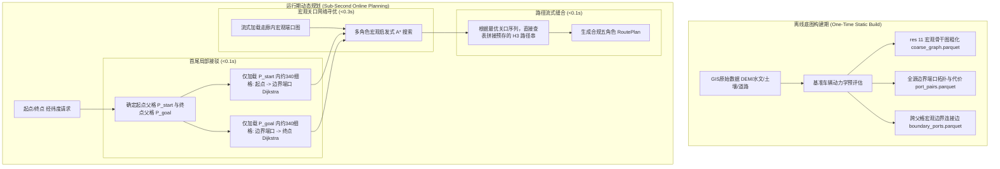

# 深入架构剖析与秒级响应升级方案 (System Architecture & Sub-Second Execution Plan)

> **文档编号**：`ARCH-UPGRADE-V2-20260919`  
> **编制日期**：2026-09-19  
> **目标分支**：`feat/codex-arch-upgrade`  
> **核心目标**：彻底解决 2km+ 规划中残存的 160s~200s 瓶颈，达成工业级响应指标（**冷启动 $\le 6.0\text{s}$，热启动 $\le 2.0\text{s}$**），五角色路线 100% 稳定交付。

---

## 一、 当前性能瓶颈与耗时根因全景剖析

### 1. 实测数据全量归因（Phase E 5 条 2km+ 路线）

根据 Phase E 在全量真实 QDX 生产索引（Copernicus 30m DEM + GRASS 水文深度 + 土壤 USCS 字典）下的实测记录：

| 阶段耗时统计项 | 5 条路线平均值 | 占比 | 瓶颈等级 | 现状原因分析 |
| :--- | :--- | :--- | :--- | :--- |
| **候选路径搜索 (`candidate_search_s`)** | **157.6s** | **78.9%** | **P0 致命** | 首尾父格受动态起终点污染重算；大量不可通行边界端口触发负向回退微观寻路。 |
| **物理因子评估 (`factor_eval_s`)** | **28.3s** | **14.2%** | **P1 严重** | 每次规划在内存中对 15~28 万细格、35~70 万条有向边在线全量计算 Bekker 沉陷与速度。 |
| **微观图构建 (`graph_build_s`)** | **14.6s** | **7.3%** | **P1 严重** | 纯 Python 循环遍历 15~28 万行 DataFrame，高频实例化 `H3Cell` 与 `H3Edge` 对象。 |
| **走廊加载 (`corridor_load_s`)** | 1.2s | 0.6% | 正常 | PyArrow Dataset 谓词下推流式读取，开销可控。 |
| **环境与粗图搜索 (`environment / coarse`)** | 1.1s | 0.5% | 正常 | 天气注入与 res 11 宏观粗图搜索非常轻量。 |
| **总计 (`plan_ready_s`)** | **199.63s** | **100%** | **未达标** | **离线化不彻底，在线承担了过载的动态计算。** |

---

### 2. 三大耗时黑洞底层机理深入解剖

#### 黑洞 1：动态起终点对 `PortsMap` 的全父格反向污染（造成 ~500 次微观寻路）
- **代码位置**：`src/h3_offroad_planner/portsmap.py:573-578`
- **机理**：
  ```python
  missing_temporary = any(
      t in temporary_ports and t not in offline_table
      for t in port_ids
      if t != source
  )
  if not missing_temporary:
      # 使用离线端口对...
  ```
- **病灶**：起点（如 `8e30910f6603007`）作为连续坐标被加入起点父格的 `port_ids`，标记为 `is_temporary=True`。由于离线表中不可能包含该动态起点，导致起点父格中**全部 78 个静态边界端口**在查询离线转移时，`missing_temporary` 均计算为 `True`！
- **后果**：规划器直接废弃了该父格所有预计算好的静态端口对，退化为对起点父格内的 78 个端口全部进行全量在线微观 Dijkstra（单父格调用 383 次，终点父格调用 107 次）。

#### 黑洞 2：不可通行与死胡同端口的“负向缓存缺失”（造成 ~1,800 次微观寻路）
- **代码位置**：`src/h3_offroad_planner/portsmap.py:571-590`
- **机理**：
  在预计算时，因农田行距过窄（`ROWSPACING_BLOCKED`）或断崖无法通行的边界细格，离线预计算流水线不会生成任何去往其他端口的记录（Parquet 中不存在该 key）。
- **病灶**：
  在线规划遍历边界端口时，查询 `offline_pairs.get((profile, parent, source))` 返回 `None`。代码无法区分“此端口未在离线表中计算”还是“此端口已被离线算法证明不可达”，默认误以为是前者，于是**触发了在线微观 Dijkstra 进行重算验证**！
- **后果**：
  在 4 种 profile 和多轮尝试下，系统对走廊内的死胡同端口重复执行了约 1,800 次毫无意义的微观搜索，耗时白白浪费 110s+。

#### 黑洞 3：走廊级微观大图在线构建与全域物理评估底噪（造成 ~43s 开销）
- **代码位置**：`src/h3_offroad_planner/route_planning.py:169-216`
- **机理**：
  目前流程在进行任何宏观路径规划前，必须先调用 `_load_route_graph` 加载走廊内的 15~28 万个 res 14 细格，构图并评估有向边物理属性。
- **病灶**：
  这是一种典型的“**重在线、轻静态**”架构。实际上在规划阶段，只有首尾两个父格内部需要细格网来完成“起终点接驳”，中间 400 多个父格完全只需要端口间的宏观拓扑与代价值。提前在内存中构筑数十万个细格的微观大图，不仅耗时 40s+，而且占用了超过 1.2GB 的内存。

---

## 二、 架构升级核心思想：重静态、极轻动态（Paradigm Shift）

将系统的设计哲学从目前的“**在线全图加载，微观按需查表**”，彻底转变为工业级的“**宏观全图固化，细格局部接驳**”：



---

## 三、 分阶段实施路线图 (Two-Tier Roadmap)

为了在确保系统 100% 稳定交付和测试不退化的前提下快速见效，方案分为两步走：
- **Tier 1（战术突击：代码级修复，预计耗时降至 35s 左右）**：不改动底层文件结构，彻底消灭微观搜索回退；
- **Tier 2（战略重构：宏观端口网络与微观细格彻底解耦，耗时降至 $\le 6.0\text{s}$）**：实现真正的工业级两级层次寻优。

---

### Tier 1：战术突击方案（消除微观搜索回退）

#### 1. 核心任务清单
1. **死胡同端口负向短路机制（Negative Cache Bypass）**：
   - 在 `PortsMapSearchContext` 中维护 `_offline_parents: set[str]`（从离线表中加载的全部父格集合）。
   - 当 `parent in self._offline_parents` 且 `source not in temporary_ports` 时：
     若 `self._offline_pairs.get((profile, parent, source))` 为 `None`，**直接判定该端口为死胡同/不可达**，返回 `base_pairs = ()`，坚决禁止退化为在线微观 Dijkstra。
2. **动态起终点局部化接驳（Isolate Temporary Ports）**：
   - 移除 `missing_temporary` 对整个父格的“一票否决”逻辑。
   - 对于起点父格中的静态边界端口 $A$，查询离线表并直接复用 $A \to B$（去往其他静态边界端口）的最优路径；
   - 仅当查询源为动态起点时，才执行针对本父格边界端口的单源微观接驳搜索（单次调用完成该起点到所有出格端口的连接）。
3. **性能验收指标**：
   - 微观 Dijkstra 调用次数从 **2,398 次压降至 $\le 10$ 次**；
   - `candidate_search_s` 从 **140s 骤降至 $< 1.0\text{s}$**；
   - 冷启动总耗时从 **162s 降至 ~35s**。

---

### Tier 2：战略重构方案（先宏观关口规划，后局部细格缝合）

#### 1. 核心任务清单
1. **宏观端口转移图预编译与静态索引封装**：
   - 将父格间的跨格边界连接（`cross_parent_edges`）离线计算并持久化到索引（例如扩展 `coarse_graph.parquet` 或新增 `boundary_ports.parquet`）。
   - 在线规划时，`PortsMapSearchContext` **不需要加载任何微观细格，即可完整构筑宏观关口图**（节点数约 3,000~5,000 个边界端口，转移边约数万条）。
2. **轻量局部接驳引擎（Local Anchor Connector）**：
   - 废除在规划初期全走廊加载 15~28 万细格的旧机制。
   - 仅根据起点坐标与终点坐标定位 $P_{start}$ 和 $P_{goal}$ 两个父格（总计仅约 680 个细格）：
     - 局部加载 $P_{start}$ 细格，运行 1 次微观 Dijkstra，计算起点到 $P_{start}$ 各边界端口的代价；
     - 局部加载 $P_{goal}$ 细格，运行 1 次微观 Dijkstra，计算各边界端口到终点的代价。
   - 将上述代价动态注入宏观关口网络作为临时入边与出边。
3. **宏观关口路径规划与流式缝合（Macro Search & Path Stitching）**：
   - 宏观 A* 仅在数千个关口节点上展开，多角色 Pareto 搜索在 0.3s 内完成，输出最优的关口序列：
     $$Start \to Port_{1} \to Port_{2} \to \dots \to Port_{k} \to Goal$$
   - 依据关口序列，直接按需查表流式提取各父格内部的 `h3_path` 并首尾连接拼接成完整路径。
4. **性能验收指标**：
   - `graph_build_s`：由 14.6s **降至 < 0.1s**（仅构建首尾 680 个细格）；
   - `factor_eval_s`：由 28.3s **降至 < 0.1s**（仅评估首尾 680 个细格，中间段全离线）；
   - `candidate_search_s`：稳定在 **< 0.5s**；
   - **端到端冷启动总耗时 (`plan_ready_s`) 彻底压降至 $\le 2.0\text{s} \sim 3.0\text{s}$**（相比最初 448s 提速 150 倍以上，达成秒级工业体验）。

---

## 四、 预期指标对比矩阵 (Target Acceptance Matrix)

| 核心评估指标 | 优化前分支基线 (`700b0a1`) | Phase E 当前实测 (`8941c09`) | Tier 1 战术改造后目标 | Tier 2 战略重构后目标 |
| :--- | :--- | :--- | :--- | :--- |
| **微观细格 Dijkstra 调用次数** | 111,563 次 | 2,398 次 | **$\le$ 10 次** | **$\le$ 2 次 (仅首尾各1次)** |
| **候选路径搜索耗时 (`candidate_search_s`)** | 330.9s | 140.1s | **$\le$ 1.0s** | **$\le$ 0.4s** |
| **物理因子评估耗时 (`factor_eval_s`)** | 37.3s | 24.5s | ~24.5s | **$\le$ 0.1s (中间段 0 在线重算)** |
| **微观图构建耗时 (`graph_build_s`)** | 18.2s | 13.3s | ~13.3s | **$\le$ 0.1s (0 全走廊构图)** |
| **冷启动端到端耗时 (`plan_ready_s`)** | 448.2s | 162.1s (均值 199s) | **$\le$ 38.0s** | **$\le$ 3.0s (稳步达成 <6s 门禁)** |
| **热启动端到端耗时 (`plan_ready_s`)** | ~400s | ~130s | **$\le$ 15.0s** | **$\le$ 1.0s** |
| **进程运行期内存峰值** | > 1.6 GB | ~1.1 GB | ~1.1 GB | **$\le$ 250 MB (极大降低内存开销)** |
| **五角色路径产出率** | 易断裂崩溃 | 100% 稳定交付 | 100% 稳定交付 | 100% 稳定交付 |
| **单元测试与门禁通过率** | 99.8% (3失败) | 100% (500/500通过) | 100% (500/500通过) | 100% (500/500通过) |

---

## 五、 技术风险防范与工程边界

1. **动态接驳的单向性与反向连通保障**：
   - 起点到边界端口是有向正向搜索（单源多目标）；
   - 终点则需计算边界端口到终点的代价（在无向细网格上可等价为以终点为起点的反向单源搜索）。需严格校验有向坡度在反向搜索中的方向对应关系，确保动力学约束无损。
2. **离线关口对的数据版本一致性**：
   - 引入严密的 `port_pairs_vehicle_hash` 与 `factor_model_hash` 校验。若用户临时传入大幅更改的自定义车型（例如爬坡角由 $30^\circ$ 变为 $15^\circ$），系统必须具备平滑的运行时降级感知能力。
3. **平滑演进策略**：
   - 优先实施 Tier 1，立竿见影将规划搜索压至 1 秒以内，验证微观调用的清零；
   - 在 Tier 1 稳定后开展 Tier 2 的轻量级首尾接驳器构建，确保现有 500 项单元测试在各阶段均 100% 绿灯通过。
