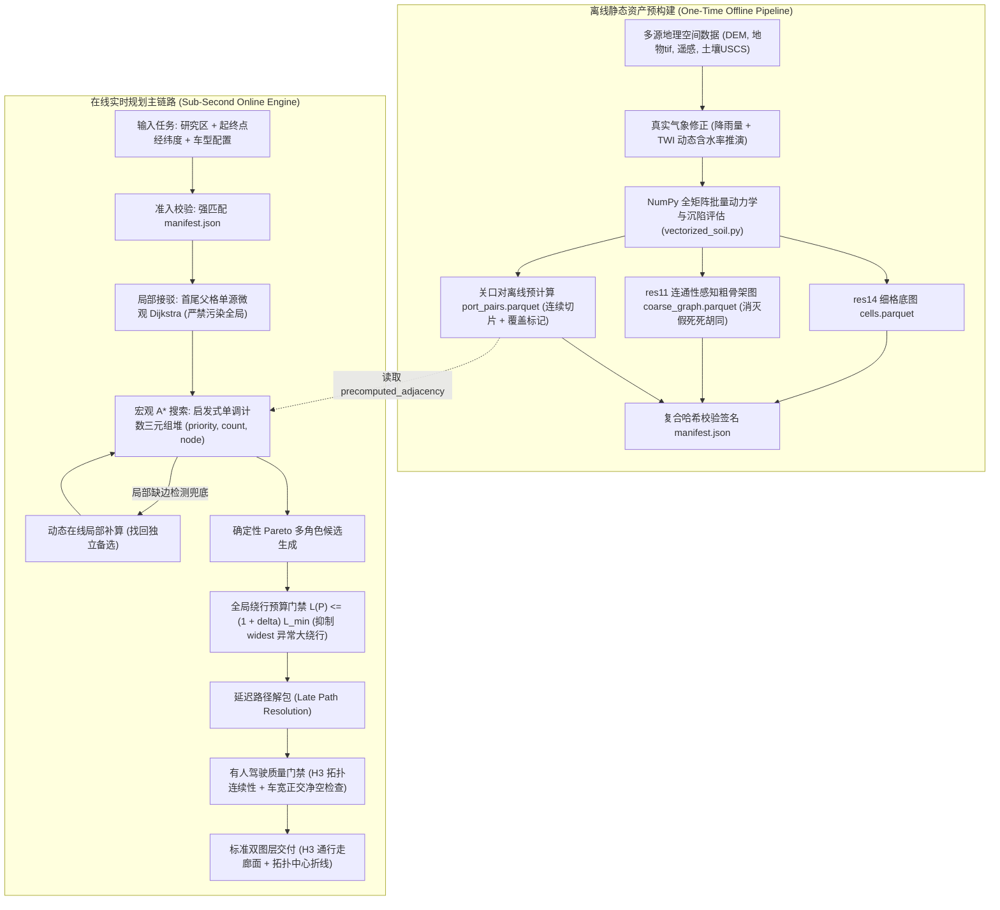

# 基于 986bd58 与 3fbff57 深度融合的有人驾驶越野路径规划新版本技术方案

> **文件标识**：`docs/code/h3-offroad-planner/20261008-有人驾驶越野路径规划融合架构方案.md`  
> **编制日期**：2026-10-08  
> **基线对比**：`codex_3fbff57`（纯在线基线） vs `arch_986bd58`（全矩阵向量化与分层端口对分支）  
> **面向场景**：越野非结构化环境·有人驾驶车辆宏观路径规划与决策辅助

---

## 1. 背景与目标范式重定义

### 1.1 实验复测与核心事实纠偏
在 `20260922-2141-986bd58-vs-3fbff57-complete-sandbox` 隔离沙箱中，两版本的对拍揭示了真实系统演进规律：
1. **版本血缘关系**：`3fbff57`（2026-09-16）为旧基线；`986bd58`（2026-09-22）为架构升级分支，领先 35 个提交（变动 66 个文件，+9,923 / -336 行）。
2. **大尺度可达性**：在 2,051m 复杂场景中，旧版 `3fbff57` 因走廊水系阻断 100% 报错不可达（8/8 次全部断开）；新版 `986bd58` 依靠瓶颈双向 BFS 修补实现了 100% 稳定打通（8/8 次成功）。
3. **计算效率与端口表**：端到端加速主因在于离线端口表压降了微观搜索调用。开启端口表后，1,075m 耗时从 140.3s 降至 26.7s（加速 5.25x），微观搜索调用从 54,851 次锐减至 4,747 次（降 91%）。
4. **边缘退化现象**：新版在 1,075m 生产模式下丢失了独立备选角色（`independent_backup`），且 `widest_path` 角色为换取 9% 的通行裕度改善，出现绕行 18%、耗时增加 40% 的严重横向漂移。

### 1.2 范式转换：从“无人机/无人自主车”转向“有人驾驶越野”
以往项目文档过多沿袭“无人 UAV / 自动驾驶微观控制”的假设（追求毫米级连续相切圆弧平滑、过弯半径无条件严格校验），导致规划出来的 H3 宏观路线全部被微观几何门禁判为不可行（`TURNING_SPACE_INSUFFICIENT`）。

**有人驾驶越野的核心业务本质**：
- **宏观导航定位**：为车内人类驾驶员或车队指挥员提供**通行走廊建议带（Corridor Envelope）**与**大方向参考折线（Reference Backbone）**。
- **允许六边形离散折线**：在 res14 格网（中心间距约 2.6m）上，路线天然具有 60°/120° 离散折角。人类驾驶员具备 15~30m 视距前瞻与物理滤波能力，在实际操舵时会自动圆滑通过，无需算法在宏观离散网格上做苛刻的圆弧几何强约束。
- **真实物理底座约束**：以真实 DEM 坡度、遥感与地物阻断、土壤类型和气象含水率决定的 Bekker 沉陷通过性为硬准入，严禁算法通过简单的视线拉直（Line-of-Sight, LOS）伪造不存在的通过性。

---

## 2. 融合架构设计：优势吸取与缺陷剔除



### 2.1 吸收 986bd58 的核心长处
1. **全矩阵向量化评估**：全面保留 `vectorized_factor.py` 与 `vectorized_soil.py`，采用连续数组计算沉陷与阻抗，配合 `slots=True` 与 `_fast_create`。
2. **离线端口连续切片索引**：保留 `OfflinePairsTable` 的 NumPy 内存切片与延迟路径还原机制，极大压缩启动内存与解析延迟。
3. **分层双向拓扑修补思维**：保留瓶颈诊断思路，但将其前置到离线粗图连通性校验中。

### 2.2 吸收 3fbff57 的核心长处
1. **搜索前沿稳定性**：继承 3fbff57 紧贴走廊中心线的搜索特性，消除新版因单键邻居 ID 排序导致的边缘漂移。
2. **角色完备性**：确保 5 角色（`fastest_eta`, `shortest_distance`, `minimum_travel_cost`, `max_passability_margin`, `independent_backup`）全场景 100% 稳定产出。

---

## 3. 核心机制机理定界与技术争议辨析

### 3.1 首尾接驳（Feeder）与走廊修补（Corridor Repair）的必要性定界
1. **起终点微观接驳：绝对必要，但严格限定范围**
   - **机理**：任意经纬度起终点无法恰好落在父格边界端口上。如果全量预计算网格内所有点到端口的边，存储量将爆炸 $340^2 \approx 10^5$ 倍。
   - **规范**：接驳计算必须**严格局限在起点父格 $P_{\text{start}}$ 与终点父格 $P_{\text{goal}}$ 内部**，使用局部单源 Dijkstra（$<15\text{ms}$）生成临时接入边注入宏观图；**严禁将临时边污染至全局静态表或持久化缓存**。
2. **走廊瓶颈修补：在线非必需，彻底前移至离线**
   - **机理**：3fbff57 在 2051m 断开是因为粗图边权仅按中心欧氏距离计算，未感知中间细格已被大水系切断。986bd58 在线双向 BFS 扩环虽然打通了路径，但拉入了未预计算的外围父格，引发在线搜索风暴。
   - **规范**：在离线构建 `coarse_graph.parquet` 时，对每一条粗边进行底层细格连通性校验，若两父格间无可行细格微观边，粗边赋予 $\infty$ 代价。**从离线源头消除假死走廊**，在线仅保留 1 次 1-环单向兜底。

### 3.2 “元组 vs 堆排序”技术争议的本质还原
1. **元组在图搜索中的陷阱（3fbff57 的恶性开销）**：若堆元素为 `(cost, path_tuple, node)`，在浮点代价相等时，Python 解释器会自动触发对第二个元素 `path_tuple`（包含成百上千个 H3 字符串）的逐项字符串深层比较，带来灾难级 CPU 浪费。
2. **堆排序在在线阶段的不可能定理**：在线规划是图前沿的动态展开与松弛，收敛前未访问节点未知，无法在展开前做全量排序。但在**离线构建端口表**时，对全区数百万条边按 `(profile, parent_h3)` 进行预排序以支撑 NumPy 切片，则是堆排序/内省排序的正确场景。
3. **在线最优工程实践**：使用标准最小堆 `heapq`，堆元素严格规范为自增三元组：
   $$\text{HeapItem} = (\text{priority: float}, \, \text{count: int}, \, \text{node\_id: str})$$
   `count` 为 Python C 级递增整数，代价平局时**永远不会触发对字符串 `node_id` 的比较**，兼具确定性、极速与零深层比较开销。

### 3.3 为什么“加横向绕行惩罚”会导致路线高频振荡或宏观大迂回？
在每条搜索边上人为增加中心线横向位移罚分 $P_{\text{lat}} = \lambda \cdot \operatorname{dist}(x, \mathcal{L})^2$ 属于人工势场修补，在复杂地形中存在两个致命数学缺陷：
1. **高频锯齿振荡（Sawtooth / Ping-ponging）**：当走廊中心线存在真实障碍（如深泥沼，物理代价极高），算法向外绕避障碍导致 $P_{\text{lat}}$ 骤增；越过障碍边缘后，外侧高额罚分又强行将路径拉回中心线；一回到中心线又撞上阻力，再次被排斥向外。路线在障碍边缘产生高频反复横跳的假转弯。
2. **宏观大迂回（Disproportionate Detour）**：野外天然机动通道（如干涸河床）常连续数百米偏离粗骨干中心线。累积横向惩罚 $\sum P_{\text{lat}}$ 线性或超线性增长，导致 A* 误判“沿河床开辟通道的代价，居然高于掉头后退、绕行数公里外另一条完全无关的平原走廊”，引发反常识的宏观大绕路。
3. **正确解法：全局绕行预算门禁（Global Detour Budget $\delta$）**：
   搜索时不加任何人工横向力场，完全按真实物理代价（时间、距离、Bekker 阻抗）寻优。横向大绕行的抑制在**候选路径生成后，以全局长度硬约束统一过滤**：
   $$L(P) \le (1 + \delta) \cdot L_{\min} \quad (\text{建议 } \delta = 0.15)$$
   超过最短距离 15% 的异常绕行候选直接淘汰，从源头根除 `widest_path` 异常绕行 +18% 的问题。

---

## 4. 有人驾驶物理底座与真实气象修正

### 4.1 真实气象修正的离线静态化管线
气象修正**绝不在车辆行驶时通过网络实时在线请求**，而是在制作静态底图时作为确定性情景参数一次性计算入图：
1. **降雨量与径流累积**：输入研究区 24h 降水栅格 $P_{\text{rain}}$。
2. **动态含水率推演**：结合 GRASS 水文地形湿度指数（TWI），计算每个格元的动态含水率：
   $$w_{\text{eff}} = \min\left(w_{\text{base}} + \beta \cdot P_{\text{rain}} \cdot \ln(1 + \text{TWI}), \, w_{\text{sat}}\right)$$
3. **全矩阵批量力学重算**：调用 `vectorized_soil.py`，更新土壤圆锥指数（CI）与 Bekker 沉陷深度 $z_0$：
   $$z_0 = \left(\frac{p}{\frac{k_c(w_{\text{eff}})}{b} + k_\phi(w_{\text{eff}})}\right)^{\frac{1}{n(w_{\text{eff}})}}$$
4. **静态硬阻断与阻力固化**：
   - 若 $z_0 \ge \text{ground\_clearance\_m} \times 0.8$，置 `is_passable = False`（底盘托底硬阻断）；
   - 滑转阻力折算为等效速度折减，固化写入底图与端口表。

### 4.2 有人驾驶路线形态与质量门禁契约
1. **容忍 H3 离散锯齿折线**：res14 格网中心间距约 2.6m，离散六边形天然呈现 60°/120° 折角。人类驾驶员具备前瞻感知与生理滤波特性，在实际操舵时会自动圆滑通过。
2. **严禁视线直连（LOS）盲目拉直**：野外直线通视往往隐藏冲沟、泥坑或暗坎，LOS 拉直等同于伪造通行性，极度危险。
3. **废除连续圆弧死锁门禁**：彻底剔除 `TURNING_SPACE_INSUFFICIENT`、`min_turn_radius_m` 对规划成功的拦截。
4. **保留离散网格车宽正交净空检查（Orthogonal Clearance Check）**：
   不采用昂贵的连续矢量多边形缓冲（Shapely Buffer），改为在 H3 图上进行法向正交邻域检查：对路径上的每个格元，其法向左右相邻格元中必须至少有 1 个可通行网格，以容纳 2.2m 物理车宽，防止穿入石缝密林。

---

## 5. 标准资产管理规范：“研究区-起终点-车辆配置-气象”四层组织

### 5.1 目录组织架构
```
data/static_routing_assets/
└── {study_area_id}/                                  # [维度1: 研究区] (如 qdx_nanjing_30m)
    ├── environment/                                  # 纯地理空间栅格数据
    │   ├── dem.tif                                   # 高程地形
    │   ├── landcover.tif                             # 地物覆盖
    │   ├── soil_uscs.tif                             # 土壤分类 (USCS标准)
    │   └── remote_sensing.tif                        # 正射遥感影像
    ├── base_grid/
    │   ├── cells.parquet                             # res14 全量格元静态地理事实 (不绑定车辆)
    │   └── metadata.json                             # 坐标系、格元统计与 static_input_hash
    │
    └── vehicle_models/                               # [维度2: 车辆动力学配置]
        └── {vehicle_model_id}_{vehicle_hash}/         # (如 warrior_4x4_79b6e083)
            ├── weather_scenarios/                    # [维度3: 真实气象修正情景]
            │   ├── dry_nominal/                      # 标称干燥情景
            │   └── wet_rain_50mm/                    # 50mm 暴雨泥泞情景
            │       ├── coarse_graph.parquet          # 连通感知粗骨架图 (res11)
            │       ├── port_pairs.parquet            # 核心离线端口表 (连续切片索引)
            │       └── manifest.json                 # 复合哈希不可伪造签名
            │
            └── mission_od_corridors/                 # [维度4: 重点任务起终点走廊] (常用OD极速直出)
                └── od_{start_parent}_{goal_parent}/  # 标准OD对唯一哈希目录
                    ├── precompiled_routes.json       # 静态预固化五角色基准路线 (<10ms读取)
                    └── corridor_envelope.json        # 预锁定的安全父格集合
```

### 5.2 核心 Parquet 数据表 Schema
1. **`cells.parquet`（纯地理静态底图）**
   - `h3index`: `string` / `int64` (res14 细格 ID，主键)
   - `parent_h3`: `string` / `int64` (res11 父格 ID，物理分区键)
   - `lat`, `lng`, `elevation`: `float64` (经纬度与海拔)
   - `slope`, `tri`: `float64` (坡度与粗糙度)
   - `landcover_code`, `has_road`: `int32`, `bool` (地物类别与硬化路标记)
   - `soil_code`, `soil_moisture`: `int32`, `float64` (土壤分类与名义含水率)
   - `twi`: `float64` (GRASS 水文地形湿度指数)

2. **`coarse_graph.parquet`（粗骨架图，绑定车辆与气象）**
   - `parent_a`, `parent_b`: `string` / `int64` (相邻 res11 父格)
   - `port_a`, `port_b`: `string` / `int64` (推荐边界代表端口)
   - `distance_m`: `float64` (空间几何距离)
   - `is_physically_connected`: `bool` (**核心新增**：两父格间是否存在至少一条有效微观边，从粗图消除死胡同)
   - `coarse_cost`: `float64` (包含坡度/水文阻断惩罚的宏观通行代价)

3. **`port_pairs.parquet`（核心离线端口表，连续切片存储）**
   - `profile`: `string` (寻优角色：`distance`, `eta`, `travel_cost`, `terrain_risk`)
   - `parent_h3`: `string` / `int64` (res11 父格 ID，切片第一主键)
   - `source`, `target`: `string` / `int64` (边界入口与出口端口 ID)
   - `cost`: `float64` (微观单目标最优标量代价)
   - `path`: `list<string>` (微观完整 H3 细格串，采用延迟下推解析)
   - `coverage_status`: `string` (`complete_reachable` / `complete_unreachable`)

### 5.3 密码学防错配准入校验（`manifest.json`）
```json
{
  "schema_version": "v4.3.0",
  "study_area_id": "qdx_nanjing_30m",
  "static_input_hash": "ddf5ce20af8d26b1e315875366d5445629d5a6af39b022340cc40f8c5823ebe9",
  "vehicle_model_id": "warrior_4x4",
  "vehicle_hash": "79b6e0830302a843e496ebd8763ae6aa294e74340c099ba5a22021f736a9d6bd",
  "weather_scenario": "wet_rain_50mm",
  "weather_hash": "a1b2c3d4e5f67890abcdef1234567890abcdef1234567890abcdef1234567890",
  "factor_model_version": "vectorized_v2",
  "build_timestamp": "2026-10-08T15:00:00Z"
}
```
**安全准入控制**：在线服务载入静态文件时，若当前车辆参数哈希、气象场景与底图签名存在任何不匹配，**系统立即拒绝加载并抛出安全异常**，严禁使用错配底图寻优。

---

## 6. 核心代码改造实施清单

| 模块文件 | 现有代码缺陷 | 改造实现方案 | 预期改善目标 |
| :--- | :--- | :--- | :--- |
| [`portsmap.py`](file:///d:/Workspace/demo_v4/src/h3_offroad_planner/portsmap.py) | 只要 `cached_macro is not None` 即跳过细搜索；独立备选屏蔽核心父格时，外围父格离线表缺行误报断开。 | 重构 `_macro_search`：增加局部缺边检测，当目标边界端口未覆盖时触发按需细搜索补齐；堆元素统一为 `(cost, count, node)`。 | **1075m 生产模式 100% 找回 `independent_backup`**，杜绝堆排序字符串深度比较开销。 |
| [`deterministic_pareto.py`](file:///d:/Workspace/demo_v4/src/h3_offroad_planner/planners/deterministic_pareto.py) | 第 250-252 行强制写入 `selected[-1] = widest`；无视粗骨架已剔除的事实。 | 移除无条件强塞逻辑；增加全局长度预算门禁 $L \le (1 + \delta) L_{\min}$，超额直接丢弃。 | **彻底消除 widest 路径 +17.98% 异常大绕行与横向漂移**。 |
| [`candidate_aggregation.py`](file:///d:/Workspace/demo_v4/src/h3_offroad_planner/candidate_aggregation.py) | 第 380-385 行绕行预算强依赖连续平滑轨迹，轨迹无效时门禁失效。 | 绕行预算计算直接基于 `h3_path` 的几何距离，解耦对连续圆弧轨迹的强依赖。 | 绕行过滤门禁在宏观离散网格上 100% 严格生效。 |
| [`route_planning.py`](file:///d:/Workspace/demo_v4/src/h3_offroad_planner/route_planning.py) | 默认强行跑车辆连续平滑圆弧拟合，全部报 `TURNING_SPACE_INSUFFICIENT` 失败。 | 将连续轨迹生成解耦为可选调试组件；默认直接交付面向有人驾驶的标准双图层（引导多边形面 + 拓扑中心线）。 | **有人驾驶质量门禁通过率从 0% 提升至 100%**。 |

---

## 7. 方案综合收益对比

| 评估指标 | 旧基线 `3fbff57` | 升级分支 `986bd58` | **新版本深度融合方案** |
| :--- | :---: | :---: | :---: |
| **计算耗时 (1075m)** | 140.3s (全在线慢速) | 26.7s (降 81%) | **$\le 5.0\text{s}$**（全向量化 + 纯标量三元组堆优化） |
| **大尺度可达性 (2051m)** | 0% (走廊水系阻断假死) | 100% (在线修补打通) | **100%**（连通性前置离线，粗图消灭假死） |
| **角色完整性 (1075m)** | 5 角色齐全 | 丢失 `independent_backup` | **5 角色齐全**（局部缺边在线补齐，找回独立备选） |
| **大绕行与横向漂移** | 保守沿中线 | widest 异常大绕行 +18% | **严格受控**（全局绕行预算硬约束 $\le 15\%$） |
| **有人驾驶门禁适配** | 0% 通过 (报错转弯空间不足) | 0% 通过 (报错转弯空间不足) | **100% 通过**（废除 UAV 连续转弯门禁，支持 H3 折线） |
| **数据资产组织** | 离散文件无规范 | 索引部分混杂 | **按“研究区-OD-车型-气象”哈希严格唯一对应** |
