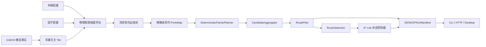
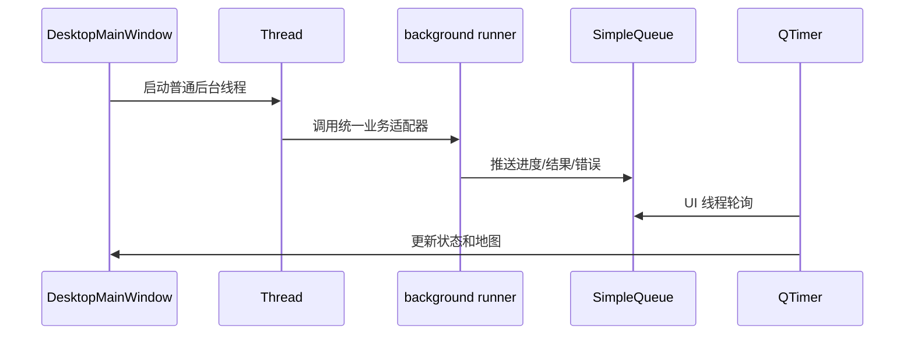

# 当前单车 RoutePlan 闭环架构

> 状态：当前活动基线，2026-07-27。本文只描述本地源码的现行生产链；历史 MVP
> 分解不再构成架构约束。若与其他文档冲突，以
> [closed-loop-contract.md](closed-loop-contract.md) 为准。

## 1. 生产数据流

核心依赖从静态事实流向适配器，生产路径不存在反向依赖或循环导入。GUI、HTTP 和 CLI
不得重新实现规划、选择或阻塞生命周期规则。

## 2. 模块边界

| 模块 | 当前职责 | 明确禁止 |
|---|---|---|
| `tiling` / `grid` | GIS 采样、H3 静态事实、邻接、边长、父格和质量统计 | 加载车辆、生成通行评分或执行搜索 |
| `factor_model` | 严格配置、硬约束、物理裕度、速度区间及有向边指标冻结 | 搜索中重复读取 YAML；写回基础图 |
| `portsmap` | 为本次请求精确计算 Port-pair 和展开细格路径 | 磁盘缓存、近似走廊或静默资源回退 |
| `planners.deterministic_pareto` | 四个可加目标、widest 锚点、非支配和拥挤选择 | 种群、交叉、变异或代际演化 |
| `candidate_aggregation` | 精确去重、角色合并、扰动存活和独立备选 | 把数据可靠性当作路线角色 |
| `route_models` | RoutePlan、RouteSelection、BlockageRecord 和 ReplanResult 强合同 | UI 状态或文件 I/O |
| `route_persistence` | 原子 JSON、GPKG、manifest、选择和活动路线成果 | 隐式激活候选或猜测损坏状态 |
| `replanning` | 阻塞生命周期、只读 overlay、D* Lite、全局回退和安全保持 | 向低层传递时间戳字典或修改基础 Tile |
| `coordination` | FleetCoordinator Protocol 和基础值对象 | 多车冲突求解业务 |
| `cli` / `web_console` | 参数解码、协议适配和统一业务调用 | 复制规划规则 |
| `desktop_project` | 唯一桌面项目状态、输入构造和地图选择状态 | 持有第二套业务控制器 |
| `desktop_client` | 窗口、普通后台线程、SimpleQueue、QTimer 和 UI 更新 | 在生产调度中使用 Legacy Worker |
| `map_config` | 私有 YAML/环境变量发现、严格 token 和图层校验 | 源码默认凭据 |

## 3. 运行时边界

### 3.1 规划

Tile 在构建后视为只读。每次路由请求加载车辆和因子配置，产生一次性
`FactorEvaluation`；后续 PortsMap、候选搜索、聚合和重规划只读取其中冻结的有向边指标。

### 3.2 持久状态

`RoutePlan` 只描述候选，不代表激活。`select_route` 显式生成版本化
`RouteSelection`。`replan_route` 读取当前选择、显式当前位置和阻塞观测，更新活动路线与
重规划历史。JSON 写入采用同目录临时文件与原子替换；GPKG 使用临时副本后替换。

### 3.3 桌面后台链

Legacy Qt compatibility shim 仅用于旧调用方和回归测试，不属于生产线程调度层。

## 4. 兼容性边界

- `TrafficabilityAssessor` 是包级可导入的 standalone legacy evaluator，不参与
  RoutePlan 生产链。
- Legacy/NSGA-II 候选规划兼容层已删除；`PlannerFactory` 对旧名称明确抛出
  `ConfigError`。新生产链只允许
  `FactorEvaluation -> PortsMapSearchContext -> DeterministicParetoPlanner ->
  CandidateAggregator -> RoutePlan`。
- RoutePlan v1 与 GIS 成果可以继续输出旧评分字段别名，但内部领域模型只使用
  `safety_margin` 语义。
- Web 控制台是本地调试/备选入口；桌面客户端是主要交互入口，二者共享相同业务函数。

## 5. 资源与故障策略

- PortsMap、候选数量、搜索展开和重规划回退均有显式上限；超限必须返回具体错误码。
- 缺失地类或土壤降低置信度并使用保守速度区间；已知硬约束超限直接阻断。
- 无 token 时在线底图不可用，但本地 H3、候选和活动路线功能保持可用。
- 局部重规划失败时执行有界全局回退；超出回退频率进入 `safe_hold`，证明无路时进入
  `invalidated`。
