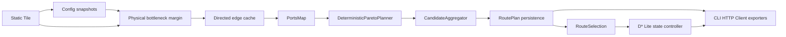

# 单车工程闭环实施合同

状态：已冻结，取代旧 MVP-5/6/7/8 中与候选角色、PBS、Tile 评分及选择流程冲突的条款。

## 1. 需求与边界

本闭环的数据流固定为：车辆无关 Tile → 路由时物理证据评估 → 无权重瓶颈裕度 →
冻结有向边指标 → 精确内存 PortsMap → `DeterministicParetoPlanner` →
`CandidateAggregator` → `RoutePlan` → 显式 `RouteSelection` → D* Lite 状态流 →
GPKG/GeoJSON/JSON。

实现真正遗传式 NSGA-II、PBS 多车业务、大规模并行 Tile、磁盘 PortsMap、实时交通、
`.lyrx` 和 `index.html` 自动化均不在本期范围。`NSGAII` 名称、输入别名、配置、Demo、
Legacy 适配器和专项测试全部删除；任何旧规划器名称均明确触发 `ConfigError`。任何新输出
均写 `DeterministicParetoPlanner`，新生产链是唯一候选规划入口。

## 2. 公共合同

### 2.1 配置和评估

- `load_factor_model(path) -> FactorModelConfig`：路径必须存在且为 YAML。schema v2 对未知
  章节和字段严格返回 `ConfigError`；schema v1 只读取仍生效参数，其余章节发出通用
  “未使用配置”警告。新快照只写 schema v2 生效参数。
- `evaluate_factor_model(graph, vehicle, config) -> FactorEvaluation`：图和车辆非空；坡度单位
  degree、锥指 kPa、沉陷 m、推力 N、速度 m/s。静态阻塞、水体、坡度、已知锥指和沉陷
  先执行硬约束；缺失地类或土壤不阻断，采用保守速度区间、降低 confidence 并产生原因码。
  评估只返回新对象，不修改静态图。
- `build_directed_edge_cache(...)`：每条可通行邻接生成两个方向；距离 m、ETA s、风险
  `distance * -ln(max(safety_margin, epsilon))`、综合行驶代价 cost unit。边裕度是已知节点
  裕度、方向坡度裕度和上坡重力分量推力裕度的无权重最小值；已知约束超限时不生成该方向边。
  速度下界为零时 ETA 上界为 `null` 且
  `eta_upper_bounded=false`。
- `evaluate_path_metrics(path, cache)`：路径必须连续且所有方向边存在；逐边精确累加，失败
  返回 `PlanningInputError`，不做展示层估算。
- 内部领域字段统一使用 `safety_margin`、`safety_margin_lower/nominal/upper` 和
  `safety_margin_min/mean`。RoutePlan v1、JSON、GeoJSON 和 GPKG 仅在序列化边界继续写
  `trafficability`、`score_lower/nominal/upper`、`score_lower_min` 和
  `score_nominal_mean` 兼容字段。

### 2.2 搜索、候选和角色

- `PortsMapSearchContext.search(start, goal, profile, blocked)`：端点必须存在，候选边权有限
  非负；每个跨父格端点为 Port，同父格全部 Port-pair 使用本轮指定权重精确最短路；宏路径
  必须展开为连续细格序列。超过配置资源上限返回 `PORTS_MAP_LIMIT_EXCEEDED`，不得近似回退。
- `DeterministicParetoPlanner.plan(...)`：`max_paths` 为 1..5，`candidate_limit` 为 1..24 且
  不小于 `max_paths`，`penalty_factor` 为有限非负数；四个可加目标为
  distance/eta/terrain_risk/travel_cost，另加 widest-path 锚点；输出唯一、确定且使用原始单位。
- `CandidateAggregator.aggregate(...)`：输入 1..24 条；精确去重、五维 Pareto、走廊聚类、
  四指标角色和扰动存活验证。输出 1..5 条唯一候选，同一路线允许多角色；无存活备选则不创建
  `independent_backup`。

角色固定为 `fastest_eta`、`shortest_distance`、`max_passability_margin`、
`minimum_travel_cost`、`independent_backup`。任务映射固定为 fastest/shortest/passability/
economy/resilient；resilient 无独立备选时回退最快路线并写
`INDEPENDENT_BACKUP_UNAVAILABLE`。

### 2.3 持久状态

- `write_route_plan` 使用同目录临时文件和原子替换；相同规范输入产生相同 `plan_id`、候选 ID、
  哈希和排序。
- `select_route` 只能按候选 ID 或其角色选择；重复相同选择幂等，冲突版本拒绝；首次规划不自动
  生成选择。
- `replan_route` 必须收到 `current_h3` 或可按最大距离吸附的经纬度。基础图和因子缓存只读，
  阻塞以 overlay 应用；局部失败按原任务偏好全局回退，窗口超限进入 `safe_hold`，无路进入
  `invalidated`。
- `BlockageRecord` 的确认、解除、过期和 TTL 只属于 `replanning` 控制层。低层
  `PlannerInput`、`LocalReplanner`、D* Lite 和全局回退只接收已解析的
  `blocked_cells: set[str]`，不接收时间戳字典。

阻塞状态仅允许：`tentative -> confirmed -> cleared|expired`。路线状态仅允许：
`active -> safe_hold|superseded|invalidated`。任何原子写失败保留旧文件；损坏状态文件隔离并
返回明确错误，不猜测游标或选择。

## 3. 依赖 DAG 与批次



核心 DAG 无循环。批次依次为：静态事实与因子缓存、PortsMap、候选聚合、RoutePlan/选择、
D* 状态控制器、Client/Web、工程验收。

## 4. 规格测试追踪

| 编号 | 合同 | Oracle |
|---|---|---|
| CL-001..008 | 物理硬约束、瓶颈裕度、推力、方向 ETA/风险/travel cost | 逐项手算 |
| CL-009..011 | 配置 v1 兼容、v2 严格校验、快照与模型哈希 | YAML 往返/哈希比较 |
| CL-012..015 | PortsMap 方向权重、展开连续性、缓存键、资源上限 | 全图 Dijkstra |
| CL-016..021 | 四目标、widest、去重、多角色、扰动存活、无备选 | 构造小图 |
| CL-022..027 | 稳定 ID、原子写、幂等选择、损坏隔离、GPKG 图层 | 文件往返读取 |
| CL-028..035 | 显式位置、阻塞确认/解除/TTL、重启、回退、safe_hold | 状态转移表 |
| CL-036..040 | CLI、HTTP、Client 离屏、双车辆 Tile 复用、确定性 | 端到端验收 |

## 5. Gate 1 证据

Gate-1 的唯一活动计分表见 [gate1-design-score.md](gate1-design-score.md)。分母为
[spec.md](spec.md) 的 FR-001～FR-012 共 12 项：

```text
C_func = 12/12 = 1.00
C_detail = 12/12 = 1.00
C_decouple = 1.00
S_design = 0.4×1.00 + 0.3×1.00 + 0.3×1.00 = 1.00
```

写操作均有幂等或原子恢复；端点、数量、物理量均有真实边界；异常恢复路径可执行；
PortsMap 与因子算法具有独立 Oracle；覆盖率不得替代算法正确性。

## 6. 在线底图私有配置

Client/Web 默认在无 token 状态下启动，本地 H3、候选和活动路线仍可显示。开发工作区会
自动发现被 Git 忽略的 `configs/map.private.yaml`；安装部署可通过
`H3_OFFROAD_MAP_CONFIG` 指向外部私有 YAML，非空
`H3_OFFROAD_TIANDITU_TOKEN` 拥有最高优先级，`H3_OFFROAD_MAP_LAYER` 可覆盖图层。
示例见 `configs/map.private.example.yaml`。token 不进入受跟踪源码、项目 YAML、
RoutePlan、manifest 或公开成果。

## 7. 静态 GIS 土壤—机动迁移扩展

- `preprocess-hydrology` 只接受米制投影 DEM，并通过单一 GRASS `r.watershed` 后端生成
  accumulation、drainage direction、TWI、有效性和边界影响缓存。`mapping_t0/t1` 必须成对
  冻结；缺失时不生成 D，只保留诊断结果。
- 分类土壤目录不再隐式推断 USCS、Bekker 类型或默认体积含水率。Tile 额外保存土壤来源、
  支持尺度、TWI、D、有效性、边界影响、地表响应 U 及证据来源。
- 启用 `static_planning_path` 后，水体在没有显式涉水模型时一律硬阻断；`rowspacing` 不作为
  树木净空。环境等效距离 `J = sum(length * M)` 与 `travel_cost` 分离，未知 U/D 采用配置
  上界进入稳健比较。
- 连续轨迹以 `rear_axle_center` 为参考，由直线和相切圆弧组成；对车辆完整矩形包络做连续
  扫掠碰撞与地图边界检查。车辆尺寸不完整时状态必须是 `not_evaluated`。
- 决策先在几何有效候选池取 `L_ref`，再保留 `L <= (1 + detour_ratio) * L_ref`，按目标净空、
  请求压力场景最坏 J、长度、稳定 ID 排序。旧路线有效且相对改进不超过滞后阈值时保留。
- 新计划写 schema v2，身份包含策略哈希、场景哈希和 trajectory ID；schema v1 仍可读取。
  `h3_path` 是引导与重规划语义，`trajectory` 是最终驾驶几何，两者不得互相覆盖。
