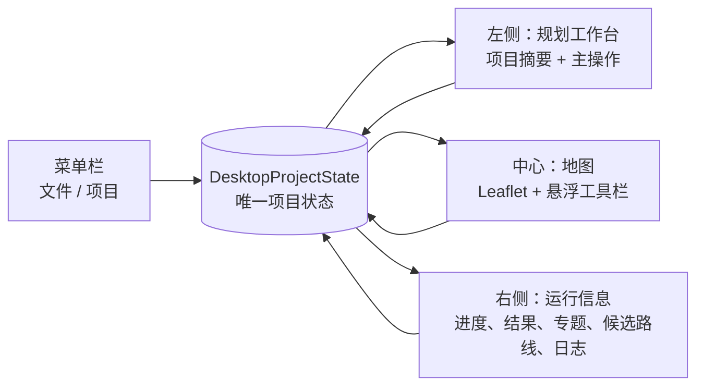
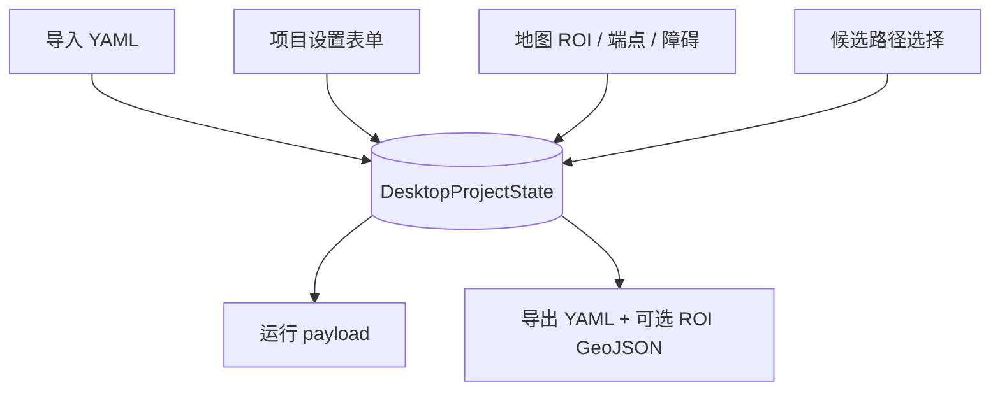

# 桌面端前端页面组织结构

## 1. 目标与边界

桌面端采用“**地图主交互 + 结构化项目设置 + 结果侧栏**”的组织方式。
YAML 是项目配置的导入/导出格式，不再作为主界面的可编辑文本；界面中的
地图、表单、候选路径选择和动态障碍均写入同一份项目状态。

适用范围：PyQt5 桌面端 `desktop_client.py` 与 Leaflet 地图组件
`desktop_map.py`。备用 Web Console 不在本页面结构内。

## 2. 页面总览

| 区域 | 承担内容 | 不承担内容 |
|---|---|---|
| 菜单栏 | 导入/导出 YAML、恢复默认项目、打开项目设置 | 不直接执行地图交互 |
| 左侧工作台 | 当前项目摘要、构建、规划、重规划等高频主操作 | 大量低频 GIS/算法字段 |
| 中央地图 | 研究区绘制、起终点选择、障碍标记、格网/路径可视化 | 配置文件文本编辑 |
| 右侧运行信息 | 进度、运行结果、主题切换、候选路线、后端日志 | 项目基础数据源配置 |
| 项目设置对话框 | 数据源、规划参数、端点来源及高级参数 | 运行结果展示 |

## 3. 菜单栏

### 文件

- **导入 YAML**：读取交付配置并创建项目状态。YAML 格式错误、缺失顶层
  `tile_build` / `route` 映射时，保留当前项目且显示错误。
- **导出当前配置为 YAML**：从当前项目状态输出配置；若研究区来自地图绘制，
  同时生成同名 `.roi.geojson`，并在 YAML 中以相对路径引用。
- **恢复默认配置**：重新载入默认交付配置。

### 项目

- **项目设置**：打开结构化设置对话框。

## 4. 左侧：规划工作台

左侧仅保留运行前需要频繁确认或触发的内容，避免数据源与地图操作混杂。

### 当前项目摘要

摘要显示：

- DEM 与土地利用数据路径；
- 当前研究区来源（地图绘制或配置图层）；
- 端点来源（地图坐标或端点矢量文件）及起终点坐标；
- 当前动态障碍数量；
- 导入但后端尚不支持的字段警告。

“打开项目设置”按钮用于进入低频配置，而不在工作台中展开全部字段。

### 执行规划

主操作由按钮触发：

1. 构建通行地图；
2. 生成多候选路线（组合构建与规划）；
3. 使用动态障碍执行 D* Lite 重规划。

运行中按钮禁用，工作在后台线程执行，主线程只更新进度和显示结果。

## 5. 中央：地图与就近交互

地图是空间数据输入和成果阅读的核心区域。Leaflet 地图右上角悬浮工具栏包含：

- 绘制研究区；
- 清除研究区；
- 选取起点；
- 选取终点；
- 标记动态障碍；
- 清除端点；
- 清空障碍；
- 取消当前操作。

### 交互反馈

- 进入研究区、端点或障碍选择模式时，工具按钮进入激活态，地图切换为十字光标，
  并显示当前操作提示。
- 起点或终点选取成功后自动退出选择模式，恢复普通光标，在地图显示标记，并更新摘要。
- 动态障碍仅在已加载细层 H3 格网时可用；再次点击同一格会取消障碍标记。
- 地图事件带递增事件标识，经 WebView 的 document-title 桥接回 Qt，确保重复点击
  同一格仍会被识别。

### 地图图层

- 底图：天地图影像/矢量及标注图层；
- 编辑图层：地图绘制的研究区；
- 标记图层：起点、终点；
- 格网图层：父格网与按需加载的细层格网；
- 路线图层：当前激活候选路线；
- 障碍状态：阻塞格以显式地图样式覆盖显示。

## 6. 右侧：运行信息与结果

右侧 Dock 集中呈现运行时和运行后的信息：

- 当前阶段文字与 0–100% 进度条；
- 路线与通行评价摘要；
- 专题属性选择（例如评分、成本、高程、坡度、粗糙度、土地利用、土壤）；
- 父层/细层格网显示与下钻；
- 多候选路线下拉选择与“确认并激活当前候选”；
- 后端运行日志、警告与错误。

候选路线索引写回项目状态，因此后续重规划与导出配置使用的都是用户当前选择，
不会退回默认索引。

## 7. 项目设置对话框

项目设置使用 `QToolBox` 分组，避免把几十个字段堆在主窗口。

### 数据与研究区

- DEM、土地利用、土壤、土壤目录、道路、ROI 图层；
- 瓦片输出目录；
- 使用文件选择器或目录选择器输入路径。

### 路径规划

- 规划器配置、车辆配置、路线输出目录；
- 目标函数多选；
- 最大吸附距离；
- 端点来源显式选择：地图坐标或端点矢量文件。

地图选择端点会自动切换为“地图坐标”模式，但不会删除已配置的端点矢量路径，
便于用户切回图层模式。

### 高级参数

- H3 细层与父层分辨率；
- 瓦片数、每瓦片格网数限制；
- 采样模式、覆盖策略；
- 走廊/研究区策略；
- 主题属性、最大估算格网数；
- 继续处理错误、覆盖既有输出等布尔选项。

数值采用数值输入框，布尔值采用复选框，枚举项采用下拉框，避免因手写 YAML
缩进或类型错误导致运行异常。

## 8. 唯一项目状态与数据优先级

`DesktopProjectState` 是桌面端唯一可编辑的状态源，包含：

- `tile_build`：瓦片构建配置；
- `route`：路径规划配置、端点、障碍、候选索引；
- `study_area_geojson`：地图绘制的研究区；
- `extra_sections`：导入后暂未提供控件的顶层字段。

优先级规则：

1. 地图绘制研究区优先于配置中的 ROI 图层；清除绘制研究区后，恢复配置 ROI 图层。
2. 地图选择端点将端点来源切换为坐标模式。
3. 动态障碍与候选索引始终从项目状态读取。
4. 导入的未知字段会原样保存以支持再次导出；在运行前会明确阻止并列出字段名，
   不会静默丢弃或覆盖。

## 9. 运行与结果回流

1. 用户在左侧发起构建、规划、重规划或组合运行。
2. 客户端从项目状态生成运行 payload；若有地图 ROI，则为本次会话落盘 GeoJSON。
3. 后端操作在后台执行，事件队列/Qt 定时器将进度、成功或失败消息回流至主线程。
4. 成功后，右侧更新结果和候选路线，地图绘制路线及可视化格网。
5. 失败时，保留项目状态与现有配置，显示可操作的错误信息。

## 10. 实现对应关系

| 结构 | 主要实现 |
|---|---|
| 主窗口、菜单、左右 Dock、运行调度 | `src/h3_offroad_planner/desktop_client.py` |
| 项目状态、YAML 导入导出、ROI 文件物化 | `src/h3_offroad_planner/desktop_project.py` |
| Leaflet 模板、悬浮工具栏、Qt 事件桥 | `src/h3_offroad_planner/desktop_map.py` |
| 桌面 UI 与项目状态回归测试 | `tests/test_desktop_ui.py`、`tests/test_desktop_project_validation.py` |
