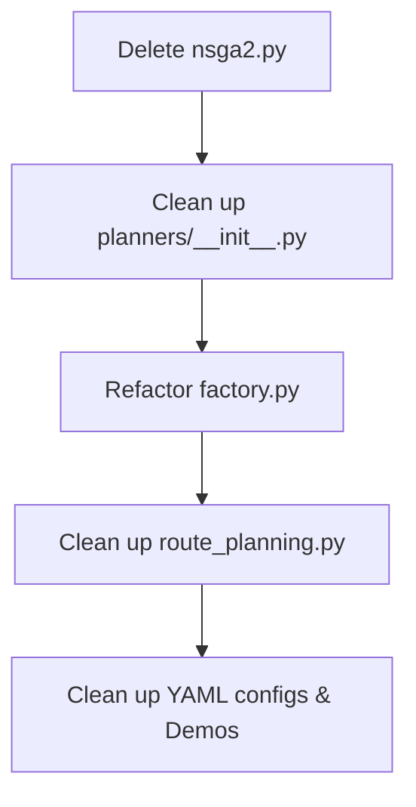

# NSGA-II Legacy Code Cleanup & Test Redesign Analysis

> 历史证据（非活动规范）：记录 Legacy/NSGA-II 清理前的分析，当前状态以 ADR-022 和活动架构文档为准。

This report outlines the structural cleanup and redesign requirements to completely remove the legacy `NSGA-II` compatibility layers, rename related components, and rebuild the test suite for the new `DeterministicParetoPlanner` architecture in the demo environment.

---

## 1. Current Legacy Code Footprint

The codebase currently maintains a dual-track planning setup for backward compatibility, keeping several legacy files and classes:

*   **`src/h3_offroad_planner/planners/nsga2.py`**: Contains 342 lines implementing `LegacyDeterministicParetoPlanner` and `NSGAIIPlanner`.
*   **`src/h3_offroad_planner/planners/factory.py`**: Contains compatibility parsing logic looking for the `"nsga2"` configuration block and mapping `"NSGAII"` to legacy components.
*   **`demo/run_mvp5_nsga2.py`**: A historical demo script outputting `"planner": "NSGAII"`.
*   **Legacy Tests**: Regression tests under `tests/` verifying the deprecated alias, warning outputs, and the legacy single-path cost aggregation.

---

## 2. Refactoring Roadmap (Cleanup & Rename)

To completely decouple the system from the legacy naming and implementation, the following actions can be taken:



### Action Items

1.  **Delete Legacy Modules**:
    *   Delete the `src/h3_offroad_planner/planners/nsga2.py` file.
    *   Remove `NSGAIIPlanner` and `LegacyDeterministicParetoPlanner` from `src/h3_offroad_planner/planners/__init__.py`.

2.  **Simplify Planner Factory**:
    *   In `src/h3_offroad_planner/planners/factory.py`, remove `"NSGAII"` from `GLOBAL_PLANNERS`.
    *   In `_build_global`, remove the `"NSGAII"` handling branch (including warnings) and raise a `ConfigError` if `"NSGAII"` is supplied.
    *   Change the parsed configuration section key from `"nsga2"` to `"deterministic_pareto"`:
        ```python
        nsga_cfg = _optional_mapping(cfg, "deterministic_pareto")
        ```

3.  **Clean Up Routing Orchestration**:
    *   In `src/h3_offroad_planner/route_planning.py:L124`, modify `_validate_route_plan_planner` to reject `"NSGAII"` entirely and require `"DeterministicParetoPlanner"`.

4.  **Update Configurations and Demos**:
    *   Remove `demo/run_mvp5_nsga2.py` historical demo.
    *   In all YAML templates (e.g. `mvp71_delivery.example.yaml`, `mvp81_delivery.example.yaml`), change `global_planner: NSGAII` to `global_planner: DeterministicParetoPlanner` and rename `nsga2:` configuration blocks to `deterministic_pareto:`.

---

## 3. Discarding Legacy Tests & Redesigning Test Scripts

Legacy regression tests targeting `NSGAIIPlanner` and `LegacyDeterministicParetoPlanner` should be discarded. The test suite should be rewritten to focus on the properties of `DeterministicParetoPlanner` and the multi-objective closed-loop flow.

### Proposed Test Redesign Plan

| Test File | Focus Area | Verification Items |
| :--- | :--- | :--- |
| `test_deterministic_pareto.py` | Core Planner Whitebox | - **Search Bounds**: Output path list size does not exceed `candidate_limit`. <br>- **Pareto Domination**: Verify that dominated (strictly worse) paths are correctly filtered out via `_non_dominated_fronts`. <br>- **Diversity Penalty**: Test that `penalty_factor > 0` successfully forces path exploration by penalizing shared grid cells. <br>- **Anchor Inclusion**: Verify that `widest_path` is always included. |
| `test_route_plan_flow.py` | Multi-Objective Integration | - **Config Loading**: Factory correctly parses the `deterministic_pareto:` block from YAML. <br>- **Contract Validation**: Verify that the generated `RoutePlan` metadata has `"planner_name"` set strictly to `"DeterministicParetoPlanner"`. |
| `test_closed_loop_replanning.py` | Closed-loop Fallback | - **Obstacle Rerouting**: Verify that providing `blocked_cells` to the planner (via `replan_route`) produces alternative paths avoiding the blocked cells. |

---

## 4. Risks and Impact

> [!NOTE]
> Since this is a demo environment, discarding legacy code is highly feasible and will significantly simplify the code architecture.

> [!WARNING]
> *   **Downstream Imports**: Any downstream application importing `NSGAIIPlanner` from `h3_offroad_planner.planners` will experience immediate `ImportError` after this refactoring.
> *   **Stale Configurations**: Old YAML files specifying `global_planner: NSGAII` will fail validation with `ConfigError`. All task runner configurations must be migrated to `global_planner: DeterministicParetoPlanner`.
