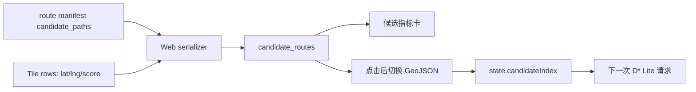

# MVP-8.2：旧 NSGA-II 候选指标与地图切换

> 状态：Historical / Superseded。当前候选指标、角色和展示合同见 `spec.md` 与
> `api-design.md`。

## 目标与边界

本批次修复现有 WebGIS 控制台未消费已存在候选目标向量的问题。它不改变
`NSGAIIPlanner` 的候选生成、Pareto 筛选或目标定义，也不实现静态 GIS 因子模型、
ETA、`terrain_risk`、走廊聚类或候选角色聚合。

已存在的旧目标均为最小化累计量：`distance`（m）、`trafficability`
（通行性惩罚，m）、`travel_cost`（统一行驶代价，无量纲）、`slope`
（坡度暴露，deg·m）和 `roughness`（粗糙度暴露，TRI·m）。因此界面不得把
`travel_cost` 称为“最短时间”。

## 功能需求

| ID | 要求 | 验收条件 |
|---|---|---|
| FR-052 | 返回候选几何 | 规划响应提供每条未重规划候选的独立 GeoJSON、目标向量、总代价、评价和候选索引。 |
| FR-053 | 显示完整旧目标 | Web 候选卡和桌面候选下拉项显示五个旧目标和总代价，总代价不得作为唯一显示内容。 |
| FR-054 | 标注当前候选集的目标最优 | 对请求中启用的每个目标，数值等于返回候选最小值的候选显示对应说明；一条路线可有多个说明。 |
| FR-055 | 即时地图切换 | 点击 Web 候选卡或桌面下拉项不重新调用规划接口，立即切换为该候选的几何、提示框和评价。下一次 D* Lite 请求继续携带所选索引。 |
| FR-056 | 重规划语义安全 | D* Lite 重规划后仅显示实际激活的重规划路线，不将原候选的旧目标向量标成新路线指标。 |
| NFR-024 | 兼容性 | 保留既有 `route_geojson` 和 `route_evaluation` 响应字段；无法构造候选几何时仍显示已导出的选中路线。 |

## 响应契约

`serialize_webgis_result` 新增 `candidate_routes`。未重规划结果中的每项为：

```json
{
  "candidate_index": 0,
  "geojson": { "type": "FeatureCollection", "features": [] },
  "objectives": {
    "distance": 0.0,
    "trafficability": 0.0,
    "travel_cost": 0.0,
    "slope": 0.0,
    "roughness": 0.0
  },
  "total_cost": 0.0,
  "evaluation": { "distance_m": 0.0, "selection_reason": [] },
  "is_selected": true,
  "replanned": false
}
```

- `candidate_index`：非负整数，与 manifest 的 `candidate_paths` 下标一致。
- `geojson`：由候选 H3 序列和已加载格网中心点构成的 WGS84 Point 或 LineString；
  无法解析时为 `null`，界面禁用切换并保留活动路线。
- `objectives`：旧目标名称到非负有限累计量的映射。
- `evaluation.selection_reason`：仅针对 `requested_objectives` 比较；当候选未获得
  任何最小值时为 `Pareto-front compromise`。
- 规划 manifest 新增 `requested_objectives`，以保持评价理由和当次请求一致。
- `replanned=true` 时，`candidate_routes` 只含活动重规划路线；其 `objectives` 为
  空映射、`total_cost` 为 `null`、理由为 `D* Lite replanned active route`。

## 实现与状态流



浏览器状态只保存当前响应的候选条目和选择索引，不写入后端会话。若候选没有可用
几何，点击不会改变活动路线，并显示本地错误状态。

## 测试规格

| Test ID | 来源 | 输入 | 预期 |
|---|---|---|---|
| T-122 | FR-052 | 含两条候选、完整 tile 行的 route manifest | 响应有两项 `candidate_routes`，各自几何与索引正确。 |
| T-123 | FR-053 | 两条候选的完整五维旧目标 | 每项保留五个目标和 `total_cost`。 |
| T-124 | FR-054 | 各候选在不同目标上最小 | 每条的评价理由仅标注其请求目标中的最小值；无最小值者为折中。 |
| T-125 | FR-055 | 服务的 HTML | 页面包含目标字段渲染、候选 GeoJSON 切换及点击更新索引逻辑。 |
| T-126 | FR-056 | `replanned=true` 的 route manifest | 只返回活动路线，不泄露旧候选指标为重规划结果。 |
| T-127 | NFR-024 | 无 tile 行或旧单路线响应 | 保留原有 `route_geojson` 与 `route_evaluation`，不抛出候选几何错误。 |
| T-128 | FR-053/FR-055 | 桌面候选条目 | 下拉项包含五个旧目标；切换使用真实候选索引而非下拉位置。 |

## Gate 1 设计证据

| 模块 | 覆盖需求 | 范围 | 单位 | 异常/降级 | 完整度 |
|---|---:|---:|---:|---:|---:|
| `routing._route_manifest` | FR-054 | 旧目标白名单 | 名称/累计量 | 旧调用默认兼容 | 1.00 |
| `web_console._candidate_routes` | FR-052、FR-056、NFR-024 | 下标、H3 序列、坐标 | WGS84/m | 无几何为 `null`；重规划单路线 | 1.00 |
| `web_console._candidate_evaluation` | FR-054 | 有限目标、有效车辆 | m、s、旧累计量 | 无车辆则无评价 | 1.00 |
| Web candidate renderer | FR-053、FR-055 | 数值、可用 GeoJSON | 展示单位 | 禁用不可用候选并保留活动路线 | 1.00 |

`C_func = 5/5 = 1.00`；`C_detail = 1.00`；核心依赖为
`routing → web_console → web/index.html`，无反向导入，`C_decouple = 1.00`。

`S_design = 0.4 × 1.00 + 0.3 × 1.00 + 0.3 × 1.00 = 1.00`，通过 Gate 1。

反证检查：本批次不把 travel_cost 解释为时间；不将重规划路径与旧候选指标混淆；
不依赖浏览器状态作为后端的不可恢复选择状态；完整静态 GIS 语义仍明确排除在本批次外。
