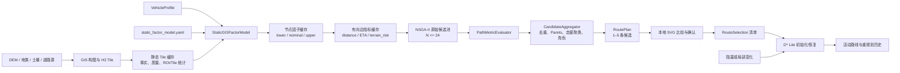
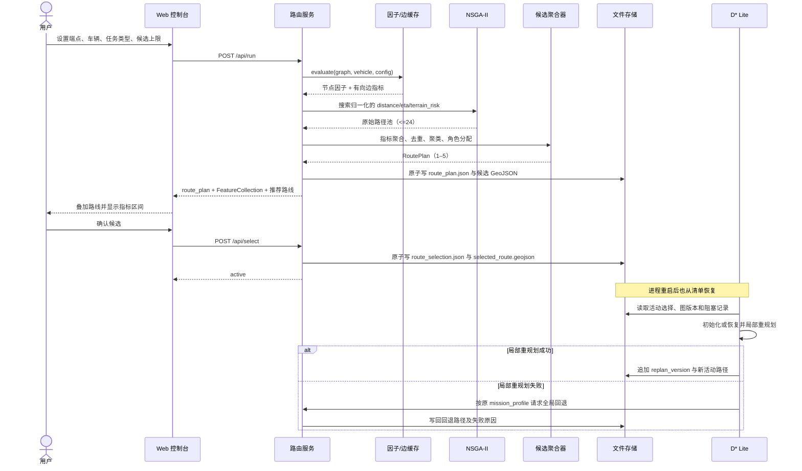
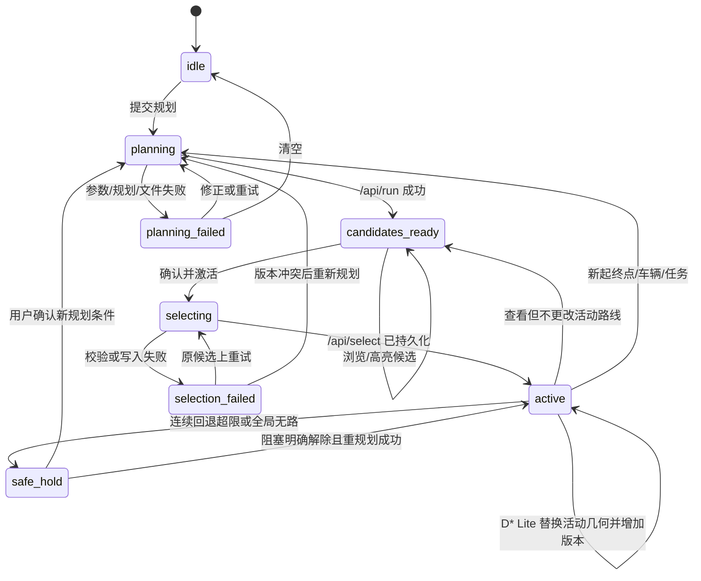
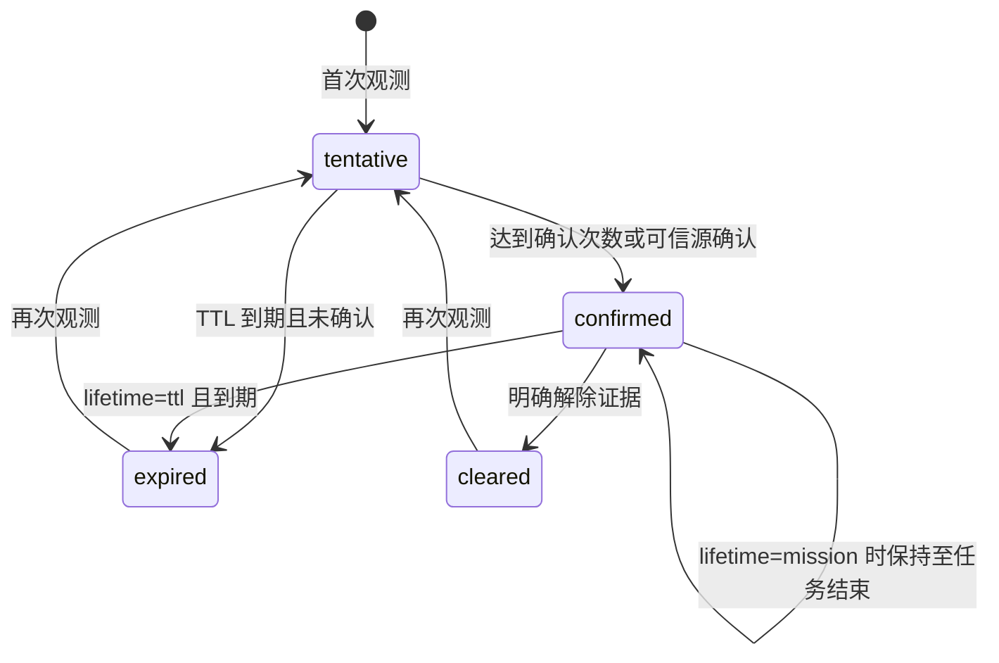
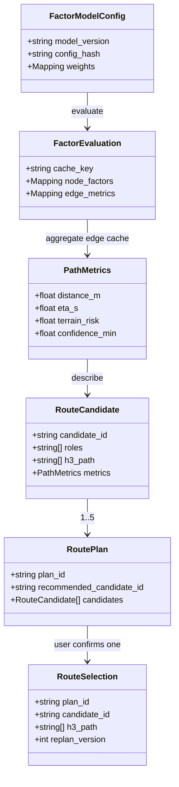

# 静态 GIS 因子模型与多路径交互规划设计（历史草案）

> 本草案已由 2026-07-16 的 [closed-loop-contract.md](closed-loop-contract.md) 和
> 2026-07-17 的 [ADR-021](adr/ADR-021-physical-margin-evaluator.md) 取代。
> 下文关于相对评分、因子区间和高阶风险的内容只记录已退役的加权多指标评估器，不是当前
> 运行时合同。当前固定四个可加目标和五种角色；不存在 `highest_data_reliability`/
> “最高数据可靠性”角色，数据质量只降低 confidence 并生成诊断。

> 文档状态：Historical / Superseded，不得作为实施或验收门禁。
> 适用模块：`h3_offroad_planner`、本地 Web 控制台、D* Lite 接续流程  
> 首版边界：仅使用静态 GIS、车辆参数和现有本地文件；公开数据集与传感器仅作为后续校准输入  
> 原兼容目标：旧单路径配置、旧专题图及旧多目标名称；当前兼容边界以活动 API 文档为准。
> 最后更新：2026-07-13

> 2026-07-13 复核修订：将容易与战术暴露混淆的旧风险字段统一命名为 `terrain_risk`；以高阶地形危险函数强化短距离瓶颈惩罚；补齐速度下界无界 ETA、阻塞生命周期/防抖和独立走廊失效仿真合同。

## 0. 结论与设计原则

本设计将当前“构 Tile 时按车辆写入评分、规划后只取 `paths[0]`”的链路改造成一个可复现的两阶段闭环：Tile 只保存静态 GIS 事实和区域统计；每次路由时再将静态事实与当前 `VehicleProfile` 结合，批量生成车辆相关的节点因子和有向边指标缓存。NSGA-II 只在缓存上搜索，得到至多 24 条原始路径；聚合器再按非支配性、核心走廊和指标可分辨性压缩成 1–5 条候选。用户确认的候选写入可恢复的选择清单，并作为 D* Lite 后续局部重规划的基准路径。

本方案遵循以下不变量：

1. **事实与解释分离**：坡度、TRI、地类、土壤和质量标记是静态事实；通行评分、速度和风险是“事实 × 车辆 × 模型版本”的结果。
2. **不可通行先于评分**：物理极限或显式禁行不能被加权平均抵消。
3. **区间先于伪精确值**：缺失或低质量 GIS 产生保守区间和较低置信度，而不是默认优良。
4. **三个主要目标彼此独立**：新流程默认只优化距离、ETA 和车辆地形风险 `terrain_risk`；相关的坡度、粗糙度和通行性作为诊断或兼容目标，不重复占据 Pareto 维度。`terrain_risk` 只描述地理要素对车辆动力学和通过能力的危险，不包含敌情、可视域或火力暴露。
5. **候选不为凑数而保留**：相同核心走廊且指标不可分辨的路径合并；结果可以少于五条。
6. **推荐不新增路径**：任务类型只决定现有候选中的推荐者，不生成含义模糊的“综合折中”第六目标。
7. **确定性与可恢复性**：相同输入、配置和数据版本产生相同 ID、排序及输出；进程重启后可由文件清单恢复活动路径。

## 1. 范围、需求与非目标

### 1.1 功能需求

| ID | 需求 | 验收结果 |
|---|---|---|
| FR-01 | Tile 缓存保存车辆无关的静态 GIS 字段、质量标记和稳健统计 | 更换车辆不需要重建 Tile；新路由不读取不匹配车辆的旧评分作为权威值 |
| FR-02 | 路由前执行硬约束和区间化因子评估 | 每个可通行节点均有满足上下界不变量的评分、速度和置信度 |
| FR-03 | 有向边距离、ETA、风险和诊断值只预计算一次 | NSGA-II 搜索过程不再调用 Bekker 或重复求因子公式 |
| FR-04 | 新流程优化 `distance`、`eta`、`terrain_risk` | 输出的原始候选经验证为目标空间中的非支配路径，且极差短路段受到高阶惩罚 |
| FR-05 | 聚合后返回 1–5 条有显著用途的候选 | 完全重复被删除；等价走廊且区间重叠被合并；同一路线可有多个角色 |
| FR-06 | 任务类型只选择推荐候选 | `emergency/cargo/reconnaissance/conservative` 分别按明确主目标推荐 |
| FR-07 | `/api/run` 同时兼容单路线与多候选前端 | 旧字段 `route_geojson` 仍返回推荐路线，新字段返回完整 `route_plan` |
| FR-08 | 用户确认候选并持久化选择 | `/api/select` 原子写入选择清单和选中路线；失败不伪造激活成功 |
| FR-09 | D* Lite 从选择清单恢复和重规划 | 局部失败时按同一任务主目标全局回退，并保留追溯字段 |
| FR-10 | 所有结果可复现 | Tile、车辆、因子配置、任务配置和路径均有稳定哈希或版本 |

### 1.2 非功能需求

| ID | 要求 | 设计边界 |
|---|---|---|
| NFR-01 | 本地、离线运行 | 前端无在线底图、Leaflet、CDN 或远程脚本 |
| NFR-02 | 快速计算 | 因子及边缓存为 `O(V+E)`；候选聚合上限固定为 24 |
| NFR-03 | 可维护配置 | 不建立“坡度×土壤×地类×TRI”的笛卡尔积巨表 |
| NFR-04 | 向后兼容 | 未显式启用多路径时保持旧单路径行为和旧目标语义 |
| NFR-05 | 故障可解释 | 错误响应、manifest 和日志均携带机器可判定错误码 |
| NFR-06 | 确定性 | 并列时使用固定的风险、距离和 H3 序列规则，禁止依赖集合遍历顺序 |

### 1.3 本期非目标

- 不训练 Transformer、端到端越野驾驶模型或强化学习策略。
- 不新增数据库、消息队列、在线地图、多用户认证或云服务。
- 不声称 `confidence` 是经过标定的概率；首版它仅表示输入完整性和模型区间宽度。
- 不在 D* Lite 中持久化开放列表或优先队列；只持久化足以重新初始化的选择与阻塞事实。
- 不删除 Tile 中已有的 `score/cost_score`，但新路由不把它们当成跨车辆通用值。

## 2. 当前实现基线与差距

当前代码已有 H3 图、地形/地类/土壤字段、Bekker 校核、A*、D* Lite 和 NSGA-II。需要保留并演进的具体语义如下：

| 当前实现 | 当前行为 | 设计调整 |
|---|---|---|
| Tile 构建/通行评估 | 使用一辆车计算 `H3Cell.score` 和 `cost_score` | Tile 继续保存旧值供专题图和兼容输出；新增静态事实和统计作为路由权威输入 |
| `TrafficabilityAssessor` | 坡度、地类、TRI、土壤和道路加权求和 | 路由时由 `StaticGISFactorModel` 执行硬约束、区间变换和加权几何平均 |
| `CostFunction` | 距离乘地类、坡度、TRI、`cost_score` 并加高程惩罚 | 旧 `travel_cost` 保留；新主流程使用可解释的距离、ETA、风险边缓存 |
| `BekkerChecker` | 计算沉陷、土壤机动性和最大速度 | 预处理阶段每节点至多调用一次；结果缓存并记录失败/回退原因 |
| `NSGAIIPlanner` | 多个标量化 A*，直接相加不同单位目标，候选池 24，最多输出 5 | 搜索前按当前可通行边稳健尺度归一化；输出 24 条原始候选交给独立聚合器 |
| 正式 `run_route` | 未传递新多目标，固定读取 `.paths[0]` | 显式多路径模式返回 `RoutePlan`；旧模式仍返回第一条路径 |
| Web 控制台 | `/api/run` 返回并渲染一条 GeoJSON LineString | 返回全部候选 FeatureCollection，保留推荐 LineString 兼容字段；增加 `/api/select` |

迁移期间，任何 Tile 上的旧 `score` 都必须附带 `vehicle_hash` 才可证明匹配。若缺失或不匹配，它只能用于专题显示，不能进入新边代价。

## 3. 目标架构

### 3.1 组件 DAG



### 3.2 一次规划、确认与局部重规划时序



### 3.3 数据所有权

| 层 | 保存内容 | 明确不保存/不信任 |
|---|---|---|
| Tile | H3 ID、邻接、中心点、高程、方向坡度输入、TRI、地类、`lc_factor`、土壤/含水率/USCS、道路、源质量、区域统计 | 不保存跨车辆通用的权威通行评分或速度 |
| 路由评估缓存 | `vehicle_hash + model_version + tile_hash` 下的节点区间和有向边指标 | 不跨哈希复用 |
| RoutePlan | 候选、角色、指标、模型/车辆/数据哈希、聚合元数据 | 不作为已激活状态 |
| RouteSelection | 用户确认的计划/候选、完整路径、确认时间和版本 | 不依赖仅存在于内存的会话对象 |
| D* Lite 运行态 | 当前图、活动路径、变化边及算法内存 | 不要求跨进程保存内部优先队列 |

## 4. 静态 GIS 输入与 Tile 统计

### 4.1 首版允许输入

模型输入限定为当前数据链已拥有或可由相邻 H3 单元直接计算的字段：

| 字段 | 单位/类型 | 合法范围 | 缺失处理 |
|---|---|---|---|
| `elevation_m` | m | 有限浮点数 | 无法得到方向坡度时使用保守坡度区间并降低置信度 |
| `directed_slope_deg` | °，有向边 | `[-90, 90]` | 由高程差/边距重算；仍缺失则边标记低置信或不可用 |
| `elevation_delta_m` | m，有向边 | 有限浮点数 | 与方向坡度同步回退 |
| `tri` | 与数据生产链一致的非负数 | `[0,+∞)` | 使用缺失 TRI 区间，不当成 0 |
| `landcover` | 类别 | 版本化字典 | 未知类别走 `unknown_landcover` 区间 |
| `lc_factor` | 正数或 `+∞` | `(0,+∞]` | 缺失走未知地类；`+∞` 硬禁行 |
| `soil_type` / `uscs` | 类别 | 版本化字典 | 走未知土壤区间 |
| `soil_moisture` | 0–1 或带单位原值 | 配置声明 | 越界拒绝或按显式单位转换，禁止静默裁剪原始错误 |
| `cone_index` | Pa 或 kPa，配置声明 | `>=0` | 无 CI 时使用土壤类别区间 |
| `sinkage_m` | m | `>=0` | Bekker 无法计算时使用土壤回退区间 |
| `soil_mobility` | 无量纲 | `[0,1]` | 优先由 Bekker/现有逻辑生成，否则回退 |
| `road_coverage` | 0–1 | `[0,1]` | 缺失视为“道路未知”，不是“无道路” |
| `source_quality` | 枚举/0–1 | 配置声明 | 缺失使用最低已配置质量档 |

方向坡度属于有向边事实。同一对单元的 `A→B` 与 `B→A` 坡度符号相反；硬爬坡约束只对正向上坡应用。若现有 Tile 只保存无向坡度，则边缓存构建必须通过高程差恢复方向，不能复用绝对坡度替代上下坡语义。

### 4.2 稳健区域统计

每个 Tile manifest 至少保存以下统计，统计样本只包含有限且通过基本质量检查的值：

- `tri.q10/q50/q90`、有效样本数、缺失率；
- 高程与坡度的 `q10/q50/q90`；
- 地类、土壤、道路和源质量的类别频数与缺失率；
- 源数据版本、空间分辨率、CRS、生成时间、Tile H3 分辨率；
- `static_input_hash`：对规范化静态字段、邻接和源版本计算的 SHA-256；
- 旧评分存在时的 `legacy_score_vehicle_hash`，缺失表示不可证明匹配。

稳健分位数应由完整 Tile 或本次 ROI 中不少于 `min_stat_samples` 个有效单元计算。样本不足时按“Tile → 数据集全局统计 → 配置缺省”的顺序回退，并把统计来源写入 manifest。

### 4.3 Tile manifest 增量字段示例

```yaml
schema_version: "tile-manifest/2"
tile_id: "roi_demo_r9"
h3_resolution: 9
source_crs: "EPSG:4326"
source_resolution_m: 30.0
static_input_hash: "sha256:4f5a..."
statistics:
  scope: tile
  min_stat_samples: 128
  tri:
    valid_count: 18432
    missing_ratio: 0.012
    q10: 1.8
    q50: 6.4
    q90: 21.7
  slope_deg:
    q10: 0.9
    q50: 7.2
    q90: 23.4
quality:
  dem: {level: surveyed, missing_ratio: 0.0}
  landcover: {level: classified, missing_ratio: 0.006}
  soil: {level: inferred, missing_ratio: 0.18}
legacy_score:
  present: true
  vehicle_hash: null
  authority_for_new_routing: false
```

## 5. 静态 GIS 因子模型

### 5.1 通用区间类型与不变量

每个连续因子使用同一值对象：

```text
FactorInterval = {
  lower: float,       # 保守值
  nominal: float,     # 名义值
  upper: float,       # 乐观值
  confidence: float,  # 输入完整性/区间宽度指标，不是概率
  source: str,        # measured | derived | class_table | fallback
  reason_codes: list[str]
}
```

必须满足：

```text
0 <= lower <= nominal <= upper <= 1
0 <= confidence <= 1
```

任何 NaN、无穷因子值、上下界倒置或非法枚举均视为配置/数据错误，不得静默进入图搜索。只有文档明确的缺失回退可以继续计算。

### 5.2 硬约束

硬约束按顺序执行并短路，结果为 `is_passable=false`、速度区间全 0，并记录首要及全部命中的 `reason_codes`：

1. 地类属于 `impassable_landcover`、水体，或 `lc_factor=+∞`；
2. 有向上坡 `directed_slope_deg > vehicle.max_climb_deg`；
3. 已成功计算的 `sinkage_m >= vehicle.ground_clearance_m`；
4. 存在有效锥指数且 `cone_index < vehicle.min_cone_index`；
5. 配置声明为硬禁行的道路/区域掩膜；
6. 关键几何损坏，无法得到边长或相邻关系。

等于边界的处理必须确定：坡度等于最大爬坡角仍可进入连续评分，但其坡度因子会降至 `score_floor`；沉陷等于离地间隙不可通行。未知土壤、未知地类或 Bekker 数值失败本身不自动硬禁行，除非配置的安全策略为 `reject_unknown`。

### 5.3 坡度因子

对于有向边坡度 `θ` 和车辆最大爬坡角 `θmax>0`：

```text
r_slope = abs(θ) / θmax
f_slope_nominal = max(score_floor, 1 - min(r_slope, 1)^p_slope)
```

默认 `p_slope=2`。该定义相对车辆能力归一化，不依赖某地区的绝对坡度阈值。上坡超过 `θmax` 已被硬约束移除；下坡若车辆配置了 `max_descent_deg`，同样执行硬约束，否则只进入风险与速度衰减。坡度不确定度由 DEM 垂直误差和边长传播到 `θ_lower/nominal/upper`，再按单调方向映射为因子区间。

### 5.4 地类因子

地类映射由版本化表给出 `[lower, nominal, upper]` 和速度因子。若只有旧 `lc_factor`，名义通行因子为：

```text
f_landcover_nominal = clamp(1 / lc_factor, score_floor, 1)
```

类别表优先于推导值，但两者冲突超过配置允许误差时记录 `LANDCOVER_FACTOR_CONFLICT` 并取更保守下界。未知类别使用 `unknown_landcover`，不得回退为 1。

### 5.5 土壤与 Bekker 因子

优先级为：

1. 已验证的 `soil_mobility` 与 Bekker 结果；
2. 有单位且合法的锥指数、含水率和 USCS 组合；
3. 版本化土壤类别区间；
4. `unknown_soil` 保守区间。

若得到 `soil_mobility∈[0,1]`，直接作为名义因子，并依据输入误差或类别区间生成上下界。Bekker 迭代不收敛、参数越界或数值溢出时记录 `BEKKER_NUMERIC_FALLBACK`，使用第 3/4 级回退；搜索阶段不得再次尝试 Bekker。

### 5.6 TRI 粗糙度因子

只使用相对归一化会把“整片都很粗糙”的区域误判为局部优良，因此 TRI 同时使用局部稳健尺度与全局绝对下界：

```text
s_local = max(q90_TRI - q50_TRI, tri.min_scale, epsilon)
f_tri_relative = 1 / (1 + max(0, TRI - q50_TRI) / s_local)
f_tri_absolute = 1 / (1 + TRI / tri.absolute_scale)
f_tri_nominal = clamp(min(f_tri_relative, f_tri_absolute), score_floor, 1)
```

`q50/q90` 来源按 ROI/Tile、数据集全局、配置缺省依次回退；`absolute_scale` 必须与 TRI 生产方式和单位同版本。上下界通过 TRI 输入误差及统计来源质量传播。统计样本不足会降低置信度，而不是改变为乐观分数。

### 5.7 道路与源质量

道路覆盖可提高速度和降低区间宽度，但不能把任何因子推到 1 以上。道路因子按覆盖率在线性插值配置的 `offroad` 与 `road` 区间。道路未知使用独立的 `unknown` 区间，不等同于无道路。

源质量不作为可被高分抵消的“地面好坏”，而用于两处：

- 扩大地类、土壤、TRI 和坡度的上下界；
- 计算整体 `confidence`，供保守任务推荐及前端解释。

### 5.8 加权几何通行评分

设参与聚合的因子为坡度、地类、土壤、TRI 和道路，权重 `w_i>=0` 且总和大于 0。对 `b∈{lower, nominal, upper}`：

```text
score_b = exp( Σ_i w_i * ln(max(f_i,b, epsilon)) / Σ_i w_i )
```

几何平均使单个极差因素不能被多个高分完全抵消。聚合后强制检查：

```text
score_floor <= score_lower <= score <= score_upper <= 1
```

兼容写回：

```text
H3Cell.score = score
H3Cell.cost_score = 1 - score
```

这两个字段只属于本次 `vehicle_hash/model_version/static_input_hash` 的评估上下文；若写入文件，必须同时写三项哈希。

### 5.9 置信度

首版置信度是确定性的质量指数：

```text
input_quality = Σ_i w_i * quality_i / Σ_i w_i
interval_precision = 1 - Σ_i w_i * (f_i.upper - f_i.lower) / Σ_i w_i
confidence = clamp(input_quality * interval_precision, 0, 1)
```

`quality_i` 由数据来源档位、是否缺失、统计回退层级和数值求解状态映射。该值不能解释为“成功通行概率”。若未来有实车真值，可另行校准成概率并提升模型主版本。

### 5.10 速度区间

可通行节点先计算未经运行策略修饰的原始速度，由车辆最高速度与地表、坡度、土壤、粗糙度和道路速度因子相乘：

```text
raw_speed_b = clamp(
  vehicle.max_speed_mps * Π_j speed_factor_j,b,
  0,
  vehicle.max_speed_mps
)
```

区间方向必须体现不确定性：

```text
0 <= raw_speed_lower_mps <= raw_speed_mps
   <= raw_speed_upper_mps <= vehicle.max_speed_mps
```

硬禁行节点速度为 0。运行策略必须在原始速度计算之后执行，避免“先钳制、后判断”导致 `reject` 分支不可达：

1. 若 `raw_speed_mps < min_operating_mps`，按 `nominal_below_min_policy` 处理；默认 `reject`，节点不可通行。可选 `clamp` 只表示车辆运行控制器保证不以更低速度连续行驶，必须记录 `SPEED_NOMINAL_CLAMPED`。
2. 若名义速度合格但 `raw_speed_lower_mps < min_operating_mps`，按 `lower_below_min_policy` 处理：`reject` 表示保守任务拒绝；默认 `unbounded_eta` 保留候选，但将 `eta_upper_s=null`、`eta_upper_bounded=false`，表示现有静态数据不能给出有限最坏到达时间。
3. 禁止为了前端排版而人为截短 ETA 上界。前端对 `null` 显示“无界/数据不足”，排序时将其视为正无穷；JSON 中不得写 `Infinity`。

生效速度字段取策略处理后的 `speed_lower_mps/speed_mps/speed_upper_mps`，仍须满足有序关系。只有 `eta_upper_bounded=true` 时才要求 `speed_lower_mps>=min_operating_mps`。

### 5.11 有向边指标缓存

每条有向边 `e=(u,v)` 只计算一次：

```text
distance_m(e) = geodesic_or_projected_distance(u, v)
speed_b(e) = min(speed_b(u), speed_b(v)) * directed_slope_speed_factor_b(e)
eta_lower_s(e) = distance_m / speed_upper_mps(e)
eta_s(e)       = distance_m / speed_mps(e)
eta_upper_s(e) = distance_m / speed_lower_mps(e)  # 仅在 eta_upper_bounded=true

severity_lower(e)   = -ln(max(score_upper(v,e), epsilon))
severity_nominal(e) = -ln(max(score(v,e), epsilon))
severity_upper(e)   = -ln(max(score_lower(v,e), epsilon))
p = config.terrain_risk.exponent
terrain_risk_lower(e)   = distance_m * severity_lower(e)^p
terrain_risk_nominal(e) = distance_m * severity_nominal(e)^p
terrain_risk(e)         = distance_m * severity_upper(e)^p
```

`terrain_risk` 表示静态地形要素对车辆动力学/通过能力的保守危险代价，不是事故概率，也不是战术暴露。`p` 的合法范围为 `[2,8]`，首版配置值为 `4`；`p=1` 会退化为已被反例否定的线性累计风险，因此新流程不允许。高阶幂使短距离极差路段不能轻易被长距离优良路段稀释，同时保持边代价可加，NSGA-II 搜索无需增加路径状态维度。其量纲记为 `TRU = m·severity^p`，仅用于同模型版本内比较；展示区间为 `[terrain_risk_lower, terrain_risk_nominal, terrain_risk]`。

`score_lower_min` 仍作为独立瓶颈诊断。最安全路线采用“最大化 `score_lower_min`，再最小化 `terrain_risk`”的字典序，避免只依赖任何单一累积量。边缓存还保存方向坡度、坡度利用率、TRI、最低置信度、可通行状态、ETA 是否有界和原因码。任一距离非正、速度顺序错误或名义 ETA 非有限时，该边不进入新路线图并记录数据错误；无界 ETA 上界按上述显式 `null` 合同处理，不属于数值错误。

缓存键为：

```text
(static_input_hash, graph_topology_hash, vehicle_hash, factor_model_hash)
```

NSGA-II、路径指标聚合和 D* Lite 代价查询只能读取该缓存，不能隐式修改因子值。

## 6. 参数配置与快速计算

### 6.1 配置职责

`static_factor_model.yaml` 只保存：

- 数值稳定参数和缺失策略；
- 类别到因子区间/速度区间的映射；
- 连续因子曲线参数；
- 因子权重、统计回退和模型版本。

它不保存单元 ID、某次路线结果，也不展开多因子的笛卡尔积。车辆的质量、最大坡度、速度、离地间隙等仍由 `VehicleProfile` 提供。

### 6.2 完整配置示例

```yaml
schema_version: "static-factor-config/1"
model_version: "static-gis-factor/1.0.0"

numeric:
  epsilon: 1.0e-6
  score_floor: 0.02
  reject_nan: true

missing_data:
  policy: conservative_interval       # conservative_interval | reject_unknown
  minimum_quality: 0.20
  widen_interval_by: 0.15

weights:
  slope: 0.30
  landcover: 0.20
  soil: 0.25
  tri: 0.20
  road: 0.05

slope:
  exponent: 2.0
  max_descent_uses_vehicle_profile: true
  dem_vertical_error_m: 2.0

tri:
  statistics_scope: tile              # roi | tile | global
  min_stat_samples: 128
  min_scale: 1.0
  absolute_scale: 18.0
  fallback_q50: 7.0
  fallback_q90: 24.0

landcover:
  water_codes: [80, 90, 95]
  unknown:
    passability: {lower: 0.15, nominal: 0.35, upper: 0.60}
    speed:       {lower: 0.20, nominal: 0.40, upper: 0.65}
    quality: 0.25
  classes:
    road:
      codes: [10]
      passability: {lower: 0.85, nominal: 0.95, upper: 1.00}
      speed:       {lower: 0.75, nominal: 0.90, upper: 1.00}
      quality: 0.90
    grassland:
      codes: [30]
      passability: {lower: 0.55, nominal: 0.75, upper: 0.90}
      speed:       {lower: 0.45, nominal: 0.65, upper: 0.85}
      quality: 0.75
    forest:
      codes: [40]
      passability: {lower: 0.25, nominal: 0.50, upper: 0.75}
      speed:       {lower: 0.20, nominal: 0.40, upper: 0.65}
      quality: 0.65

soil:
  cone_index_unit: "kPa"
  unknown:
    passability: {lower: 0.12, nominal: 0.32, upper: 0.58}
    speed:       {lower: 0.15, nominal: 0.35, upper: 0.60}
    quality: 0.20
  classes:
    GW:
      passability: {lower: 0.70, nominal: 0.85, upper: 0.95}
      speed:       {lower: 0.60, nominal: 0.78, upper: 0.90}
      quality: 0.75
    CL:
      passability: {lower: 0.30, nominal: 0.55, upper: 0.78}
      speed:       {lower: 0.25, nominal: 0.48, upper: 0.70}
      quality: 0.65

road:
  offroad:
    passability: {lower: 0.60, nominal: 0.75, upper: 0.90}
    speed:       {lower: 0.45, nominal: 0.60, upper: 0.80}
  road:
    passability: {lower: 0.90, nominal: 0.97, upper: 1.00}
    speed:       {lower: 0.80, nominal: 0.95, upper: 1.00}
  unknown:
    passability: {lower: 0.55, nominal: 0.72, upper: 0.90}
    speed:       {lower: 0.40, nominal: 0.58, upper: 0.80}

speed:
  min_operating_mps: 0.20
  nominal_below_min_policy: reject    # reject | clamp
  lower_below_min_policy: unbounded_eta  # reject | unbounded_eta

terrain_risk:
  exponent: 4.0                       # [2, 8]；高阶惩罚短距离危险瓶颈

normalization:
  method: robust_edge_scale
  quantile: 0.90
  minimum_scale: 1.0e-6

candidate_aggregation:
  candidate_limit: 24
  default_max_candidate_paths: 5
  res_coarse_delta: 2
  require_interval_overlap_for_same_cluster: true
  independent_backup:
    qualification: disruption_survival
    disruption_radius_m: auto          # auto 或有限正数；auto 使用源分辨率/H3 尺度
```

示例数值是配置格式的初始值，不是跨地区真值。项目落地时应由现有 `lc_factor` 表、车辆手册和本地 GIS 统计生成首个受控版本，并通过测试与领域审查发布。

### 6.3 配置加载与验证

加载时执行以下验证：

- `schema_version` 和 `model_version` 非空；
- 权重非负且总和大于 0；
- 所有区间满足 `[0,1]` 与顺序不变量；
- `epsilon/score_floor/min_operating_mps/absolute_scale` 为有限正数；
- `terrain_risk.exponent` 为 `[2,8]` 内有限数，两个低速策略属于受支持枚举；
- 地类代码不能同时属于可通行类和水体/禁行类；
- 单位枚举必须受支持，禁止猜测 CI 或含水率单位；
- 候选池上限范围为 `[1,24]`，前端候选上限为 `[1,5]`。
- `independent_backup.disruption_radius_m` 为 `auto` 或有限正数；禁止用固定 Jaccard 百分比替代失效仿真。

验证失败时整个新多路径请求以 `FACTOR_CONFIG_INVALID` 失败，不能部分采用配置。若旧配置未引用本文件，则按兼容规则执行原单路径流程。

### 6.4 计算阶段与复杂度

一次规划上下文严格分三步：

1. 遍历节点，进行缺失解析、Bekker/土壤回退和节点区间计算：`O(V)`；
2. 遍历有向边，计算距离、方向坡度、ETA、`terrain_risk` 并冻结缓存：`O(E)`；
3. NSGA-II 的每次标量化搜索只查缓存；最多 24 条原始候选的聚合为 `O(N²L)`，其中 `N≤24`，`L` 为路径 H3 长度。

不允许在目标函数回调中读取 YAML、计算分位数、运行 Bekker 或解析地类名称。对于同一缓存键可复用只读缓存；任何键变化都完整重算，避免参数污染。

## 7. 路径目标、归一化与诊断

### 7.1 新主目标

对路径 `P` 的有向边集合：

```text
distance_m(P) = Σ_e distance_m(e)
eta_lower_s(P) = Σ_e eta_lower_s(e)
eta_s(P)       = Σ_e eta_s(e)
eta_upper_s(P) = Σ_e eta_upper_s(e)  # 仅当所有边上界有界；否则为 null
terrain_risk_lower(P) = Σ_e terrain_risk_lower(e)
terrain_risk_nominal(P) = Σ_e terrain_risk_nominal(e)
terrain_risk(P) = Σ_e terrain_risk(e)
```

三个 NSGA-II 最小化目标为 `distance_m`、`eta_s`、`terrain_risk`。距离和 ETA 通常相关但不等价；`terrain_risk` 使用评分下界和第 5.11 节高阶危险函数，是车辆地形安全目标，不是战术暴露目标。聚类使用区间 `[terrain_risk_lower, terrain_risk]`。

### 7.2 路径诊断字段

每条路径还必须计算：

| 字段 | 单位/范围 | 聚合规则 |
|---|---|---|
| `score_lower_mean` | `[0,1]` | 按边距离加权平均目标节点 `score_lower` |
| `score_lower_min` | `[0,1]` | 全路径最小值，定义为“最低通行裕度” |
| `max_slope_utilization` | `[0,+∞)` | `max(abs(slope)/vehicle_limit)`；可通行上坡应 `<=1` |
| `tri_p90` | TRI 单位 | 路径节点 TRI 的 90 分位 |
| `confidence_min` | `[0,1]` | 路径节点与边的最小置信度 |
| `confidence_weighted` | `[0,1]` | 按距离加权平均置信度 |
| `eta_upper_bounded` | boolean | 全部路径边 ETA 上界均有界时为 true |
| `distance_interval_m` | m | 由 H3 中心线离散和源分辨率传播，不凭经验造阈值 |
| `corridor_signature` | H3 列表 | 见第 9 节 |

空路径、断边、不可通行边或名义指标非有限时返回 `PATH_METRIC_INVALID`，不得进入候选集。`eta_upper_s=null` 是受支持的不确定状态，不等于非法 NaN/Infinity。单节点起终点路径距离、ETA 和 `terrain_risk` 均为 0，诊断取该节点值。

### 7.3 搜索归一化

为避免直接相加“米、秒、TRU”，每次评估缓存完成后，从当前可通行有向边得到稳健尺度：

```text
scale_j = max(Q90({edge_metric_j}), normalization.minimum_scale)
normalized_edge_j = edge_metric_j / scale_j
```

若有效边少于 `min_stat_samples`，依次使用中位数非零值、配置缺省尺度、`1.0` 回退，并记录来源。标量化搜索仅使用归一化边值；最终 Pareto 判定和对外输出使用原始单位。权重向量至少包含三个单目标锚点和若干确定性生成的混合权重。

### 7.4 兼容目标

`travel_cost/trafficability/slope/roughness` 保留现有计算和调用语义：

- 旧配置仍可显式请求它们；
- 新多路径默认不把这些高度相关指标与 `terrain_risk` 一起全部放入 Pareto 维度；
- 它们可以出现在诊断字段或兼容 manifest 中；
- `PlannerInput.objectives` 增加 `eta`、`terrain_risk`，但不改变旧五类枚举字符串。此前设计稿中的风险简写从未进入生产枚举，因此不保留语义含混的别名。

## 8. NSGA-II 原始候选生成

### 8.1 输入和输出边界

新流程输入目标固定为 `distance/eta/terrain_risk`，原始候选池 `candidate_limit` 默认 24、范围 `[1,24]`。现有“多组标量化 A* + Pareto 前沿/拥挤度”的实现可继续使用；高阶 `terrain_risk(e)` 仍是可加边指标，不改变搜索状态结构，但须满足：

1. 所有标量化搜索读取相同冻结边缓存；
2. 标量代价使用第 7.3 节的无量纲边指标；
3. 重复惩罚只用于探索，不写回真实目标向量；
4. Pareto 支配比较使用原始路径指标；
5. 相同配置下权重向量、邻接遍历和并列规则确定；
6. 聚合前可输出最多 24 条，而不是在 NSGA-II 内先武断截成 5 条。

### 8.2 Pareto 重合的解释

同一路径完全可能同时是最短距离、最短 ETA 和最低 `terrain_risk`。例如平坦、道路化且没有替代走廊的区域，三个目标方向一致。这不是算法错误，也不应复制成三条候选。相反，不同指标最优路径也不保证重合：较长道路可能比短而松软的越野段更快、更安全。

因此“角色数”与“路线条数”分离：一条 `RouteCandidate` 的 `roles` 可以同时包含 `shortest_distance`、`fastest_eta` 和 `max_passability_margin`。

## 9. 候选聚合与最多五条规则

### 9.1 聚合流水线

聚合顺序固定，禁止交换造成不确定结果：

1. 校验路径和指标；
2. 按完整 H3 cell 序列精确去重；
3. 对原始单位的 `distance/eta/terrain_risk` 做 Pareto 非支配筛选；
4. 生成核心走廊签名；
5. 对“相同签名且主要指标区间重叠”的路线聚类；
6. 每簇选代表；
7. 标注任务推荐者和四类基本角色；
8. 选择相对推荐路线走廊差异最大的独立备选；
9. 合并同一路线角色并按确定性顺序截断到 `max_candidate_paths`。

任一步结果为空都返回 `NO_VALID_ROUTE_CANDIDATE`，并保留被拒绝计数和原因分布。

### 9.2 精确去重与 Pareto 筛选

精确去重键为规范化 H3 序列。若序列相同但指标不同，说明缓存或计算不一致，返回 `CANDIDATE_METRIC_CONFLICT`，而不是任意保留一个。

路径 A 支配 B 当且仅当 A 在三个目标上均不差且至少一个严格更优。浮点比较使用配置的机器容差，只消除数值噪声；该容差不得充当业务“显著差异”阈值。

### 9.3 核心走廊签名

对每条路径：

1. 将 H3 cell 转成 `res_coarse = max(min_resolution, route_resolution - res_coarse_delta)` 的父格；
2. 压缩连续重复父格；
3. 在所有候选上计算最长公共起始前缀和最长公共结束后缀；
4. 从每条压缩序列中删除公共前/后缀，剩余序列为核心走廊签名；
5. 若全部被删除，使用单个哨兵 `COMMON_CORRIDOR`。

该处理忽略起终点附近必然重合的“漏斗段”，把独立性集中在真正可选择的中间走廊。

### 9.4 指标区间重叠与同簇判定

不使用固定“路径重合 90%”或固定百分比差值。A、B 进入同一簇需同时满足：

```text
core_signature(A) == core_signature(B)
overlap(distance_interval(A), distance_interval(B))
overlap(eta_interval(A), eta_interval(B))
overlap(terrain_risk_interval(A), terrain_risk_interval(B))
```

其中：

```text
overlap([a_lo,a_hi], [b_lo,b_hi]) := max(a_lo,b_lo) <= min(a_hi,b_hi)
```

ETA 区间由速度区间传播；`terrain_risk` 区间由评分区间和同一高阶指数传播；距离区间由 H3 中心线离散误差和源空间分辨率传播。ETA 上界无界时，内部比较使用 `[eta_lower,+∞)`，序列化仍使用 `null`，因此不会被误判为精确优势。这样“是否显著”来自数据分辨率和模型不确定度，而不是跨地区硬编码百分比。若没有可证明的距离误差，距离使用 `[distance,distance]`，聚类会更保守。

相同走廊但任一主要指标区间不重叠，表示存在可辨认收益，可分别保留。粗走廊不同则不聚为同簇，即使总指标很接近，也可作为突发阻塞的备选。

### 9.5 簇代表和确定性并列规则

每个簇先按当前任务主目标选代表；主目标在机器容差内相同，则依次比较：

1. 较低 `terrain_risk`；
2. 较短 `distance_m`；
3. 较高 `confidence_min`；
4. H3 序列的字典序。

被合并路线及原因保存在 `aggregation_metadata`，便于调试，但不返回为可选路线。

### 9.6 固定候选角色

聚类代表集上分配以下角色：

| 角色 | 选择标准 | 并列规则 |
|---|---|---|
| `shortest_distance` | 最小 `distance_m` | `terrain_risk`、ETA、H3 序列 |
| `fastest_eta` | 最小 `eta_s` | 有界 ETA 上界优先、`terrain_risk`、H3 序列 |
| `max_passability_margin` | 最大 `score_lower_min`，再最小 `terrain_risk` | `terrain_risk`、距离、H3 序列 |
| `highest_data_reliability` | 最大 `confidence_min`，再最大加权置信度 | `terrain_risk`、距离、H3 序列 |
| `independent_backup` | 通过主走廊失效仿真后，与推荐者核心走廊差异最大 | `terrain_risk`、任务主目标、H3 序列 |

Jaccard 距离只用于对已经通过独立性资格检查的路线排序，不能单独授予“独立备选”角色：

```text
corridor_distance(A,B) = 1 - |C_A ∩ C_B| / |C_A ∪ C_B|
```

独立性资格采用主走廊失效仿真，不设置固定 `0.25/0.35` Jaccard 阈值：

1. 从推荐路线去除公共起终段后的核心父格构造 `recommended_core_mask`；
2. 失效半径 `disruption_radius_m` 若由任务显式提供则使用该值，否则自动取 `max(source_resolution_m, coarse_h3_edge_length_m)`；
3. 按米制距离将核心父格扩张到该半径，得到 `disruption_mask`；
4. 在屏蔽该 mask 的图上验证备选 H3 序列仍连续、所有边可通行且起终点连通；
5. 只有通过者才参与 Jaccard 最大化和 `independent_backup` 分配。

若不存在通过失效仿真的路线、没有不同核心签名，或候选已因指标不可分辨被聚合，则不创建独立备选。`disruption_radius_m` 的自动值来自数据分辨率和 H3 空间尺度；任务若针对桥梁、滑坡、火力区等已知影响范围，可显式覆盖并写入 manifest。D* Lite 能解决局部变化，但独立走廊仍有价值：它提供全局级备用通道，可应对大范围封锁或局部搜索无法跨越的拓扑变化；没有真正独立走廊时不伪造该价值。

### 9.7 数量限制与排序

同一路线拥有多个角色时只返回一次，`roles` 按上表顺序排列。推荐路线固定排第一，其余按角色优先级、任务主目标和 H3 字典序排列。若 `max_candidate_paths<` 唯一路线数，先保留推荐者，再尽量覆盖尚未出现的角色，最后按任务主目标补齐。

允许结果为 1–4 条；只有在五条路线均有不同角色或走廊/指标收益时才返回五条。单候选并不表示系统失败，而表示在当前数据分辨率和不确定度下没有可证明有意义的替代方案。

## 10. 任务类型与推荐规则

任务类型不参与因子模型，也不改变物理可通行性；它只在候选生成/聚合后定义主目标和推荐标签：

| `mission_profile` | 主选择规则 | 后续并列规则 | 典型用途 |
|---|---|---|---|
| `emergency` | `eta_s` 最小 | ETA 上界有界优先、`terrain_risk`、H3 序列 | 救援、撤离、时效优先 |
| `cargo` | `score_lower_min` 最大 | `terrain_risk`、ETA 上界、H3 序列 | 载重运输，先避开最危险动力学瓶颈，再降低累计地形危险 |
| `reconnaissance` | `distance_m` 最小 | `terrain_risk`、ETA、H3 序列 | 在用户已定义作业区/战术暴露约束后的短程机动 |
| `conservative` | `confidence_min` 最大 | 加权置信度、通行裕度、`terrain_risk`、H3 序列 | 数据不足时优先可解释与可靠输入 |

`reconnaissance` 不能把“武装侦察暴露”简化成距离。如果项目后续具备敌情、可视域或暴露栅格，应新增独立的 `tactical_exposure` 因子和任务目标，而不是把含义塞进 `distance` 或 `terrain_risk`。首版没有该数据，因此文档只承诺最短距离；`terrain_risk` 始终只表示地形对车辆动力学的危险。

“推荐路线”是 `RoutePlan.recommended_candidate_id` 指向的已有候选。它不额外占用候选名额，也不引入人工权重混合的“综合折中”。如果用户已经通过任务类型明确目标，系统应直接按该主目标推荐；前端仍展示其他候选供用户检查不确定性和走廊差异。

## 11. 后端公共数据契约

本节是后续实现的接口合同。Python 类型名表示建议的领域对象；序列化字段使用 snake_case。所有时间戳为带时区的 RFC 3339 UTC 字符串，所有哈希为 `sha256:<lowercase-hex>`。

### 11.1 `FactorModelConfig`

```python
@dataclass(frozen=True)
class FactorModelConfig:
    schema_version: str
    model_version: str
    numeric: NumericPolicy
    missing_data: MissingDataPolicy
    weights: Mapping[str, float]
    slope: SlopeCurveConfig
    tri: TriScalingConfig
    landcover: CategoryFactorConfig
    soil: CategoryFactorConfig
    road: RoadFactorConfig
    speed: SpeedPolicy
    terrain_risk: TerrainRiskPolicy
    normalization: NormalizationPolicy
    candidate_aggregation: CandidateAggregationConfig
    config_hash: str
```

| 字段 | 范围/单位 | 异常 | 回退 |
|---|---|---|---|
| `model_version` | 非空 SemVer 风格字符串 | `FACTOR_CONFIG_INVALID` | 无；新流程失败 |
| `weights` | 每项 `>=0`，总和 `>0` | 同上 | 无 |
| 因子区间 | `[0,1]` 且有序 | 同上 | 无 |
| `tri.absolute_scale` | TRI 同单位，有限正数 | 同上 | 无 |
| `speed` 低速策略 | 最低运行速度为有限正数；策略属于受支持枚举 | 同上 | 默认名义拒绝、下界输出无界 ETA |
| `terrain_risk.exponent` | 无量纲 `[2,8]` | 同上 | 无；禁止退化到线性累计公式 |
| 类别未命中 | 合法未知值 | 不抛异常 | 使用对应 `unknown` 区间 |
| `config_hash` | 规范化配置 SHA-256 | 加载时计算不一致 | 以实际规范化内容重算，manifest 记录 |

加载函数应为 `load_factor_model(path) -> FactorModelConfig`，只负责语法、单位和不变量验证，不访问图或车辆。

### 11.2 `StaticGISFactorModel.evaluate`

```python
class StaticGISFactorModel:
    def evaluate(
        self,
        graph: H3Graph,
        vehicle: VehicleProfile,
        config: FactorModelConfig,
    ) -> FactorEvaluation:
        """生成只读节点因子和有向边指标缓存。"""
```

`FactorEvaluation` 至少包含：

```text
static_input_hash, graph_topology_hash, vehicle_hash,
factor_model_hash, cache_key,
node_factors: Mapping[h3_id, NodeFactorMetrics],
edge_metrics: Mapping[(from_h3,to_h3), DirectedEdgeMetrics],
normalization_scales,
quality_summary,
rejected_node_counts, rejected_edge_counts, warning_counts
```

前置条件：图拓扑封闭、H3 ID 合法、车辆最大速度/爬坡角/离地间隙为有限正数、配置已验证。正常输出不可变；每条可搜索边都具有有限正距离、有序速度区间和有限名义 ETA；ETA 上界可按第 5.10 节显式无界。

异常与回退：

| 条件 | 行为 |
|---|---|
| 单节点土壤/地类缺失 | 使用配置回退，记录 reason code，降低置信度 |
| Bekker 数值失败 | 不重试；使用土壤类别/未知区间 |
| 节点硬禁行 | 从可搜索边中移除，保留诊断记录 |
| 图哈希、车辆或配置非法 | 整体失败，不生成部分缓存 |
| 所有边被移除 | 返回合法空可通行图摘要；上层产生 `NO_ROUTE` |

### 11.3 `PathMetricEvaluator.evaluate`

```python
class PathMetricEvaluator:
    def evaluate(
        self,
        path: Sequence[str],
        edge_metrics: Mapping[tuple[str, str], DirectedEdgeMetrics],
    ) -> PathMetrics:
        """聚合距离、ETA、车辆地形风险、置信度和地形诊断。"""
```

`PathMetrics` 字段：

```text
distance_m,
distance_lower_m, distance_upper_m,
eta_lower_s, eta_s, eta_upper_s: float | None,
eta_upper_bounded: bool,
terrain_risk_lower, terrain_risk_nominal, terrain_risk,
score_lower_mean, score_lower_min,
max_slope_utilization, tri_p90,
confidence_min, confidence_weighted
```

范围：距离、名义 ETA 和 `terrain_risk` 非负且有限；有界区间有序；评分/置信度在 `[0,1]`。`eta_upper_bounded=false` 时 `eta_upper_s` 必须为 `None/null`，否则必须是大于等于 `eta_s` 的有限数。路径出现断边、重复造成非法零长边或缓存键不一致时抛出 `PATH_METRIC_INVALID`。不允许跳过坏边后继续累加。

### 11.4 `RouteCandidate`

```python
@dataclass(frozen=True)
class RouteCandidate:
    candidate_id: str
    h3_path: tuple[str, ...]
    roles: tuple[str, ...]
    is_recommended: bool
    objectives: Mapping[str, float]
    metrics: PathMetrics
    corridor_signature: tuple[str, ...]
    corridor_distance_from_recommended: float
    independence_evidence: Mapping[str, object] | None
    geojson: Mapping[str, object]
```

| 字段 | 合同 |
|---|---|
| `candidate_id` | `sha256(canonical_json(h3_path))`；不依赖输出次序 |
| `h3_path` | 至少 1 个有效 H3 ID；连续相邻；不可变 |
| `roles` | 第 9.6 节枚举；至少一个；无重复 |
| `objectives` | 至少含 `distance/eta/terrain_risk`，使用原始单位 |
| `corridor_signature` | 核心父格序列或 `COMMON_CORRIDOR` |
| `corridor_distance_from_recommended` | `[0,1]`；推荐路线为 0 |
| `independence_evidence` | 非独立角色为 null；独立备选必须含失效半径、mask 哈希和存活校验结果 |
| `geojson` | `Feature`，几何为 LineString；单节点时允许 Point 并显式标记 |

### 11.5 `RoutePlan`

```python
@dataclass(frozen=True)
class RoutePlan:
    plan_id: str
    mission_profile: str
    recommended_candidate_id: str
    candidates: tuple[RouteCandidate, ...]
    aggregation_metadata: Mapping[str, object]
    data_versions: DataVersions
    created_at: str
```

不变量：候选数 `[1,5]` 且不超过请求值；候选 ID 唯一；推荐 ID 必须属于候选；恰有一条 `is_recommended=true`；所有候选的模型/车辆/静态数据哈希相同。

`plan_id` 使用以下规范化对象的 SHA-256：

```text
{
  start_h3, goal_h3, static_input_hash, graph_topology_hash,
  vehicle_hash, factor_model_hash, mission_profile,
  normalized_objectives, candidate_limit, max_candidate_paths
}
```

时间戳不进入哈希，因此同输入可得到同 `plan_id`。

### 11.6 `CandidateAggregator.aggregate`

```python
class CandidateAggregator:
    def aggregate(
        self,
        raw_paths: Sequence[Path],
        path_metrics: Mapping[str, PathMetrics],
        graph: H3Graph,
        independence_context: IndependenceContext,
        mission_profile: str,
        max_candidate_paths: int,
        config: CandidateAggregationConfig,
    ) -> AggregationResult:
        """去重、Pareto 筛选、走廊聚类、角色分配和限额。"""
```

`IndependenceContext` 包含源分辨率（m）、粗 H3 分辨率、粗格边长（m）和可选任务扰动半径（m）。前置条件：`max_candidate_paths∈[1,5]`；指标与路径一一对应；图、上下文和配置已验证。异常：非法任务为 `MISSION_PROFILE_INVALID`，指标冲突为 `CANDIDATE_METRIC_CONFLICT`，无有效路线为 `NO_VALID_ROUTE_CANDIDATE`。函数不重新执行全局候选搜索、不修改路径指标；它只对已有备选执行确定性的走廊屏蔽存活校验，并返回去重/支配/聚类/独立性拒绝/截断计数。

### 11.7 `RouteSelection`

```python
@dataclass(frozen=True)
class RouteSelection:
    schema_version: str
    plan_id: str
    candidate_id: str
    h3_path: tuple[str, ...]
    metrics: PathMetrics
    mission_profile: str
    model_version: str
    factor_model_hash: str
    vehicle_hash: str
    static_input_hash: str
    selected_at: str
    activation_status: str
    replan_version: int
    blockages: tuple[BlockageRecord, ...]
```

`activation_status` 为 `active|safe_hold|superseded|invalidated`；首次确认 `replan_version=0`。选择清单必须包含完整 H3 路径而不只保存候选 ID，以便计划文件丢失时仍能诊断和恢复。

`BlockageRecord` 的持久化合同为：

```text
blockage_id: stable hash
target: H3 cell 或有向边
state: tentative | confirmed | cleared | expired
lifetime: observation | ttl | mission
valid_until: RFC 3339 timestamp | null
first_seen_at, last_seen_at: RFC 3339 timestamp
confirmation_count: integer >= 1
source, reason, payload_hash: non-empty string
```

`lifetime=mission` 时 `valid_until` 必须为 null，表示本任务内不自动过期；禁止写 Infinity。`lifetime=ttl` 必须给出晚于 `last_seen_at` 的有限时间。只有 `confirmed` 阻塞进入图变化层；`tentative` 只累计观测，`cleared/expired` 触发受防抖策略约束的恢复评估。

## 12. 输入配置与兼容迁移

### 12.1 `PlannerInput` 和 `RouteRequest`

`PlannerInput.objectives` 合法集合扩展为：

```text
distance, roughness, slope, trafficability, travel_cost, eta, terrain_risk
```

HTTP `RouteRequest` 增加：

```text
mission_profile: emergency | cargo | reconnaissance | conservative
max_candidate_paths: integer [1,5]
multi_path_enabled: boolean
```

规划 YAML 增加：

```yaml
route:
  algorithm: nsga2
  multi_path_enabled: true
  objectives: [distance, eta, terrain_risk]
  mission_profile: cargo
  max_candidate_paths: 5
  candidate_limit: 24
  static_factor_model: "config/static_factor_model.yaml"
```

### 12.2 兼容矩阵

| 输入情况 | 行为 |
|---|---|
| 无 `multi_path_enabled` 且无新字段 | 保持旧单路径流程、旧默认目标和旧响应语义 |
| `multi_path_enabled=false` | 显式旧流程；忽略候选参数但记录兼容警告 |
| `multi_path_enabled=true`，字段完整 | 新静态因子/NSGA-II/聚合/选择流程 |
| 启用多路径但缺 `mission_profile` | 使用项目默认 `emergency`，并把实际值写入 manifest；建议前端总是显式传递 |
| 新流程加载到旧 Tile | 使用静态原始字段重新评估；若关键静态字段不足，按缺失策略回退或失败 |
| 旧 Tile 的评分车辆哈希不匹配 | 仅用于专题图，不进入新路由边缓存 |

兼容分支必须在 route manifest 写入 `planning_mode: legacy_single_path|static_gis_multipath`，防止结果含义混淆。

## 13. 文件输出与 manifest

### 13.1 文件布局

一次计划建议产生：

```text
outputs/<run_id>/
  route_plan.json
  route_candidates.geojson
  route_recommended.geojson
  route_manifest.json
  route_selection.json          # 用户确认后出现
  selected_route.geojson        # 用户确认后出现
  replan_history.jsonl          # 首次发生 D* Lite 变化后出现
```

JSON 文件使用 UTF-8、规范字段顺序和原子写入：先在同目录写临时文件、`flush/fsync`，再 `replace`。写入失败不得更新内存中的活动状态；遗留临时文件在下次启动时隔离并记录，不自动当成成功结果。

### 13.2 路线 manifest 示例

```json
{
  "schema_version": "route-manifest/2",
  "planning_mode": "static_gis_multipath",
  "plan_id": "sha256:2b41...",
  "created_at": "2026-07-13T06:30:00Z",
  "start_h3": "8930...001",
  "goal_h3": "8930...0ff",
  "mission_profile": "cargo",
  "effective_parameters": {
    "objectives": ["distance", "eta", "terrain_risk"],
    "candidate_limit": 24,
    "max_candidate_paths": 5,
    "res_coarse": 7,
    "terrain_risk_exponent": 4.0,
    "independent_disruption_radius_m": 1220.0
  },
  "versions": {
    "static_input_hash": "sha256:4f5a...",
    "graph_topology_hash": "sha256:83d1...",
    "vehicle_hash": "sha256:01ba...",
    "factor_model_version": "static-gis-factor/1.0.0",
    "factor_model_hash": "sha256:74dc..."
  },
  "quality_summary": {
    "node_count": 18432,
    "passable_node_count": 15108,
    "soil_fallback_ratio": 0.18,
    "minimum_confidence": 0.31
  },
  "aggregation": {
    "raw_count": 24,
    "exact_duplicate_count": 7,
    "dominated_count": 6,
    "clustered_count": 3,
    "returned_count": 4
  },
  "recommended_candidate_id": "sha256:a671..."
}
```

### 13.3 `RoutePlan` 响应示例

```json
{
  "plan_id": "sha256:2b41...",
  "mission_profile": "cargo",
  "recommended_candidate_id": "sha256:a671...",
  "created_at": "2026-07-13T06:30:00Z",
  "model_version": "static-gis-factor/1.0.0",
  "candidates": [
    {
      "candidate_id": "sha256:a671...",
      "roles": ["fastest_eta", "max_passability_margin"],
      "is_recommended": true,
      "objectives": {
        "distance_m": 12840.5,
        "eta_s": 1680.2,
        "terrain_risk": 4690.0
      },
      "metrics": {
        "distance_lower_m": 12620.0,
        "distance_m": 12840.5,
        "distance_upper_m": 13061.0,
        "eta_lower_s": 1420.1,
        "eta_s": 1680.2,
        "eta_upper_s": 2180.7,
        "eta_upper_bounded": true,
        "terrain_risk_lower": 2700.0,
        "terrain_risk_nominal": 3412.8,
        "terrain_risk": 4690.0,
        "score_lower_mean": 0.74,
        "score_lower_min": 0.58,
        "max_slope_utilization": 0.63,
        "tri_p90": 12.4,
        "confidence_min": 0.61,
        "confidence_weighted": 0.79
      },
      "corridor_signature": ["8730...01", "8730...02"],
      "corridor_distance_from_recommended": 0.0,
      "independence_evidence": null
    }
  ],
  "aggregation_metadata": {
    "raw_count": 24,
    "returned_count": 4,
    "rejected_by_reason": {
      "exact_duplicate": 7,
      "dominated": 6,
      "same_corridor_indistinguishable": 3
    }
  }
}
```

### 13.4 候选 GeoJSON 契约

`route_candidates.geojson` 为标准 FeatureCollection；每个 Feature 的属性至少包含：

```json
{
  "type": "FeatureCollection",
  "features": [
    {
      "type": "Feature",
      "id": "sha256:a671...",
      "properties": {
        "plan_id": "sha256:2b41...",
        "candidate_id": "sha256:a671...",
        "roles": ["fastest_eta", "max_passability_margin"],
        "is_recommended": true,
        "distance_m": 12840.5,
        "eta_lower_s": 1420.1,
        "eta_s": 1680.2,
        "eta_upper_s": 2180.7,
        "eta_upper_bounded": true,
        "terrain_risk": 4690.0,
        "score_lower_min": 0.58,
        "confidence_min": 0.61,
        "corridor_distance": 0.0
      },
      "geometry": {
        "type": "LineString",
        "coordinates": [[120.10, 30.10], [120.11, 30.11]]
      }
    }
  ]
}
```

GeoJSON 坐标顺序固定为 `[longitude, latitude]`。前端显示单位转换只发生在视图层，原始 JSON 仍用米、秒和 TRU。无界 ETA 上界写为 JSON `null`，并同时令 `eta_upper_bounded=false`。

### 13.5 选择清单示例

```json
{
  "schema_version": "route-selection/1",
  "plan_id": "sha256:2b41...",
  "candidate_id": "sha256:a671...",
  "h3_path": ["8930...001", "8930...002", "8930...0ff"],
  "metrics": {
    "distance_lower_m": 12620.0,
    "distance_m": 12840.5,
    "distance_upper_m": 13061.0,
    "eta_lower_s": 1420.1,
    "eta_s": 1680.2,
    "eta_upper_s": 2180.7,
    "eta_upper_bounded": true,
    "terrain_risk_lower": 2700.0,
    "terrain_risk_nominal": 3412.8,
    "terrain_risk": 4690.0,
    "score_lower_mean": 0.74,
    "score_lower_min": 0.58,
    "max_slope_utilization": 0.63,
    "tri_p90": 12.4,
    "confidence_min": 0.61,
    "confidence_weighted": 0.79
  },
  "mission_profile": "cargo",
  "model_version": "static-gis-factor/1.0.0",
  "factor_model_hash": "sha256:74dc...",
  "vehicle_hash": "sha256:01ba...",
  "static_input_hash": "sha256:4f5a...",
  "selected_at": "2026-07-13T06:32:10Z",
  "activation_status": "active",
  "replan_version": 0,
  "blockages": []
}
```

## 14. HTTP 接口合同

服务继续使用 loopback-only 本地 HTTP 服务器。所有请求/响应 JSON 均为 UTF-8；未知字段首版忽略并记录，已知字段类型或范围错误必须拒绝。

### 14.1 `POST /api/run`

请求可继续携带现有 YAML/运行参数；新字段示例：

```json
{
  "config_yaml": "route:\n  multi_path_enabled: true\n  objectives: [distance, eta, terrain_risk]\n",
  "mission_profile": "cargo",
  "max_candidate_paths": 5
}
```

成功 `200`：

```json
{
  "delivery": {
    "output_dir": "outputs/run-20260713-063000",
    "tile_manifest": "outputs/run-20260713-063000/tile_manifest.json",
    "route_manifest": "outputs/run-20260713-063000/route_manifest.json"
  },
  "route_plan": {"plan_id": "sha256:2b41...", "candidates": []},
  "route_candidates_geojson": {"type": "FeatureCollection", "features": []},
  "route_geojson": {
    "type": "Feature",
    "properties": {"candidate_id": "sha256:a671..."},
    "geometry": {"type": "LineString", "coordinates": []}
  }
}
```

示例中的空数组仅为省略正文；真实成功响应必须有 1–5 个候选和非空推荐几何。`route_geojson` 始终是推荐候选，供旧前端读取。

错误响应统一格式：

```json
{
  "error": {
    "code": "MISSION_PROFILE_INVALID",
    "message": "mission_profile must be one of emergency, cargo, reconnaissance, conservative",
    "recoverable": true,
    "details": {"received": "balanced"}
  }
}
```

状态码：参数/配置错误 `400`，没有路线 `422`，文件读取或规划内部错误 `500`。失败时不覆盖上一次有效 RoutePlan。

### 14.2 `POST /api/select`

请求：

```json
{
  "plan_id": "sha256:2b41...",
  "candidate_id": "sha256:a671..."
}
```

处理顺序：

1. 从持久化 `route_plan.json` 加载 plan，不依赖内存会话；
2. 校验 `plan_id` 和文件内容哈希；
3. 校验 candidate 属于 plan；
4. 校验候选、计划、当前 Tile/模型版本一致；
5. 生成 `RouteSelection` 和选中 GeoJSON；
6. 两个文件均成功原子写入后，才更新活动引用；
7. 返回持久化路径及 D* Lite 初始化引用。

成功 `200`：

```json
{
  "status": "active",
  "selection": {
    "plan_id": "sha256:2b41...",
    "candidate_id": "sha256:a671...",
    "activation_status": "active",
    "selected_at": "2026-07-13T06:32:10Z",
    "selection_manifest": "outputs/run-20260713-063000/route_selection.json",
    "selected_route_geojson": "outputs/run-20260713-063000/selected_route.geojson",
    "dstar_reference": {
      "static_input_hash": "sha256:4f5a...",
      "graph_topology_hash": "sha256:83d1...",
      "replan_version": 0
    }
  }
}
```

| 错误码 | HTTP | 条件 | 前端恢复 |
|---|---:|---|---|
| `PLAN_NOT_FOUND` | 404 | 计划文件不存在 | 保留候选显示，提示重新规划 |
| `CANDIDATE_NOT_IN_PLAN` | 400 | 候选不属于计划 | 不改变选择，刷新当前 plan |
| `MODEL_VERSION_MISMATCH` | 409 | 当前模型/Tile 与计划不一致 | 要求重新规划 |
| `SELECTION_PERSIST_FAILED` | 500 | 选择或 GeoJSON 写入失败 | 保留 candidates_ready，允许重试 |
| `PLAN_CORRUPTED` | 500 | 哈希或不变量失败 | 隔离损坏文件，不激活 |

重复提交相同 `{plan_id,candidate_id}` 是幂等操作：若现有清单内容一致，返回同一 active 结果但不增加 `replan_version`。选择同计划内的另一候选会原子替换活动清单，并将旧选择标记为 superseded 的审计记录追加到历史文件。

## 15. 前端交互设计

### 15.1 页面增量

基于现有单文件、无外部依赖 SVG 控制台增加：

- 任务类型下拉框；
- 最多候选数下拉框（1–5）；
- 候选指标卡和比较表；
- 多条半透明 SVG 路径；
- 路线/卡片双向 hover、focus 和 click 高亮；
- “确认并激活”按钮及持久化状态。

候选颜色使用本地固定调色板，并同时用线宽/虚线和角色文字区分，不能只靠颜色。推荐路线默认高亮并置顶；非推荐路线降低不透明度但仍可点击。路径选择只改变本地 `selectedCandidateId`，确认按钮成功返回后才改变 `activeCandidateId`。

### 15.2 指标呈现

每张卡及比较表显示：

| 显示项 | 格式 |
|---|---|
| 角色 | 中文标签，可多选，如“最快 / 通行裕度最大” |
| 距离 | km，保留两位，tooltip 显示原始 m 和区间 |
| ETA | `hh:mm:ss` 名义值，紧邻显示 `[lower, upper]`；上界为 null 时显示“无界/数据不足” |
| 最低通行裕度 | `score_lower_min × 100%`，并明确是模型下界 |
| 地形风险 | `terrain_risk`（TRU，越小越好），tooltip 显示上下界及指数 p |
| 数据置信度 | `confidence_min × 100%`，注明不是成功概率 |
| 走廊差异 | 相对推荐路线 Jaccard 距离百分比 |
| 模型 | `model_version` 和截断哈希 |

只有一条候选时隐藏走廊差异列、路线图例切换和无意义比较提示；仍显示指标、区间、模型版本、置信度及确认按钮。

### 15.3 前端状态机



状态约束：

- `planning` 与 `selecting` 禁用相应提交按钮，防止并发重复请求；
- `planning_failed` 不清除上一次已激活路线；
- `selection_failed` 保留候选列表、用户选择和错误详情；
- 仅收到 `/api/select` 成功响应才显示“已激活”；
- D* Lite 更新必须携带相同 plan ID 和递增 `replan_version`，前端拒绝旧版本覆盖新版本。
- `safe_hold` 必须明确显示触发原因、最后有效路线仅供历史参考；禁止继续显示“活动路线可通行”。

### 15.4 SVG 几何与交互

所有候选先合并计算同一经纬度包围盒，再映射到共享 SVG viewBox，避免各路径各自缩放造成视觉误导。绘制顺序为非选中候选、推荐候选、用户当前选中候选；选中项最后绘制。点击 `<path>`、指标卡或键盘激活均调用同一 `selectCandidate(id)`，统一更新 `aria-selected`、CSS 类和比较表行。

几何或候选字段损坏时，该候选不渲染并显示 `CANDIDATE_RENDER_INVALID`；若推荐候选损坏，则整个 plan 进入 planning_failed，不能悄悄改推另一条路线。

## 16. D* Lite 接续与异常恢复

### 16.1 初始化来源

D* Lite 的活动路径权威来源是 `route_selection.json`，而不是 Web 进程内变量。启动或收到阻塞时：

1. 加载并验证选择清单 schema、哈希和版本；
2. 加载相同 `static_input_hash/graph_topology_hash` 的图；
3. 加载或重建相同缓存键的有向边指标；
4. 将选择路径作为当前基准路径初始化 D* Lite；
5. 应用阻塞/变化边；
6. 求局部新路径并使用同一 `PathMetricEvaluator` 重新计算指标。

不持久化 D* Lite 内部堆意味着进程重启会重新初始化，但不会丢失用户选择、任务语义和阻塞事实。

### 16.2 局部变化和版本

每条阻塞记录遵守第 11.7 节 `BlockageRecord` 合同。状态转换固定为：



路由配置必须显式给出控制策略，示例为：

```yaml
blockage_policy:
  min_confirmation_count: 2
  debounce_window_s: 2.0
  replan_cooldown_s: 5.0
  global_fallback_window_s: 120.0
  max_global_fallbacks_per_window: 3
  recent_failed_corridor_ttl_s: 300.0
  trusted_sources: [operator, fused_perception]
```

示例数值是部署参数，不是地理阈值。控制器按 `(target, source, payload_hash)` 合并防抖窗口内重复事件；可信源可一次确认，其他源达到 `min_confirmation_count` 才从 `tentative` 转为 `confirmed`。只有 confirmed 阻塞进入 D* Lite 变化层。

为防止“A 路线—B 路线”反复切换：

1. 除非当前活动边被新 confirmed 阻塞直接切断，否则两次重规划不得短于 `replan_cooldown_s`；
2. 局部失败或全局回退失败涉及的核心走廊写入带 TTL 的 `recent_failed_corridors`，相关阻塞 cleared/expired 前不得重新推荐该走廊；
3. 滑动窗口内全局回退次数超过上限时停止自动切换，`activation_status=safe_hold`，等待用户确认、阻塞变化或新静态数据；
4. `lifetime=mission` 的 confirmed 阻塞不会因传感器离开视野自动清除，只有明确解除证据或任务结束才能退出；
5. 防抖、冷却和禁忌记录均写入 `replan_history.jsonl`，保证重启后不会立刻重复失败决策。

D* Lite 成功后：

- `plan_id` 保持不变，表明来源计划和任务语义不变；
- 活动路径替换为新 H3 序列；
- `replan_version += 1`；
- 追加阻塞、旧/新路径哈希、指标变化和算法类型到 `replan_history.jsonl`；
- 活动 GeoJSON 原子替换，前端接收新版本。

### 16.3 局部失败的全局回退

局部失败条件包括起终点断开、变化范围超出加载图、缓存版本失配、D* Lite 无有限路径。回退流程必须：

1. 保留并记录 `DSTAR_LOCAL_REPLAN_FAILED` 原因；
2. 在应用阻塞后的图上重新执行完整评估/NSGA-II；
3. 沿用原 `mission_profile`、车辆、因子模型和候选上限；
4. 生成候选时排除尚有效的 confirmed 阻塞和 `recent_failed_corridors`，再自动激活新 RoutePlan 中同任务主选择规则的推荐路线，或由部署策略要求再次确认；首版默认自动激活以满足应急连续性，但 manifest 必须记录 `activation_reason=global_fallback`；
5. 若达到滑动窗口回退上限，进入 `safe_hold`，不继续自动规划环路；
6. 若全局也无路线，活动状态改为 `invalidated`，保留最后有效几何仅用于历史显示，禁止标注为可通行。

部署若不允许自动激活，必须把策略显式配置为 `global_fallback_activation=require_confirmation`，不能依赖前端猜测。

### 16.4 典型恢复表

| 故障 | 可恢复状态 | 处理 |
|---|---|---|
| 服务在 `/api/select` 写入中崩溃 | 旧清单仍完整或新清单完整 | 启动时校验正式文件，隔离临时文件 |
| RoutePlan 在选择前被删除 | 候选页面可能仍显示 | `/api/select` 返回 404，不激活缓存中的对象 |
| 模型版本改变 | 旧选择仍可审计但不可直接复算 | 标记版本冲突并重新规划 |
| TTL 阻塞过期 | `lifetime=ttl` 且到期 | 经防抖/冷却后移除变化层并重运行 D* Lite，版本递增 |
| 任务级永久阻塞 | `lifetime=mission`、`valid_until=null` | 不自动过期，直至明确解除或任务结束 |
| 连续局部失败/全局回退 | 滑动窗口计数达到上限 | 进入 `safe_hold`，禁止航向抖动式自动切换 |
| 局部图无路 | 选择和任务仍存在 | 执行同任务主目标的全局回退 |
| 全局无路 | 无可安全激活路径 | `invalidated`，前端明确显示不可达 |

## 17. 性能、缓存与运行边界

### 17.1 预算

首版不规定与硬件绑定的绝对毫秒门槛，而规定可稳定验证的结构预算，并在基准硬件上建立基线：

| 阶段 | 结构预算 | 验证指标 |
|---|---|---|
| 节点因子 | 每节点一次，`O(V)` | Bekker 调用数 `<=` 需评估节点数；无搜索期调用 |
| 有向边缓存 | 每有向边一次，`O(E)` | 距离/ETA/`terrain_risk` 计算计数等于有效边数 |
| NSGA-II | 原始候选上限 24 | 权重配置数和搜索次数受 `candidate_limit` 限制 |
| 路径指标 | 每原始候选一次，`O(NL)` | 不重复计算节点因子或边指标 |
| 聚合 | `O(N²L)`，`N<=24` | 对比次数有固定上界；不随全图 V/E 二次增长 |
| 前端渲染 | 至多 5 条路线 | 单次共享 viewBox 映射，无网络依赖 |

性能验收以当前旧 A* 单路径基线为参照：兼容模式不得因引入新类型而执行新因子区间或候选聚合；多路径模式中因子预处理和聚合应分别计时并写入 route manifest。若路线搜索本身占比低，不能仅报告总时长掩盖重复预处理。

### 17.2 缓存生命周期

- 内存缓存仅在完整缓存键相同时复用；
- 文件缓存必须同时保存 schema 和构建代码版本；
- 任一静态字段、邻接、车辆、因子配置改变即产生新键；
- 任务类型和候选上限不改变边缓存，可复用同一评估结果；
- 阻塞只改变少量边时，D* Lite 可在活动缓存上覆盖边状态，但覆盖层必须有独立 `blockage_hash`，不能回写基础缓存。

缓存命中与未命中必须产生相同的候选指标和稳定 ID。缓存损坏时删除/隔离该缓存项并重算；不得降级读取旧车辆评分。

### 17.3 资源上限

为防止本地控制台被异常输入拖垮，实施时应配置并验证：最大图节点/边数、最大单路径 H3 长度、最大请求 YAML 字节数、最大 GeoJSON 响应字节数和单次规划超时。超限返回明确错误，不自动截断 H3 路径；截断会产生表面合法但拓扑错误的路线。

## 18. 确定性、哈希与安全边界

### 18.1 规范化哈希

所有稳定哈希使用 UTF-8 的 canonical JSON：对象键按字典序、数组保序、浮点按项目统一十进制表示、禁止 NaN/Infinity、路径使用项目相对 POSIX 形式。哈希算法固定 SHA-256。以下内容不得进入稳定哈希：时间戳、输出目录绝对路径、进程 ID、字典偶然遍历顺序。

| 哈希 | 输入 |
|---|---|
| `static_input_hash` | 静态节点字段、质量、邻接和数据源版本 |
| `graph_topology_hash` | 规范化节点 ID 与有向邻接 |
| `vehicle_hash` | 参与路由的全部车辆物理参数和单位 |
| `factor_model_hash` | 验证后的完整因子配置 |
| `candidate_id` | 完整有序 H3 路径 |
| `plan_id` | 第 11.5 节规划上下文，不含时间戳 |

### 18.2 本地 HTTP 安全

服务只监听 `127.0.0.1`/`::1`，拒绝非 loopback Host；路径参数不得直接拼接用户输入，输出目录须解析后仍在项目允许根目录内。YAML 使用安全加载器，不允许对象构造标签。错误消息不得返回本机敏感绝对路径、环境变量或完整配置密钥。本文不新增认证；若未来开放非 loopback 访问，必须重新设计认证、CSRF、授权和文件隔离，不能沿用本合同的信任边界。

## 19. 公开数据与传感器校准扩展

### 19.1 首版策略

没有实车真值时，不训练一个看似精确的 Transformer。首版以物理硬约束、车辆相对坡度、Bekker/CI、版本化类别区间和 GIS 质量传播构建可审计先验。参数表的“更优”首先指：不违反物理单调性、能覆盖专家给定范围、对缺失数据保守、跨区域不会因相对归一化而反转。

### 19.2 后续可校准数据

公开越野数据、历史轨迹或车载传感器可提供：实际速度、轮滑率、沉陷、能耗、是否通过、天气/含水率与车辆载荷。它们适合校准本设计中的有限对象：

- 地类/土壤区间和质量档；
- 连续因子曲线参数；
- 名义速度与上下界覆盖率；
- `confidence` 到真实成功概率的校准层。

不应直接让模型输出无解释的路线总代价覆盖硬约束。训练/校准产物必须导出为同一 `static_factor_model.yaml` schema 或带版本的可调用模型，并保留输入特征、适用车辆和地域范围。

### 19.3 无真值时的误差控制

在获得实际运行数据前，采用以下替代证据：

1. **物理单调性测试**：坡度、沉陷、粗糙度恶化时评分/速度不得提高；
2. **合成边界样本**：覆盖最大坡度、离地间隙、CI 阈值和缺失组合；
3. **专家区间而非点标签**：把不同专家意见作为 lower/upper，而不是强行平均成真值；
4. **区域留出敏感性**：用不同 Tile 的稳健统计运行，检查绝对 TRI 下界能否阻止区域反转；
5. **排名稳定性**：在合理参数扰动中统计候选角色是否频繁翻转；频繁翻转时扩大区间并降低置信度；
6. **版本化回放**：相同静态快照在新旧配置上重算，记录路线角色和硬禁行差异。

这些方法不能替代实车真值，但能剔除明显错误项并控制过拟合幻觉。获得传感器后，再用留出路线/区域验证区间覆盖率和排名损失，禁止用同一轨迹同时拟合与验收。

## 20. 可观测性与错误码

route manifest 或结构化日志至少记录：阶段耗时、缓存键/命中、节点/边总数和拒绝数、缺失/回退比率、Bekker 失败数、各目标归一化尺度、每个聚合阶段数量、最终角色覆盖及 D* Lite 版本。

核心错误码：

| 错误码 | 层 | 是否可重试 | 含义 |
|---|---|---:|---|
| `FACTOR_CONFIG_INVALID` | 配置 | 否，需修正 | schema、范围、单位或不变量错误 |
| `VEHICLE_PROFILE_INVALID` | 评估 | 否，需修正 | 车辆物理参数非法 |
| `STATIC_INPUT_INVALID` | Tile | 视情况 | 图/静态字段损坏且无法回退 |
| `NO_ROUTE` | 搜索 | 条件变化后可重试 | 可通行图上无起终点连通路径 |
| `PATH_METRIC_INVALID` | 聚合 | 否，属实现/数据错误 | 路径断边或指标非有限 |
| `CANDIDATE_METRIC_CONFLICT` | 聚合 | 否 | 同路径从同缓存得到不同指标 |
| `NO_VALID_ROUTE_CANDIDATE` | 聚合 | 条件变化后可重试 | 所有原始路径被判无效 |
| `PLAN_NOT_FOUND` | 选择 | 可重新规划 | 计划文件不存在 |
| `MODEL_VERSION_MISMATCH` | 选择/D* | 可重新规划 | 计划与当前数据/模型不一致 |
| `SELECTION_PERSIST_FAILED` | 文件 | 可重试 | 原子写未完成，活动路线未改变 |
| `DSTAR_LOCAL_REPLAN_FAILED` | D* Lite | 自动全局回退 | 局部搜索无有限路径或版本异常 |
| `REPLAN_GUARD_SAFE_HOLD` | D* Lite | 条件变化或用户确认后 | 滑动窗口回退超限，停止自动切换并进入 safe_hold |

警告码与错误码分离。未知地类、土壤回退、统计回退、`ETA_UPPER_UNBOUNDED`、`INDEPENDENT_BACKUP_UNQUALIFIED` 和 Bekker 单点失败通常是警告，只有超过部署配置的最大回退比例或对应主任务要求有限上界时才升级为整体错误。

## 21. 测试规格与需求追踪

测试以公开合同为单位，覆盖正常、边界和失败三类；固定样例须使用小型内存 H3 图，避免把网络或大型 GIS 文件引入单元测试。

### 21.1 因子模型测试

| 测试 ID | 对应需求 | 场景 | 断言 |
|---|---|---|---|
| T-FAC-001 | FR-02 | 平地、已知道路和高 CI 土壤 | 可通行；所有区间有序；评分和速度接近配置优良端 |
| T-FAC-002 | FR-02 | 上坡分别为 `θmax-δ`、`θmax`、`θmax+δ` | 前两者可评估、后者硬禁行；边界无浮点随机翻转 |
| T-FAC-003 | FR-02 | `sinkage` 分别小于、等于、大于离地间隙 | 小于可评估；等于和大于禁行 |
| T-FAC-004 | FR-02 | CI 低于车辆阈值 | 禁行并含 `CONE_INDEX_TOO_LOW` |
| T-FAC-005 | FR-02 | 水体、禁行地类、`lc_factor=inf` | 全部短路禁行，不被道路高分抵消 |
| T-FAC-006 | FR-02 | 未知地类 | 使用 `unknown_landcover`，置信度下降，不默认为 1 |
| T-FAC-007 | FR-02 | 土壤缺失/Bekker 不收敛 | 使用保守回退，reason code 正确，搜索期无重试 |
| T-FAC-008 | FR-02 | 整个 Tile TRI 都高但相对差异小 | `f_tri_absolute` 阻止中位单元被评为优良 |
| T-FAC-009 | FR-02 | 逐步增大坡度/TRI/沉陷 | 评分和速度单调不增，`terrain_risk` 单调不减 |
| T-FAC-010 | FR-01 | 相同 Tile、两辆不同能力车辆 | 静态哈希相同；车辆/缓存哈希和评估结果不同 |
| T-FAC-011 | FR-10 | 相同输入重复执行 | 缓存键、数值和 reason code 顺序完全一致 |
| T-FAC-012 | FR-02 | NaN、倒置区间、零权重和未知单位 | 配置或数据明确失败，不静默裁剪 |

### 21.2 边与路径指标测试

| 测试 ID | 对应需求 | 场景 | 断言 |
|---|---|---|---|
| T-MET-001 | FR-03 | 两节点单边手算样例 | 距离、三档 ETA 和三档 `terrain_risk` 与手算一致 |
| T-MET-002 | FR-03 | A→B 上坡、B→A 下坡 | 方向坡度符号、速度与可通行性不同 |
| T-MET-003 | FR-03 | 零/负/NaN 距离或速度 | 边被拒绝并记录；无除零/无穷进入路径 |
| T-MET-004 | FR-04 | 三边路径 | 距离/ETA/`terrain_risk` 严格为边和；有界区间有序 |
| T-MET-005 | FR-04 | 单节点起终点 | 三目标为 0，诊断取节点值 |
| T-MET-006 | FR-03 | 24 次目标查询 | Bekker 和节点因子计数不增加，全部读取缓存 |
| T-MET-007 | FR-04 | 路径中缺一条边缓存 | 整条路径 `PATH_METRIC_INVALID`，不跳边 |
| T-MET-008 | FR-04 | 10 km、评分 0.97 的安全路与含 10 m、评分 0.03 瓶颈的 1 km 捷径 | `p=4` 时危险捷径的 `terrain_risk` 更高，证明短瓶颈未被线性距离稀释 |
| T-MET-009 | FR-03 | 名义速度合格但速度下界低于运行下限 | `unbounded_eta` 输出 `eta_upper_s=null` 和 false 标记；JSON 无 Infinity；`reject` 策略移除边 |

### 21.3 NSGA-II 测试

| 测试 ID | 对应需求 | 场景 | 断言 |
|---|---|---|---|
| T-NSG-001 | FR-04 | 米/秒数量级相差很大的图 | 稳健归一化后单目标锚点均能产生；不由数值量级垄断 |
| T-NSG-002 | FR-04 | 已知三条非支配路径 | 三条原始目标向量均不被错误删除 |
| T-NSG-003 | FR-04 | 一条在三目标均更差 | 被 Pareto 筛除 |
| T-NSG-004 | FR-10 | 重复运行及不同字典插入顺序 | 原始候选和目标排序一致 |
| T-NSG-005 | NFR-02 | 候选池配置 24 | 原始唯一候选不超过 24，搜索次数有界 |
| T-NSG-006 | NFR-04 | 旧 `travel_cost/trafficability/slope/roughness` | 旧显式调用仍可运行，含义不变 |
| T-NSG-007 | FR-04 | 新目标枚举和高阶边风险 | 仅接受 `terrain_risk`，标量化搜索读取可加缓存且最终 Pareto 使用原始 TRU |

### 21.4 候选聚合测试

| 测试 ID | 对应需求 | 场景 | 断言 |
|---|---|---|---|
| T-AGG-001 | FR-05 | 完全相同 H3 序列重复 | 只保留一次；冲突指标则报错 |
| T-AGG-002 | FR-05 | 相同核心走廊且三类区间均重叠 | 收缩为一簇，代表符合任务并列规则 |
| T-AGG-003 | FR-05 | 相同走廊但 ETA 区间不重叠 | 两条均可保留并展示明确时间收益 |
| T-AGG-004 | FR-05 | 起终段重合、中间父格不同 | 公共前后缀移除后仍识别为不同走廊 |
| T-AGG-005 | FR-05 | 一条路线同时三项目标最优 | 返回一次，`roles` 含三个角色 |
| T-AGG-006 | FR-05 | 无不同粗走廊 | 不创建 `independent_backup`，允许少于 5 条 |
| T-AGG-007 | FR-05 | 6 个以上有意义代表、请求上限 5/3/1 | 返回数不超过请求，推荐者始终保留 |
| T-AGG-008 | FR-06 | 四种任务配置 | 推荐者分别符合第 10 节主目标和并列规则 |
| T-AGG-009 | FR-10 | 输入候选顺序打乱 | candidate ID、聚类代表、角色和最终顺序一致 |
| T-AGG-010 | FR-05 | 所有候选无效 | `NO_VALID_ROUTE_CANDIDATE` 与原因计数完整 |
| T-AGG-011 | FR-05 | 签名不同但备选穿过推荐核心失效 mask | 即使 Jaccard 距离最大也不授予 `independent_backup` |
| T-AGG-012 | FR-05 | 备选在推荐核心扩张 mask 后仍连续可通行 | 授予独立角色并持久化半径、mask 哈希和存活证据 |

### 21.5 API、文件与前端测试

| 测试 ID | 对应需求 | 场景 | 断言 |
|---|---|---|---|
| T-API-001 | FR-07 | 合法多路径 `/api/run` | 同时返回 RoutePlan、全部候选 GeoJSON 和推荐 `route_geojson` |
| T-API-002 | FR-07 | 非法任务/候选数 0、6、字符串 | `400` 和稳定错误码，不启动规划 |
| T-API-003 | NFR-04 | 旧请求 | 保持单路径字段与执行分支，无新预处理性能回退 |
| T-API-004 | FR-08 | 合法 `/api/select` | 两文件持久化后才返回 active；内容版本一致 |
| T-API-005 | FR-08 | 未知 plan/候选 | 分别 404/400，旧活动选择不变 |
| T-API-006 | FR-08 | 模型版本不一致 | `409 MODEL_VERSION_MISMATCH`，不激活 |
| T-API-007 | FR-08 | 第二个文件写入失败 | `SELECTION_PERSIST_FAILED`，正式活动引用仍指旧选择 |
| T-API-008 | FR-10 | 同一选择重复提交 | 幂等返回，不增加重规划版本 |
| T-UI-001 | FR-07 | 1–5 条路线 | 共享 viewBox 正确绘制，卡片/路线双向联动 |
| T-UI-002 | FR-07 | 单候选 | 隐藏比较噪声但显示模型、区间、置信度和确认 |
| T-UI-003 | FR-08 | 选择请求失败 | 保留候选和选中项，不显示已激活，可重试 |
| T-UI-004 | NFR-01 | 离线静态扫描和浏览器网络拦截 | 无远程脚本、样式、地图或字体请求 |
| T-UI-005 | FR-09 | 收到新旧乱序 replan 版本 | 只接受更高版本，不被旧响应覆盖 |
| T-UI-006 | FR-07 | `eta_upper_s=null` 或进入 safe_hold | 分别显示“无界/数据不足”和明确停机原因，不显示 Infinity 或虚假 active |

### 21.6 D* Lite 与性能测试

| 测试 ID | 对应需求 | 场景 | 断言 |
|---|---|---|---|
| T-DST-001 | FR-09 | 重启后只有选择清单 | 能恢复图/车辆/模型引用并初始化活动路径 |
| T-DST-002 | FR-09 | 活动路径一条边阻塞且邻域可绕行 | 新路径绕开阻塞，plan 不变，replan 递增 |
| T-DST-003 | FR-09 | 局部图断开、全图有路 | 记录局部失败并按原 mission 全局回退 |
| T-DST-004 | FR-09 | 局部与全局均无路 | 选择标记 invalidated，不把历史几何当活动路线 |
| T-DST-005 | FR-10 | 阻塞历史回放 | 相同图和阻塞顺序产生相同活动路径与指标 |
| T-DST-006 | FR-09 | 未达到确认次数的 tentative 阻塞重复抖动 | 防抖合并且不触发重规划；可信源可按配置一次确认 |
| T-DST-007 | FR-09 | mission 阻塞离开传感器视野、服务重启 | `valid_until=null` 且保持 confirmed，不重新选择受阻走廊 |
| T-DST-008 | FR-09 | A/B 走廊连续局部失败并触发多次全局回退 | 最近失败走廊被禁忌；窗口超限进入 safe_hold，不无限切换 |
| T-PERF-001 | NFR-02 | 代表性最大 Tile | 节点/边计算计数线性，搜索阶段计数不再增加 |
| T-PERF-002 | NFR-02 | 24 条、最大路径长度固定样例 | 聚合对比次数符合 `O(N²L)` 固定上界 |
| T-PERF-003 | NFR-04 | 旧单路径基准 | 不调用区间评估/聚合，性能相对基线无统计显著回退 |

### 21.7 需求—测试覆盖矩阵

| 需求 | 主要测试 |
|---|---|
| FR-01 | T-FAC-010、T-API-003 |
| FR-02 | T-FAC-001–012 |
| FR-03 | T-MET-001–003、006、009、T-PERF-001 |
| FR-04 | T-MET-004–008、T-NSG-001–007 |
| FR-05 | T-AGG-001–012 |
| FR-06 | T-AGG-008 |
| FR-07 | T-API-001–003、T-UI-001–002、006 |
| FR-08 | T-API-004–008、T-UI-003 |
| FR-09 | T-DST-001–008、T-UI-005–006 |
| FR-10 | T-FAC-011、T-NSG-004、T-AGG-009、T-API-008、T-DST-005、007 |

## 22. 实施批次与交付门禁

每一批都必须先补测试规格再实现，批次输出可单独回滚；不得在前端先制造一个无法持久化或无法恢复的“已激活”状态。

### 批次 1：静态事实和评估缓存

- 新增 `static_factor_model.yaml` schema、加载/验证器和配置哈希；
- Tile manifest 增加稳健统计、缺失率、质量和静态哈希；
- 实现节点区间、硬约束、速度和有向边缓存；
- 保留旧评分专题图，阻止车辆哈希不匹配值进入新缓存。

完成门禁：T-FAC 全部通过，T-MET-001–003/006 通过；缓存计数证明一次遍历。

### 批次 2：新目标与路径指标

- `PlannerInput` 增加 `eta/terrain_risk`；
- 路径指标聚合距离、ETA、高阶车辆地形风险和瓶颈诊断；
- NSGA-II 标量化前计算稳健尺度；
- 旧目标兼容测试固定。

完成门禁：T-MET 全部、T-NSG 全部通过；原始目标非支配且确定。

### 批次 3：候选聚合和输出

- 完成精确去重、Pareto、核心走廊、区间聚类和主走廊失效存活校验；
- 实现任务推荐、五角色、多角色合并、稳定哈希；
- 输出 RoutePlan、manifest 和多候选 GeoJSON。

完成门禁：T-AGG 全部通过；任何请求结果 1–5 条且不凑数。

### 批次 4：本地 HTTP 与 SVG 交互

- 扩展 `/api/run`，保持 `route_geojson`；
- 页面增加任务、候选上限、指标卡、叠加、高亮和确认按钮；
- 实现前端状态机和错误恢复；
- 保持 loopback-only 与零远程依赖。

完成门禁：T-API-001–003、T-UI-001–004 通过；旧页面调用仍能读取推荐路线。

### 批次 5：选择持久化与 D* Lite 接续

- 实现 `/api/select`、原子清单和幂等；
- 从选择清单恢复 D* Lite；
- 写阻塞状态、确认/过期、防抖和重规划历史；
- 局部失败执行同任务全局回退，连续回退超限进入 safe_hold。

完成门禁：T-API-004–008、T-DST 全部、T-UI-005 通过；故障注入下不出现虚假 active。

### 批次 6：回归、性能和交付

- 执行需求映射、旧配置、固定随机种子和跨顺序确定性测试；
- 建立代表性 Tile 基准并记录分阶段耗时/计数；
- 校验文档、配置样例、manifest schema 与实现一致；
- 完成交付门禁和变更说明。

完成门禁：T-PERF 全部通过，FR/NFR 无未覆盖项，Gate 1 设计证据在实现后重新复核。

## 23. 设计决策与反例审查

| 决策 | 被拒绝的替代 | 原因 |
|---|---|---|
| Tile 保存静态事实，路由时结合车辆 | 为每辆车重建一套 Tile 或复用旧 `score` | 前者缓存爆炸，后者造成车辆参数污染 |
| 区间和几何平均 | 单点分数与普通加权和 | 缺失数据会伪精确，单个极差因素可被高分抵消 |
| 高阶 `terrain_risk` 与最低通行裕度 | 线性累计风险或固定 0.15 安全阈值 | 前者会稀释短危险瓶颈，后者无法跨车辆/模型版本解释；高阶边代价仍可加 |
| 三个主目标 | 同时优化 `trafficability/travel_cost/slope/roughness` 等全部相关量 | Pareto 维度冗余、候选膨胀且难解释 |
| 任务类型只选主目标 | 再造“任务优选/综合折中”路线 | 人工已经定义任务，二次模糊加权没有独立语义 |
| 走廊 + 区间可分辨聚类 | 固定 90% 重合阈值 | H3 分辨率、区域尺度和数据误差变化时阈值失效 |
| 独立备选通过主走廊失效仿真 | 只要求签名不同或固定 Jaccard 下界 | 相似度不等于故障后可用性，固定比例受 H3/区域尺度影响 |
| D* Lite 保留独立备选 | 认为局部重规划可以替代所有备用走廊 | 大范围封锁或拓扑断裂可能超出局部修复能力 |
| 文件选择清单 | 只保存 Web 内存选中 ID | 进程重启无法恢复，D* Lite 无可信起点 |
| 配置曲线/类别表 | 多因子笛卡尔积参数巨表 | 维护成本、稀疏组合和跨地区迁移均不可控 |
| 首版不训练 Transformer | 无真值下拟合端到端模型 | 难以消除伪相关和验证泛化，结果不如物理/区间先验可审计 |

## 24. Gate 1：设计完整度证据

### 24.1 公共函数逐项证据

评分定义遵循项目初始化规范：

```text
S_design = 0.4 * C_func + 0.3 * C_detail + 0.3 * C_decouple
Gate 1 threshold = 0.95
```

`C_func` 为已定义公共能力覆盖率；`C_detail` 为公共接口中“参数范围/单位、异常、回退”证据平均覆盖率；`C_decouple` 为数据、算法、接口、UI 与持久化边界的解耦证据覆盖率。

| 公共能力/接口 | 输入范围与单位 | 输出与不变量 | 异常 | 回退/恢复 | 证据位置 |
|---|---|---|---|---|---|
| `load_factor_model` | schema、区间、权重、单位 | 冻结配置与哈希 | 配置非法整体失败 | 旧配置走旧流程 | 6.2–6.3、11.1 |
| `StaticGISFactorModel.evaluate` | 图、车辆正数参数、验证后配置 | 节点/边只读缓存及有序区间 | 图/车辆非法、空图 | 单点缺失/Bekker 回退 | 4–6、11.2 |
| `PathMetricEvaluator.evaluate` | 连续 H3 路径、同键边缓存 | 非负有限名义距离/ETA/`terrain_risk`，ETA 上界可显式无界 | 断边、非有限名义值失败 | 不跳过坏边；无界上限输出 null | 7、11.3 |
| `NSGAIIPlanner` 新目标路径 | 归一化 distance/eta/terrain_risk、池上限 24 | 原始单位非支配路径池 | 无路、非法目标 | 旧目标兼容分支 | 7.3–8、12 |
| `CandidateAggregator.aggregate` | 1–24 原始候选、图、独立性上下文、任务枚举、上限 1–5 | 1–5 唯一候选、多角色、确定顺序和独立性证据 | 指标冲突、无有效候选 | 失效仿真不通过则不授予角色；允许少于 5 | 9–11.6 |
| `RoutePlan/RouteCandidate` | 同版本路径/指标 | 稳定 ID、推荐成员关系、GeoJSON | schema/几何不变量失败 | 不输出损坏计划 | 11.4–11.5、13 |
| `POST /api/run` | 旧/新配置、任务枚举、上限 1–5 | 新旧字段并存 | 400/422/500 稳定错误 | 不覆盖上次有效计划 | 12、14.1 |
| `POST /api/select` | 已持久化 plan/candidate | 原子 active 选择与 D* 引用 | 404/409/500 | 幂等、失败保留候选和旧活动路线 | 11.7、13.5、14.2 |
| 前端交互状态机 | 1–5 候选及合法 GeoJSON | 选中与激活分离、版本单调 | 渲染/规划/选择失败 | 保留候选或旧 active，允许重试 | 15 |
| D* Lite 接续 | 选择清单、同版本图、生命周期阻塞记录和窗口策略 | 新活动路径、递增版本、历史或 safe_hold | 局部/全局无路、版本冲突、回退超限 | 同任务全局回退、禁忌走廊、safe_hold 或 invalidated | 16 |

十项公共能力均具有范围/单位、输出不变量、异常和回退证据，因此：

```text
C_func = 10 / 10 = 1.00
C_detail = 40 / 40 = 1.00
```

### 24.2 解耦证据

| 解耦检查项 | 结果 | 证据 |
|---|---:|---|
| 静态 GIS 与车辆解释分离 | 1 | 第 0、3.3、5、12.2 节 |
| 因子评估与图搜索分离 | 1 | 第 5.11、6.4、8.1 节 |
| 原始候选与业务聚合分离 | 1 | 第 8–9、11.6 节 |
| 任务推荐与路径生成分离 | 1 | 第 10 节 |
| 领域对象与 HTTP/GeoJSON 表示分离 | 1 | 第 11、13–14 节 |
| 用户选择与易失 Web 会话分离 | 1 | 第 3.3、11.7、14.2 节 |
| D* Lite 基础缓存与阻塞覆盖层分离 | 1 | 第 16、17.2 节 |
| 首版模型与未来校准器分离 | 1 | 第 19 节 |

```text
C_decouple = 8 / 8 = 1.00
S_design = 0.4*1.00 + 0.3*1.00 + 0.3*1.00 = 1.00
Gate 1 = PASS (1.00 >= 0.95)
```

### 24.3 反方复核清单

| 反方问题 | 复核结论 | 合同证据 |
|---|---|---|
| 短而极危险的瓶颈是否会被长距离优良路段稀释？ | 不再使用线性危险函数；`p∈[2,8]` 高阶惩罚，并由 `score_lower_min` 定义最安全路线首排序 | 5.11、7.1、10、T-MET-008 |
| 速度下界趋近 0 时是否产生巨大数或 Infinity JSON？ | 原始速度先判断；无法给出有限上界时序列化 null 和 bounded=false，禁止截断伪装精确 | 5.10、7.2、11.3、T-MET-009 |
| 临时障碍过期是否可能触发 A/B 走廊循环？ | 阻塞有生命周期、确认、防抖、冷却、失败走廊 TTL 和滑动窗口 safe_hold | 11.7、16.2、T-DST-006–008 |
| 签名不同但高度重合的路线是否会被误标独立？ | Jaccard 仅排序；角色资格由按实际米制扰动半径执行的主走廊失效存活校验决定 | 9.6、11.6、T-AGG-011–012 |
| `terrain_risk` 是否与侦察战术暴露混用？ | 明确只描述地理要素对车辆动力学的危险；战术暴露保留为未来独立目标 | 0、5.11、10、附录 B |

以上修订均具有范围、单位、异常/无界表达、恢复动作和规格测试，Gate 1 证据表据此重新复核。高阶指数、阻塞窗口和任务扰动半径仍属于版本化部署参数，其首版示例值不构成跨地区真值。

### 24.4 设计门禁结论

本设计已覆盖需求、单位与范围、数学定义、配置 schema、公共接口、文件/HTTP 契约、状态流、异常恢复、性能边界、兼容迁移、测试映射和分批交付。Gate 1 只证明设计合同完整，不证明生产实现已完成或模型数值已经实车标定。后续每个实施批次仍须以本文件中的测试规格和完成门禁为准；若实现改变字段、公式或错误语义，应先更新本文档与对应测试，再重新评分。

## 附录 A：实现时的最小领域对象关系



## 附录 B：术语与单位速查

| 术语 | 含义 |
|---|---|
| 通行评分 | `[0,1]` 的车辆相关综合因子；越大越好，不是成功概率 |
| 通行裕度 | 候选路径的 `score_lower_min`，表示最差位置的评分下界 |
| 车辆地形风险 | `terrain_risk = Σ distance × [-ln(score_lower)]^p`，越小越好，单位 TRU；只表示地形对车辆动力学的危险 |
| 数据置信度 | 输入质量与区间精度的确定性指数，不是概率 |
| 核心走廊 | 粗 H3 父格序列去掉全部候选公共起终段后的部分 |
| 角色 | 对候选用途的明确标签；一条路线可有多个角色 |
| 推荐 | 由任务主目标在现有候选中选出的默认项，不是新路线 |
| 独立备选 | 在推荐核心走廊失效 mask 下仍可通行、再按走廊差异排序的候选；不存在时不返回 |
| 静态输入哈希 | GIS 事实与数据源版本的稳定指纹 |
| 评估缓存键 | 静态输入、图拓扑、车辆和因子模型四类哈希的组合 |
