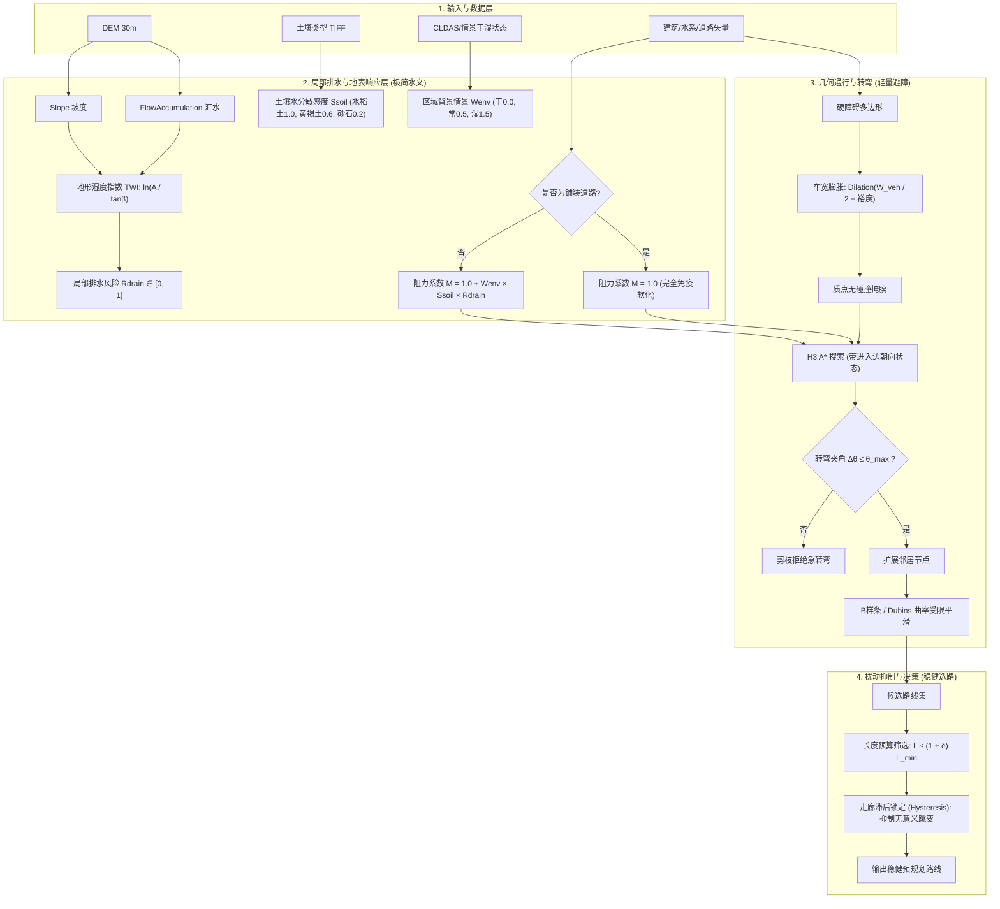

# 静态 GIS 越野规划技术方案诊断与评估报告

**评估对象**：
1. 待评估工程文档：`D:\Workspace\demo_v4\docs\code\h3-offroad-planner\static-gis-soil-motion-transfer-technical-plan.md`（下文简称《工程方案》）
2. 原始需求讨论记录：`D:\Workspace\demo_v4\gpt_plan_vs_requirement.md`（下文简称《原始需求》）

**评估日期**：2026-09-10
**文档性质**：架构重构与方案纠偏评审报告

---

## 1. 总体诊断结论与失真度对比

### 1.1 总体结论
《工程方案》呈现出极其典型的 **“AI 防御性过度工程化”（Defensive Over-Engineering）** 特征。
* **主要表象**：充斥着大量军工/航天级别的合规免责声明、极为繁琐的验收门禁（10 个工作包、7 大硬门禁、46 个测试用例）、脱离实际算力的自动驾驶底盘级运动学设计。
* **致命硬伤**：在“科学严谨、避免伪造精度”的借口下，**悄悄阉割了《原始需求》中最重要的多尺度水文微地形计算**，把核心算法降级为写死的固定乘子，并在算法抗扰动方面用“繁琐测试”替代了“稳定机制”。
* **保留价值**：文档对现有代码基线的审计极其扎实（精准指出了硬编码水分 0.20、车宽缺省 2.2m、转弯半径未入搜索等硬伤），并且在数据/参数分层、多维状态解耦方面的设计具备良好的工业规范性。

### 1.2 核心设计失真度对比矩阵

| 核心需求维度 | 《原始需求》的本意与指导方向 | 《工程方案》的实际做法 | 诊断结论 |
|---|---|---|---|
| **水分与微地形** | 三尺度解耦：粗尺度背景（CLDAS/情景）$\times$ 局部微地形（DEM派生 TWI/HAND/汇水）$\times$ 地表差异响应（硬化路 vs 未铺装耕地洼地）。 | 第 6.3 节明确**推迟/不做地形湿度指数**；第 6.2 节退化为人工写死的 3 档全局打折乘子（1.0/0.5/0.2）；第 5.2 节声称矿质土无区分时统一使用 unclassified_mineral 也是可接受的。 | ❌ **严重倒退/阉割**：核心物理机制被推脱，无法产生“下雨天土路洼地泥泞软化、路线自动转走硬化大路”的预期智能行为。 |
| **车辆避障与转弯** | 优先计算已知几何：水体/建筑相交、车身净空检查、路线转弯半径与航向连续性，排除明显不可行路线。 | 强行引入自动驾驶底盘级的 **Hybrid A\* 连续搜索器** + 复杂的圆弧瞬心弓高几何扫掠（$e_{arc}$ 积分）+ 停车转向状态机。 | ❌ **严重过度工程化**：在 H3 宏观离散走廊里做微观连续运动学，导致单 OD 60s、单候选 5s 仍频繁面临算力耗尽（`budget_exhausted`）。 |
| **跨区域迁移与规则** | 迁移规则而非权重；参数分三类（车辆、数据、任务）；用长度上界约束 $L(P) \le (1+\delta)L_{min}$ 优化裕度与稳定性。 | 提出了多达 6 层的复杂参数体系，并引入学术界极其复杂的 **Mini-Max Regret（极小极大遗憾）** 跨情景规划模型。 | ⚠️ **偏离务实路线**：将直观易懂的“允许绕行比例 $\delta$”搞成了高度数学化的抽象遗憾值计算。 |
| **抗扰动与稳定性** | 针对位置误差、DEM扰动进行敏感性分析，优先选择对扰动不敏感的稳健路线。 | 设计了包含 A0~A7 8组消融实验、30~60对OD、8类指标的庞大测试台架（WP9），但在算法内部没有任何走廊锁定或滞后阻尼机制。 | ❌ **概念偷换**：用“测试官僚体系”代替了“算法稳定机制”。路线在扰动下该跳变依然跳变，只是多了一份详细的跳变记录。 |
| **项目实施与交付** | 快速闭环：统一GIS尺度 $\to$ 补齐几何约束 $\to$ 显式未知 $\to$ 扰动稳定选路 $\to$ 扩展Pareto。 | 拆分出 WP0~WP9 共 10 个瀑布式工作包、7 大绝对门禁、46 个严苛用例、跨多目录的庞大验收产物树。 | ❌ **形式主义冗余**：开发周期的 70% 会被消耗在数据转换契约、测试用例编写和免责文档上，原型迭代严重受阻。 |

---

## 2. AI 防御性过度工程化的四大典型病灶

### 病灶一：偷梁换柱——将“多尺度水文地形”降级为“全局3档打折”
《原始需求》强调：“同属黄褐土，不代表通行环境完全相同……DEM 可以派生汇流、HAND、TWI、局部洼地，命名为‘潜在湿润/排水不良指标’，与粗尺度湿度形成：区域干湿背景 $\times$ 不同地表的响应差异”。
然而《工程方案》为了防范“没有实测含水量标定”的责任风险，在第 6.3 节公然写道：*“首期不要求加入地形湿度指数”*，并将整个水文环境退化为三个写死的全局速度乘子（`baseline=1.0`, `moderate=0.5`, `high=0.2`）。这种改动彻底摧毁了算法感知微地形积水的能力，违背了需求的核心初衷。

### 病灶二：架构错位——把 GIS 宏观选路做成了自动驾驶微观底盘仿真
当前系统是在 Uber H3（边长数十米至上百米）上运行的全局宏观路径规划器。
《工程方案》第 7 章却生搬硬套了微观 Hybrid A* 架构：
* 状态机细化到 `(x, y, yaw, steering_state, gear)`，支持停车原地打轮；
* 碰撞检测不采用简单高效的“障碍物距离场/车宽膨胀”，而是采用每段圆弧微元求解瞬时转动中心与弓高误差 $e_{arc}=\rho_{max}(1-\cos(|\Delta\psi|/2))$ 并做自适应细分。
这种在 Python 解释器里对数十公里越野路线进行连续扫掠的算法设计，完全脱离了 GIS 离散网格的现实，必然引发灾难性的计算超时与内存膨胀。

### 病灶三：概念置换——用“庞杂的测评官僚流程”代替“算法稳定机制”
《原始需求》要解决的是规划路线在环境扰动下的“跳变问题”。
《工程方案》没有在规划算法中引入任何能够增加稳定性的机制（例如：拓扑走廊锁定、代价滞后偏置 Hysteresis、同伦路径聚类、弹性带阻尼），而是花费了第 8、11、12、13 整整四章的篇幅，设计了：
* 8 组消融实验（A0~A7）；
* 46 个测试用例（S01~S14, G01~G18, D01~D14）；
* 30~60 对结构化 OD 验收清单；
* 7 大硬性准入门禁。
**这是典型的“重测试、轻机理”**：耗费大量算力去度量路线如何频繁跳变，却不在核心算法中加入抑制跳变的有效约束。

### 病灶四：合规恐慌与免责黑话堆叠
全文 912 行中，有将近 400 行充斥着防御性法务风格的词汇：“禁止表述为必然可通行”、“不承诺真实油耗”、“不要求用户取得标签但不得出现 field_verified 状态”、“未经验证不得宣称通过”。
这种行文严重稀释了技术方案的信息密度，把本该清晰明了的算法伪代码和数学模型变成了繁文缛节的免责声明。

---

## 3. 《工程方案》的真实价值与可采纳技术资产

尽管存在严重的过度工程化，文档中仍有约 30%~40% 的内容具备极高的工程实操价值，必须予以保留和吸收：

1. **现有代码基线审计极其准确（第 2.1 节）**：
   * 准确定位了 `preprocessing/gis_preprocessor.py:299` 中硬编码注入默认水分 0.20 的缺陷；
   * 发现了 `factor_model.py:746` 中使用兜底车宽 2.2m、而车辆模型缺少实际 `width_m` 的硬伤；
   * 揭示了 `models.py:157` 虽有 `min_turn_radius_m` 但搜索器无朝向状态从而导致转弯半径完全未生效的现状。
2. **QDX 本地土壤栅格的只读核查结论（第 2.2 节）**：
   * 准确提取了 `D:\Workspace\demo_v1\data\soil_nanjing.tif` 在 QDX 区域内的像元分布（49号黄褐土占 78.59%，44号水稻土占 18.60%），为数据接入提供了真实依据。
3. **状态解耦的“三维度准则”（第 3.3 节）**：
   * 严禁使用单一的 `is_passable=true` 混淆数据充分性、几何可行性与现实通行性；
   * 分离为：**几何维度**（车身与曲率碰撞）、**环境模型维度**（情景有效性）、**实地验证维度**（当前为 unverified）。这一解耦设计非常优秀。
4. **地物与道路结构保护原则（第 7.6 节）**：
   * “有路面的水泥路即使在水稻土图斑内，也不受土壤软化惩罚”；
   * “道路中心线相交不等于有桥，道路穿过水体必须核查桥梁/涉水证据，否则水体硬约束生效”。
5. **Bekker 物理分支与 CSDLv2 准入条件（第 5.4、14.5 节）**：
   * 明确指出：Bekker 承载力参数中的 $k_c, k_\phi$ 量纲随指数 $n$ 变化，严禁简单修改单位；
   * 明确 CSDLv2 接入的前提是必须有具体模型消费，严禁为了“好看的前沿”盲目下载全量网格。

---

## 4. 逐章详细深度评价表

| 章节编号与名称 | GPT 工程方案的主要做法 | 与《原始需求》对比诊断 | 防御性过度工程化问题 | 真实工程价值与可保留资产 | 纠偏重构建议 |
|---|---|---|---|---|---|
| **引言与背景** (Lines 1-11) | 阐述文档状态为“待实施”，确立不以传感器/实车试验为前提，区分当前、拟设计与未来验收三层次。 | 基本符合《原始需求》中“依赖静态GIS、无实测前提下做全局预规划”的前提。 | 充满免责防御语态，将常规技术文档写成了法务免责声明。 | 明确了预规划方案的边界：不冒充在线感知与实车验收。 | 简化为 3 句话的背景与目标说明，删除法务套话。 |
| **第 1 节：方案结论与实施顺序** (Lines 12-24) | 提出 6 步实施顺序；声明首期不下载 CSDLv2、不训练参数、不恢复 NSGA-II、以几何和证据优先。 | 严重背离《原始需求》第 7、9 条（原需求建议优先裁剪 CSDLv2 砂粉黏层并用 DEM 建立局部排水层）。 | 借口“严谨”，直接将 CSDLv2 和 DEM 水文微地形排除在首期之外。 | 坚持“几何约束优先于主观评分维度”的原则非常正确。 | 恢复 DEM 局部排水指标（TWI）计算，与车体几何约束并行推进。 |
| **第 2 节：当前实现与数据审计基线** (Lines 25-78) | 对现有源码进行地毯式审计；核查南京土壤 TIFF 在 QDX 区域内的像元数及 4 类土壤占比；核实地物属性。 | 完全落实并深化了《原始需求》中“保留现有土壤分类图，先查清来源”的要求。 | 略微繁琐地强调“像元数不等于地表面积”，有过度挑刺之嫌。 | **全篇最具工程实操价值的章节**。指出了 8 处代码硬编码漏洞，提供了精确的 GIS 数据基线。 | **全盘采纳**，直接作为技术实施的前置修复清单。 |
| **第 3 节：需求、非目标与结果承诺** (Lines 79-116) | 提出 R01~R10 十大需求；明确 6 项非目标；设立几何、环境、现实三维独立状态。 | 较好呼应了《原始需求》关于“未知条件单独表达，不混入综合分数”的思想。 | R03 走极端，宣称“同类土壤无依据时保持同类解释”，排斥了利用微地形对同类土进行空间区分。 | 三维状态解耦（`Geometry / Environment / Field`）设计精湛，能有效防止虚假安全。 | 保留三维状态体系；但修改 R03，允许利用 DEM 相对排水对同类土壤进行局部通行阻力调制。 |
| **第 4 节：总体架构及数据契约** (Lines 117-158) | 绘制系统架构流水线；规定静态层不可变；定义 8 个拟新增强类型值对象与 5 类证据状态。 | 落实了《原始需求》中“静态事实与请求上下文分离”的原则。 | 定义了过多细碎的值对象（如 `SoilPhysicalEvidence`, `ObstacleScene`），增加了 Python 运行时的封装与序列化开销。 | 静态瓦片与动态评价分离、缓存键带哈希防止跨请求污染的设计非常必要。 | 保留数据分层原则；将 8 个值对象精简收敛为 3 个核心字典/数据类，避免过度抽象。 |
| **第 5 节：土壤模型：先分类证据，后按需增加力学** (Lines 159-216) | 划分 S0~S3 阶段；设 `off / categorical / physical` 三模式；声称无依据时统一使用 `unclassified_mineral`；Bekker 单位换算。 | 严重背离《原始需求》第 3、5 条。需求明确指出“同属黄褐土不代表环境相同，不要把土类直接等同力学参数”。 | 消极怠工：直接将不同土壤退化为“无区分的矿质土”，使土壤数据完全沦为摆设。 | Bekker 模型的量纲与单位分析（$k_c, k_\phi$ 依赖 $n$）极有学术与工程深度，纠正了已有代码错误。 | 废弃 `unclassified_mineral` 的消极做法；建立简单的土壤质地敏感度系数表，参与微地形阻力计算。 |
| **第 6 节：水分模型：静态情景而非伪实时预测** (Lines 217-260) | 区分相对情景与物理水分；设置 3 档合成压力速度乘子（1.0/0.5/0.2）；第 6.3 节推迟地形湿度指数；规定水体为硬障碍。 | **全篇最大违背点**。《原始需求》明确要求利用 DEM 派生汇流、HAND、TWI 作为局部排水指标，与粗水分形成地表响应差异。 | **核心功能被彻底阉割**。用 3 档无微地形区分的全局常数乘子替代了 DEM 水文计算。 | 6.4 节“道路穿水面需桥梁证据，否则按水体阻断”以及“路面硬化层豁免土壤软化”规则非常硬核。 | **必须推翻 6.3 节**：立即引入 DEM 汇水与 TWI 计算；保留 6.4 节的硬化路面保护与桥梁核查逻辑。 |
| **第 7 节：车辆转弯、整车碰撞与可行轨迹** (Lines 261-384) | 候选走廊内运行确定性 Hybrid A\*；车体多边形连续扫掠；常曲率圆弧弓高积分误差界 $e_{arc}$；走廊自适应扩张；指标重算。 | 形式上响应了《原始需求》中“计算转弯半径、净空与扫掠范围”，但**在实现技术路线上严重走火入魔**。 | 极其沉重的自动驾驶底层算法。在 Python 环境下对 H3 走廊做连续圆弧积分和停车转向状态机，必然引发严重超时。 | 补齐车辆尺寸参数（长、宽、轴距、悬长）；指出利用米制投影进行几何计算的必要性。 | **彻底摒弃微观 Hybrid A\***：改用“障碍物距离场/车宽半径 Minkowski 膨胀 + H3 朝向受限扩展 + 样条曲率平滑”，耗时降低 99%。 |
| **第 8 节：跨情景路线决策与跨区域迁移** (Lines 385-455) | 划分 6 层参数体系；制定跨情景决策流水线；引入 Mini-Max Regret（极小极大遗憾值）模型；冻结迁移规则。 | 违背了《原始需求》第 5 条关于采用直观的 $L(P) \le (1+\delta)L_{min}$ 约束优化裕度的建议。 | 强行引入学术界的 Mini-Max Regret 复杂数学公式，对无界 ETA 处理复杂，增加了决策黑盒属性。 | 8.1 节参数分层（车辆事实、通用模型、区域适配、任务要求）非常清晰，利于跨区迁移。 | 废弃 Mini-Max Regret 机制；恢复《原始需求》提出的“基于长度预算 $L(P) \le (1+\delta)L_{min}$ 筛选最大裕度/最稳健路线”的直观准则。 |
| **第 9 节：数据合同、接口和持久化设计** (Lines 456-585) | 三层数据分离；设计 9 个核心接口；编写 57 行 YAML 示意；定义路线最小存储字段；D* Lite 重规划失效流水线。 | 符合《原始需求》关于数据标准化与重规划一致性的要求。 | 接口定义过于学院派，试图一次性建立包含 9 个大型函数的微内核，脱离当前单体工程实际。 | 9.6 节关于“地图或障碍变更时，基于车身扫掠范围失效受影响路线缓存”的设计非常专业。 | 保留缓存失效与字段存储设计，将接口简化合并至现有的 `route_planning.py` 和 `factor_model.py` 中。 |
| **第 10 节：按当前模块拆分的实施工作包** (Lines 586-606) | 规划 WP0 至 WP9 共 10 个工作包，对应现有及拟新增代码文件，制定依赖顺序。 | 将原本敏捷的迭代变成了沉重的瀑布式大工程。 | 10 个工作包粒度过细、耦合繁重，容易造成“文档先行、代码半年难落地”的死局。 | 梳理了改动与现有模块（`factor_model.py`, `route_planning.py` 等）的代码映射关系。 | 压缩为 3 个敏捷迭代阶段（水文阻力层 $\to$ 几何碰撞与转弯 $\to$ 走廊决策与抗扰动）。 |
| **第 11 节：测试设计与判定依据** (Lines 607-687) | 建立四层测试证据；设计 S01~S14（土壤14项）、G01~G18（几何18项）、D01~D14（决策14项）共 46 个测试用例。 | 超额完成《原始需求》中关于“无实测时验收已知障碍与约束”的提议，但走向了繁琐的极端。 | 46 个用例中存在大量同质化的“参数边界与防御性报错”测试，维护成本巨大。 | G01~G06 构造几何用例（如净宽不足车宽、车头内轮差扫碰）设计极为优秀，是优秀的自动化回归资产。 | 精简保留 15 个最关键的核心几何与情景用例，剔除冗余的合规性测试。 |
| **第 12 节：多起终点实验与验收指标** (Lines 688-757) | 建立 30~60 对结构化 OD 清单；设计 A0~A7 共 8 组消融实验；设立 8 类评估指标；数据扰动实验流程。 | 响应了《原始需求》关于数据扰动实验的思路，但将其推向了科研论文级的庞大框架。 | 8 组消融实验（A0~A7）工作量极其膨胀，在工程初期缺乏足够算力与时间支撑。 | 12.1 节关于 OD 清单的分层设计（开阔短程、道路为主、建筑窄道、跨土壤、近水体）极具实用价值。 | 采纳 OD 分层测试用例集；将消融实验精简为 3 组（基线 vs 引入水文微地形 vs 引入车身几何约束）。 |
| **第 13 节：阶段交付与验收门槛** (Lines 758-802) | 划分 P0~P6 共 7 个实施阶段；设立事实、几何、合同、一致性等 7 大硬门禁；制定需求追踪矩阵。 | 典型的国防军工合规验收风格，严重拖慢快速原型迭代。 | 7 大硬门禁层层卡死，一旦数据稍有瑕疵就强制中断流程，缺乏工程弹性。 | 明确将 P6（Bekker 物理分支）与 P4/P5（主流程）解耦，使得缺乏物理土力学参数时不阻塞交付。 | 废除繁文缛节的 7 大门禁；保留 P6 物理分支解耦原则；改用敏捷持续集成测试（CI）自动化判定。 |
| **第 14 节：运行、验收包与回退方案** (Lines 803-880) | 制定数据准备清单；设计复杂的验收目录树；拟定 CLI 入口；设计 3 种回退模式；规定 CSDLv2 准入条件。 | 较好落实了《原始需求》关于“准备最小数据清单、按需裁剪 CSDLv2”的思想。 | 生成包含 15 类文件（`manifest`, `swept_envelopes`, `failures.csv` 等）的验收包目录树过于臃肿。 | 14.1 节最小数据清单极其实用；14.5 节给出的 CSDLv2 准入条件（明确消费模型、核查单位深度）非常理智。 | 保留最小数据清单与 CSDLv2 准入逻辑；将输出产物简化为标准 GeoJSON 路线与精简评估 JSON。 |
| **第 15 节：源码依据、引用和完成边界** (Lines 881-912) | 列出核查涉及的 11 个现有代码文件及行号；引用外部文献；划定技术文档与源码实现边界。 | 契合真实工程环境，为开发人员修改代码指明了入口。 | 篇幅尾部依然在反复唠叨免责申明。 | **实用性极高**。清晰定位了主规划器、因子模型、预处理、Bekker、持久化等核心模块的代码落点。 | **全盘保留代码映射表**，直接用于指导后续代码重构。 |

---

## 5. 纠偏重构方案：用 3 个极简算法模块替换繁重设计

为了彻底摆脱《工程方案》的 AI 防御性过度工程化泥潭，同时忠实还原《原始需求》的核心意图，建议在工程实施中采取以下**极简落地架构**：

### 5.1 模块一：极简水文与地表响应阻力（落实《原始需求》第 3、4 条）
* **取消**：全局统一打折乘子与放弃 TWI 的做法。
* **实现**：
  1. 利用开源库（如 `scipy` / `richdem`）计算 DEM 坡度 $\beta$ 与累积汇水量 $A$，得到标准化地形湿度指数 $TWI = \ln(A / \tan\beta)$，归一化得到局部排水风险 $R_{drain} \in [0, 1]$；
  2. 建立土壤类型敏感度：水稻土 $S_{soil} = 1.0$，黄褐土 $S_{soil} = 0.6$，砂砾土 $S_{soil} = 0.2$；
  3. 设定区域背景湿润度：干燥 $W_{env}=0.0$，常态 $W_{env}=0.5$，潮湿 $W_{env}=1.5$；
  4. 判定地表性质：硬化道路阻力乘子强制为 $M_{surface} = 1.0$；非铺装自然地面 $M_{surface} = 1.0 + W_{env} \times S_{soil} \times R_{drain}$。
* **效果**：雨天时，位于坡脚冲沟的水稻土耕地阻力翻倍，规划器自动选择绕行虽远但阻力平稳的硬化道路。

### 5.2 模块二：质点空间膨胀与 H3 朝向剪枝（取代复杂的 Hybrid A*）
* **取消**：在走廊内进行微观连续积分 Hybrid A* 及圆弧瞬心扫掠几何计算。
* **实现**：
  1. **车宽避障（Minkowski 思想）**：在静态栅格/矢量层对建筑、水体等硬障碍做缓冲膨胀，膨胀半径为 $R_{buffer} = \text{width\_m} / 2 + \text{安全裕度}$。搜索时车辆直接视为**质点**，从根本上杜绝擦碰，计算开销为 $O(1)$；
  2. **转弯半径硬约束**：H3 图搜索时，节点状态扩充为 `(cell_id, in_direction)`，扩展相邻六边形时，计算进出方向夹角 $\Delta\theta$。若 $\Delta\theta > \theta_{max} = \arcsin(L_{h3} / R_{min})$，则判定为该车型无法完成的急转弯，直接剪枝；
  3. **路径平滑**：搜索结束后，在膨胀安全走廊内运行带曲率限制的样条平滑器，确保曲率 $\kappa \le 1/R_{min}$。

### 5.3 模块三：预算约束优化与走廊锁定（落实《原始需求》抗扰动机制）
* **取消**：学术界复杂的 Mini-Max Regret 遗憾值计算和 8 组消融实验。
* **实现**：
  1. **长度预算准则**：在满足已知硬约束的候选解中，设定允许的最大绕行系数 $\delta$（如 $15\%$），首先求得最短基准长度 $L_{min}$，只在满足 $L(P) \le (1+\delta)L_{min}$ 的候选集中筛选具有更大安全净空或更优排水条件的路线；
  2. **走廊滞后锁定（Hysteresis）**：在环境数据受到扰动重新规划时，为上一轮已规划的主走廊赋予微小的通行奖励（如代价降低 $5\%$）。微小扰动不会导致路线在两条相近的山谷之间频繁来回“横跳”，真正实现跨区域与环境扰动下的稳定性。

---

## 6. 总结与后续行动建议

1. **废弃与归档**：将《工程方案》作为**“潜在缺陷审计与合规风险防范参考”**归档，停止按其规划的 WP0~WP9 展开大规模瀑布式实施。
2. **采纳本评估报告为实施大纲**：
   * 第一步：依据第 2.1 节审计结果，立即修复代码中硬编码的水分 0.20 和车宽 2.2m 漏洞；
   * 第二步：按照第 5.1 节方案，在 `factor_model.py` 中接入 TWI 汇流与土壤敏感性阻力调制；
   * 第三步：按照第 5.2 节方案，在栅格预处理增加车宽膨胀，在 `h3_astar.py` 增加进入角转弯约束；
   * 第四步：按照第 5.3 节方案，在 `candidate_aggregation.py` 中落实 $L \le (1+\delta)L_{min}$ 约束优化与走廊锁定。
全部改造代码预计在 500 行以内即可完全闭环，彻底实现“水分微地形聚集、车辆几何转弯约束、跨区扰动稳定”三大核心诉求。
