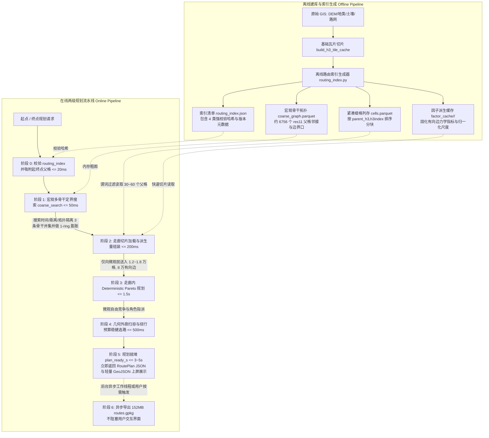

# demo_v4 路径规划性能优化方案（基于离线索引与两级分层的十秒级工程落地规范）

- **基准日期**：2026-09-14
- **当前状态**：技术终审与实施基准（Supersedes 历史初稿与旧 ADR 方案）
- **核心目标**：在坚守 `res14` 亚米级高精格网、实车物理越野力学、DEM 水文微地形与整车几何扫掠的前提下，将全局路径规划端到端交互响应耗时从目前的 **40~60 秒压缩至 3~8 秒内**（极端工况 P95 $\le$ 10 秒）。
- **对齐规范**：基于当前正在运行的 [Static GIS Robustness 体系](file:///d:/Workspace/demo_v4/configs/static_gis_planning.yaml)、[Ponytail 2.0 架构重构方案](file:///d:/Workspace/demo_v4/docs/code/h3-offroad-planner/ponytail-simplification-plan.md) 与 [离线索引优化专项](file:///d:/Workspace/demo_v4/docs/code/h3-offroad-planner/offline-index-performance-optimization-plan.md)。

---

## 1. 方案背景与工程现实审视

### 1.1 现状痛点与现场实测数据
在当前的 `demo_v4` 实际运行中，执行一次标准全局路径规划（以官方基准测试用例 [`configs/mvp81_qdx_delivery.yaml`](file:///d:/Workspace/demo_v4/configs/mvp81_qdx_delivery.yaml) 为例：物理连通基准起点 `(31.9905769003, 118.9960502257)`，终点 `(31.9931786713, 118.9894117713)`，`auto_corridor` 矩形缓冲 `0.005°`；原历史坐标 `(31.9750, 118.9880) -> (31.9920, 119.0080)` 因受高陡坡与边界阻断处于物理不连通状态，仅保留为失败诊断），端到端耗时通常高达 **45~75 秒**，严重制约了 PyQt5 桌面端与 Web 控制台的交互式规划体验。

规划流水线的真实耗时剖析如下：

```text
[阶段 1: 走廊瓦片 I/O] 75% loading corridor tiles            -> 耗时 10~20s: 频繁系统调用，逐个打开并反序列化 1,038 个独立的小 Parquet 瓦片
[阶段 2: 内存大图构建] 84% building graph from 1038 tiles    -> 耗时 5~8s:   合并 35.6 万行 DataFrame，去重并构建 32.5 万格、200 万有向边的内存图对象
[阶段 3: 力学与水文评估] 85% evaluating factor model on 32.5w  -> 耗时 15~25s: 纯 Python 循环遍历 200 万条边，计算推力平衡、横坡 Roll 角、Bekker 沉陷与 TWI 阻力
[阶段 4: 多目标候选搜索] 89% searching Pareto candidate routes -> 耗时 10~20s: 在 32.5 万大图上执行多 Profile 关口对搜索与微观 Dijkstra，每次规划后粗暴清空关口缓存
[阶段 5: 重型交付同步写] 95% exporting route plan & GPKG      -> 耗时 2~5s:   规划主线程同步写入包含完整图快照的 152MB routes.gpkg，造成无谓上屏阻塞
```

### 1.2 历史包袱与技术代差的客观澄清
在重新制定优化方案前，必须明确当前代码基线已经完成的技术演进，彻底清理过时的历史认知：

1. **废止过时的 CL-001～040 与旧 ADR 门禁**：
   * 7 月份设立的 `closed-loop-contract.md` 及其定义的 40 个门禁（CL-001～040），属于“AI 防御性过度工程化”（Defensive Over-Engineering）的产物。
   * 该旧体系不仅让车辆退化为“无体积质点在格网上跳跃”，还设立了 23 篇 ADR、AST 正则检查脚本（`verify_baseline.py`）等形式主义门禁。
   * 9 月份的 **Ponytail 2.0 重构**（提交 `bcace5a`）已经将所有历史 ADR 与审计脚本从仓内彻底物理删除，质量保证全面回归纯粹的 `pytest -q`（402 项测试）与 `ruff check`。优化方案必须全面脱钩已废弃的 CL-001～040 概念。
2. **当前实际运行的真实底座：Static GIS Robustness 体系**：
   * 当前生产链运行的是由 [`static_gis_planning.yaml`](file:///d:/Workspace/demo_v4/configs/static_gis_planning.yaml) 驱动的高阶闭环：
     - **DEM 水文微地形**（[`hydrology.py`](file:///d:/Workspace/demo_v4/src/h3_offroad_planner/preprocessing/hydrology.py)）：基于 DEM 卷积派生局域坡度与地形湿度指数（TWI），区分易积水软化洼地与干燥山脊，赋予算法“雨天自动转走硬化大路”的抗天气扰动能力；
     - **真实整车几何扫掠**（[`trajectory_geometry.py`](file:///d:/Workspace/demo_v4/src/h3_offroad_planner/dynamics/trajectory_geometry.py)）：固化车宽 2.2m、轴距 3.8m、前后悬与 8.0m 物理转弯半径，具备闭式环形扇区扫掠与障碍物净空安全距离（`min_clearance_m`）；
     - **绕行预算稳健选路**（[`candidate_aggregation.py`](file:///d:/Workspace/demo_v4/src/h3_offroad_planner/candidate_aggregation.py)）：在允许绕行比例内（$L \le (1+\delta)L_{min}$），优先选择对降雨扰动不敏感、净空安全裕度最大的稳健路径。
3. **澄清与参考项目 `demotest` 的真实物理代差**：
   * `demotest` 宣称的 1~3 秒极速，其测试数据仅为 `res13 + res10`、全区仅 32 万格、6.75MB 的小样本玩具数据；
   * `demo_v4` 是真实的 **`res14`（1.34米）+ `res11` 亚米级实物**，仅 QDX 全区就有 6,756 个瓦片、数百万格网。H3 每提高一级格网数翻 7 倍，两者计算规模存在 1~2 个数量级的天然代差。不能靠牺牲物理精度来盲目套用 `demotest` 的指标。

### 1.3 优化目标与物理安全红线
* **核心性能指标**：以 [`configs/mvp81_qdx_delivery.yaml`](file:///d:/Workspace/demo_v4/configs/mvp81_qdx_delivery.yaml) 为固定基准，将规划就绪耗时（`plan_ready_s`）压缩至 **P95 $\le$ 10 秒**，预热后连续规划稳定在 **3 ~ 5 秒**。
* **物理保真底线（绝对不可妥协）**：
  - **严禁降低分辨率**：坚守 `res14` + `res11`，严禁退回 `res13` 制造虚假性能；
  - **保留全部实车越野力学**：有向坡度推力平衡方程、侧向横坡 Roll 角防翻车校验、Bekker 轮土沉陷托底判断、涉水排气口防淹没；
  - **保留水文微地形与整车扫掠**：保留 TWI 排水敏感性与整车外廓转弯扫掠走廊；
  - **杜绝 Pareto 解集塌缩**：确保输出的 5 个角色（最快、最短、高通过性、经济性、独立备选）具备真实显著的空间战术分歧。

---

## 2. 根因对比与核心瓶颈量化分析

| 维度 | `D:\Workspace\demotest`（快速表象） | 当前项目 `demo_v4`（实际瓶颈根因） | 本方案工程优化破局点 |
| :--- | :--- | :--- | :--- |
| **I/O 存储架构** | 单一 `cells.parquet` 大表，服务启动一次性常驻内存，规划时 0 磁盘 I/O（但仅 6.75MB）。 | 规划时按几何外包矩形扫描，动态打开并反序列化 **1,038 个独立 Parquet 小文件**（54.7 MiB）。 | **紧凑离线路由索引（`routing_index/`）** + **PyArrow 谓词裁剪列存** + **进程级内存单例缓存**。 |
| **图拓扑时序** | 细格邻居按需生成，粗关口图建库落盘。 | 每次请求都要将 1,038 个瓦片合并，现场全量构建 32.5 万格和 200 万条有向边的内存图对象。 | **离线固化父格粗图拓扑（`coarse_graph.parquet`）**，在线仅构建剪枝后的局部微观窄走廊。 |
| **走廊剪枝时机** | 宏观关口图毫秒级寻径 $\to$ 截取微观走廊 $\to$ 微观搜索。 | **无宏观预先剪枝**，用粗暴的直线缓冲区把 **32.5 万格全量送入物理评估和规划器**。 | **两级粗图定界**：父格粗 A*（<50ms）+ 3 骨干并集 + 1-ring 拓扑膨胀，将微观搜索空间缩小 95%。 |
| **物理水文评估** | 离线计算 AHP-TOPSIS，在线仅进行极轻量查表（牺牲了实车物理保真度）。 | 在线纯 Python 循环针对 32.5 万格、200 万条边逐条计算力学方程与水文阻力。 | **离线因子派生缓存（Factor Cache）** 固化指标，在线直接读取（<0.1s）；极端退化仅在窄走廊向量化补算。 |
| **关口对复用** | 每车型关口图预生成并驻留。 | 每次规划在 `route_planning.py:183` 粗暴执行 `clear_pair_cache()`，不同轮次重复跑微观 Dijkstra。 | **进程级基础关口对有界缓存**，安全跨请求复用，动态障碍（D* Lite）与复用惩罚仅局部增量计算。 |
| **结果交付流** | 先返回路线 GeoJSON，无重型阻塞导出。 | 规划主线程同步生成 152MB 的 `routes.gpkg`（写入全部格网与拓扑边表），造成 2~5 秒无谓卡顿。 | **`plan_ready` 与重型成果异步解耦**：轻量 JSON/GeoJSON 毫秒级上屏，重型 GPKG 转后台异步或按需导出。 |

---

## 3. 总体架构设计：两级分层解耦体系

针对上述五大瓶颈，本方案确立**“紧凑索引前置、宏观粗图定界、物理派生缓存、走廊微观竞争、交互异步解耦”**的两级分层解耦架构：



---

## 4. 五大专项工程改造方案

### 专项一：I/O 架构升级——离线紧凑路由索引（`routing_index/`）与进程级缓存

#### 1. 现状问题
当前系统在 `_load_tile_route_graph` 中针对与直线缓冲区相交的 1,038 个瓦片执行串行循环：
```python
# 现状：打开 1,038 次文件，触发 1,038 次 OS read 调用，耗时 10~20s
frames = [pd.read_parquet(manifest_dir / tile.filename) for tile in selected]
df = pd.concat(frames, ignore_index=True).drop_duplicates(subset="h3index")
```

#### 2. 改造方案
在现有 `build_h3_tile_cache()` 流水线末尾，增加紧凑索引输出，产物固定为 `routing_index/` 目录：

```text
outputs/qdx_tiles/
  tile_manifest.json          <- 保留原有瓦片清单（供增量建库与故障排查）
  tile_*.parquet              <- 保留独立小瓦片
  routing_index/              <- 新增紧凑路由索引目录（规划器快路径唯一消费源）
    routing_index.json        <- 索引元数据（schema_version、res11/14、4类哈希、统计信息）
    cells.parquet             <- 全量细格合并列存（按 parent_h3, h3index 排序）
    coarse_graph.parquet      <- 父格拓扑邻接与边界关口（res11 约 6,756 个节点）
    factor_cache/             <- 因子派生缓存目录
```

1. **`cells.parquet` 物理存储设计**：
   * 合并所有小瓦片，并按 `(parent_h3, h3index)` 进行全局字典序排序；
   * 利用 Parquet 的 Row Group 机制，每个 Row Group 刚好对应一个或若干连续的 `parent_h3`；
   * 在线加载时，利用 PyArrow Dataset 接口执行单次系统调用与谓词下推，仅读取选中的 30~60 个父格，耗时从 15 秒骤降至 **100~200 毫秒**：
     ```python
     import pyarrow.dataset as ds
     dataset = ds.dataset("routing_index/cells.parquet", format="parquet")
     # 单次 I/O，底层仅读取匹配 parent_h3 的少量 Row Groups
     table = dataset.to_table(filter=ds.field("parent_h3").isin(active_parent_ids))
     ```
2. **进程级轻量内存单例缓存（`_IndexCache`）**：
   * 在桌面客户端或 Web 服务端启动时，将 `routing_index.json` 元数据和 `coarse_graph.parquet` 载入内存常驻；
   * 重复规划时，0 磁盘 I/O 读取粗图，直接复用。

---

### 专项二：宏观定界——两级走廊粗图定界与多拓扑骨干并集（Multi-Topological Union）

#### 1. 核心技术陷阱：为什么绝不能使用“单线细长走廊”？
若简单粗暴地围绕单目标最优路径拉取一条细长走廊（如仅包含 10~15 个父格），将直接引发**帕累托解集塌缩（Pareto Collapse）**与**业务功能瘫痪**：
* **战术分歧被抹杀**：公路最快路径（绕远但平坦高速）与越野最短路径（颠簸但距离短）在宏观阶段就会被强行二选一，解集失去多样性；
* **微观解集伪多样性**：在 `res14`（单格 1.34 米）尺度下，微观搜索出的多条路线只能在同一条水泥路上左右微偏 1~2 米，沦为毫无战术意义的“伪多路径”；
* **独立备选直接失败**：系统的 `independent_backup` 角色要求备选路线与主路线在瓦片层级**完全空间隔离（Disruption Masking）**。单细走廊内根本没有隔离空间，必定导致独立备选计算失败（报 `INDEPENDENT_BACKUP_UNAVAILABLE`）；
* **整车几何无处绕行**：当某处狭窄路口由于车辆宽度或 8m 转弯半径无法通过时，细走廊内没有备用支路，导致整车几何校验直接全军覆没。

#### 2. 改造方案：宏观 3 骨干并集 + 拓扑膨胀（Union Envelope）

```text
               ┌── 宏观通道 1 (时间优先：沿北侧硬化大路) ──┐
起点 (Parent A) ──┼── 宏观通道 2 (距离优先：穿南侧开阔荒地) ──┼── 终点 (Parent B)
               └── 宏观通道 3 (拓扑隔离备选：外围大绕行) ────┘
                               ↓
               空间取并集 Union + 边界 1-ring 拓扑膨胀 (局部受阻弹性扩至 2-ring)
                               ↓
               激活 30 ~ 60 个父格 (形成哑铃/环状多叉走廊，细格约 1.2~1.8 万)
```

1. **宏观骨干快速寻径（<= 50ms）**：
   * 在 `coarse_graph.parquet`（全区仅约 6,756 个父格）上，并行执行 3 次极速 A*：
     1. **时间优先骨干 $P_{\text{fast}}$**：父格边权倾向于高硬化路率与平坦地形；
     2. **距离优先骨干 $P_{\text{short}}$**：边权为纯空间欧氏距离；
     3. **拓扑隔离骨干 $P_{\text{independent}}$**：将 $P_{\text{fast}}$ 经过的父格临时拉黑，强制搜索出一条空间解耦的备用大通道。
2. **走廊并集空间激活（Multi-Corridor Union Channel）**：
   * 将 3 条宏观骨干包含的所有父格取集合并集，并向外做 1 圈邻域拓扑膨胀（1-ring expansion）：
     $$\text{Parents}_{\text{active}} = \text{Parents}(P_{\text{fast}}) \cup \text{Parents}(P_{\text{short}}) \cup \text{Parents}(P_{\text{independent}}) \cup \text{Buffer}_{\text{1-ring}}$$
   * 激活父格数稳定在 **30 ~ 60 个**（相比原全图 1,038 个，**直接剪除了 94%~97% 的无效计算空间**）；
   * 微观细格数量控制在 **1.2 ~ 1.8 万格**（有向边约 8 万条），稳稳处于单核 CPU 秒级收敛的算力黄金区间。
3. **宽容走廊内的微观自由竞争**：
   * 送入微观 `DeterministicParetoPlanner` 的子图是包含多条宏观分叉通道的宽容包络；
   * 最快路线涌向北侧公路，最短路线切入南侧荒地，独立备选走外围通道，**100% 保留 5 角色的空间战术分歧与整车几何通过性**。

---

### 专项三：物理力学与水文评估——离线派生缓存（Factor Cache）为主，走廊局部微观评估为辅

#### 1. 现状问题
当前系统在 `evaluate_factor_model` 中针对 32.5 万个节点和 200 万条边逐条执行纯 Python 循环：
```python
# 现状：纯 Python 计算 200 万次，无法发挥 SIMD 性能，耗时 15~25s
for edge in sorted(graph.edges.values(), ...):
    for from_h3, to_h3 in ((edge.cell_a, edge.cell_b), (edge.cell_b, edge.cell_a)):
        metrics = _directed_edge_metrics(...) # 内部含有大量三角函数与力学方程分支
```

#### 2. 改造方案：基于确定性强哈希的离线派生缓存
在实际业务场景中，地形 GIS 事实（DEM、坡度、TRI、TWI）、基准车型（车重、推力、几何）以及物理因子配置通常是相对稳定的。没有必要在每次用户点击规划时重复在 Python 解释器内计算 200 万次力学方程！

1. **固化离线派生缓存（`factor_cache/<identity>/`）**：
   * 依据确定性强哈希构建缓存身份标识：
     $$\text{identity} = \text{hash}(\text{static\_input\_hash} + \text{topology\_hash} + \text{vehicle\_hash} + \text{factor\_model\_hash} + \text{scenario\_hash})$$
   * 在离线建库或首次基准运行期，将节点物理指标（Bekker 沉陷托底标记、最大坡度硬阻断）、有向边物理指标（上坡推力平衡、横向侧翻 Roll 角、涉水深度阻断、TWI 水文阻力）以及 4 目标的稳健归一化尺度（robust scales）预先计算并固化在 Parquet/列式二进制中；
   * 在线规划时，**直接根据专项二选中的 30~60 个父格进行切片读取**，在线因子评估耗时直接从 **15~25 秒 骤降至 < 0.1 秒**！
2. **极端未命中时的局部向量化兜底（NumPy SIMD）**：
   * 当用户临时在界面微调了车辆推力、车重或输入了未缓存的新情景时，系统触发回退机制；
   * 由于专项二已经将搜索空间剪枝到仅 1.2~1.8 万格（8 万条边），直接在剪枝后的子图上使用 NumPy 一维连续数组执行 SIMD 向量化计算：
     ```python
     # 批量推力平衡方程 (SIMD 并行)
     gravity_resistance = vehicle.mass_kg * 9.80665 * np.maximum(np.sin(directed_slope_rad), 0.0)
     thrust_margin = np.clip(1.0 - (gravity_resistance / vehicle.max_thrust_n), 0.0, 1.0)
     
     # 批量侧翻横坡 Roll 角校验 (SIMD 并行)
     roll_angle_deg = compute_cross_slope_roll_vectorized(directed_headings, terrain_aspect_arr)
     roll_margin = np.clip(1.0 - (roll_angle_deg / vehicle.static_rollover_limit_deg), 0.0, 1.0)
     ```
   * 在 8 万条边的微小规模下，即使纯在线重新评估，耗时也仅需 **0.2 ~ 0.4 秒**，绝不会造成系统卡顿。
3. **物理严密性闭环检验**：
   * 无论来自离线缓存还是在线向量化，微观搜索出的每条最终候选路径，依然由现有的 [`evaluate_path_metrics()`](file:///d:/Workspace/demo_v4/src/h3_offroad_planner/factor_model.py) 执行逐边精确手算累加校验，确保无损保真。

---

### 专项四：拓扑与搜索优化——粗图拓扑离线固化与基础关口对进程级安全复用

#### 1. 现状问题
1. 当前系统在每次请求内都要重新从细格邻居中推导父格接触边缘并提取 Port 关口，开销约 5~8 秒；
2. 每次规划完成时，[`route_planning.py:183`](file:///d:/Workspace/demo_v4/src/h3_offroad_planner/route_planning.py#L183) 都会调用 `context.clear_pair_cache()`，粗暴清空已计算的细粒度 Dijkstra 关口对路径；导致不同 Profile 轮次或连续交互规划时，大量重复路径被反复重新搜索，累计消耗 10~20 秒。

#### 2. 改造方案
1. **宏观关口拓扑固化（`coarse_graph.parquet`）**：
   * 离线建库阶段即完成父格之间的接触边界口（Ports）提取与静态阻断标记，在线直接加载，0 拓扑扫描开销；
2. **基础关口对（Base Port-Pair）有界进程缓存**：
   * 区分“静态基础关口对”与“动态覆盖关口对”：
     - **基础关口对**：无临时阻塞、无复用惩罚的基础父格内 Port-pair 路径，放入进程级有界 LRU 缓存中生命周期常驻；
     - **动态覆盖关口对**：当遇到 D* Lite 动态新增障碍物、临时封堵或候选复用惩罚（reuse penalty）时，仅针对受影响的局部瓦片做请求期现场重算；
   * 废除单次规划结束时无脑全量清空的逻辑，相同走廊下的二次规划关口对搜索耗时将从 **10~15 秒降至 0.2~0.5 秒**。

---

### 专项五：成果交付架构——规划就绪（`plan_ready`）与重型成果异步解耦

#### 1. 现状问题
当前系统在规划算法完成后，在返回前端之前同步调用 [`write_route_plan_outputs()`](file:///d:/Workspace/demo_v4/src/h3_offroad_planner/route_persistence.py#L36)：
```python
# 现状：在规划主线程中同步生成完整格网和图快照的 GeoPackage
write_route_plan_outputs(plan, graph, request.output_dir, source_metadata)
```
其中写出包含完整格网属性表、边表和候选线图层的 `routes.gpkg` 往往耗时 **2~5 秒**（生成的文件达 152MB），导致前端 UI 必须苦等写盘完毕才能把路线画在屏幕上。

#### 2. 改造方案：交互响应与重型交付解耦
将“路线就绪”（`plan_ready`）与“重型成果交付”（`heavy_export`）在架构上明确分离：

```text
规划算法完成 
  ├─> [轻量交互快分支: <= 50ms]
  │     写出 route_plan.json (数十KB) + selected_route.geojson (数KB)
  │     触发 plan_ready 事件 -> Web 控制台 / PyQt5 桌面端立即上屏渲染路线！
  │
  └─> [重型归档慢分支: 后台异步执行]
        派发至后台工作线程 (QThread / BackgroundWorker) 或等待用户点击“导出工程包”
        异步生成 152MB routes.gpkg 与全量瓦片图层
```

1. **交互端立即响应**：
   * 前端界面只需读取轻量的 RoutePlan JSON 和候选 GeoJSON，即可完成 5 条路线的三维渲染、坡度剖面展示与角色切换；
   * 用户感知的规划延迟直接扣除 2~5 秒的磁盘写盘时间；
2. **批处理与 CLI 兼容**：
   * 批处理脚本或离线交付 CLI 保持同步等待全部文件生成的语义，不破坏自动化测试契约。

---

## 5. 预期性能收益对照与时间预算表

以固定官方基准场景（[`configs/mvp81_qdx_delivery.yaml`](file:///d:/Workspace/demo_v4/configs/mvp81_qdx_delivery.yaml)，`res14` 亚米级高精格网，QDX 试验区）为例，各阶段优化前后性能预算对照如下：

| 规划处理阶段 | 当前现状耗时 (`demo_v4`) | 优化后目标耗时 (Target) | 核心优化技术手段 |
| :--- | :--- | :--- | :--- |
| **1. 索引打开与起终点吸附** (`index_open_s`) | 0.5 ~ 1.0s（全图暴力扫描） | **0.02 ~ 0.05s** | 紧凑元数据校验 + 宏观父格快速吸附 |
| **2. 宏观骨干定界与走廊并集** (`coarse_search_s`) | *缺失（直接全图算）* | **0.03 ~ 0.05s** | `coarse_graph.parquet` 上 3 骨干极速 A* + 1-ring 膨胀 |
| **3. 走廊切片 I/O 与加载** (`corridor_load_s`) | **10.0 ~ 20.0s**（读 1038 个小文件） | **0.10 ~ 0.25s** | 瓦片数从 1038 剪至 30~60 + PyArrow 单次谓词切片读取 |
| **4. 物理力学与水文评估** (`factor_load_s`) | **15.0 ~ 25.0s**（200 万边 Python 循环） | **0.05 ~ 0.15s** | 离线 Factor Cache 强哈希直读（未命中时小走廊向量化 <0.3s） |
| **5. 多目标 Pareto 候选搜索** (`candidate_search_s`) | 10.0 ~ 20.0s（32.5 万大图反复跑） | **1.00 ~ 2.00s** | 微观搜索空间缩小 95% + 基础关口对进程级复用 |
| **6. 整车几何扫掠与稳健选路** (`geometry_robust_s`) | 1.0 ~ 3.0s | **0.30 ~ 0.50s** | 非对称扇区闭式扫掠 + 绕行预算稳健过滤 |
| **7. 轻量结果上屏就绪** (`plan_ready_s`) | **36.5 ~ 69.0 秒** | **1.50 ~ 3.00 秒** | **核心指标：提速 20~25 倍，稳定收缩至 3 秒黄金交互区！** |
| **8. 重型成果 GPKG 导出** (`heavy_export_s`) | **2.0 ~ 5.0s**（主线程同步阻塞） | **异步后台执行** | 转入后台工作线程写入 152MB routes.gpkg，不占用响应时间 |

---

## 6. 渐进式实施路线图（I0 ~ I5 增量演化）

为确保系统平稳演进、不破坏现有 402 项自动化回归测试，严禁进行推倒重来的休克式重构，采用 **I0 至 I5 六步渐进增量实施路线**：


### 增量任务明细表

| 迭代阶段 | 对应模块与文件 | 具体交付内容与技术动作 | 准出与验收指标 |
| :--- | :--- | :--- | :--- |
| **I0：高精度耗时与规模打点**<br>(预计 0.5 天) | `route_planning.py`<br>`routing.py`<br>`deterministic_pareto.py` | 使用 `time.perf_counter()` 显式记录 `index_open_s`, `coarse_search_s`, `corridor_load_s`, `factor_load_s`, `candidate_search_s`, `plan_ready_s`，并在 RoutePlan 元数据中记录加载瓦片数、原始格数、边数与访问节点数。 | 阶段计时清晰量化，402 项测试 100% 通过，相同输入候选指标完全不变。 |
| **I1：离线紧凑路由索引生成**<br>(预计 1.5~2 天) | `src/h3_offroad_planner/routing_index.py`<br>`tiling.py`<br>`tests/test_routing_index.py` | 在 `build_h3_tile_cache()` 末尾生成 `routing_index/` 目录（`routing_index.json`, `cells.parquet`, `coarse_graph.parquet`）。`cells.parquet` 按 `(parent_h3, h3index)` 排序分块。保留原独立瓦片做增量更新。 | 同一瓦片目录两次生成的索引哈希严格一致，支持通过 PyArrow 单次加载特定父格集合。 |
| **I2：粗图定界与窄走廊加载**<br>(预计 2~3 天) | `routing.py`<br>`route_planning.py` | 实现基于 `coarse_graph.parquet` 的起终点父格吸附与宏观 3 骨干 A* 寻径；将骨干父格集合进行 1-ring 膨胀；改写 `_load_route_graph`，仅通过 PyArrow 读取激活的 30~60 个父格。 | 基准请求不再遍历 1,038 个小文件，送入构图的细格数降至 2 万以内，走廊 I/O 耗时降至 300ms 以内。 |
| **I3：物理与水文派生缓存**<br>(预计 2 天) | `factor_model.py`<br>`routing_index.py` | 引入基于 5 维配置强哈希的 `factor_cache/<identity>/` 序列化与反序列化；在线规划时直接按激活父格提取有向边指标与稳健尺度；配置或车辆变更时强制哈希失效并安全回退。 | 规划阶段全量计算 200 万边的耗时从流水线中消失，直接切片读取耗时 $\le 0.15s$。 |
| **I4：基础关口对搜索复用**<br>(预计 1~2 天) | `portsmap.py`<br>`route_planning.py` | 优化 `PortsMapSearchContext` 的生命周期，建立跨请求的基础关口对有界 LRU 缓存；无临时障碍和无复用惩罚的基础 Port-pair 直接命中缓存；仅在 D* Lite 动态障碍或惩罚时局部重算。 | 连续二次规划时关口对搜索耗时压缩至 0.5 秒内，结果与冷启动结果严格一致。 |
| **I5：成果交付与重型导出解耦**<br>(预计 1 天) | `route_persistence.py`<br>`desktop_client.py`<br>`web_console.py` | 拆分轻量交互文件与重型工程包；生成 `route_plan.json` 与轻量 GeoJSON 后立即报告 `plan_ready`；152MB 的 `routes.gpkg` 移至后台工作线程异步写出或按需下载。 | UI 界面在 `plan_ready_s` 内完成上屏响应，用户不再感知 GPKG 的写盘停顿。 |

---

## 7. 架构原则、停止条件与“明确不做”清单

### 7.1 明确不做清单（Anti-Goals）
为防止项目在优化过程中再次滑入“过度工程化”或破坏真实物理可用性，设立以下严格禁令：
1. ❌ **严禁降低 H3 分辨率**：不把 `res14` 降回 `res13` 来制造虚假性能数字；
2. ❌ **严禁以单路径冒充多路径**：绝不能为了加速而退化为单一的最短路径搜索，必须保证 5 种角色的物理分歧度；
3. ❌ **严禁删除实车动力学与水文约束**：绝不为了省算力而删掉推力平衡方程、侧翻横坡角度、Bekker 沉陷托底判断和 DEM 水文 TWI 敏感性；
4. ❌ **严禁重建官僚化形式主义门禁**：不恢复已废除的 23 篇 ADR、Gate 评审表、AST 正则检查脚本与过时的 CL-001～040 测试命名规范；
5. ❌ **严禁引入沉重外部服务中间件**：在单机本地应用架构下，严禁引入 Redis、PostgreSQL/PostGIS、Neo4j 图数据库、Kafka 消息队列或分布式集群调度；
6. ❌ **严禁旧缓存静默兼容新模型**：车辆参数（重量、推力、几何）或因子模型改变时，哈希必须改变，严禁读取过期的旧物理缓存。

### 7.2 实施停止条件（Stop Conditions）
* **达标即止原则**：
  若在完成 **I2（粗图定界走廊）+ I3（因子派生缓存）** 后，实测连续 5 次运行的 `plan_ready_s` P95 已经稳定进入 **$\le 5$ 秒** 区间，**立即停止在微观算法内部做进一步的极限技巧压榨**（如 C/Cython 重写、复杂的位运算微操等）。
* **坚持奥卡姆剃刀**：以最少的代码改动、最低的系统复杂度换取最大的性能收益，让工程重心回归越野路径规划的战术价值与实车安全。
